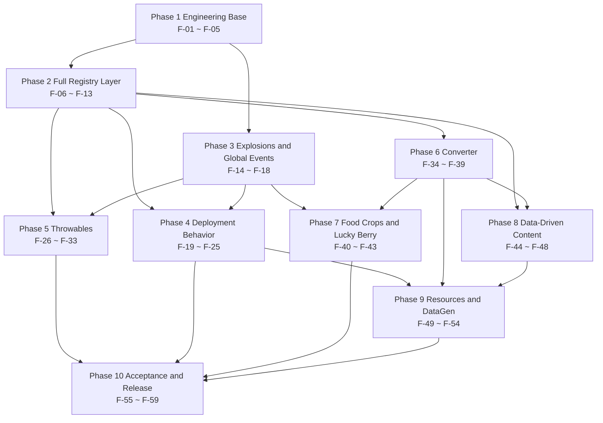

# 03 · Task Breakdown

> **Document status**: this file is a construction-period historical record of v0.0.1; its numbers and structural descriptions may have been corrected by the implementation. **The implementation baseline is `00-DECISIONS.md`** (see D-42 ~ D-48); the complete list of discrepancies is in `09-IMPL-VS-PLAN.md`.

> Project: Farmstorm · v0.0.1
> Basis: `plan0.0.1.txt` + `docs/zh/00-DECISIONS.md` (D-01 ~ D-41) + `docs/zh/01-DESIGN.md` + `docs/zh/02-TECH-SPEC.md`
> This file breaks the technical spec into tasks that can each be committed and verified independently. **Phase numbering is fully consistent with the milestone split in `04-ROADMAP.md`** (Phase 1 ~ Phase 10 → M1 ~ M6).
> **59** tasks in total; they cover the **64 registered objects** of `02-TECH-SPEC.md §3`, with **0** left uncovered (item-by-item mapping in §14).

> **Translation note · Chinese item names** — each Chinese item name is rendered as “English (中文原名)” on first use and in English only afterwards. The naming reference:
>
> | 中文原名 | English |
> |---|---|
> | 膨胀麦 | Puffed Wheat |
> | 胡罗贝 | Blast Carrot |
> | 育碧服务器 | Ubi Server |
> | 毒育碧服务器 | Toxic Ubi Server |
> | 瓜片子 | Melon Slice Bomb |
> | 瓜！子母弹 | Melon Grenade |
> | man瓜炮台 | Pumpkin Turret |
> | 火把花 | Torchflower |
> | 瓶子草 | Pitcher Plant |
> | 仙人掌尖牙陷阱 | Fang Trap Cactus |
> | 爆竹 | Bamboo Firecracker |
> | 红菇 | Red Mushroom Puff |
> | 棕菇 | Brown Mushroom Puff |
> | 幸运浆果 | Lucky Berry |
> | 甜菜！ | Power Beet |

---

## 0. Reading Conventions

### 0.1 Task Granularity

A task = one change that can be committed and verified independently. Three criteria; a task is not a valid task if any one of them is missing:

1. After the commit, `./gradlew build` passes, and the task does not depend on tasks in the same batch that are not yet committed.
2. The task carries at least one acceptance assertion observable in the log, `/execute`, `/data get`, the F3 overlay, or an artifact file.
3. Reverting that commit does not invalidate other completed tasks (a revert only affects later tasks that depend on it).

### 0.2 Complexity and Workload Conversion

| Complexity | Meaning | Converted person-days |
|---|---|---|
| S | Single file or pure data; ≤ 1 class, or ≤ 20 JSON files | 0.5 |
| M | 2 ~ 4 files, across 1 ~ 2 packages, or 1 new full behavior implementation | 1.5 |
| L | ≥ 5 files or across 3 packages, including runtime state machine / serialization / transaction | 3.0 |

Project total: **96.0 person-days** (excluding the 25% buffer). The conversion rule is uniform across the project and is not adjusted midway.

### 0.3 How Acceptance Criteria Are Written

Every acceptance item must be observable in one of the following places: the assertion output in `logs/latest.log`; the return value of `/execute`, `/data get`, `/damage`, `/advancement` in game; an F3 / F3+B overlay reading; the content of `src/generated/resources` or `config/farmstorm-server.toml`; an artifact under `build/libs`. Unobservable phrasing such as “behaves normally” or “feels good” is forbidden.

### 0.4 Document Adjudication Record

The three upstream documents disagree on the following three points. The dispatcher rules on them here, and all later tasks follow the ruling; revisions to the upstream documents are registered separately and do not block this file.

| # | Conflict point | Documents involved | Ruling | Implementing tasks |
|---|---|---|---|---|
| 1 | Number of progress bars: 12 or 6 | `01-DESIGN.md §6` lists 12; `02-TECH-SPEC.md §6.7` lists 6 | Deliver **12** (the more complete set); the 6 in 02 are treated as a subset of them (registered as **C-7**). Knock-on accounting: resource total 251 → **257** (+6 advancement JSON files), lang keys 204 → **216** (+12 advancement text keys) | F-47, F-52, F-53 |
| 2 | Whether a deployable records a team snapshot | `01-DESIGN.md §7.2`: “records ownerUuid only”; `02-TECH-SPEC.md §4.2 / §4.5`: “UUID + team name snapshot” | Deliver per **`00-DECISIONS.md` C-9**: the deployed block **stores only `ownerUuid` + `ownerName`, with no team snapshot of any kind**; ally determination resolves the owner's **current** team live through `TeamResolver` **at the trigger instant**; when the owner is offline, `ownerName` is used to reverse-look-up the **last known team** in the Scoreboard member table; when the owner has no team, the `self` rule of D-31 applies | F-03, F-10, F-20 |
| 3 | Scope of the fixed 10-second hard-mining time | `01-DESIGN.md §7.1` also counts the torchflower / pitcher plant; `00-DECISIONS.md` D-37 narrows it to `pumpkin_turret` | **DEC wins** (D-37, also registered as **C-8**): only `pumpkin_turret` takes a fixed 10 seconds; the torchflower / pitcher plant follow “zero progress for non-allies + normal speed for allies” | F-09, F-23, F-24 |

---

## 1. Task Dependency Graph

### 1.1 Phase-Level Dependencies



### 1.2 Trunk Chains (Text Tree)

Only the chains that determine total duration are drawn; for the full dependency set, the “Depends on” column of each phase table is authoritative.

```text
F-01 Build Baseline
└── F-02 Main Class and Registration Skeleton
    ├── F-03 Ally Check ──────────────────┐
    ├── F-04 Profiles and Distance Utils  │
    │   ├── F-06 14 Crop Blocks ──┐       │
    │   └── F-07 9 Entity Types ──┤       │
    │                             └ F-08 22 Items ── F-11 Creative Tab
    ├── F-05 Config 58 Keys ──────────────┼── F-34 ConverterRecipe
    │                                     │      └── F-35 CBE Container
    │                                     │            ├── F-36 Menu ── F-37 Screen
    │                                     │            │        └── F-38 ConverterBlock ── F-49 DataGen ──┐
    │                                     │            └── F-39 tryConvert ── F-47 Advancements ── F-52 Lang ──┐   │
    │                                     │                                                                    │   │
    │   F-09 5 Deployed Blocks ── F-10 5 BEs ── F-19 Behavior Framework ── F-22 Turret / F-23 / F-24 Aura       │   │
    │   F-13 Damage Types ── F-14 Explosion ── F-20 Trap                                                        │   │
    ├── F-15 Player Events ── F-16 Batching / F-17 Explosion Immunity / F-18 Temp Enchantments                 │   │
    └── F-41 Roller ── F-42 Six Branches / F-43 Creative Branch                                                │   │
                                                                                             └───┴ F-53 Artifact Check ── F-55 Server Regression ── F-59 Release
```

---

## 2. Overview

| Phase | Name | Tasks | Task IDs | Person-days | Milestone |
|---|---|---|---|---|---|
| Phase 1 | Engineering Base | 5 | F-01 ~ F-05 | 7.0 | M1 |
| Phase 2 | Full Registry Layer | 8 | F-06 ~ F-13 | 18.5 | M1 |
| Phase 3 | Explosions and Global Events | 5 | F-14 ~ F-18 | 9.5 | M2 |
| Phase 4 | Deployment Behavior | 7 | F-19 ~ F-25 | 12.0 | M2 |
| Phase 5 | Throwables | 8 | F-26 ~ F-33 | 11.5 | M3 |
| Phase 6 | Converter | 6 | F-34 ~ F-39 | 10.5 | M4 |
| Phase 7 | Food Crops and Lucky Berry | 4 | F-40 ~ F-43 | 6.5 | M4 |
| Phase 8 | Data-Driven Content | 5 | F-44 ~ F-48 | 5.5 | M5 |
| Phase 9 | Resources and DataGen | 6 | F-49 ~ F-54 | 8.5 | M5 |
| Phase 10 | Acceptance and Release | 5 | F-55 ~ F-59 | 6.5 | M6 |
| **Total** | | **59** | | **96.0** | |

---

## 3. Phase 1 · Engineering Base (F-01 ~ F-05)

Phase goal: get an empty mod with no registered content running across all four entry points on ModDevGradle, and stand up the registration skeleton, ally check, static profiles and config framework once and for all — every later phase only appends entries to them.

Phase exit criteria: `./gradlew build` produces a jar, `runServer` prints `Done`, `config/farmstorm-server.toml` generates 58 keys, and `Farmstorm.id()` works.

| ID | Title | Goal | Files / Classes | Depends on | Acceptance criteria | Complexity |
|---|---|---|---|---|---|---|
| F-01 | Build Baseline Landed | Get the empty mod through its first successful build / runClient / runServer / runData run under MDG | `gradle.properties`, `settings.gradle`, `build.gradle`, `gradle/wrapper/gradle-wrapper.properties`, `src/main/resources/META-INF/neoforge.mods.toml`, `src/main/resources/pack.mcmeta` | — | ① `./gradlew build` produces `build/libs/farmstorm-0.0.1+mc1.21.1.jar`; ② the `./gradlew runServer` log contains `Done (` and no `ERROR` line; ③ the `build.gradle` extension block is named `neoForge` (case-sensitive), and `neo_version` carries a concrete patch number with no wildcard; ④ `./gradlew runData` exits with code 0 | M |
| F-02 | Main Class and Registration Skeleton | Set up the mod entry point and 8 `DeferredRegister` skeletons so later registration tasks only need to append entries | `Farmstorm.java`, `registry/FarmstormItems.java`, `registry/FarmstormBlocks.java`, `registry/FarmstormBlockEntities.java`, `registry/FarmstormEntityTypes.java`, `registry/FarmstormMenus.java`, `registry/FarmstormRecipes.java`, `registry/FarmstormDataComponents.java`, `registry/FarmstormCreativeTabs.java`, `registry/FarmstormDamageTypes.java` | F-01 | ① the constructor attaches the 8 `REGISTER`s to the mod bus and calls `container.registerConfig(ModConfig.Type.SERVER, ...)`; ② `Farmstorm.id("converter").toString()` equals `farmstorm:converter`; ③ the `runClient` startup log has no `Missing registry` and no registration exception | M |
| F-03 | Ally Check and Ownership Utilities | Extract “is this an ally of the deployer” into an interface plus a single implementation, and provide an ownership read/write utility that stores only UUID + player name | `team/TeamResolver.java`, `team/ScoreboardTeamResolver.java`, `util/DeployedOwnership.java` | F-02 | ① after `/team add red`, a teammate's `isAlly` is true, a non-teammate's is false, and the deployer themself is always true; ② a teamless player under `teams.untamedFallback=self` is friendly only to themself; ③ ownership writes just two fields, UUID and player name, and no `ownerTeam` key exists in `/data get block` (C-9); ④ with the owner offline, `ownerName` reverse-looks-up the last known team in the Scoreboard member table, and the result matches the online case; ⑤ no team object is cached (`grep -rn "PlayerTeam" team/` hits only local variables inside the implementation class) | S |
| F-04 | Static Profiles and Distance Utilities | Centralize the static profiles of 15 crops and provide Chebyshev / Euclidean distance utilities | `util/CropProfile.java`, `behavior/DeployedKind.java`, `util/DistanceMetrics.java` | F-02 | ① `CropProfile.ALL` holds exactly 15 entries whose IDs match `00-DECISIONS.md §4` verbatim; ② `DistanceMetrics.chebyshev(3,1,3)==3`, `euclidean(3,4,0)==5.0` (asserted in the startup log); ③ `DeployedKind` has 5 enum values | S |
| F-05 | Common Config Section and Effect Template Keys | Land 7 common sections and 22 effect key groups (14 + 44 = 58 keys), and set up the hook that rebuilds caches after a reload | `config/FarmstormConfig.java` | F-02 | ① after `runServer`, `config/farmstorm-server.toml` contains the seven sections `[converter]` `[stack]` `[deploy]` `[teams]` `[explosion]` `[throwable]` `[food]`; ② the total key count in the file = 58; ③ after changing `converter.xpCost` to 7 and running `/reload`, `FarmstormConfig.converterXpCost` reads 7 and the log prints one `bake()` line | L |

---

## 4. Phase 2 · Full Registry Layer (F-06 ~ F-13)

Phase goal: land **59 of the 64** registered objects in the registry (the 5 converter-related ones land in Phase 6) and make them placeable, summonable and queryable.

Phase exit criteria: the creative tab shows 22 items; the 14 crop blocks and 5 deployed blocks accept `/setblock`; the 9 entities accept `/summon`; 5 of the 6 BlockEntityTypes are registered.

| ID | Title | Goal | Files / Classes | Depends on | Acceptance criteria | Complexity |
|---|---|---|---|---|---|---|
| F-06 | Crop Blocks and the 14 Registrations | Implement the single class for the 14 crop blocks and finish their registration (no BlockItem, D-34) | `block/FarmstormCropBlock.java`, `registry/FarmstormBlocks.java` | F-04 | ① all 14 `/setblock ~ ~ ~ farmstorm:<id>` commands succeed; ② every block carries an `age` property with the four legal values 0 ~ 3; ③ `melon_slice_bomb` has no crop block (`grep` hits 0); ④ under `/gamerule randomTickSpeed 100`, `age` climbs to 3 within 5 minutes | L |
| F-07 | Throwable Base Class and 9 Entity Types | Implement the `ThrownCropEntity` base class and register the 8 throwables + 1 turret missile as EntityTypes | `entity/ThrownCropEntity.java`, `registry/FarmstormEntityTypes.java` | F-04 | ① `FarmstormEntityTypes` holds exactly 9 `DeferredHolder`s; ② all 9 `/summon farmstorm:<id> ~ ~ ~` commands succeed without a crash; ③ the entity parameters are `sized(0.25,0.25)` (0.3 for `turret_bullet`), `clientTrackingRange(4)`, `updateInterval(10)`; ④ `submunition` is synced through `SynchedEntityData` and the client log prints the received value | L |
| F-08 | Item System and the 22 Item Registrations | Implement the 5 item classes and register 15 crops + 6 sowing items + 1 converter item | `item/ModifiedCropItem.java`, `item/ThrowableCropItem.java`, `item/DeployableCropItem.java`, `item/SeedItem.java`, `item/FoodCropItem.java`, `registry/FarmstormItems.java` | F-06, F-07, F-05 | ① the creative tab holds all 22 items; ② the server startup log prints `stacksTo` for the 22 items: 16 for the 8 throwable types, 64 for the other 14 (D-16); ③ the 6 sowing items, right-clicked on dirt, place the corresponding `_crop` / `_stem` / `_stalk` / `_block` / `_bush` block; ④ the 5 deployable items take the planting branch when right-clicked on farmland | L |
| F-09 | Deployed Blocks and the 5 Registrations | Implement the attachment / floating / breaking rules of the deployed blocks and register 5 blocks | `block/DeployedCropBlock.java`, `registry/FarmstormBlocks.java` | F-04, F-05 | ① right-clicking glass / slab / leaves is rejected and the item is not consumed; ② `pumpkin_turret` can be placed on the top / bottom / side faces, the other 4 only on the top face; ③ after the supporting block is mined, `pumpkin_turret` / `awakened_torchflower` / `awakened_pitcher_plant` switch to `floating=true` and do not fall, while `blast_carrot` / `fang_trap_cactus` vanish immediately and drop themselves; ④ `/setblock ~ ~ ~ farmstorm:pumpkin_turret[face=wall,facing=east,floating=false]` succeeds | L |
| F-10 | Deployable BlockEntity and the 5 Types | Land the deployable's runtime state, persistence and syncing, and register 5 BlockEntityTypes with one and the same class | `blockentity/DeployedCropBlockEntity.java`, `registry/FarmstormBlockEntities.java` | F-09, F-03 | ① the 5 IDs are distinct but share one class and one factory; ② after placement, `/data get block` reads the six saved fields `ownerUuid` `ownerName` `placedGameTime` `detached` `pendingWaves` `fuseTicks`, and **no `ownerTeam` key exists** (C-9: no team snapshot of any kind); ③ these six fields are preserved verbatim after quitting and re-entering the world; ④ there are 6 saved fields in total and all 6 participate in `getUpdateTag` syncing, while `behavior` and `cooldown` are neither saved nor synced; ⑤ `getTicker` returns null on the client (`runClient` prints no server tick log) | L |
| F-11 | Creative Mode Tab | Register the custom tab and order it as “crops → sowing items → tool blocks” | `registry/FarmstormCreativeTabs.java`, `event/FarmstormModEvents.java` | F-08 | ① `itemGroup.farmstorm.main` displays as “Farmstorm”; ② the 22 items inside the tab are ordered 15 crops → 6 sowing items → converter; ③ `BuildCreativeModeTabContentsEvent` appends only to this tab (the entry count of other tabs is unchanged) | S |
| F-12 | Data Component temporary_enchantments | Register the temporary-enchantment ledger component and pin down its serialized form | `registry/FarmstormDataComponents.java`, `util/TempEnchantRecord.java` | F-02 | ① the `DataComponentType` registers successfully with the ID `farmstorm:temporary_enchantments`; ② after `stack.set(...)`, a `stack.get(...)` round trip is consistent; ③ the startup log prints `true` for the equality comparison of the `Codec` encode/decode round trip; ④ the component is still there after the item is put into a chest and taken out again | M |
| F-13 | Damage Types void_bolt / crop_blast | Provide 2 damage types in a data-driven way and merge them into the vanilla tags | `registry/FarmstormDamageTypes.java`, `data/farmstorm/damage_type/void_bolt.json`, `data/farmstorm/damage_type/crop_blast.json`, `data/minecraft/tags/damage_type/is_projectile.json`, `data/minecraft/tags/damage_type/is_explosion.json` | F-02 | ① `/damage @s 1 farmstorm:void_bolt` and `farmstorm:crop_blast` both succeed; ② the death messages read “torn apart by the void” and “blasted away by a crop”; ③ both IDs appear in `/damage` tab completion; ④ `crop_blast` damage on leather armor with Blast Protection IV is clearly lower than on a bare target | M |

---

## 5. Phase 3 · Explosions and Global Events (F-14 ~ F-18)

Phase goal: stand up the three-stage “destruction / damage / presentation” explosion, explosion batching, explosion immunity, the temporary-enchantment ledger and the player event bus first — every later crop with an explosion or an aura reuses them, which avoids writing crops first and reworking the explosion afterwards.

Phase exit criteria: one `FarmstormExplosion` can be constructed and observed to do “rule-driven block destruction + capped damage + correct death cause”; 12 explosions in the same tick are spread over 2 ticks; the torchflower (火把花) survives TNT.

| ID | Title | Goal | Files / Classes | Depends on | Acceptance criteria | Complexity |
|---|---|---|---|---|---|---|
| F-14 | Three-Stage Explosion and Damage Cap | Implement `FarmstormExplosion` and `BlastRule`, splitting block destruction, per-entity capped damage and particles/sound into three stages | `explosion/FarmstormExplosion.java`, `explosion/BlastRule.java` | F-13 | ① an explosion with power 2 / cap 7 deals 0 < damage ≤ 7 to a bare player; ② under the `COBBLESTONE_6` rule cobblestone is not broken while dirt is; ③ the death cause shows `death.attack.farmstorm.crop_blast` and the kill is attributed to the deployer / thrower; ④ with `power=4, cap=2`, a player standing at the center loses only 2 health | L |
| F-15 | Event Bus and Player Events | Create the game-bus event class that carries player tick, login / logout and explosion events as one entry point | `event/FarmstormGameEvents.java`, `Farmstorm.java` | F-02 | ① `PlayerTickEvent.Post` prints a heartbeat log line every 20 ticks (switchable); ② `PlayerLoggedInEvent` / `PlayerLoggedOutEvent` each print one log line containing the player name and UUID; ③ the event class registers no block entity tick | M |
| F-16 | Explosion Batching Queue | Use the internal constant `MAX_EXPLOSIONS_PER_TICK = 8` to defer over-quota explosions in the same tick to the next tick | `explosion/ExplosionQueue.java`, `event/FarmstormGameEvents.java` | F-14, F-15 | ① 12 explosions thrown in the same tick: the first 8 run immediately, the last 4 run on the next tick, and the log prints `deferred=4`; ② the total number of blocks broken equals that of one-by-one execution; ③ `/debug` shows a single-tick time < 5 ms | S |
| F-17 | Explosion Immunity and Detonate Interception | Make the torchflower / pitcher plant (瓶子草) immune to any explosion (vanilla TNT and other mods included) | `block/DeployedCropBlock.java`, `event/FarmstormGameEvents.java`, `util/FarmstormTags.java`, `data/farmstorm/tags/block/explosion_immune.json` | F-15, F-09, F-14 | ① after one blast each from TNT / a creeper / an end crystal, both blocks are still there; ② `blast_carrot` at the same position is blown away; ③ the `ExplosionEvent.Detonate` log prints a count > 0 of blocks removed from `getAffectedBlocks()`; ④ `getExplosionResistance` returning 3600000F combined with the tag gives a second line of defence | M |
| F-18 | Temporary Enchantment Ledger | Implement grant / revoke / expiry in `TempEnchantHandler`, and never overwrite the player's real enchantment on revoke | `util/TempEnchantHandler.java`, `event/FarmstormGameEvents.java` | F-12, F-15 | ① granting Fire Aspect I to a wooden sword makes the `tooltip.farmstorm.temporary_enchant` line appear; ② on expiry the enchantment is gone and the component is removed (`/data get entity @s SelectedItem` has no such key); ③ an original level 0 returns to unenchanted and an original level 2 is not downgraded; ④ a sword put into a chest and taken out is cleaned up on the next tick | L |

---

## 6. Phase 4 · Deployment Behavior (F-19 ~ F-25)

Phase goal: turn the 5 deployables from “blocks that can be placed” into “devices that do things” — behavior interfaces + 5 implementations + rate limiting.

Phase exit criteria: blast carrot self-detonates, the fang-trap cactus (仙人掌尖牙陷阱) emits two rings of fangs, pumpkin turret (man瓜) opens fire, both auras apply effects, and the per-chunk and per-player caps take effect.

| ID | Title | Goal | Files / Classes | Depends on | Acceptance criteria | Complexity |
|---|---|---|---|---|---|---|
| F-19 | Behavior Family and Tick Dispatch | Define `DeployedBehavior` / `TrapBehavior` / `TurretBehavior` / `AuraProvider` plus a factory, and dispatch ticks to the behavior objects | `behavior/DeployedBehavior.java`, `behavior/TrapBehavior.java`, `behavior/TurretBehavior.java`, `behavior/AuraProvider.java`, `behavior/DeployedBehaviors.java`, `blockentity/DeployedCropBlockEntity.java` | F-10 | ① place 1 of each of the 5 deployables and run 600 ticks without an exception; ② 8 deployables in the same chunk are spread over different ticks by `stagger` (the log prints ≤ 2 triggers per tick); ③ no scanning inside the cooldown window (the turret produces only 1 targeting log line in 60 ticks); ④ the client does not tick | M |
| F-20 | Blast Carrot Trap | After deployment, self-detonate on a non-ally player at Chebyshev ≤ 1: power 2 / cap 7 / Nausea III | `behavior/impl/BlastCarrotTrap.java` | F-19, F-14 | ① an enemy player entering Chebyshev 1 triggers it; ② damage per player ≤ 7; ③ **all** players within explosion radius 4 (teammates included) get Nausea III for 60 ticks (D-27); ④ the block disappears after triggering (`/execute if block` returns 0); ⑤ a teammate joining the team stops the trigger and leaving the team starts it again, with **no redeployment required** at any point (C-9: resolved live at the trigger instant) | M |
| F-21 | Fang Trap Cactus | After a Euclidean ≤ 3 trigger, spawn 8 + 5 fangs in two waves with delayed appearance | `behavior/impl/FangTrapCactusTrap.java` | F-19 | ① triggers at Euclidean distance ≤ 3 (4 blocks does not trigger); ② the outer ring of 8 `minecraft:evoker_fangs` appears after 10 ticks and the inner ring of 5 after 4 ticks (count hitboxes and order with F3+B); ③ outer radius 2.0, inner radius 1.0; ④ the block disappears once both waves are out | M |
| F-22 | Pumpkin Turret and Missile | Implement Chebyshev 5-block targeting, 60-tick firing, and the performance of the custom missile | `behavior/impl/PumpkinTurret.java`, `entity/TurretBullet.java` | F-19, F-13, F-07 | ① a non-ally player entering range is fired at on a 60-tick interval; ② a hit deals 1 point of `farmstorm:void_bolt` damage; ③ the knockback direction is the “pumpkin → target” line and no Levitation is applied; ④ it vanishes on hitting a block and does not break blocks; ⑤ ally players never become targets; ⑥ with interception enabled in config it also fires at non-ally throwables (C-3) | L |
| F-23 | Torchflower Aura | Ally players within radius 20 gain 6 buffs every 100 ticks, and sword holders are granted a temporary Fire Aspect | `behavior/impl/TorchflowerAura.java` | F-19, F-18 | ① the 6 effect values and the 300-tick duration are correct (Strength III / Resistance II / Haste II / Speed I / Water Breathing I / Night Vision I); ② holding any `#minecraft:swords` grants temporary Fire Aspect I; ③ each application emits 8 flame particles; ④ non-ally players and creative-mode players cannot mine it (progress stays 0); ⑤ the temporary enchantment is revoked within 100 ticks of leaving the radius | M |
| F-24 | Pitcher Plant Aura | Ally players within radius 10 gain 3 buffs every 100 ticks and all negative effects are cleansed | `behavior/impl/PitcherPlantAura.java` | F-19 | ① Regeneration II / Saturation II / Absorption I for 300 ticks each; ② every effect the player carries with `MobEffectCategory.HARMFUL` is removed (verify with `/effect give @s poison`); ③ 8 heart particles; ④ non-ally players cannot mine it | M |
| F-25 | Deployment Rate Limiting and Anti-Farming | Close off placement farming and per-chunk pile-up with 3 internal constants | `blockentity/DeployedCropBlockEntity.java`, `block/DeployedCropBlock.java` | F-10, F-19 | ① the 33rd deployable of the same player is rejected without consuming the item; ② the 9th in the same chunk is rejected; ③ “place → immediately break → place again” is rejected inside the 5-tick cooldown; ④ a rejection produces no drops | M |

---

## 7. Phase 5 · Throwables (F-26 ~ F-33)

Phase goal: implement the impact effects of the 8 throwable crops one by one, and unify lifecycle, hit dispatching and the creative-mode rule.

Phase exit criteria: all 8 throwables can be thrown and produce the impact-point effects described in plan0.0.1.txt, damage never exceeds the cap, and creative mode consumes nothing.

| ID | Title | Goal | Files / Classes | Depends on | Acceptance criteria | Complexity |
|---|---|---|---|---|---|---|
| F-26 | Puffed Wheat | Replace the impact point's 3×3×3 with hay blocks, expanding to 5×5×5 when water is present | `entity/thrown/PuffedWheatProjectile.java` | F-07, F-05 | ① a dry impact point replaces 27 blocks with `minecraft:hay_block`; ② with one water block inside the area it replaces 125; ③ bedrock / barrier / command block are never replaced (T-05/§8.5); ④ air blocks are replaced | M |
| F-27 | Ubi Server and Melon Slice Bomb | Implement the two obstacle-breaking / damaging throwables and their differing resistance thresholds | `entity/thrown/UbiServerProjectile.java`, `entity/thrown/MelonSliceProjectile.java` | F-07, F-14 | ① Ubi Server: power 4, damage per player ≤ 2, can blow up stone; ② Melon Slice Bomb: power 2, damage ≤ 6; ③ cobblestone (6.0) is not broken and dirt is (D-19) | M |
| F-28 | Toxic Ubi Server | After the explosion, spawn a cloud of poison potion in place | `entity/thrown/ToxicUbiServerProjectile.java` | F-07, F-14 | ① explode first (power 2 / damage ≤ 2); ② then spawn an `AreaEffectCloud` of radius 3.0 lasting 600 ticks; ③ players inside the cloud are poisoned; ④ the cloud dissipates after 60 seconds | M |
| F-29 | Melon Grenade | Spawn 4 melon slices one block above the impact point, then immediately produce a power 3 explosion | `entity/thrown/MelonGrenadeProjectile.java` | F-27 | ① spawn 4 `melon_slice_bomb` at `pos + (Δx, +1.0, Δz)` with Δ ∈ [-0.3, 0.3]; ② `/data get entity` reads `submunition=true`; ③ a power 3 / damage ≤ 8 explosion follows immediately; ④ the 4 submunitions each explode once more on landing, for a total of 5 explosions | M |
| F-30 | Bamboo Firecracker | Survive 140 ticks after impact, spawning and detonating one wind charge every 5 ticks | `entity/thrown/BambooFirecrackerProjectile.java` | F-07 | ① it does not disappear on impact, has `noPhysics=true` and a velocity of 0; ② every 5 ticks it spawns a `minecraft:wind_charge` and detonates it immediately, 28 times in total; ③ it disappears after 140 ticks; ④ the wind charges do not break blocks | L |
| F-31 | Red Mushroom / Brown Mushroom Throwables | Implement the two AoE buff throwables, whose area effects do not filter friend from foe | `entity/thrown/RedMushroomPuffProjectile.java`, `entity/thrown/BrownMushroomPuffProjectile.java` | F-07 | ① Red Mushroom: all players within radius 4 (teammates included) get Nausea V for 60 ticks + Blindness I for 60 ticks; ② Brown Mushroom: Weakness II for 200 ticks + Slowness II for 100 ticks; ③ neither breaks blocks nor deals damage | M |
| F-32 | Lifecycle and Hit Dispatching | Unify the throwables' lifetime cap and post-impact behavior, locking the shared part into the base class | `entity/ThrownCropEntity.java` | F-07 | ① surviving longer than `throwable.lifetimeTicks` (default 100) triggers an automatic `discard`; ② `onHitBlock` / `onHitEntity` are implemented only in the base class (`grep -c "onHitBlock" entity/thrown/` returns 0); ③ they vanish immediately on impact (the firecracker is the exception via `keepAliveAfterImpact()`) | S |
| F-33 | Creative-Mode Consumption Rule | Unify the rule “creative mode consumes no items and is not targeted by traps” | `item/ThrowableCropItem.java`, `item/DeployableCropItem.java`, `behavior/impl/BlastCarrotTrap.java` | F-08, F-09 | ① the item count is unchanged after throwing in creative mode; ② the item count is unchanged after deploying in creative mode; ③ a creative-mode player standing next to a trap does not trigger it; ④ mining `pumpkin_turret` in creative mode still takes 10 seconds | S |

---

## 8. Phase 6 · Converter (F-34 ~ F-39)

Phase goal: build the complete “vanilla ↔ modified” closed-loop block, covering the recipe type, container, menu, screen and transactional conversion.

Phase exit criteria: putting in wheat and clicking convert once yields puffed wheat (膨胀麦) and deducts 3 XP; the reverse conversion works; insufficient XP is rejected without deducting levels; the converter accounts for 5 of the 64 objects.

| ID | Title | Goal | Files / Classes | Depends on | Acceptance criteria | Complexity |
|---|---|---|---|---|---|---|
| F-34 | Recipe Type and Serializer | Define `ConverterRecipe` and its serializer, and register 1 RecipeType + 1 Serializer | `recipe/ConverterRecipe.java`, `recipe/ConverterRecipeSerializer.java`, `registry/FarmstormRecipes.java` | F-02, F-05 | ① exactly 1 of each for `farmstorm:converting`; ② after adding a `data/farmstorm/recipe/puffed_wheat.json`, `runServer` shows no `Parsing error`; ③ `reverse()` returns a view with input / result swapped and does not write to disk | M |
| F-35 | Converter Container and Persistence | Implement the single-slot container BlockEntity with content persistence and drops on break | `blockentity/ConverterBlockEntity.java`, `registry/FarmstormBlockEntities.java` | F-34 | ① slot insert / extract / `stillValid` behave correctly; ② the item is still in the slot after quitting and re-entering; ③ breaking the block drops the contents and swallows nothing | M |
| F-36 | Converter Menu | Implement the menu with 1 input + 1 read-only preview + 3 `ContainerData`, and register the menu type | `menu/ConverterMenu.java`, `registry/FarmstormMenus.java` | F-35 | ① the `farmstorm:converter` menu type registers successfully; ② `clickMenuButton(player, 0)` accepts only 0; ③ `ContainerData`'s `xpCost` / `canConvert` / `reverse` change with the input item; ④ `quickMoveStack` handles only the input slot and the player inventory | M |
| F-37 | Converter Screen and Client Registration | Implement the GUI background / title / button and register the screen through a client event | `client/ConverterScreen.java`, `client/FarmstormClient.java` | F-36 | ① opening the converter in `runClient` shows a 176×166 background and the title “Farm Produce Converter”; ② the convert button click sends a `ServerboundContainerButtonClickPacket` (visible in the log, no custom packet); ③ closing and reopening it 10 times does not crash | M |
| F-38 | Converter Block and Break Drops | Register the converter block, wiring up the menu provider and the break drops | `block/ConverterBlock.java`, `registry/FarmstormBlocks.java` | F-36 | ① the `farmstorm:converter` block ID registers successfully (20th of blocks); ② it carries a 4-way `facing` and `getRenderShape` is MODEL; ③ mining drops the block itself + its contents; ④ `#minecraft:mineable/pickaxe` takes effect (pickaxe is faster than bare hand) | M |
| F-39 | Conversion Transaction | Implement `tryConvert` as “validate everything first, then touch state”, covering XP, catalyst and both directions | `blockentity/ConverterBlockEntity.java` | F-34, F-35 | ① forward and reverse 1:1 conversion both succeed; ② insufficient XP is rejected and **no level is deducted**; ③ the torchflower / pitcher plant are forward-only, cost 1 nether star, and are free in reverse; ④ when validation fails, clicking 10 times in a row leaves item and XP unchanged | L |

---

## 9. Phase 7 · Food Crops and Lucky Berry (F-40 ~ F-43)

Phase goal: complete the two edible crops, with the focus on the 8-tier probability table and the three-tier fallback of the creative-mode branch.

Phase exit criteria: Power Beet (甜菜！) grants 4 buffs; all 8 tiers of Lucky Berry (幸运浆果) can be force-triggered; the creative-mode branch leaves no residue after a crash.

| ID | Title | Goal | Files / Classes | Depends on | Acceptance criteria | Complexity |
|---|---|---|---|---|---|---|
| F-40 | Power Beet Edible Effects | Apply 4 buffs of 600 ticks each in one shot on eating | `item/FoodCropItem.java` (`onEaten` implementation), `config/FarmstormConfig.java` | F-08, F-05 | ① 32 ticks after eating, gain Strength II / Speed II / Haste II / Resistance I for 600 ticks each; ② nutrition 4, saturation 0.3 (`/data get` reads the `food` component); ③ still edible when the hunger bar is full | S |
| F-41 | Probability Table and Roll | Implement the per-mille weight table with a single `nextInt(1000)` roll, rebuilt on reload | `util/LuckyBerryRoller.java`, `config/FarmstormConfig.java` | F-05 | ① the internal weights always sum to 1000 (asserted in the startup log); ② setting the 8 config entries to 100 / 0 / … one at a time and running 100 rolls each yields a 100% hit rate; ③ when the configured sum ≠ 100, `bake()` rejects that section, falls back to the defaults and prints a warn | M |
| F-42 | Lucky Berry's 6 Regular Branches | Implement the 6 outcomes: lightning, random crops, regeneration, treasure chest, small explosion, charged creeper | `util/LuckyBerryRoller.java` | F-41, F-14 | ① lightning strikes at the player's position with no source-damage; ② 16 random crops are generated (14 kinds besides itself, D-17), landing on standable blocks within radius 2 (D-33); ③ Regeneration V for 100 ticks; ④ 2 `end_city_treasure` chests; ⑤ a power 1 small explosion with no damage cap; ⑥ the creeper has `powered=true` and is not ignited | L |
| F-43 | Creative Branch and Three-Tier Fallback | Implement the 0.1% branch's 90-second rollback, immediate restore on disconnect and login reconciliation | `util/LuckyBerryRoller.java`, `event/FarmstormGameEvents.java` | F-41, F-15 | ① on rolling it the player switches to creative and is restored automatically after 1800 ticks; ② disconnecting midway restores immediately and writes nothing to the save; ③ after `kill -9` on the server and a reconnect, non-OP players are restored to survival while OP players are left untouched (RT-05); ④ a player already in creative mode who rolls this branch only hears a sound and keeps their mode | M |

---

## 10. Phase 8 · Data-Driven Content (F-44 ~ F-48)

Phase goal: fill in the pure-data content — recipes, loot tables, tags, advancements — so the gameplay loop holds at the data layer.

Phase exit criteria: the 21 recipes convert both ways; the 20 loot tables work with `/loot give`; the 5 tags work with `/execute if block`; the 12 advancements unlock.

| ID | Title | Goal | Files / Classes | Depends on | Acceptance criteria | Complexity |
|---|---|---|---|---|---|---|
| F-44 | 21 Conversion Recipes | Write one conversion recipe each for the 15 crops and the 6 sowing items | `data/farmstorm/recipe/*.json` (21 files) | F-34, F-08 | ① `runServer` reports no recipe parsing error; ② all 15 vanilla crops + 6 seeds are convertible in the converter; ③ 15 are reversible, while the 2 for the torchflower / pitcher plant are not; ④ the above conclusions are unchanged after `/reload` | M |
| F-45 | 20 Loot Tables | Write loot tables for the 14 crop blocks, the 5 deployed blocks and the 1 converter block | `data/farmstorm/loot_table/blocks/*.json` (20 files) | F-06, F-09 | ① when mature (`age=3`) a crop drops both the crop and the sowing item at vanilla proportions, while an immature one drops only 1 sowing item; ② the 5 deployable tables drop themselves by default and 0 items when destroyed by an explosion; ③ `/loot give @s loot farmstorm:blocks/puffed_wheat_crop` runs table by table with no error | M |
| F-46 | 4 Block / Item Tags | Provide the deployable set, modified-crop set, sowing-item set and the pickaxe-mining tag | `data/farmstorm/tags/block/deployed_crops.json`, `data/farmstorm/tags/item/modified_crops.json`, `data/farmstorm/tags/item/seeds.json`, `data/minecraft/tags/block/mineable/pickaxe.json` | F-06, F-09 | ① the four tags have 5 / 15 / 6 / 6 entries; ② `/execute if block ~ ~ ~ #farmstorm:deployed_crops` returns 1 for all 5 deployed blocks; ③ `#farmstorm:modified_crops` has exactly 15 entries and contains no sowing items | S |
| F-47 | 12 Advancements | Deliver the 12 advancements per `01-DESIGN.md §6`, with 1 of them hidden | `data/farmstorm/advancement/*.json` (12 files) | F-08, F-09, F-39 | ① all 12, starting with `/advancement grant @s only farmstorm:root`, succeed; ② each one's trigger condition unlocks it; ③ `lucky_jackpot` has `hidden: true`; ④ all use `frame=task` and `announce_to_chat=false`; ⑤ the `root` background is `minecraft:textures/block/hay_block_side.png` | M |
| F-48 | Recipe Cache and Reload Regression | Stop the converter from hitting stale recipes after `/reload` | `blockentity/ConverterBlockEntity.java`, `event/FarmstormGameEvents.java` | F-39, F-44 | ① after `/reload`, 5 consecutive conversions succeed and the log has no `Recipe not found`; ② delete one recipe JSON and `/reload`, and the corresponding item is immediately non-convertible; ③ restore the JSON and it converts again | S |

---

## 11. Phase 9 · Resources and DataGen (F-49 ~ F-54)

Phase goal: fill in the 20 blockstates, 62 block models, 22 item models, 87 textures, 216 language keys and client rendering in one pass, all generated by DataGen.

Phase exit criteria: `./gradlew runData` goes through in one run, with 257 artifacts in total (JSON 169 + TOML 1 + PNG 87); no purple-black blocks in game and no lang keys displayed raw.

| ID | Title | Goal | Files / Classes | Depends on | Acceptance criteria | Complexity |
|---|---|---|---|---|---|---|
| F-49 | Blockstates and Block Models | Generate 20 blockstates and 62 block models with DataGen | `datagen/FarmstormDataGen.java`, `datagen/ModBlockStateProvider.java` | F-06, F-09, F-38 | ① `runData` generates 20 `blockstates/*.json` and 62 `models/block/*.json`; ② each of the 14 crops has all 4 stage variants (age 0 ~ 3); ③ the blockstates of the 5 deployed blocks cover face × facing × floating, and the floating variants reuse the same model | L |
| F-50 | Item Models | Generate 22 item models with DataGen | `datagen/ModItemModelProvider.java` | F-08 | ① 22 `models/item/*.json`; ② the 5 deployable item models have `parent` pointing at `farmstorm:block/<id>`; ③ none of the 22 creative-tab icons is a purple-black block | S |
| F-51 | Texture Generation Script | Produce 87 placeholder PNGs in bulk with a script, adding a green plus in the bottom-right corner of the 15 crop icons | `tools/gen_textures.py` | F-02 | ① one run produces 22 files in `textures/item`, 64 in `textures/block`, 1 in `textures/gui`; ② the 15 crop item icons have a green plus in the bottom-right corner (visual check per image + a 16×16 size assertion); ③ repeated runs are idempotent (md5 identical across two runs) | M |
| F-52 | Language Files 216 Keys | Generate Chinese and English language files whose key sets match exactly | `datagen/ModLangProvider.java` | F-08, F-47, F-05 | ① the key-set diff between `zh_cn.json` and `en_us.json` is empty; ② the key count is 216 (22 item + 20 block + 9 entity + 1 itemGroup + 1 container + 8 gui + 10 tooltip + 4 death + 24 advancement + 117 config); ③ Chinese names match `plan0.0.1.txt` verbatim (full-width punctuation included); ④ no `item.farmstorm.*` is displayed raw in game | M |
| F-53 | DataGen Assembly and Artifact Check | Hook the 7 providers into `GatherDataEvent`, and reconcile the total artifact count with the manifest | `datagen/FarmstormDataGen.java`, `event/FarmstormModEvents.java` | F-44, F-45, F-46, F-47, F-49, F-50, F-52 | ① one `./gradlew runData` generates the full artifact set under `src/generated/resources`; ② the artifact total is 257 (JSON 169 + TOML 1 + PNG 87), which is +6 over the pre-C-7 figure of 251 (12 advancements replacing 6; `02-TECH-SPEC.md §6.1` has been synced to 257); ③ there is no trace of hand-editing `src/generated` (a second run leaves an empty diff) | M |
| F-54 | Turret Missile Rendering | Make the missile visible on the client, reusing the shulker bullet model | `client/render/TurretBulletRenderer.java`, `client/FarmstormClient.java` | F-07, F-22 | ① the missile is visible on the client and looks identical to a shulker bullet; ② its orientation follows its velocity; ③ `runServer` does not load client render classes (no `NoClassDefFoundError`) | S |

---

## 12. Phase 10 · Acceptance and Release (F-55 ~ F-59)

Phase goal: run through the 9 technical risks and the DoD item by item, and produce a releasable v0.0.1 jar.

Phase exit criteria: all 18 DoD items in `04-ROADMAP.md` are ticked; each of RT-02 / RT-03 / RT-05 / RT-08 / RT-09 in the risk register has one passing record.

| ID | Title | Goal | Files / Classes | Depends on | Acceptance criteria | Complexity |
|---|---|---|---|---|---|---|
| F-55 | Dedicated Server and Three-Mode Regression | Verify server authority and the stability of hard-mining progress | No new source (acceptance scripts and records) | F-53, F-39 | ① `runServer` starts standalone and prints `Done` in ≤ 120 s; ② with two clients connected, traps / turret / auras all take effect; ③ creative / survival / spectator each mine `pumpkin_turret` once, and the progress bar does not rebound after 10 seconds (RT-02); ④ it stays stable after `/tp` far away and back, which triggers a chunk reload | M |
| F-56 | Numeric Cross-Check Acceptance | Check the 117 config keys item by item against the spec | `config/farmstorm-server.toml` (read-only check) | F-05, F-42, F-43 | ① the 117 keys exported from the toml are compared item by item with `02-TECH-SPEC.md §4.11`, with 0 differences; ② randomly picking 5 keys and changing their values changes the behavior accordingly; ③ the check that the 8 probabilities always sum to 100 rejects a wrong edit and falls back | M |
| F-57 | Performance Acceptance | Verify the worst case of aura stacking and deployment density | No new source (measurement records) | F-25, F-23 | ① in the 10-auras + 8-players scene `/debug profile` shows a single tick < 1 ms (RT-06); ② 8 deployables in one chunk reach a steady state with no tick spike; ③ 12 throwable hits in the same tick cause no stutter (batching works) | M |
| F-58 | Failure Paths and Crash Regression | Run each of the RT-03 / RT-05 / RT-08 / RT-09 verification methods once | No new source (regression records) | F-17, F-18, F-43 | ① after the four scenarios lava / chest / death drop / disconnect, the item component is cleared; ② after `kill -9` the mode is correct on reconnect; ③ after one blast each from TNT / a creeper / an end crystal the torchflower is still there; ④ with blocks of resistance 6.0 and 5.99 side by side, the former is not broken and the latter is | M |
| F-59 | Packaging and v0.0.1 Release | Produce a releasable jar and complete the DoD sign-off | `build/libs` (artifacts), `04-ROADMAP.md` (sign-off record) | F-55, F-56, F-57, F-58 | ① the `./gradlew build` artifact is named `farmstorm-0.0.1+mc1.21.1.jar`; ② the version inside the jar's `META-INF/neoforge.mods.toml` resolves to 0.0.1; ③ the repository has no mixin config and no placeholder marker (grep hits 0); ④ all 18 DoD items are ticked | S |

---

## 13. Parallelism Analysis

### 13.1 Parallelizable Task Clusters

| Cluster | Location | Parallelizable tasks | Parallelism | Notes |
|---|---|---|---|---|
| A | Phase 2 | F-06, F-07, F-09, F-12, F-13 | 4 | The five share only the F-04 / F-02 prerequisites; F-08 and F-10 are join points and must wait for upstream |
| B | Phase 4 | F-20, F-21, F-22, F-23, F-24 | 5 | Once F-19 is done the 5 behaviors are mutually independent — the highest parallel gain in the project |
| C | Phase 5 | F-26, F-27, F-30, F-31, F-32, F-33 | 6 | Only depends on F-07 / F-14; F-29 must wait for F-27 (reuses `MelonSliceProjectile`) |
| D | Phase 6 | F-37 and F-39 | 2 | Both depend only on F-35 / F-36 and can proceed at the same time |
| E | Phase 9 | F-49, F-50, F-51, F-52 | 4 | The four resource chains are mutually independent; F-53 is a mandatory join point |
| F | Phase 10 | F-55, F-56, F-57, F-58 | 4 | The four acceptance lines do not block each other and all feed into F-59 |

### 13.2 Serial Bottlenecks

| # | Bottleneck chain | Length | Why it cannot be split |
|---|---|---|---|
| 1 | F-01 → F-02 | 3.0 person-days | The project's only entry: without the registration skeleton, no registry entry has a home |
| 2 | F-04 → F-06 → F-08 | 6.5 person-days | Crop blocks → items has a single producer; F-08 waits on both F-06 and F-07 upstream |
| 3 | F-05 → F-34 → F-35 → F-36 → F-38 → F-49 → F-53 | 12.0 person-days | The 6-level converter + DataGen chain is the only route to Phase 9 completion; F-05 is the widest fan-out node (8 direct downstream consumers) |
| 4 | F-47 → F-52 | 3.0 person-days | Advancement JSON is a hard prerequisite of the language files (24 text keys depend on 12 advancement paths) |
| 5 | F-10 → F-19 | 4.5 person-days | All 5 behaviors rest on the behavior framework; once the framework interfaces ship late, all 7 Phase 4 tasks stall at the same time |

### 13.3 Parallelism Ceiling and Scheduling Advice

- The theoretical ceiling is **6** (cluster C), but in practice it is constrained by **same-file conflicts**: F-06 / F-08 / F-09 / F-38 all modify `registry/FarmstormBlocks.java` or `registry/FarmstormItems.java`, and one file cannot be written by several tasks at once. Once registry entries follow the “one task appends only its own segment” convention, **3 ~ 4 lanes** can run in parallel reliably.
- Recommended 3-lane schedule (1 lead programmer owns `registry/` + `blockentity/`; 2 parallel programmers own `item/`+`entity/` and `behavior/`+`datagen/` respectively): total workload 96.0 person-days ÷ 3 ≈ 32 person-days, plus a 25% buffer ≈ **40 person-days (about 8 weeks)**.
- Single-person serial work with no parallelism: 96.0 person-days × 1.25 ≈ **120 person-days (about 24 weeks @ 5 days/week)**.
- The critical path (see `04-ROADMAP.md §3`) is only **18.5 person-days / 11 tasks**, so **parallelism, not the critical path**, is what determines the schedule: farming out cluster B and cluster E are the two most effective moves for shortening total duration.

---

## 14. Registered Object → Task ID Mapping (64 / 64)

Counting follows `02-TECH-SPEC.md §3.11`: 64 registry objects across 10 registries. **0 uncovered.**

### 14.1 items (22, all in F-08)

| # | ID | Task |
|---|---|---|
| 1 | `farmstorm:puffed_wheat` | F-08 |
| 2 | `farmstorm:blast_carrot` | F-08 |
| 3 | `farmstorm:ubi_server` | F-08 |
| 4 | `farmstorm:toxic_ubi_server` | F-08 |
| 5 | `farmstorm:power_beet` | F-08 |
| 6 | `farmstorm:melon_slice_bomb` | F-08 |
| 7 | `farmstorm:melon_grenade` | F-08 |
| 8 | `farmstorm:pumpkin_turret` | F-08 |
| 9 | `farmstorm:awakened_torchflower` | F-08 |
| 10 | `farmstorm:awakened_pitcher_plant` | F-08 |
| 11 | `farmstorm:fang_trap_cactus` | F-08 |
| 12 | `farmstorm:bamboo_firecracker` | F-08 |
| 13 | `farmstorm:red_mushroom_puff` | F-08 |
| 14 | `farmstorm:brown_mushroom_puff` | F-08 |
| 15 | `farmstorm:lucky_berry` | F-08 |
| 16 | `farmstorm:puffed_wheat_seeds` | F-08 |
| 17 | `farmstorm:power_beet_seeds` | F-08 |
| 18 | `farmstorm:melon_grenade_seeds` | F-08 |
| 19 | `farmstorm:pumpkin_turret_seeds` | F-08 |
| 20 | `farmstorm:awakened_torchflower_seeds` | F-08 |
| 21 | `farmstorm:awakened_pitcher_plant_pod` | F-08 |
| 22 | `farmstorm:converter` (item) | F-08 |

### 14.2 blocks (20)

| # | ID | Task |
|---|---|---|
| 23 | `farmstorm:puffed_wheat_crop` | F-06 |
| 24 | `farmstorm:blast_carrot_crop` | F-06 |
| 25 | `farmstorm:ubi_server_crop` | F-06 |
| 26 | `farmstorm:toxic_ubi_server_crop` | F-06 |
| 27 | `farmstorm:power_beet_crop` | F-06 |
| 28 | `farmstorm:melon_grenade_stem` | F-06 |
| 29 | `farmstorm:pumpkin_turret_stem` | F-06 |
| 30 | `farmstorm:awakened_torchflower_crop` | F-06 |
| 31 | `farmstorm:awakened_pitcher_plant_crop` | F-06 |
| 32 | `farmstorm:fang_trap_cactus_block` | F-06 |
| 33 | `farmstorm:bamboo_firecracker_stalk` | F-06 |
| 34 | `farmstorm:red_mushroom_puff_block` | F-06 |
| 35 | `farmstorm:brown_mushroom_puff_block` | F-06 |
| 36 | `farmstorm:lucky_berry_bush` | F-06 |
| 37 | `farmstorm:blast_carrot` (block) | F-09 |
| 38 | `farmstorm:pumpkin_turret` (block) | F-09 |
| 39 | `farmstorm:awakened_torchflower` (block) | F-09 |
| 40 | `farmstorm:awakened_pitcher_plant` (block) | F-09 |
| 41 | `farmstorm:fang_trap_cactus` (block) | F-09 |
| 42 | `farmstorm:converter` (block) | F-38 |

### 14.3 block_entity_type (6)

| # | ID | Task |
|---|---|---|
| 43 | `farmstorm:blast_carrot` | F-10 |
| 44 | `farmstorm:pumpkin_turret` | F-10 |
| 45 | `farmstorm:awakened_torchflower` | F-10 |
| 46 | `farmstorm:awakened_pitcher_plant` | F-10 |
| 47 | `farmstorm:fang_trap_cactus` | F-10 |
| 48 | `farmstorm:converter` | F-35 |

### 14.4 entity_type (9, all in F-07)

| # | ID | Task |
|---|---|---|
| 49 | `farmstorm:puffed_wheat` | F-07 |
| 50 | `farmstorm:ubi_server` | F-07 |
| 51 | `farmstorm:toxic_ubi_server` | F-07 |
| 52 | `farmstorm:melon_slice_bomb` | F-07 |
| 53 | `farmstorm:melon_grenade` | F-07 |
| 54 | `farmstorm:bamboo_firecracker` | F-07 |
| 55 | `farmstorm:red_mushroom_puff` | F-07 |
| 56 | `farmstorm:brown_mushroom_puff` | F-07 |
| 57 | `farmstorm:turret_bullet` | F-07 |

### 14.5 The Remaining 7 Registered Objects

| # | registry | ID | Task |
|---|---|---|---|
| 58 | `Registries.RECIPE_TYPE` | `farmstorm:converting` | F-34 |
| 59 | `Registries.RECIPE_SERIALIZER` | `farmstorm:converting` | F-34 |
| 60 | `Registries.CREATIVE_MODE_TAB` | `farmstorm:main` | F-11 |
| 61 | `Registries.DAMAGE_TYPE` | `farmstorm:void_bolt` | F-13 |
| 62 | `Registries.DAMAGE_TYPE` | `farmstorm:crop_blast` | F-13 |
| 63 | `Registries.DATA_COMPONENT_TYPE` | `farmstorm:temporary_enchantments` | F-12 |
| 64 | `Registries.MENU` | `farmstorm:converter` | F-36 |

### 14.6 Count Verification

| registry | Count | Covered by tasks | Coverage |
|---|---|---|---|
| items | 22 | F-08 | 22 / 22 |
| blocks | 20 | F-06, F-09, F-38 | 20 / 20 |
| block_entity_type | 6 | F-10, F-35 | 6 / 6 |
| entity_type | 9 | F-07 | 9 / 9 |
| recipe_type | 1 | F-34 | 1 / 1 |
| recipe_serializer | 1 | F-34 | 1 / 1 |
| creative_mode_tab | 1 | F-11 | 1 / 1 |
| damage_type | 2 | F-13 | 2 / 2 |
| data_component_type | 1 | F-12 | 1 / 1 |
| menu_type | 1 | F-36 | 1 / 1 |
| **Total** | **64** | | **64 / 64, 0 uncovered** |
