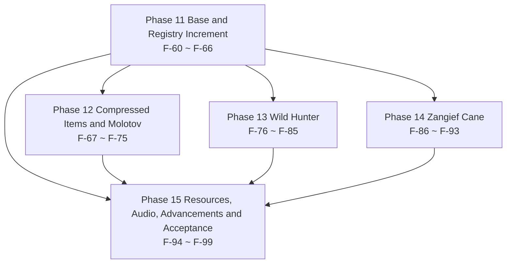

# 13 · v0.0.2 Task Breakdown & Roadmap

> Project: Farmstorm · v0.0.2
> Basis: `.work/v002-BRIEF.md` (finalized conventions) + `docs/zh/10-DECISIONS-0.0.2.md` (D-49 ~ D-79) + `docs/zh/11-DESIGN-0.0.2.md` (design specs of the 7 new features) + `docs/zh/12-TECH-0.0.2.md` (registered objects / class design / resources / config list)
> This file breaks the 12-TECH spec into **40** tasks that can each be committed and verified independently, numbered **F-60 ~ F-99**, continuing from F-59 of `03-TASKS.md`. Phase 11 ~ Phase 15 map one-to-one onto M7 ~ M11 of `04-ROADMAP.md`.
> Coverage: 13 new registered objects, 22 new config keys, 43 resource deliverables, 11 data entries (5 recipes + 3 advancements + 1 item tag + 2 spots in vanilla tags); 0 uncovered (item-by-item mapping in §9).
> This file only reads upstream: it does not modify `03-TASKS.md`, `04-ROADMAP.md`, documents `10` / `11` / `12`, `.work/v002-BRIEF.md` or `src/`.

---

## 0. Reading Conventions

### 0.1 Task Granularity

A task = one change that can be committed and verified independently. The criteria follow the three of `03-TASKS.md §0.1`; v0.0.2 adds two more (supplemented by this file):

1. After the commit, `.tools\gw.cmd build` exits with code 0, and the task does not depend on tasks in the same batch that are not yet committed.
2. The task carries at least one acceptance assertion observable at a location listed in §0.3.
3. Reverting that commit does not invalidate other completed tasks (a revert only affects later tasks that depend on it).
4. No Phase boundary is crossed: all deliverables of a task fall inside the name scope of the Phase it belongs to; a cross-Phase prerequisite is written only in the “Depends on” line.
5. Touch only whitelisted files: the 19 existing files of `BRIEF §3.3` + the three places that section's whitelist adds (`behavior/DeployedBehaviors.java`, `registry/FarmstormBlockEntities.java`, `entity/thrown/PuffedWheatProjectile.java`) + new files. Any change outside the whitelist first amends `10-DECISIONS-0.0.2.md` and only then gets broken into tasks.

### 0.2 Complexity and Workload Conversion

The conversion basis is exactly that of `03-TASKS.md §0.2` and is not adjusted midway:

| Complexity | Meaning | Converted person-days |
|---|---|---|
| S | Single file or pure data; ≤ 1 class, or ≤ 20 JSON files | 0.5 |
| M | 2 ~ 4 files, across 1 ~ 2 packages, or 1 new full behavior implementation | 1.5 |
| L | ≥ 5 files or across 3 packages, including runtime state machine / serialization / transaction / render pipeline | 3.0 |

Distributed under this rule, the 40 tasks of v0.0.2 are **S 10 / M 23 / L 7**, converting to `10 × 0.5 + 23 × 1.5 + 7 × 3.0 = 5.0 + 34.5 + 21.0 = 60.5` person-days (buffer excluded).

### 0.3 How Acceptance Criteria Are Written

Every acceptance item must be observable at one of the following locations: the assertion output in `logs/latest.log`; the return value of `/execute` `/data get` `/damage` `/advancement` in game; an F3 / F3+B overlay reading; the content of `src/generated/resources` or `config/farmstorm-server.toml`; an artifact under `build/libs` or `dist`. Unobservable phrasing such as “behaves normally” or “feels good” is forbidden.

Four writing conventions of this file (supplemented by this file):

1. An assertion must contain a concrete number, key name or file path (e.g. “the remaining duration is within 700 ticks ± 2”, not “the duration is normal”).
2. A manual-test assertion must state the control scenarios (e.g. “test once each on flat ground / a two-block platform / a four-block platform”).
3. When referencing an upstream self-check item, cite its number (e.g. `12-TECH-0.0.2.md §11 #9`) instead of restating the criterion.
4. A few assertions use structural evidence (a `grep` match count of 0, an empty `git diff`, the codec output of `ffprobe`, the entry list of `jar tf`) — they point at definite file content, are as valid as the five locations above, and are used only where those five cannot decide (e.g. the red line “0 custom network packets” has no runtime reading of its own).

### 0.4 Document Adjudication Record

The 9 items below are the convention disagreements that actually occurred during construction, together with this file's rulings. Later tasks all follow the “Ruling” column. **A-01 ~ A-09 are numbered in agreement with `BRIEF §8.1` and `15-PROMPT-TASKS-0.0.2.md §0.4`**; the upstream revisions were completed during the revision period, and the evolution and its final landing are recorded in §12.3.

| # | Conflict point | Documents involved | Ruling | Implementing tasks |
|---|---|---|---|---|
| A-01 | How many probability keys Molotov needs: both `fireChance` + `magmaChance`, or only one | `11-DESIGN-0.0.2.md §10.2` old draft / `12-TECH-0.0.2.md §8.1` / `BRIEF §8` | **Keep only `molotov.fireChance` (default 85.0 %, range 0.0–100.0)**; the remaining percentage lands magma blocks automatically and no second probability key is set | F-61, F-70 |
| A-02 | Which key owns Wild Apple's duration: `wild_apple.hunterDurationTicks` or `wild_hunter.durationTicks` | Same as above | It belongs to **`wild_hunter.durationTicks` (default 700 ticks = 35 s, range 1–72000)**; Wild Apple only applies the effect and gets no duration key of its own | F-61, F-77 |
| A-03 | How Zangief Cane's phase 2 is driven: a fixed speed via `dropVelocity`, or tick-by-tick servoing via `fallTicks` | Same as above | Use **`zangief_cane.fallTicks` (default 40 ticks) + a downward velocity reset every tick as “remaining height ÷ remaining ticks”**; no fixed-speed key. The reason: the plan's constraint is the time “landing within 1.7–2.0 s”, and a fixed speed necessarily fails once the height changes | F-61, F-90 |
| A-04 | The written form of a config key | `11-DESIGN-0.0.2.md §10.2` / `12-TECH-0.0.2.md §8.1` | Prose writes **`<group>.<key>`** (e.g. `molotov.fireChance`), a language key writes **`farmstorm.configuration.<group>.<key>`**, isomorphic to the 117 entries of v0.0.1 | F-61, F-97 |
| A-05 | Whether `zangief_cane.spinDegreesPerTick` defaults to 24 or 72 | `BRIEF §8` old text (24) / `BRIEF §2` D-70 (1440 degrees/s) / `12-TECH-0.0.2.md §8.1` | **72.0 degrees/tick** (1440 ÷ 20 ticks/s = 72; 40 ticks accumulate 2880° = 8 full turns). 24 was a miscalculation in the old text | F-61, F-91 |
| A-06 | The consequence matrix of Compressed Hay Block at resistance 6.0: the table in `12-TECH-0.0.2.md §3.9` and §11 #9 say vanilla TNT cannot break it, while `BRIEF §2` D-57 and `10-DECISIONS-0.0.2.md §5.3` say it can | BRIEF §2 / 10-DECISIONS §5.3 / 12-TECH §3.9, §11 | Follow **BRIEF + 10-DECISIONS**: Melon Grenade and Melon Slice Bomb (threshold 6.0) **cannot break it** (the test is `resistance < maxResistance`, and `6.0 < 6.0` is false); Ubi Server and Toxic Ubi Server (threshold 3.6e6) **can break it**; **vanilla explosions (TNT included) can break it too** (the formula accumulates per block as `f -= (resistance + 0.3) * 0.3`, and `f > 0` breaks it; at TNT power 4 the initial interval of f is [2.8, 5.2]). The `12-TECH-0.0.2.md §3.9` and §11 #9 were changed to the same conclusion during the revision period | F-67 |
| A-07 | What exactly Compressed Puffed Wheat “reuses from Puffed Wheat” | `BRIEF §2` D-77 / `10-DECISIONS-0.0.2.md §3.3` | What is reused is the **impact-point write**: dry-state cube edge 3 / edge 5 when water is met, written directly over air, fluids and solid blocks, no drops produced by the replaced blocks, and skipped where the target cell's block has resistance ≥ 3.6e6. It is **not an explosion reuse** — Puffed Wheat has no explosion stage of its own (`PuffedWheatProjectile` never calls `Explosion`), so the two items “explosion power” and “damage cap” exist on neither throwable | F-68 |
| A-08 | Zangief Cane drops nothing after triggering — but what if the player mines it personally | `10-DECISIONS-0.0.2.md` D-72 / `12-TECH-0.0.2.md §7.2 #34`, §3.14 / `BRIEF §8.1` A-08 | **Keep the two paths apart**: triggered vanishing goes through `consume()` → `removeBlock` and bypasses the loot table, so it drops nothing; the player mining the deployed block personally **does go through the loot table and drops itself ×1** (consistent with the five deployed blocks of v0.0.1). The implementation must not achieve “trigger drops nothing” by deleting the loot table | F-74 (loot table), F-87 (triggered vanishing) |
| A-09 | Whether the advancement display name uses the item blurb or a short phrase | `11-DESIGN-0.0.2.md §9.1` / `12-TECH-0.0.2.md §7.3` / `BRIEF §8.1` A-09 | **Use short phrases**: `first_molotov` = 火了！/ It's Lit!; `zangief_hit` = 手摇重 360 / Hand-Cranked 360; `first_wild_hunter` = 狂野猎人 / Wild Hunter. “火了！火了！” “吃我一个手摇重360！” “我是布洛特·亨德尔！” are the **item blurbs** of `plan0.0.2.txt` and belong to the `item.farmstorm.*.tooltip` namespace, not to advancement titles | F-97 (language keys), F-98 (advancement references) |

---

## 1. Task Dependency Graph

### 1.1 Phase-Level Dependencies



P13 and P14 do not depend on each other (Wild Hunter reads `mob_effects.wild_hunter`, Zangief Cane reads `zangief_cane` plus the hidden effect, and the two effect chains run on their own), so they can be assigned to two different people. There is no edge between P12 and P13 / P14 either: the Molotov, the compressed items and the latter two content lines share only the Phase 11 registry layer.

### 1.2 Trunk Chains (Text Tree)

```text
F-60 Build baseline 0.5
├─ F-61 config 22 keys 1.5
├─ F-62 19 profiles 1.5
│   ├─ F-63 DeployedKind 1.5 ── F-86 deployed block 1.5 ── F-87 trigger check 1.5 ── F-88 phase 0 1.5
│   │   ├─ F-89 levitation 0.5 ── F-90 servoed fall 1.5
│   │   ├─ F-91 camera 1.5
│   │   └─ F-92 input lock 3.0
│   └─ F-65 5 items 2 blocks 1.5
│       ├─ F-66 2 throwables + renderers 1.5 ── F-69 impact-point trigger 1.5 ── F-70 scatter fire / magma 1.5
│       ├─ F-67 Compressed Hay Block 1.5
│       │   ├─ F-68 Compressed Puffed Wheat 1.5
│       │   └─ F-74 loot tables and tags 1.5
│       ├─ F-71 converter crafting 1.5 ── F-73 three conversions 0.5
│       ├─ F-72 shapeless crafting 0.5
│       └─ F-95 6 textures 3.0 ── F-96 models 9 JSON 1.5
└─ F-64 two effect registrations 3.0 ── F-76 attribute bonuses 1.5
    ├─ F-77 Wild Apple 1.5
    ├─ F-78 targeting 1.5
    │   ├─ F-79 dash 3.0
    │   └─ F-80 recheck and settlement 1.5 ── F-81 kill extension 0.5
    ├─ F-82 world-only grayscale 3.0
    ├─ F-83 outline 1.5
    └─ F-84 loop sound 1.5 ── F-94 audio pipeline 3.0
Convergence layer (Phase exits and the final acceptance; each node appears once, prerequisites item by item in the “Depends on” field of the task block):
F-75 Phase 12 exit 0.5   ← Molotov, the compressed items and the 5 recipes
F-85 Phase 13 exit 0.5   ← the seven Wild Hunter abilities
F-93 Phase 14 exit 0.5   ← the three phases and the input lock
F-98 three advancements 0.5 ── F-97 language 41 keys 0.5 ── F-99 four-count cross-check + regression + packaging 3.0
```

Only the chains that decide the total duration are drawn. **Each task appears exactly once in the tree, and a node's parent on the tree is always one of the tasks listed in that node's “Depends on” field**; prerequisites not drawn in the tree follow the “Depends on” field of each task block. `F-97` hangs under `F-98` (`F-98` is the prerequisite listed in its “Depends on” field), and `F-99`'s prerequisites are every node above.

---

## 2. Overview

| Phase | Name | Tasks | Task IDs | Person-days | Milestone |
|---|---|---|---|---|---|
| Phase 11 | Base and Registry Increment | 7 | F-60 ~ F-66 | 11.0 | M7 |
| Phase 12 | Compressed Items and Molotov! | 9 | F-67 ~ F-75 | 10.5 | M8 |
| Phase 13 | Wild Hunter | 10 | F-76 ~ F-85 | 16.0 | M9 |
| Phase 14 | Zangief Cane | 8 | F-86 ~ F-93 | 11.5 | M10 |
| Phase 15 | Resources, Audio, Advancements and Acceptance | 6 | F-94 ~ F-99 | 11.5 | M11 |
| **Total** | | **40** | **F-60 ~ F-99** | **60.5** | **M7 ~ M11** |

- **Raw person-day total: 60.5 person-days** (= the sum of the row subtotals = the sum of the per-task converted person-days; see the reconciliation below).
- **Total after a 25% buffer: 75.625 person-days** (60.5 × 1.25 = 75.625; recorded to one decimal as **75.6** person-days).
- Critical path length: **14.5 person-days / 9 tasks** (derivation in §11.1).

Complexity distribution and reconciliation:

| Complexity | Tasks | Person-days each | Subtotal | Task IDs |
|---|---|---|---|---|
| S | 10 | 0.5 | 5.0 | F-60, F-72, F-73, F-75, F-81, F-85, F-89, F-93, F-97, F-98 |
| M | 23 | 1.5 | 34.5 | F-61, F-62, F-63, F-65, F-66, F-67, F-68, F-69, F-70, F-71, F-74, F-76, F-77, F-78, F-80, F-83, F-84, F-86, F-87, F-88, F-90, F-91, F-96 |
| L | 7 | 3.0 | 21.0 | F-64, F-79, F-82, F-92, F-94, F-95, F-99 |
| **Total** | **40** | — | **60.5** | Full coverage of 1 – 40 |

Reconciliation equation: `10 × 0.5 + 23 × 1.5 + 7 × 3.0 = 5.0 + 34.5 + 21.0 = 60.5`, digit-for-digit equal to the total of the first table in §2; `60.5 × 1.25 = 75.625`.

---

## 3. Phase 11 · Base and Registry Increment (F-60 ~ F-66)

Phase goal: land the whole v0.0.2 registry increment in one move — version number, 22 new config keys, 19 crop profiles, the new `DeployedKind` enum value, two new `DeferredRegister`s, 5 items / 2 blocks / 2 entity types — so later phases only fill in behavior.

Phase exit criteria: `.tools\gw.cmd build` exits with code 0; all four startup-log self-checks are OK (19 crops, 77 registered objects, 16 lucky-berry pool entries, entity renderers 11/11); `config/farmstorm-server.toml` has 139 leaf nodes.

#### F-60 · Build Baseline Switch and 5 New Resource Directories

- **Complexity**: S | **Person-days**: 0.5
- **Depends on**: —
- **Deliverables**: `gradle.properties` (`mod_version=0.0.1` → `0.0.2`); 5 new directories under `src/main/resources/assets/farmstorm/`: `sounds/`, `textures/misc/`, `textures/mob_effect/`, `shaders/core/`, `post_effect/`; zero changes to `build.gradle`
- **Acceptance**:
  1. `.tools\gw.cmd build` exits with code 0 and the artifact is `build/libs/farmstorm-0.0.2+mc1.21.1.jar` (the version in the file name follows `gradle.properties`).
  2. Those 5 directories exist under `src/main/resources/assets/farmstorm/` (the five-directory table of `12-TECH-0.0.2.md §1.2`).
  3. `git diff` of `build.gradle` is empty (`12-TECH-0.0.2.md §1.1`: this round introduces no dependency).

#### F-61 · config 22 Keys in Four Groups

- **Complexity**: M | **Person-days**: 1.5
- **Depends on**: F-60
- **Deliverables**: the 4 new groups in `config/FarmstormConfig.java`, 22 keys in total (`molotov` 3 / `wild_apple` 2 / `wild_hunter` 11 / `zangief_cane` 6) + the baked snapshot `bake()`; the generated `config/farmstorm-server.toml`
- **Acceptance**:
  1. `config/farmstorm-server.toml` has **139** leaf nodes (117 + 22), and the 4 new groups appear in alphabetical order at the end of the file (`12-TECH-0.0.2.md §8.2`).
  2. The 22 key names match the single list of `BRIEF §8` character for character; spot-check three defaults: `molotov.fireChance = 85.0`, `wild_hunter.durationTicks = 700`, `zangief_cane.spinDegreesPerTick = 72.0` (rulings A-01 / A-02 / A-05).
  3. After setting `molotov.fireChance` to `50.0` and running `/reload`, the log shows one `bake()` line and the read-back value is 50.0; the same holds after changing it back to 85.0.

#### F-62 · 4 New Crop Profiles, 19 `ALL` Entries and 16 Lucky Berry Pool Entries

- **Complexity**: M | **Person-days**: 1.5
- **Depends on**: F-60
- **Deliverables**: `util/CropProfile.java` (+4 constants `MOLOTOV` / `ZANGIEF_CANE` / `WILD_APPLE` / `COMPRESSED_PUFFED_WHEAT`, `ALL` at 19 entries, `LUCKY_BERRY_POOL` changed to exclude `lucky_berry` / `wild_apple` / `compressed_puffed_wheat` explicitly); the two self-check strings in `Farmstorm.java`
- **Acceptance**:
  1. The startup log prints verbatim `自检 作物 19 种：投掷型 10 / 部署型 6 / 食用型 3；破障类 4 → OK` (the startup self-check string of `BRIEF §4`).
  2. The startup log prints verbatim `自检 幸运浆果池 16 种（排除 lucky_berry / wild_apple / compressed_puffed_wheat）→ OK` (`12-TECH-0.0.2.md §11 #3`).
  3. `git diff util/CropProfile.java` contains added lines only: not one character of any field of the 15 existing profiles changed (`BRIEF §3.4`).

#### F-63 · `DeployedKind` New Enum Value and the Two Exhaustive Switches

- **Complexity**: M | **Person-days**: 1.5
- **Depends on**: F-62
- **Deliverables**: `behavior/DeployedKind.java` (+`ZANGIEF_CANE(10)`); `behavior/DeployedBehaviors.java` (+1 static singleton field +1 `case`); `registry/FarmstormBlockEntities.java` (+1 `case`, and the `ZANGIEF_CANE` block added to the block list of the existing `BlockEntityType.Builder`)
- **Acceptance**:
  1. The startup log prints the 6 enum values of `DeployedKind` with their scan intervals, and the interval of `ZANGIEF_CANE` is 10 ticks.
  2. `.tools\gw.cmd build` exits with code 0 and the compile log has no `the switch expression does not cover all possible input values` (the compile-time enforcement of `12-TECH-0.0.2.md §3.14`).
  3. `block_entities` in the registration self-check line is still **6** (one type takes two blocks, no new BE).

#### F-64 · Two New `DeferredRegister`s: `mob_effects` and `sound_events`

- **Complexity**: L | **Person-days**: 3.0
- **Depends on**: F-60
- **Deliverables**: `effect/WildHunterEffect.java` (visible, with an icon, attach and detach of three attribute modifiers), `effect/ZangiefPiledriverEffect.java` (hidden, amplifier as the phase number), `registry/FarmstormMobEffects.java`, `registry/FarmstormSounds.java`, `Farmstorm.java` (attach the two `REGISTER`s)
- **Acceptance**:
  1. `/effect give @s farmstorm:wild_hunter 10` succeeds and an effect icon appears in the HUD; `/effect give @s farmstorm:zangief_piledriver 10 2 true` succeeds with no icon in the HUD and no inventory description (`12-TECH-0.0.2.md §3.6`). **The fifth argument `true` is required**: the 1.21.1 `MobEffect` has no `shouldRenderHUD()` / `shouldRenderIcon()`, and the five-argument `/effect` makes `showIcon = visible`, so omitting it yields `show_icon:1b` (V-08).
  2. In `/data get entity @s active_effects`, `farmstorm:zangief_piledriver` has `amplifier` **2** and `show_icon` **false** (the phase channel of D-50 holds).
  3. `/playsound farmstorm:zangief_piledriver master @s ~ ~ ~ 1 1` and `/playsound farmstorm:wild_hunter_loop master @s ~ ~ ~ 1 1` both succeed, and both events are visible in the `/playsound` completion list (`12-TECH-0.0.2.md §11 #6`).
  4. The dedicated-server startup log has no `NoClassDefFoundError` (both effect classes and both registration classes sit on the common side and do not depend on `Dist.CLIENT`).

#### F-65 · 5 Items, 2 Blocks and the Fuel Tag Key

- **Complexity**: M | **Person-days**: 1.5
- **Depends on**: F-62
- **Deliverables**: `registry/FarmstormItems.java` (+5: the BlockItem of `molotov` / `zangief_cane` / `wild_apple` / `compressed_puffed_wheat` / `compressed_hay_block`); `registry/FarmstormBlocks.java` (+2: `compressed_hay_block` and `deployed(ZANGIEF_CANE, …)`); `util/FarmstormTags.java` (+`TagKey<Item> CONVERTER_FUEL`)
- **Acceptance**:
  1. `/give @s farmstorm:molotov 1`, `/give @s farmstorm:zangief_cane 1`, `/give @s farmstorm:wild_apple 1`, `/give @s farmstorm:compressed_puffed_wheat 1` and `/give @s farmstorm:compressed_hay_block 1` all return success, and the creative tab `farmstorm:main` shows these 5 entries.
  2. `/setblock ~ ~ ~ farmstorm:compressed_hay_block` and `/setblock ~ ~1 ~ farmstorm:zangief_cane` each return success; the latter has no visible geometry in the world (empty model, D-68).
  3. `/data get block <zangief_cane 坐标>` returns the `owner` field (reuses the existing `DeployedCropBlockEntity`; `block_entities` increment +0).

#### F-66 · 2 Throwable Class Skeletons, 2 entity_types and Renderers 11/11

- **Complexity**: M | **Person-days**: 1.5
- **Depends on**: F-64, F-65
- **Deliverables**: `entity/thrown/MolotovProjectile.java` (skeleton: `profile()` returns a static constant, `onImpact` only hooks the “settle once per spawn” point), `entity/thrown/CompressedPuffedWheatProjectile.java` (same shape), `registry/FarmstormEntityTypes.java` (+2 `projectile(...)`), `client/FarmstormClient.java` (+2 `ThrownItemRenderer`, `ALL_ENTITY_TYPES` filled from 9 entries to 11), `Farmstorm.java` (two new lines `自检 注册对象 77 个` and `自检 实体渲染器 11/11`)
- **Acceptance**:
  1. The startup log prints verbatim `自检 注册对象 77 个：items 27 / blocks 22 / block_entities 6 / entity_types 11 / mob_effects 2 / sound_events 2 / recipe_types 1 / recipe_serializers 1 / creative_tabs 1 / damage_types 2 / data_components 1 / menu_types 1 → OK` (`12-TECH-0.0.2.md §11 #2`).
  2. The client log prints `自检 实体渲染器 11/11 → OK`, followed by one line listing the 11 entity IDs, including `farmstorm:molotov` and `farmstorm:compressed_puffed_wheat` (`12-TECH-0.0.2.md §11 #4`).
  3. `/summon farmstorm:molotov ~ ~2 ~` and `/summon farmstorm:compressed_puffed_wheat ~ ~2 ~` each return success; when the entity lands, every surrounding block's `/execute if block` is unchanged (the skeleton `onImpact` wires no behavior; the impact-point write lands in F-68 / F-69).

Phase subtotal: **7 tasks, 11.0 person-days** (S 1 / M 5 / L 1).

---

## 4. Phase 12 · Compressed Items and Molotov! (F-67 ~ F-75)

Phase goal: land the three pieces of content (D-57 Compressed Hay Block, D-77 Compressed Puffed Wheat, D-58 Molotov) plus the 5 new recipes, and fill in Compressed Hay Block's two block tags and two loot tables.

Phase exit criteria: a crafting table yields a converter → the converter converts out `molotov` / `zangief_cane` / `wild_apple` → 4 Puffed Wheat condense into 1 Compressed Puffed Wheat → thrown, it sets a patch alight with not one original block missing → Compressed Hay Block survives Melon Grenade, while Ubi Server and TNT blow it away.

#### F-67 · Compressed Hay Block Properties and the Resistance Matrix

- **Complexity**: M | **Person-days**: 1.5
- **Depends on**: F-65
- **Deliverables**: the `BlockBehaviour.Properties.of().mapColor(MapColor.COLOR_BROWN).strength(30.0F, 6.0F).requiresCorrectToolForDrops().sound(SoundType.GRASS)` of `COMPRESSED_HAY_BLOCK` in `registry/FarmstormBlocks.java` (a plain `Block`, no new class)
- **Acceptance**:
  1. After `/setblock ~ ~ ~ farmstorm:compressed_hay_block`, the hardness reading on the F3 targeted-block panel is **30**; `/execute if block ~ ~ ~ farmstorm:compressed_hay_block run say ok` returns `ok`.
  2. Bare-handed or with a wooden pickaxe, after 30 s (600 ticks) the **block is still there, progress is about 0.400 and nothing is dropped** (`requiresCorrectToolForDrops`). **"A diamond pickaxe breaks it once and yields the block itself" is handed over to F-74**: the `minecraft:mineable/pickaxe` and `minecraft:needs_diamond_tool` tags and the loot table are all F-74 deliverables, so this task only does "attribute check + resistance matrix" (V-14).
  3. Blasting it once each with Melon Grenade and Melon Slice Bomb leaves the block **standing** (threshold 6.0, `6.0 < 6.0` is false); blasting it once with Ubi Server **destroys** the block (threshold 3.6e6).
  4. `/summon tnt` right against the block and detonating it **destroys** the block (ruling A-06: vanilla explosions break it, the same conclusion as the revised `12-TECH-0.0.2.md §3.9` and `§11 #9`).

#### F-68 · Compressed Puffed Wheat Throwable: Reusing the Impact-Point Write

- **Complexity**: M | **Person-days**: 1.5
- **Depends on**: F-66, F-67
- **Deliverables**: `entity/thrown/CompressedPuffedWheatProjectile.java` (`FILL = COMPRESSED_HAY_BLOCK.defaultBlockState()`; reuses the `LANDING_PROBE = 0.1` impact-point back-derivation, the water test, dry 3 / wet 5, and the 3.6e6 resistance floor); `entity/thrown/PuffedWheatProjectile.java` (`fillHay` extracts a `protected BlockState fillBlock()`, a 4-line change)
- **Acceptance**:
  1. Throwing one Puffed Wheat and then one Compressed Puffed Wheat at the same coordinates writes two cubes of the same edge length (3 in the dry state, 5 near water at the surface), and the per-block `/execute if block` counts are equal.
  2. The two writes cover exactly the same position set, the only difference being the block ID (`minecraft:hay_block` vs `farmstorm:compressed_hay_block`); all original blocks are replaced and produce no drops (the item-entity count is 0 before and after `/kill @e[type=item]`).
  3. Thrown next to `minecraft:bedrock` (resistance 3.6e6), every per-block `/execute if block` on `minecraft:bedrock` is true (skipped, not written).
  4. `config/farmstorm-server.toml` gains no `compressed_puffed_wheat.*` or `puffed_wheat.*` key (both read the same existing keys `puffed_wheat.dryEdge` / `wetEdge`).

#### F-69 · Molotov Impact-Point Trigger

- **Complexity**: M | **Person-days**: 1.5
- **Depends on**: F-66
- **Deliverables**: the `trigger(Vec3)` of `entity/thrown/MolotovProjectile.java`: `new FarmstormExplosion(level, owner, FarmstormDamageTypes.cropBlast(level, owner), x, y, z, config.molotovTriggerExplosionPower(), BlastRule.NEVER_BREAK, 0F).detonate()`; one log line `莫洛托夫 落点 (x, y, z) 威力 {P}`
- **Acceptance**:
  1. Thrown once on flat ground, `/data get entity @p Health` is identical before and after (`damageCap = 0`, no damage).
  2. A 3×3×3 box centred on the impact point, checked block by block with `/execute if block`, matches the pre-throw state item for item: no block is destroyed (`NEVER_BREAK`).
  3. The log shows `莫洛托夫 落点 (x, y, z) 威力 0`, consistent with the default 0 of `molotov.triggerExplosionPower`.
  4. After setting `molotov.triggerExplosionPower` to `4` and throwing again: entities inside the blast get **vanilla knockback** (`/data get entity @s Motion` goes from 0 to non-zero), **block destruction stays 0** and health is unchanged; setting it back to 0 removes the knockback (proving the key drives the power without violating A-10: raising it only adds entity damage and never breaks blocks, V-18).

#### F-70 · In-Sphere Candidate Enumeration and Per-Block Fire / Magma Blocks

- **Complexity**: M | **Person-days**: 1.5
- **Depends on**: F-69, F-61
- **Deliverables**: `MolotovProjectile#scatter(ServerLevel, BlockPos)` and `#landingBlock(Vec3, boolean)`; one log line `莫洛托夫 候选 {N} 火 {F} 岩浆 {M}`
- **Acceptance**:
  1. After one throw on flat ground, inside the radius-4 sphere only cells that are “solid with air above” gain fire or a magma block above them; the original blocks match the pre-throw state block by block through `/execute if block`, with not one missing (D-58's “append, not destroy”).
  2. Nothing is placed above a block whose `isSolidRender` is false (a slab / a snow layer) (`12-TECH-0.0.2.md §3.7` criterion 2).
  3. Over 20 throws in a row, `岩浆块 / (火 + 岩浆块)` falls in the **10 %–20 %** range (the rough check of 85 : 15); the three numbers in the log can be added up directly as a cross-check.
  4. After setting `molotov.effectRadius` to `1.0` and throwing again, `候选 {N}` in the log shrinks markedly (the radius really reads config).
  5. A single throw completes within one tick and the server log has no `Can't keep up` line (a ceiling of about 257 `setBlock` calls).

#### F-71 · Converter Crafting Recipe and the `converter_fuel` Tag

- **Complexity**: M | **Person-days**: 1.5
- **Depends on**: F-65
- **Deliverables**: `datagen/ModRecipeProvider.java` (shaped 3×3: `minecraft:crafting_table` in the centre, the eight surrounding cells `#farmstorm:converter_fuel` → 1 `farmstorm:converter`); `datagen/ModItemTagsProvider.java` (creates `farmstorm:converter_fuel`); the artifacts `data/farmstorm/recipe/converter.json`, `data/farmstorm/tags/item/converter_fuel.json`
- **Acceptance**:
  1. The `type` of `data/farmstorm/recipe/converter.json` is `minecraft:crafting_shaped`, the eight `key` positions point at one and the same tag, and `result` has `item` `farmstorm:converter` with `count` 1.
  2. The `values` of `data/farmstorm/tags/item/converter_fuel.json` cover the vanilla crops (`minecraft:wheat` / `carrot` / `potato` / `beetroot`) and the items of the 19 profiles; spot-check 5 entries one by one with `/give` and all hit.
  3. Laying the recipe out in a crafting table once yields 1 `farmstorm:converter`; replacing any one cell with `minecraft:diamond` yields nothing.
  4. `git diff` of the 21 existing converting recipe JSONs is empty (`BRIEF §3.4`).

#### F-72 · Compressed Puffed Wheat Shapeless Crafting

- **Complexity**: S | **Person-days**: 0.5
- **Depends on**: F-65
- **Deliverables**: one `ShapelessRecipeBuilder` in `datagen/ModRecipeProvider.java` (4 × `farmstorm:puffed_wheat` → 1 × `farmstorm:compressed_puffed_wheat`); the artifact `data/farmstorm/recipe/compressed_puffed_wheat.json`
- **Acceptance**:
  1. The generated JSON has `type` `minecraft:crafting_shapeless`, 4 `ingredients` groups of the same item, and `result.count` 1.
  2. 4 Puffed Wheat anywhere in the crafting grid yield 1 Compressed Puffed Wheat (cross-checked with `/data get entity @s Inventory` before and after).
  3. 3 of them yield nothing, and 5 of them yield nothing.

#### F-73 · Three New Converting Recipes

- **Complexity**: S | **Person-days**: 0.5
- **Depends on**: F-65, F-71
- **Deliverables**: three `ConverterRecipe`s in `datagen/ModRecipeProvider.java` (`minecraft:crimson_fungus` ⇄ `farmstorm:molotov`; `minecraft:sugar_cane` ⇄ `farmstorm:zangief_cane`; `minecraft:golden_apple` ⇄ `farmstorm:wild_apple`), bidirectional, experience cost read from the existing key (default 3), no catalyst; the artifacts `data/farmstorm/recipe/molotov.json`, `zangief_cane.json`, `wild_apple.json`
- **Acceptance**:
  1. All three JSONs have `type` `farmstorm:converting`; `bidirectional` (default `true`), `experience` (default 3) and the catalyst are **omitted because they equal the defaults** — `ConverterRecipeSerializer` uses `optionalFieldOf`, so the generated files never carry these three keys, exactly like the existing 21 (V-25). Runtime values (`xpCost = 3`, the reverse direction) are taken from measurement; do not change the codec just to get them written out. **The catalyst slot still exists, but the three new recipes do not occupy it** (V-29): with 1 nether star in slot 1, three conversions leave the star untouched; only the **forward** conversion of `awakened_torchflower` / `awakened_pitcher_plant` consumes one (D-12).
  2. In the converter GUI, golden apple → Wild Apple succeeds once in each direction; `/xp query @s points` drops by 3 both times and `/xp query @s levels` **stays unchanged** (the points are deducted, never the level, D-12 / V-24). Boundary case: when the progress points of the current level run out, exactly 3 points are still deducted and the level drops by one.
  3. The converting recipes (`farmstorm:converting`) under `src/generated/resources/data/farmstorm/recipe/` number **24** in total (21 + 3, `BRIEF §4`).
  4. Not one of the 21 existing converting recipes or the default of the conversion-cost key changed (`git diff` contains added lines only).

#### F-74 · Compressed Hay Block and Zangief Cane Loot Tables, Two Block Tags

- **Complexity**: M | **Person-days**: 1.5
- **Depends on**: F-67
- **Deliverables**: `datagen/ModLootTableProvider.java` (+2 tables: `compressed_hay_block` drops itself, `zangief_cane` follows the deployed-block convention); `datagen/ModBlockTagsProvider.java` (`minecraft:mineable/pickaxe` gains `compressed_hay_block`; `minecraft:needs_diamond_tool` created; `farmstorm:deployed_crops` gains `zangief_cane`)
- **Acceptance**:
  1. A diamond pickaxe mines Compressed Hay Block and drops itself; after 600 ticks with a wooden pickaxe **progress is 0.400, the block is still there and nothing is dropped** (`requiresCorrectToolForDrops` + `needs_diamond_tool` acting together). **The two cases must be worded separately**: "not broken through after 600 ticks" ≠ "broken but no drop" (V-28).
  2. The `values` of `data/minecraft/tags/block/needs_diamond_tool.json` are `["farmstorm:compressed_hay_block"]` (a new file).
  3. The `values` of `data/minecraft/tags/block/mineable/pickaxe.json` gain `farmstorm:compressed_hay_block`, and every existing entry is still there (append, not overwrite).
  4. The `values` of `data/farmstorm/tags/block/deployed_crops.json` contain `farmstorm:zangief_cane`; `data/farmstorm/loot_table/blocks/zangief_cane.json` exists and drops itself (when the player mines it personally).

#### F-75 · Phase 12 Exit Regression

- **Complexity**: S | **Person-days**: 0.5
- **Depends on**: F-68, F-70, F-71, F-72, F-73, F-74
- **Deliverables**: a regression record (`logs/latest.log` excerpt + a manual-test table); if a problem turns up, the fix patch touches only `BRIEF §3.3` whitelisted files
- **Acceptance**:
  1. The five-step closed loop runs through once inside a single-player save: craft the converter → convert out the three new items → 4 into 1 → throw Molotov and set the ground alight → throw Compressed Puffed Wheat and lay compressed hay blocks, leaving one `/give` and one `/execute if block` reading per step.
  2. All three of #7 (impact-point semantics), #8 (fully reusing Puffed Wheat) and #20 (the shape and count of the 5 recipes) in `12-TECH-0.0.2.md §11` pass.
  3. `build/libs/farmstorm-0.0.2+mc1.21.1.jar` exists and is larger than the `dist/farmstorm-0.0.1+mc1.21.1.jar` of v0.0.1.

Phase subtotal: **9 tasks, 10.5 person-days** (S 3 / M 6 / L 0).

---

## 5. Phase 13 · Wild Hunter (F-76 ~ F-85)

Phase goal: land two of the three invasive effects (world-only grayscale D-61, red outline D-62) together with the whole Wild Hunter gameplay (attributes, targeting, dash, damage knockback, kill extension, loop sound, the Wild Apple entry point).

Phase exit criteria: within 700 ticks of eating one Wild Apple — the three attribute readings are queryable, an attack on a creature within 5 blocks and 30° snaps the player onto it, the effect survives 6 kills in a row, the world goes black and white with the HUD keeping its original colours, visible creatures carry a red outline, and the loop sound follows; after `/effect clear` all seven reset.

#### F-76 · Wild Hunter's Three Attribute Bonuses

- **Complexity**: M | **Person-days**: 1.5
- **Depends on**: F-61, F-64
- **Deliverables**: `WildHunterEffect#addAttributeModifiers` / `#removeAttributeModifiers` (three fixed `ResourceLocation` constants + `ADD_MULTIPLIED_TOTAL`), reading `wild_hunter.speedBonusPercent` 30.0 / `attackSpeedBonusPercent` 30.0 / `attackDamageBonusPercent` 40.0
- **Acceptance**:
  1. After eating a Wild Apple, run `/attribute @s minecraft:generic.movement_speed get`, `minecraft:generic.attack_speed get` and `minecraft:generic.attack_damage get` (**the F3 panel does not show attribute values**, V-61): +30 % / +30 % / +40 %, matching the config defaults item by item.
  2. After `/effect clear @s farmstorm:wild_hunter` the three readings return to baseline (the id is fixed, so the modifiers come off).
  3. After setting `wild_hunter.attackDamageBonusPercent` to `100.0` and re-entering the save, F3's damage reading doubles; after setting it back to 40.0 it recovers.

#### F-77 · Eating Wild Apple and Granting the Effect

- **Complexity**: M | **Person-days**: 1.5
- **Depends on**: F-65, F-76
- **Deliverables**: the `FoodProperties` of `wild_apple` in `registry/FarmstormItems.java` (nutrition reads `wild_apple.nutrition` 4, saturation modifier reads `wild_apple.saturationModifier` 1.2) + applying `farmstorm:wild_hunter` after eating (duration reads `wild_hunter.durationTicks` 700, ruling A-02)
- **Acceptance**:
  1. After one is eaten, the remaining duration of `farmstorm:wild_hunter` under `/effect` is within **700 ticks ± 2**; in `/data get entity @s active_effects` that effect's `amplifier` is 0.
  2. The F3 hunger line differs by **4** points before and after, and `Saturation` by **the same value as the vanilla golden apple (9.6 measured)** — `FoodData#eat` is `nutrition × saturationModifier × 2.0F` (V-35).
  3. Converting Wild Apple back to golden apple in the converter yields 1 `minecraft:golden_apple`, and eating a golden apple grants no `farmstorm:wild_hunter` (the bidirectional recipe of D-54).

#### F-78 · Targeting Algorithm: a 5-Block Sphere and a 30° Angle

- **Complexity**: M | **Person-days**: 1.5
- **Depends on**: F-76
- **Deliverables**: `combat/WildHunterCombat#resolveTarget(ServerPlayer)` (radius reads `wild_hunter.searchRadius` 5.0, angle reads `searchAngleDegrees` 30.0; excludes self / same-team players / spectators; smallest angle wins, equal angles fall back to the shorter distance); one log line `狂野猎人 目标 {id} 夹角 {A} 度 距离 {D}`
- **Acceptance**:
  1. Place a pig within 5 blocks straight ahead and attack once: the log shows `狂野猎人 目标 minecraft:pig 夹角 {A} 度 距离 {D}` with `A <= 30`.
  2. Place one on each side at the same distance: when the right one has the smaller angle it becomes the target; make the angles equal and the nearer side wins.
  3. A creature behind the player (angle > 30°) is not chosen; same-team players and spectators are not chosen.
  4. After setting `wild_hunter.searchRadius` to `1.0`, a pig 5 blocks away is no longer selected (the key takes effect).

#### F-79 · The Dash's Client-Side Predicted Displacement

- **Complexity**: L | **Person-days**: 3.0
- **Depends on**: F-78
- **Deliverables**: `client/WildHunterDashClient.java` (attack key pressed locally + the player carries `wild_hunter` + the client resolves the same target: velocity is derived from the current distance and the gap is closed within `wild_hunter.dashTicks` 3 ticks; if the landing spot is occupied by a block, no snap this time); the hookup in `client/FarmstormClient.java`
- **Acceptance**:
  1. With the effect on, one attack on a pig within 5 blocks and 30° carries the player across in **3 ticks** (the F3 coordinate delta ≈ the initial distance).
  2. Put a stone wall between the player and the target and attack: the dash stops in front of the wall, neither passing through nor resuming; `/data get entity @p Pos` stays on the outer side of the wall.
  3. Fill the target cell with `/setblock` and attack: no snap this time (the player's coordinates do not change).
  4. `logs/latest.log` has no `moved too quickly!`; if one appears, tune `wild_hunter.dashTicks` per RT-12 and retest.
  5. `grep -r "CustomPacketPayload" src/main/java` still matches **0** times (the D-50 red line).

#### F-80 · Server-Side Recheck and Damage / Knockback Settlement

- **Complexity**: M | **Person-days**: 1.5
- **Depends on**: F-78
- **Deliverables**: the server-side entry of `combat/WildHunterCombat` (on receiving `ServerboundSwingPacket`, resolve the target independently with the same algorithm as the client, settle the damage, and on “damage actually dealt” call the vanilla `LivingEntity#knockback` at default strength)
- **Acceptance**:
  1. Attack a pig within 30° once: the drop in `/data get entity <target> Health` equals the reading of `/attribute @s minecraft:generic.attack_damage get` (**the F3 panel does not show attribute values**, V-61).
  2. After settlement the target is pushed away: the before/after difference of `/data get entity <target> Pos` is >= 0.2 blocks (D-75 vanilla default strength, no custom number).
  3. Attacking a creature beyond 30°: a normal attack, no snap, and the player's coordinates do not change.
  4. When the target is a same-team player, neither a snap nor any health loss occurs.

#### F-81 · Kill Extension With No Cap

- **Complexity**: S | **Person-days**: 0.5
- **Depends on**: F-80
- **Deliverables**: the kill hook of `WildHunterCombat` (remaining duration += `killExtensionTicks` 160 ticks, restore `killHealPoints` 10 health, no counter designed in); one log line `狂野猎人 续时 {N}`
- **Acceptance**:
  1. Kill 6 in a row: each kill adds **+160 ticks** to the remaining duration under `/effect`, and the log shows 6 `狂野猎人 续时` lines.
  2. After the 6th the effect is still there (no cap); health rises by 10 per kill (capped at the vanilla 20).
  3. No kill counter exists in the source: `git grep -nE "killCount|maxKill"` has no output (D-74 forbids adding a counter of your own).

#### F-82 · World-Only Grayscale (the HUD keeps its colours)

- **Complexity**: L | **Person-days**: 3.0
- **Depends on**: F-60, F-76
- **Deliverables**: `client/GrayscalePass.java` (the vanilla `PostChain`: `GameRenderer#loadEffect(Farmstorm.id("shaders/post/grayscale.json"))` / `shutdownEffect()`, switched once per client tick according to whether the effect is present, and it does not steal the vanilla creeper / spider chain); `assets/farmstorm/shaders/post/grayscale.json` (the chain, `targets` must be an array), `shaders/program/grayscale.json` (program declaration), `shaders/core/grayscale.fsh` (the luminance formula); `assets/farmstorm/post_effect/grayscale.json` (RT-10's reserved mount point, no loader today); `shaders/core/grayscale.json` and `grayscale.vsh` are leftovers of the earlier plan, kept but not loaded
- **Acceptance**:
  1. With the effect on the **world goes black and white while the HUD keeps its original colours**: in an F3 screenshot blocks / entities / particles are grey, while the inventory's red hearts, the green experience bar and the coloured chat text are **unchanged** (D-61 with the scope change of V-56 — `PostChain.process()` runs at `GameRenderer:1027`, before GUI rendering at `:1073`, so including the GUI has no reliable implementation path).
  2. The client log has no `Shader ... could not be loaded` and no `GL_INVALID` line (`12-TECH-0.0.2.md §11 #5`).
  3. The F3 `ms` reading differs by **< 3 ms** between having the effect on and off.
  4. Underwater visibility (V-81): with Wild Hunter active, dive underwater → the world is still black and white but terrain outlines and mobs are legible; surfacing switches straight back to the normal chain (the client log alternates "灰度 PostChain 卸载 …grayscale.json / 加载 …grayscale_underwater.json").
  4. Colour is back within 1 tick of `/effect clear @s farmstorm:wild_hunter`; any approach that fakes grayscale by tinting fog or swapping textures never counts as passing (a prohibited item of `BRIEF §7.1`).

#### F-83 · Red Outline: Visible, Within 64 Blocks

- **Complexity**: M | **Person-days**: 1.5
- **Depends on**: F-76
- **Deliverables**: `client/WildHunterOutline.java` (`RenderLivingEvent.Post` redraws through `LivingEntityRenderer#render(...)` with `MultiBufferSource` **filtered by vertex format** — only `DefaultVertexFormat.NEW_ENTITY` becomes `RenderType.entityTranslucentEmissive(SILHOUETTE_TEXTURE)` and everything else passes through (V-58: a leash uses `POSITION_COLOR_LIGHTMAP` and forcing it into an entity buffer crashes the client); the colour is baked into the texture instead of `setShaderColor` (that shader ignores ColorModulator, V-60); `AFTER_ENTITIES` captures the camera and the projection, and `RenderGuiEvent.Pre` redraws after grayscale; distance from `wild_hunter.highlightRadius` 64.0; `player.hasLineOfSight` filter); `assets/farmstorm/textures/misc/wild_hunter_red.png` (1×1 RGBA (255,38,38,115))
- **Acceptance**:
  1. Looking straight at a pig within 5 blocks: a red outline appears; at 65 blocks: it is not drawn.
  2. A creature behind a wall is not drawn (`hasLineOfSight` is false); self and same-team players are not drawn.
  3. No recursive redraw is triggered: the client log has no `StackOverflowError`, and F3 `ms` differs by **< 3 ms** from the no-outline case (RT-11).
  4. After setting `wild_hunter.highlightRadius` to `8.0` and re-entering, a creature 10 blocks away is no longer drawn.

#### F-84 · Loop Sound `SoundInstance`

- **Complexity**: M | **Person-days**: 1.5
- **Depends on**: F-76
- **Deliverables**: `client/WildHunterLoopSound.java` (`isLooping() = true`, `SoundSource.PLAYERS`, audible range read from `wild_hunter.loopSoundRange` 16.0; **position convention per V-53**: your own instance uses `relative = true` with the coordinates **zeroed**, `Attenuation.NONE` and `getVolume()` fixed at 1.0, while everyone else's uses `relative = false` with world coordinates and `Attenuation.LINEAR` so the engine attenuates over 16 blocks — never hand-write the volume every tick, or it stacks with the engine attenuation into double attenuation)
- **Acceptance**:
  1. Two-player check: A turns the effect on, and B hears it at 8 blocks but not at 20 blocks (the 16-block attenuation holds); **A hears no stutter and no left/right image jumping while strafing left and right** (`relative=true` with zeroed coordinates, V-53).
  2. The vanilla background music is not cut off: `/playsound minecraft:music.game` and the loop sound coexist (the category is `PLAYERS`, not `MUSIC`, D-76).
  3. It stops within 1 tick of `/effect clear @s farmstorm:wild_hunter`; no loop sound is left behind after the player dies and respawns; the volume stays 1.0 (changing `loopSoundRange` only moves the audible distance for others, never your own volume).
  4. The server does not resend the play command every tick: `wild_hunter_loop` appears in `logs/latest.log` no more than 2 times over the whole effect period.

#### F-85 · Phase 13 Exit Regression

- **Complexity**: S | **Person-days**: 0.5
- **Depends on**: F-77, F-79, F-80, F-81, F-82, F-83, F-84
- **Deliverables**: a regression record (`logs/latest.log` excerpt + a manual-test table); the fix patch touches whitelisted files only
- **Acceptance**:
  1. All three of #13 (the outline's three conditions), #14 (the dash goes through the server-side recheck) and #15 (kill extension has no cap) in `12-TECH-0.0.2.md §11` pass.
  2. The seven abilities run through in one go: attribute bonuses / targeting snap / damage knockback / kill extension / world-only grayscale (HUD in its original colours) / red outline / loop sound; everything resets after `/effect clear`.
  3. `grep -r "CustomPacketPayload" src/main/java` matches 0 times; for Mixin, check the **actual usage** rather than the literal hits: `@Mixin` annotations 0, `mixins.json` / `mixins.*.json` 0, `org.spongepowered` references 0, no mixin dependency in `build.gradle` (D-40 / D-50). `grep -rn "Mixin"` does match 5 lines, **all of them javadoc comments explaining why Mixin is not used**; both readings go into the regression record, and the explanatory comments are not scrubbed to make the literal count zero (V-47).

Phase subtotal: **10 tasks, 16.0 person-days** (S 2 / M 6 / L 2).

---

## 6. Phase 14 · Zangief Cane (F-86 ~ F-93)

Phase goal: land the Deployable trap Zangief Cane with its three-phase presentation (inversion, levitation, falling spin), and accept the third invasive effect (input lock D-60) together with the camera (D-59 / D-70).

Phase exit criteria: stepping within 1.5 blocks inverts the view at once and locks the keys (ESC alone survives); 14 ticks later levitation VII runs for 20 ticks; 34 ticks later the fall starts with a 72 degrees/tick spin; the landing time at all three heights (flat ground / a two-block platform / a four-block platform) falls within `fallTicks` ± 2 ticks; within 100 ms of landing the view and the input are fully restored; the block vanishes silently with no drop.

#### F-86 · Deployed Block and Trap Behavior Hookup

- **Complexity**: M | **Person-days**: 1.5
- **Depends on**: F-63, F-65
- **Deliverables**: `deployed(ZANGIEF_CANE, …)` in `registry/FarmstormBlocks.java` (Trap category: invisible in the world; `textures.particle` in F-95); `behavior/ZangiefCaneTrap.java` (a `TrapBehavior` implementation, registered as a static singleton into `DeployedBehaviors`)
- **Acceptance**:
  1. `/setblock ~ ~ ~ farmstorm:zangief_cane` returns success; there is no visible geometry in the world, but the break particles use `zangief_cane.png`.
  2. `DeployedBehaviors.of(DeployedKind.ZANGIEF_CANE)` returns the `ZangiefCaneTrap` singleton: the startup log prints the mapping from the 6 kinds to singletons, and the `ZANGIEF_CANE` line points at that class.
  3. The scan interval is 10 ticks: the timestamps of two `桑吉尔蔗 扫描` lines in the log differ by 10 ticks.

#### F-87 · Spherical Trigger Check and Exemptions

- **Complexity**: M | **Person-days**: 1.5
- **Depends on**: F-61, F-86
- **Deliverables**: `ZangiefCaneTrap#findTrigger` (**spherical Euclidean distance** from the block centre to the player's position <= `zangief_cane.triggerRadius` 1.5; skips `isSpectator()` / `isCreative()` / `be.isAlly(player)`; players only, no mobs); `#trigger` (apply `zangief_piledriver` at `amplifier 0` → play the sound → `be.consume()`)
- **Acceptance**:
  1. Standing within 1.0 blocks of the block centre triggers it; standing 2 blocks away on the same axis does not.
  2. Standing at a spot just over 1.5 blocks away diagonally (the kind of position Chebyshev distance would wrongly count as a hit) does not trigger (D-73's spherical basis).
  3. A creative-mode player, a spectator, a teammate and a mob each step on it once: none of them triggers it (D-71).
  4. After the trigger the block is gone and there are 0 drops: the item-entity count is the same before and after `/kill @e[type=item]` (D-72 silent removal). The implementation must not achieve this by deleting the loot table — a player mining it personally still gets the block itself, see F-74 (ruling A-08).

#### F-88 · Phase 0: Inverted, Waiting for Levitation

- **Complexity**: M | **Person-days**: 1.5
- **Depends on**: F-64, F-87
- **Deliverables**: `behavior/ZangiefPiledriverController.java` (the server-side three-phase state machine; phase 0 = `amplifier 0` for a duration read from `zangief_cane.stageDelayTicks` 14 ticks, and on expiry re-issue `amplifier 1` under the same id); one log line `桑吉尔蔗 相位 0`
- **Acceptance**:
  1. Immediately after the trigger, `/data get entity @s active_effects` shows `farmstorm:zangief_piledriver` with `amplifier` **0** and **14 ticks** remaining ± 1.
  2. 14 ticks later the `amplifier` under the same id becomes **1** (a re-issue, producing no second effect record).
  3. After setting `zangief_cane.stageDelayTicks` to `30` and retesting, phase 0 lasts 30 ticks (the key takes effect).

#### F-89 · Phase 1: Servo Lift of 16 Blocks over 15 Ticks

- **Complexity**: S | **Person-days**: 0.5
- **Depends on**: F-88
- **Deliverables**: the phase 1 segment (entered on tick 14: with **gravity disabled**, servo the upward velocity every tick = remaining lift height ÷ remaining ticks, total `zangief_cane.riseHeightBlocks` 16 blocks over `zangief_cane.riseTicks` 15 ticks ≈ 1.07 blocks/tick, cap `MAX_RISE_SPEED = 4.0`); one log line `桑吉尔蔗 相位 1`
- **Acceptance**:
  1. During phase 1 the F3 `Y` coordinate rises tick by tick; in `/data get entity @s active_effects`, `minecraft:levitation` has `amplifier` **6** and **20 ticks** remaining (D-69).
  2. After setting `zangief_cane.riseTicks` to `30` and retesting, the lift is slower and phase 1 lasts about 30 ticks (the key takes effect, and `MAX_RISE_SPEED = 4.0` does not clamp the speed).
  3. During phase 0 (the first 14 ticks) the player's Y coordinate does not change (levitation is not applied in phase 0).

#### F-90 · Phase 2: Free Fall + Spin and Landing Detection

- **Complexity**: M | **Person-days**: 1.5
- **Depends on**: F-89
- **Deliverables**: the phase 2 segment (on entry **restore gravity + clear residual velocity**, then **write no velocity at all** and only detect landing, `MAX_FALL_TICKS = 100` as the backstop; clear the effect as soon as landing is detected and confirm gravity was restored; `noGravity` must be restored on **every** exit path: landing / `/kill` / disconnect / `/effect clear` / dimension change, V-39); one log line `桑吉尔蔗 相位 2 结束（{ticks} 刻）`
- **Acceptance**:
  1. Test once each on flat ground / a two-block platform / a four-block platform: N in all three `落地耗时 {N} 刻` log lines falls within **40 ± 2** (the watershed of `12-TECH-0.0.2.md §11 #10`). **"Platform" means a surface of at least 3×3**: a 1×1 pillar catches the player on the way down (23 ticks measured), which is an edge-case geometry result and is not treated as a defect (V-46).
  2. After landing, `/data get entity @s active_effects` no longer reads `farmstorm:zangief_piledriver` (the effect was cleared) and the player is subject to gravity again (`noGravity` restored).
  3. After setting `zangief_cane.riseHeightBlocks` to `8` and retesting, the lift and the phase-2 duration both shrink (height decides the fall, and **phase 2 writes no velocity**); test the five `noGravity` exit paths one by one: landing 8.70 / `/kill` 8.70 / `/effect clear` 9.21 / dimension change 9.89 / disconnect (client killed during phase 1: after reconnecting there is no `noGravity` and it falls 8.70 in half a second).
  4. `/kill @s` during phase 2 and respawn: no leftover velocity and no leftover effect.

#### F-91 · Camera: roll 180 + Inverted pitch + Self-Rotating yaw

- **Complexity**: M | **Person-days**: 1.5
- **Depends on**: F-61, F-88
- **Deliverables**: `client/ZangiefCameraController.java` (`ViewportEvent.ComputeCameraAngles`: `setRoll(180f)` + `setPitch(-pitch)` taking effect together, and phase 2 accumulating `yaw += spinDegreesPerTick` 72.0 every tick; reset as soon as the effect is gone)
- **Acceptance**:
  1. From phase 0 on the view is **upside down and rolled** (roll and pitch act together; doing only one is visible to the eye, D-59).
  2. In phase 2 yaw rises by 72° every tick, accumulating 2880° over 40 ticks = 8 full turns (D-70 / ruling A-05).
  3. During phase 2 the `/data get entity @s Rotation` reading is **unchanged** (only render-layer angles change; the player's real facing is never written back, the D-59 iron rule).
  4. The camera's three axes are back within 1 tick of the effect ending (compare screenshots with the horizon line from before the effect).

#### F-92 · Input Lock: ESC Alone Survives

- **Complexity**: L | **Person-days**: 3.0
- **Depends on**: F-88
- **Deliverables**: `client/InputLockHandler.java` (**seven mechanisms**, one segment each, as revised by D-79: `MovementInputUpdateEvent` zeroes `forwardImpulse` / `leftImpulse` / `jumping` / `shiftKeyDown`; `InputEvent.MouseButton.Pre` cancels left/right button presses; `InputEvent.InteractionKeyMappingTriggered` cancels attack and use (including holding the button to keep mining); `InputEvent.Key` drains the `consumeClick()` of hotbar 1–9 / Q / E / F / F5 (that event is not cancellable, so consumption has to be stolen); `InputEvent.MouseScrollingEvent` cancels; `CalculatePlayerTurnEvent` sets `mouseSensitivity` to 0; `ScreenEvent.Opening` allows `PauseScreen` **and `DeathScreen`** and `setNewScreen(null)` otherwise). **Why `DeathScreen` must be allowed**: the F-90 acceptance runs `/kill` during phase 2, and allowing only `PauseScreen` blocks the death screen — the player is stuck with no UI and the old screen does not come back after unlocking (V-30).
- **Acceptance**:
  1. During phases 0 to 2, pressing W/A/S/D, space or Shift does not move the F3 coordinates (movement and jumping are zeroed).
  2. Left / right click produces no attack and no use (the target block's `/data get block` is unchanged and the target mob loses no health).
  3. 1–9 and the scroll wheel cannot switch the hotbar: the selected-slot number shown in F3 is unchanged.
  4. E does not open the inventory, T and `/` do not open chat (blocked by `ScreenEvent.Opening`).
  5. **ESC still opens the pause menu** (D-60 keeps ESC alone), and `/kill @s` during phase 2 shows the death screen normally (allowing only `PauseScreen` would freeze the player, V-30).
  6. Every key recovers within 1 tick of the effect ending; hand-test key by key against the 21 items of `12-TECH-0.0.2.md §10 RT-13` and fill in the table. **Record the look item as "turn speed drops to about 1/15.6", not "the view is locked"**: after `setMouseSensitivity(0)` the `MouseHandler#turnPlayer` factor is still `0 × 0.6 + 0.2 = 0.2`, only about 15.6× slower than the default 0.5, and without Mixin it cannot be zeroed (V-31).

#### F-93 · Phase 14 Exit Regression

- **Complexity**: S | **Person-days**: 0.5
- **Depends on**: F-90, F-91, F-92
- **Deliverables**: a regression record (`logs/latest.log` excerpt + a 21-key hand-test table); the fix patch touches whitelisted files only
- **Acceptance**:
  1. All three of #10 (the three-phase timing and the landing duration), #11 (it takes effect on non-ally players only) and #12 (the input lock leaks nothing but ESC) in `12-TECH-0.0.2.md §11` pass.
  2. All four phase log lines are present: `桑吉尔蔗 相位 0` / `相位 1` / `相位 2` / `结束`, and `落地耗时 {N} 刻` appears once.
  3. `grep -r CustomPacketPayload src/main/java` matches 0 times (phase sync rests entirely on the hidden effect + `ClientboundSetEntityMotionPacket`).
  4. Three wordings for the exit record: the look item reads "turn speed drops to about 1/15.6" rather than "locked" (V-31); all five `noGravity` exit paths were checked one by one (landing / `/kill` / disconnect / `/effect clear` / dimension change, V-39); "platform" is stated as **≥3×3**, with 1×1 pillars treated as an edge case (V-46).

Phase subtotal: **8 tasks, 11.5 person-days** (S 2 / M 5 / L 1).

---

## 7. Phase 15 · Resources, Audio, Advancements and Acceptance (F-94 ~ F-99)

Phase goal: fill in the remaining part of the 43 resource deliverables, the 41 language keys and the 3 advancements, and complete the four-count cross-check of 305 / 263 / 139 / 77 together with the three-mode regression and the packaging release.

Phase exit criteria: `src/{main,generated}/resources` holds 305 files in total (the 11 `.cache` files excluded); both language files carry 263 keys each with equal key sets; `config/farmstorm-server.toml` has 139 keys; all 23 self-checks of `12-TECH-0.0.2.md §11` pass; `dist/farmstorm-0.0.2+mc1.21.1.jar` exists.

#### F-94 · Audio and Effect Icon Pipeline

- **Complexity**: L | **Person-days**: 3.0
- **Depends on**: F-60, F-64, F-84
- **Deliverables**: `tools/convert_media.ps1` (with `ffmpeg` missing it exits with an error and prints install guidance — no silent skip, no extension fallback); `assets/farmstorm/sounds/wild_hunter_loop.ogg`, `assets/farmstorm/sounds/zangief_piledriver.ogg` (mono / 64 kbps / Ogg Vorbis); `assets/farmstorm/sounds.json` (2 sound events, each with a subtitle); `assets/farmstorm/textures/mob_effect/wild_hunter.png` (18×18)
- **Acceptance**:
  1. The `ffprobe` output of both `.ogg` files is `vorbis`, mono, 64 kbps, with a duration greater than 0 s.
  2. Running the script on a machine without `ffmpeg`: the exit code is not 0 and stdout prints the install guidance (`12-TECH-0.0.2.md §6.4` and D-53).
  3. The 2 events in `assets/farmstorm/sounds.json` each carry a `subtitle`, the two referenced files exist, and the `processResources` step reports no missing file (`12-TECH-0.0.2.md §1.3`).
  4. `/playsound farmstorm:wild_hunter_loop master @s ~ ~ ~ 1 1` and `/playsound farmstorm:zangief_piledriver master @s ~ ~ ~ 1 1` both succeed and both are audible.
  5. `wild_hunter.png` is 18×18 and the effect icon is visible in the HUD, not purple-black.
  6. `README.md` and the Release notes state the provenance of the three assets and the non-commercial personal-use declaration (D-66).

#### F-95 · 6 Item / Block Textures

- **Complexity**: L | **Person-days**: 3.0
- **Depends on**: F-60, F-65
- **Deliverables**: `assets/farmstorm/textures/item/molotov.png`, `zangief_cane.png`, `wild_apple.png`, `compressed_puffed_wheat.png` (16×16 each); `assets/farmstorm/textures/block/compressed_hay_block.png` (a grayscale version of the vanilla hay block side, 16×16); `assets/farmstorm/textures/block/zangief_cane.png` (used only as `textures.particle`)
- **Acceptance**:
  1. All 6 PNGs exist and each one is verified at 16×16 (`12-TECH-0.0.2.md §7.2` items #1–#6).
  2. The icons of the 4 new crops in the creative tab are not purple-black blocks (no missing texture).
  3. Compressed Hay Block's six faces share one texture and keep the shape of the vanilla `hay_block_side`: hue 0 (grayscale) with a brightness difference of no more than 8 % (`12-TECH-0.0.2.md §6.5`).
  4. The Zangief Cane block has no visible geometry in the world and its break particles use `zangief_cane.png` (compare screenshots).

#### F-96 · Blockstates and Models: 9 JSON Files

- **Complexity**: M | **Person-days**: 1.5
- **Depends on**: F-65, F-67, F-95
- **Deliverables**: `blockstates/compressed_hay_block.json`, `blockstates/zangief_cane.json`; `models/block/compressed_hay_block.json`, `models/block/zangief_cane.json`; `models/item/molotov.json`, `zangief_cane.json`, `wild_apple.json`, `compressed_puffed_wheat.json`, `compressed_hay_block.json`
- **Acceptance**:
  1. `blockstates/compressed_hay_block.json` has **1 variant** only (`cube_all`), with `model` pointing at `farmstorm:block/compressed_hay_block`.
  2. `models/block/zangief_cane.json` has only `textures.particle` and **no `elements`** (D-68); every `face` × `facing` × `floating` variant of `blockstates/zangief_cane.json` points at it.
  3. `models/item/zangief_cane.json` has `parent` `minecraft:item/generated` and references no block model; `models/item/compressed_hay_block.json` has `parent` `farmstorm:block/compressed_hay_block`.
  4. All 5 items display correctly in the inventory (no purple-black, no missing-model warning).

#### F-97 · Language Files: 41 Entries, Chinese and English Equal

- **Complexity**: S | **Person-days**: 0.5
- **Depends on**: F-61, F-64, F-65, F-98
- **Deliverables**: the 41 `ENTRIES` of `datagen/ModLangProvider.java`; the artifacts `assets/farmstorm/lang/zh_cn.json` and `assets/farmstorm/lang/en_us.json`
- **Acceptance**:
  1. Each of the two `.json` files has **263** keys (222 + 41), and `set(zh) == set(en)` is `True` (`12-TECH-0.0.2.md §7.4`).
  2. The composition of the 41 entries matches category by category: `farmstorm.configuration.*` 22 + `item.*` 5 + `block.*` 2 + `entity.*` 2 (V-64) + `effect.*` 2 + `subtitles.*` 2 + `advancements.*` 6 (`12-TECH-0.0.2.md §7.3`).
  3. `tooltip.farmstorm.*` is still **16** entries (nothing added by mistake; the “two categories with no additions” of `12-TECH-0.0.2.md §7.3`).

#### F-98 · Three New Advancements

- **Complexity**: S | **Person-days**: 0.5
- **Depends on**: F-69, F-76, F-87
- **Deliverables**: `datagen/ModAdvancementProvider.java` (`first_molotov` / `zangief_hit` / `first_wild_hunter`, with the three appended to `AWARD_REQUIRED`); the artifacts `data/farmstorm/advancement/first_molotov.json`, `zangief_hit.json`, `first_wild_hunter.json`
- **Acceptance**:
  1. Trigger all three in practice: throwing one Molotov pops the `first_molotov` toast; being hit by Zangief Cane pops `zangief_hit`; gaining the Wild Hunter effect pops `first_wild_hunter`.
  2. `/advancement` finds the three IDs, the advancement total is **15** (12 + 3), and `git diff` of the 12 existing ones is empty.
  3. The three JSONs carry `parent` `farmstorm:first_throw` / `farmstorm:first_deploy` / `farmstorm:root` respectively, with `frame` `task` and `show_toast` true (`11-DESIGN-0.0.2.md §9.1`).

#### F-99 · Four-Count Cross-Check, Three-Mode Regression and Packaging

- **Complexity**: L | **Person-days**: 3.0
- **Depends on**: F-75, F-85, F-93, F-94, F-96, F-97
- **Deliverables**: the fix patch (whitelisted files only) + `dist/farmstorm-0.0.2+mc1.21.1.jar` + the v0.0.2 index section and the asset-provenance section of `README.md` (D-49 / D-66)
- **Acceptance**:
  1. **305** resources (JSON 197 / PNG 100 / OGG 2 / GLSL 4 / TOML 1 / `pack.mcmeta` 1), minus the 11 extensionless `.cache` files (run the checking method of `12-TECH-0.0.2.md §7.4` item by item).
  2. Both language files carry **263** keys with equal key sets; `config/farmstorm-server.toml` has **139** keys; the startup log carries both the `自检 注册对象 77 个` line and the `自检 实体渲染器 11/11 → OK` line.
  3. All 23 self-checks of `12-TECH-0.0.2.md §11` pass, with a reading kept for each.
  4. `grep -r CustomPacketPayload src/main/java` matches 0 times; for Mixin, check the **actual usage** (`@Mixin` annotations, `mixins*.json`, `org.spongepowered`, `build.gradle` dependencies all 0, with the 5 literal hits all being explanatory comments, V-47).
  5. Dedicated server started + client connected: the server log has no `NoClassDefFoundError` and the effect-related features work (`12-TECH-0.0.2.md §11 #22`).
  6. `jar tf dist/farmstorm-0.0.2+mc1.21.1.jar` shows both `.ogg` files, `sounds.json`, the 6 grayscale-related resource files (`shaders/post/grayscale.json`, `shaders/program/grayscale.json`, `shaders/program/grayscale.fsh`, `shaders/core/grayscale.json` / `.vsh` / `.fsh`) and `post_effect/grayscale.json` (kept, but it has no loader, V-49).
  7. Temporary-enchantment expiry is reproducible: step into the `farmstorm:awakened_torchflower` aura → fire aspect appears on the sword → move beyond the 20-block radius → 20 seconds later `/data get entity @s SelectedItem` no longer carries either `farmstorm:temporary_enchantments` or `fire_aspect`; a sword that natively has fire aspect I is **not downgraded**.

Phase subtotal: **6 tasks, 11.5 person-days** (S 2 / M 1 / L 3).

---

## 8. Parallelism Analysis

### 8.1 Parallelizable Task Clusters

| Cluster | Location | Parallelizable tasks | Parallelism | Notes |
|---|---|---|---|---|
| A | Phase 11 | F-61, F-62, F-64 | 3 | The three share only F-60; F-63 waits on F-62, F-65 waits on F-62, and F-66 is the join point (waiting on F-64 and F-65) |
| B | Phase 12 | F-67, F-69, F-71, F-72 | 4 | All depend only on F-65 / F-66; F-68 and F-70 are join points, F-73 waits on F-71 and F-74 waits on F-67 |
| C | Phase 13 | F-78, F-82, F-83, F-84, F-77 | 5 | Once F-76 is done the five chains are mutually independent — the highest parallel gain in the whole project; F-79 / F-80 and F-81 queue up behind F-78 |
| D | Phase 14 | F-91, F-92 | 2 | Both depend only on the phase number from F-88 and can proceed at the same time; F-89 / F-90 form the serial chain |
| E | Phase 15 | F-94, F-95, F-98 | 3 | Three independent production lines — audio / textures / advancements; F-96 waits on F-95, F-97 waits on F-98, and F-99 is the mandatory join point |

### 8.2 Serial Bottlenecks

| # | Bottleneck chain | Length | Why it cannot be split |
|---|---|---|---|
| 1 | F-60 → F-62 → F-63 → F-86 | 5.0 person-days | The only entry into the registry layer: without the `ZANGIEF_CANE` enum value and the two exhaustive switches filled in, not one of the 8 Phase 14 tasks compiles |
| 2 | F-86 → F-87 → F-88 → F-92 | 7.5 person-days | The hard order of the three-phase state machine and the input lock: two of the lock's events read `amplifier`, so with the state machine not standing first the lock has no criterion to hang on |
| 3 | F-60 → F-64 → F-94 | 6.5 person-days | The audio chain: registry layer → loop `SoundInstance` → media pipeline. RT-14 requires audio to fail early and be found early, so this chain cannot be pushed to the last week |
| 4 | F-65 → F-95 → F-96 | 6.0 person-days | The model chain: the textures must be generated first before blockstates and models have a file to reference; miss one PNG and `processResources` fails outright |
| 5 | F-69 → F-98 → F-97 | 2.5 person-days | The advancement JSONs are a hard prerequisite of the language-file text keys (6 advancement text keys depend on 3 advancement paths), the same shape as item 4 of `03-TASKS.md §13.2` |

### 8.3 Parallelism Ceiling and Scheduling Advice

- The theoretical ceiling is **5** (cluster C). In practice it is constrained by **same-file conflicts**: F-65 / F-74 / F-86 all change `registry/FarmstormBlocks.java`, F-65 / F-77 both change `registry/FarmstormItems.java`, F-71 / F-72 / F-73 all change `datagen/ModRecipeProvider.java`, F-79 / F-82 / F-83 / F-84 / F-91 / F-92 all change `client/FarmstormClient.java`, and F-68 and F-69 both change existing classes under `entity/thrown/`. With the “one task appends only its own segment” convention, **3 lanes** can run in parallel reliably.
- Recommended 3-lane schedule (1 lead programmer owns `registry/` + `behavior/` + `combat/`; 2 parallel programmers own `client/` (grayscale / outline / camera / input lock) and `datagen/` + resources respectively): total workload 60.5 person-days ÷ 3 ≈ **20.2 person-days**, plus a 25% buffer ≈ **25.2 person-days (about 5 weeks @ 5 days/week)**.
- Single-person serial work with no parallelism: 60.5 person-days × 1.25 ≈ **75.6 person-days (about 15 weeks)**.
- The critical path is only **14.5 person-days / 9 tasks** (see §11), **24 %** of the 60.5 total. That is to say, the schedule is not pinned by the longest chain but by total workload and parallelism: subcontracting cluster C and cluster E are the two most effective moves for shortening total duration.

---

## 9. Coverage Mapping Tables

Counting basis: registered objects and config keys follow `12-TECH-0.0.2.md §2.2 / §8.1` (line-for-line isomorphic to `BRIEF §3.2 / §8`), and resource files follow the 36 rows of `12-TECH-0.0.2.md §7.2`. Each sub-table gives both the “entry → task ID” mapping and this table's covered / total counts.

### 9.1 13 New Registered Objects (coverage 13 / 13)

| # | registry | Full ID | Task that lands it |
|---|---|---|---|
| 1 | items | `farmstorm:molotov` | F-65 |
| 2 | items | `farmstorm:zangief_cane` | F-65 |
| 3 | items | `farmstorm:wild_apple` | F-65 |
| 4 | items | `farmstorm:compressed_puffed_wheat` | F-65 |
| 5 | items | `farmstorm:compressed_hay_block` | F-65 |
| 6 | blocks | `farmstorm:compressed_hay_block` | F-65 (properties in F-67) |
| 7 | blocks | `farmstorm:zangief_cane` | F-65 (behavior in F-86) |
| 8 | entity_types | `farmstorm:molotov` | F-66 (behavior in F-69) |
| 9 | entity_types | `farmstorm:compressed_puffed_wheat` | F-66 (behavior in F-68) |
| 10 | mob_effects | `farmstorm:wild_hunter` | F-64 |
| 11 | mob_effects | `farmstorm:zangief_piledriver` | F-64 |
| 12 | sound_events | `farmstorm:wild_hunter_loop` | F-64 (audio file in F-94) |
| 13 | sound_events | `farmstorm:zangief_piledriver` | F-64 (audio file in F-94) |
| **Total** | **6 registries have an increment** | | **13 / 13, 0 uncovered** |

Regression basis: every other increment in `BRIEF §3.2` is +0 (`block_entities` / `recipe_type` / `recipe_serializer` / `creative_tabs` / `damage_types` / `data_components` / `menu_types`) and needs no task; that they are “not broken” is verified once each by F-63 (`block_entities` still 6) and F-66 (the 77-object self-check line).

### 9.2 22 New config Keys (coverage 22 / 22)

All 22 keys land in F-61; the “Consuming task” column names the implementation task that actually reads the key, used to check that no key falls through.

| # | Key (`<group>.<key>`) | Default | Landing task | Consuming task |
|---|---|---|---|---|
| 1 | `molotov.effectRadius` | 4.0 blocks | F-61 | F-70 |
| 2 | `molotov.fireChance` | 85.0 % | F-61 | F-70 |
| 3 | `molotov.triggerExplosionPower` | 0 | F-61 | F-69 |
| 4 | `wild_apple.nutrition` | 4 points | F-61 | F-77 |
| 5 | `wild_apple.saturationModifier` | 1.2 | F-61 | F-77 |
| 6 | `wild_hunter.durationTicks` | 700 ticks (35 s) | F-61 | F-77 |
| 7 | `wild_hunter.killExtensionTicks` | 160 ticks (8 s) | F-61 | F-81 |
| 8 | `wild_hunter.killHealPoints` | 10.0 points | F-61 | F-81 |
| 9 | `wild_hunter.searchRadius` | 5.0 blocks | F-61 | F-78 |
| 10 | `wild_hunter.searchAngleDegrees` | 30.0 degrees | F-61 | F-78 |
| 11 | `wild_hunter.dashTicks` | 3 ticks | F-61 | F-79, F-80 |
| 12 | `wild_hunter.speedBonusPercent` | 30.0 % | F-61 | F-76 |
| 13 | `wild_hunter.attackSpeedBonusPercent` | 30.0 % | F-61 | F-76 |
| 14 | `wild_hunter.attackDamageBonusPercent` | 40.0 % | F-61 | F-76 |
| 15 | `wild_hunter.highlightRadius` | 64.0 blocks | F-61 | F-83 |
| 16 | `wild_hunter.loopSoundRange` | 16.0 blocks | F-61 | F-84 |
| 17 | `zangief_cane.triggerRadius` | 1.5 blocks | F-61 | F-87 |
| 18 | `zangief_cane.stageDelayTicks` | 14 ticks | F-61 | F-88 |
| 19 | `zangief_cane.riseHeightBlocks` | **16** blocks | F-61 | F-89 |
| 20 | `zangief_cane.riseTicks` | 15 ticks | F-61 | F-89 |
| 21 | `zangief_cane.spinDelayTicks` | 4 ticks | F-61 | F-90 |
| 22 | `zangief_cane.spinDegreesPerTick` | 72.0 degrees/tick | F-61 | F-91 |
| **Total** | **22 entries** | | **22 / 22** | **22 / 22 with an implementation read point** |

`117 + 22 = 139`, aligned item by item with the “139 toml leaf nodes” of F-61 and F-99; the 22 `farmstorm.configuration.*` language keys for these 22 keys land in F-97 (the key form of ruling A-04).

### 9.3 43 v0.0.2 Resource Deliverables (43 rows, all landed)

The row numbers map one-to-one onto #1–#43 of `12-TECH-0.0.2.md §7.2`; the "Pipeline" column follows that section's basis (hand-written / DataGen / script). **Settled by the measured repository after V-49 / V-56 / V-60 / V-64 / V-81**: the list has 43 rows and **all 43 have landed**; 3 of them (2 `.ogg` files and `textures/mob_effect/wild_hunter.png`) were already in the repository at the 0.0.2 baseline commit, so `git diff` shows +40 and the resource total is 265 + 40 = **305**.

| # | Path (relative to `src/{main,generated}/resources`) | Category | Pipeline | Landed by |
|---|---|---|---|---|
| 1 | `assets/farmstorm/textures/item/molotov.png` | PNG | script | F-95 |
| 2 | `assets/farmstorm/textures/item/zangief_cane.png` | PNG | script | F-95 |
| 3 | `assets/farmstorm/textures/item/wild_apple.png` | PNG | script | F-95 |
| 4 | `assets/farmstorm/textures/item/compressed_puffed_wheat.png` | PNG | script | F-95 |
| 5 | `assets/farmstorm/textures/block/compressed_hay_block.png` | PNG | script | F-95 |
| 6 | `assets/farmstorm/textures/block/zangief_cane.png` | PNG | script | F-95 |
| 7 | `assets/farmstorm/textures/misc/white.png` | PNG | script | F-83 (the base texture of the BRIEF §7.2 draft; the silhouette now uses the red one, the file is kept) |
| 8 | `assets/farmstorm/textures/misc/wild_hunter_red.png` | PNG | script | F-83 (V-60: the colour is baked into the texture) |
| 9 | `assets/farmstorm/textures/mob_effect/wild_hunter.png` | PNG | script | F-94 |
| 10 | `assets/farmstorm/sounds/wild_hunter_loop.ogg` | OGG | script | F-94 |
| 11 | `assets/farmstorm/sounds/zangief_piledriver.ogg` | OGG | script | F-94 |
| 12 | `assets/farmstorm/sounds.json` | JSON | hand-written | F-94 |
| 13 | `assets/farmstorm/shaders/core/grayscale.json` | JSON | hand-written | F-82 (the declaration of the earlier plan, not loaded today) |
| 14 | `assets/farmstorm/shaders/core/grayscale.vsh` | GLSL | hand-written | F-82 (the vertex shader of the earlier plan, not loaded today) |
| 15 | `assets/farmstorm/shaders/core/grayscale.fsh` | GLSL | hand-written | F-82 (the `fragment` that `program/grayscale.json` references) |
| 16 | `assets/farmstorm/shaders/post/grayscale.json` | JSON | hand-written | F-82 (V-56: the `PostChain`, loaded at runtime; `targets` must be an array) |
| 17 | `assets/farmstorm/shaders/program/grayscale.json` | JSON | hand-written | F-82 (V-56: shader program declaration) |
| 18 | `assets/farmstorm/shaders/program/grayscale.fsh` | GLSL | hand-written | F-82 (V-56: same content as the core copy, a spare) |
| 19 | `assets/farmstorm/shaders/post/grayscale_underwater.json` | JSON | hand-written | F-82 (V-81: the underwater grayscale chain) |
| 20 | `assets/farmstorm/shaders/program/grayscale_underwater.json` | JSON | hand-written | F-82 (V-81: program declaration) |
| 21 | `assets/farmstorm/shaders/program/grayscale_underwater.fsh` | GLSL | hand-written | F-82 (V-81: lift shadows + add contrast) |
| 22 | `assets/farmstorm/post_effect/grayscale.json` | JSON | hand-written | F-82 (kept but **has no loader today**, RT-10's reserved mount point, V-49) |
| 23 | `assets/farmstorm/blockstates/compressed_hay_block.json` | JSON | DataGen | F-96 |
| 24 | `assets/farmstorm/blockstates/zangief_cane.json` | JSON | DataGen | F-96 |
| 25 | `assets/farmstorm/models/block/compressed_hay_block.json` | JSON | DataGen | F-96 |
| 26 | `assets/farmstorm/models/block/zangief_cane.json` | JSON | DataGen | F-96 |
| 27 | `assets/farmstorm/models/item/molotov.json` | JSON | DataGen | F-96 |
| 28 | `assets/farmstorm/models/item/zangief_cane.json` | JSON | DataGen | F-96 |
| 29 | `assets/farmstorm/models/item/wild_apple.json` | JSON | DataGen | F-96 |
| 30 | `assets/farmstorm/models/item/compressed_puffed_wheat.json` | JSON | DataGen | F-96 |
| 31 | `assets/farmstorm/models/item/compressed_hay_block.json` | JSON | DataGen | F-96 |
| 32 | `data/farmstorm/recipe/converter.json` | JSON | DataGen | F-71 |
| 33 | `data/farmstorm/recipe/compressed_puffed_wheat.json` | JSON | DataGen | F-72 |
| 34 | `data/farmstorm/recipe/molotov.json` | JSON | DataGen | F-73 |
| 35 | `data/farmstorm/recipe/zangief_cane.json` | JSON | DataGen | F-73 |
| 36 | `data/farmstorm/recipe/wild_apple.json` | JSON | DataGen | F-73 |
| 37 | `data/farmstorm/advancement/first_molotov.json` | JSON | DataGen | F-98 |
| 38 | `data/farmstorm/advancement/zangief_hit.json` | JSON | DataGen | F-98 |
| 39 | `data/farmstorm/advancement/first_wild_hunter.json` | JSON | DataGen | F-98 |
| 40 | `data/farmstorm/loot_table/blocks/compressed_hay_block.json` | JSON | DataGen | F-74 |
| 41 | `data/farmstorm/loot_table/blocks/zangief_cane.json` | JSON | DataGen | F-74 |
| 42 | `data/farmstorm/tags/item/converter_fuel.json` | JSON | DataGen | F-71 |
| 43 | `data/minecraft/tags/block/needs_diamond_tool.json` | JSON | DataGen | F-74 |
| **Total** | **43 rows** | | | **all 43 landed** |

Summary by category (item-for-item equal to the four-row counting table of `12-TECH-0.0.2.md §7.2`, 43 in total):

| Category | Rows | Count | Landed by (per row) |
|---|---|---|---|
| PNG | #1–#9 | 9 | F-95 ×6, F-83 ×2, F-94 ×1 |
| OGG | #10–#11 | 2 | F-94 ×2 |
| JSON | #12, #13, #16, #17, #19, #20, #22, #23, #25–#43 | 28 | F-94 ×1, F-82 ×6, F-96 ×9, F-71 ×2, F-72 ×1, F-73 ×3, F-98 ×3, F-74 ×3 |
| GLSL | #14, #15, #18, #21 | 4 | F-82 ×4 |
| **Total** | — | **43** | **all 43 rows accounted for** |

**Append-only changes (they create no new file and therefore do not count toward the 43 rows)**: `data/minecraft/tags/block/mineable/pickaxe.json` gains `compressed_hay_block` (F-74), `data/farmstorm/tags/block/deployed_crops.json` gains `zangief_cane` (F-74), both language files gain 39 entries (F-97), and `data/farmstorm/tags/item/modified_crops.json` gains 4 entries (F-71). `265 + 40 = 305`.

### 9.4 5 Recipes + 3 Advancements + 1 Item Tag + 2 Vanilla Tag Spots (coverage 11 / 11)

| # | Entry | Type | Content | Task that lands it |
|---|---|---|---|---|
| 1 | `farmstorm:converter` crafting | Recipe · shaped 3×3 | `minecraft:crafting_table` in the centre + eight cells of `#farmstorm:converter_fuel` → 1 converter (D-52) | F-71 |
| 2 | `farmstorm:compressed_puffed_wheat` crafting | Recipe · shapeless | 4 × `farmstorm:puffed_wheat` → 1 Compressed Puffed Wheat (D-67) | F-72 |
| 3 | `minecraft:crimson_fungus` ⇄ `farmstorm:molotov` | Recipe · converting | Bidirectional, experience 3, no catalyst | F-73 |
| 4 | `minecraft:sugar_cane` ⇄ `farmstorm:zangief_cane` | Recipe · converting | Bidirectional, experience 3, no catalyst | F-73 |
| 5 | `minecraft:golden_apple` ⇄ `farmstorm:wild_apple` | Recipe · converting | Bidirectional, experience 3, no catalyst (D-54) | F-73 |
| 6 | `farmstorm:first_molotov` | Advancement | First Molotov thrown, parent `farmstorm:first_throw` (D-63) | F-98 |
| 7 | `farmstorm:zangief_hit` | Advancement | First hit by Zangief Cane, parent `farmstorm:first_deploy` (D-63) | F-98 |
| 8 | `farmstorm:first_wild_hunter` | Advancement | First time gaining the Wild Hunter effect, parent `farmstorm:root` (D-63) | F-98 |
| 9 | `farmstorm:converter_fuel` | Item tag · new | The vanilla crops + the items among the 19 profiles that can pass as crops (D-52) | F-71 |
| 10 | `minecraft:mineable/pickaxe` += `compressed_hay_block` | vanilla tag · append | One entry appended to an existing file (D-57) | F-74 |
| 11 | `minecraft:needs_diamond_tool` += `compressed_hay_block` | vanilla tag · created, then entries appended | Requires a diamond pickaxe (D-57) | F-74 |
| **Total** | | **5 recipes + 3 advancements + 1 item tag + 2 vanilla tag spots** | | **11 / 11, 0 uncovered** |

Count check: crafting recipes `0 → 2` (#1, #2), converting recipes `21 → 24` (#3–#5 + the existing 21), advancements `12 → 15` (#6–#8 + the existing 12), new item tags `0 → 1` (#9), vanilla block tags 2 spots (#10, #11) — all five equal row by row to the number table of `BRIEF §4`.

## 10. Milestones (M7 ~ M11)

M7 ~ M11 map one-to-one onto Phase 11 ~ Phase 15. Each milestone gives two workload figures: the **bare workload** and the **workload with a 25% buffer** (the buffer absorbs rework and debugging only, never scope changes; the basis is that of `04-ROADMAP.md §0`).

| Milestone | Name | Phases included | Tasks | Bare workload | With 25% buffer | Cumulative (after buffer) | One-line exit |
|---|---|---|---|---|---|---|---|
| M7 | Base and Registry Increment | Phase 11 | 7 | 11.0 | 13.750 | 13.750 | All 77 registered objects sit inside the registry, 139 config keys generated |
| M8 | Compressed Items and Molotov Loop | Phase 12 | 9 | 10.5 | 13.125 | 26.875 | The 5 new recipes are usable, and the impact-point semantics and the resistance matrix all line up |
| M9 | Wild Hunter and Two Presentation Layers | Phase 13 | 10 | 16.0 | 20.000 | 46.875 | Seven abilities usable after one apple, all reset after clearing the effect |
| M10 | Zangief Cane and the Input Lock | Phase 14 | 8 | 11.5 | 14.375 | 61.250 | Three phases run in order after stepping on the trap, landing time 40 ± 2 ticks at all three heights |
| M11 | Resources, Advancements and Acceptance | Phase 15 | 6 | 11.5 | 14.375 | 75.625 | 305 / 263 / 139 / 77 all four align, the jar is releasable |
| **Total** | | **5 Phases** | **40** | **60.5** | **75.625** | | |

### M7 · Base and Registry Increment (Phase 11)

- **Completion criteria**: ① `.tools\gw.cmd build` exits with code 0 and produces `build/libs/farmstorm-0.0.2+mc1.21.1.jar`; ② all four self-check lines are OK (`自检 作物 19 种…` / `自检 注册对象 77 个…` / `自检 幸运浆果池 16 种…` / `自检 实体渲染器 11/11 → OK`); ③ `config/farmstorm-server.toml` has 139 leaf nodes.
- **What is playable at the end of this milestone**: pick up the 5 new items from the creative tab; place Compressed Hay Block on the ground; try out the two new effects with `/effect` (one visible with an icon, one hidden but reading an amplifier through `/data get`); `/summon` the two new throwable entities (no behavior on impact — that arrives in M8); `/playsound` the two new sound events (the audio files arrive in M11, so passing silently is acceptable for now).

### M8 · Compressed Items and Molotov Loop (Phase 12)

- **Completion criteria**: ① the JSONs of all 5 new recipes are generated with the right shape (`12-TECH-0.0.2.md §11 #20`); ② Molotov's impact-point semantics match D-58 item by item (`§11 #7`); ③ Compressed Puffed Wheat and Puffed Wheat write identical blocks cell for cell (`§11 #8`); ④ Compressed Hay Block's four resistance conclusions match ruling A-06.
- **What is playable at the end of this milestone**: build a converter and convert golden apple / sugar cane / crimson fungus into the three new items; craft 4 Puffed Wheat into 1 Compressed Puffed Wheat and throw it to lay a patch of compressed hay blocks; throw one Molotov to set a stretch of terrain alight (not one original block missing); Melon Grenade fails to break Compressed Hay Block, but Ubi Server or TNT breaks it.

### M9 · Wild Hunter and Two Presentation Layers (Phase 13)

- **Completion criteria**: ① all three of #13 / #14 / #15 in `12-TECH-0.0.2.md §11` pass; ② the world goes grayscale with the HUD in its original colours (the chain of `§11 #5` reports no error and the frame-time difference is < 3 ms, V-56); ③ the 16-block attenuation of the loop sound holds and the vanilla background music is not cut off; ④ the match counts for `CustomPacketPayload` and `Mixin` are both 0.
- **What is playable at the end of this milestone**: eat one Wild Apple and enter 35 s of Wild Hunter — three attribute bonuses, a snapping dash to the creature nearest the crosshair within 5 blocks, damage and knockback, kill extension with no cap; the whole screen goes black and white (inventory included), visible creatures carry a red outline, and the hunting music follows the player.

### M10 · Zangief Cane and the Input Lock (Phase 14)

- **Completion criteria**: ① all three of #10 / #11 / #12 in `12-TECH-0.0.2.md §11` pass; ② the landing time at all three heights falls within 40 ± 2 ticks; ③ the 21-item key hand-test table is filled in with ESC as the only exception; ④ `/data get entity @s Rotation` does not change during phase 2.
- **What is playable at the end of this milestone**: place Zangief Cane on the ground (invisible in the world); step on it and the world turns over at once with no key working but ESC; 14 ticks later the levitation effect lifts the player, from tick 34 the fall begins and spins 8 full turns, the ground is hit within about 2 s, and the instant of landing the view and the keyboard are fully restored.

### M11 · Resources, Advancements and Acceptance (Phase 15)

- **Completion criteria**: ① resources 305 / JSON 197 / PNG 100 / OGG 2 / GLSL 4; ② both language files carry 263 keys each with equal key sets, and `tooltip.farmstorm.*` is still 16 entries; ③ `config/farmstorm-server.toml` has 139 keys; ④ all 23 self-checks of `12-TECH-0.0.2.md §11` pass; ⑤ `dist/farmstorm-0.0.2+mc1.21.1.jar` exists and `jar tf` shows both `.ogg` files.
- **What is playable at the end of this milestone**: the all-Chinese interface shows no missing glyphs and all 9 new icons display correctly; each of the three new advancements pops one toast; drop the jar into a dedicated server and players need only the mod itself to take part — the client does not crash on a missing class.

---

## 11. Critical Path and Critical Chain

### 11.1 Critical Path (What Decides the Shortest Calendar Duration)

Taking the longest predecessor at every node of the dependency graph in §1 yields the chain below:

```text
F-60 Build baseline 0.5
 └─ F-62 19 profiles and a 16-entry pool 1.5     (cumulative 2.0)
     └─ F-63 DeployedKind and the two switches 1.5  (cumulative 3.5)
         └─ F-86 deployed block and behavior hookup 1.5  (cumulative 5.0)
             └─ F-87 spherical trigger check 1.5   (cumulative 6.5)
                 └─ F-88 phase 0 state machine 1.5 (cumulative 8.0)
                     └─ F-92 input lock 3.0        (cumulative 11.0)
                         └─ F-93 Phase 14 exit regression 0.5  (cumulative 11.5)
                             └─ F-99 count check, regression and packaging 3.0  (cumulative 14.5)
```

**Critical path length = 14.5 person-days / 9 tasks**, **24 %** of the 60.5 total.

### 11.2 The Next-Longest Chains

| Rank | Chain | Total person-days | Tasks |
|---|---|---|---|
| 1 (critical) | F-60 → F-62 → F-63 → F-86 → F-87 → F-88 → F-92 → F-93 → F-99 | 14.5 | 9 |
| 2 | F-60 → F-64 → F-76 → F-78 → F-79 → F-85 → F-99 | 13.0 | 7 |
| 3 | F-60 → F-62 → F-65 → F-66 → F-69 → F-70 → F-75 → F-99 | 11.5 | 8 |
| 4 | F-60 → F-64 → F-84 → F-94 → F-99 | 11.0 | 5 |
| 5 (resource chain) | F-60 → F-65 → F-95 → F-96 → F-99 | 9.5 | 5 |

Chain 2 is the Wild Hunter chain (cluster C's exit is F-85), chain 3 the Molotov chain, chain 4 the audio chain — all four chains end at F-99, so M11's acceptance is the junction of every content line.

### 11.3 Conclusions and Compressible Points

- The critical path at 14.5 person-days is only 24 % of the 60.5 total. That is to say, **the schedule is not pinned by the longest chain but by total workload and parallelism**: serial work by one person is 60.5 person-days, 3 lanes in parallel about 20.2 person-days (25.2 after the buffer). To shorten the duration, add parallelism first rather than squeezing the critical path.
- Three compressible points:
  1. **Relax F-92's prerequisite**: the input lock needs only the criterion “effect present + amplifier”, and F-64's two effect classes supply it, so it need not wait for the three-phase state machine (F-88) to land. Changing F-92's prerequisite from “F-88” to “F-64, F-87” turns the critical path into `F-60 → F-62 → F-63 → F-86 → F-87 → F-92 → F-93 → F-99` = **13.0 person-days / 8 tasks**, saving 1.5 person-days. The price: F-92's hand test has to fabricate the phase with `/effect give … zangief_piledriver 200 0`, so the 21-item hand-test table gains a “manually applied” column.
  2. **Split F-64**: break “the two `DeferredRegister` skeletons” and “the two effect classes + attribute attach” into two 1.5 person-day tasks, so F-76 and F-94 can start about 1.5 person-days earlier; after the compression of item 1 the critical path drops further to **11.5 person-days**. The price: one extra commit, and F-61's 22 keys and F-76's modifiers have to be aligned in two passes.
  3. **Two segments not recommended for compression**: the `F-89 → F-90` timing chain (`fallTicks` 40 ± 2 ticks is the watershed between “tick-by-tick servoing” and “fixed speed”; compressing it voids ruling A-03) and `F-99` (the three-mode regression and the four-count cross-check are M11's DoD threshold, so compressing them defers the acceptance of RT-10 / RT-12 / RT-16 to after the release).
- The real calendar bottleneck is **M7**: within its 11.0 person-days, 7 tasks form the registry layer's sequential chain (F-60 → F-62 → F-63 / F-65 → F-66, F-60 → F-64), and with no parallelism in M7 not one of the four later milestones can start.

---

## 12. Consistency of This File With the Upstream Documents (Self-Check Record)

### 12.1 Where the Cited Numbers Come From

Every key number appearing in this file has its upstream location in the table below. Numbers are copied verbatim, never recomputed or rewritten; only one number (the person-days) is estimated by this file itself, and it is reconciled by the S / M / L conversion of §0.2.

| # | Number | Where this file cites it | Source (document + section) | Consistent with upstream |
|---|---|---|---|---|
| 1 | `CropProfile` **19** entries | §2, F-62, §12.2 | `BRIEF §3.1` (15 → 19), `BRIEF §4`; `10-DECISIONS-0.0.2.md §4`; `12-TECH-0.0.2.md §3.1` | Consistent |
| 2 | Registered objects **77** | F-66, F-99, §10 | `BRIEF §4` (64 → 77); the 12-category subtotals of `12-TECH-0.0.2.md §2.1` | Consistent |
| 3 | New config **22** entries | §9.2, F-61 | the single list of `BRIEF §8`; `12-TECH-0.0.2.md §8.1` | Consistent |
| 4 | config total **139** | F-61, F-97, F-99, §10 | `BRIEF §8` (117 + 22 = 139); `12-TECH-0.0.2.md §8.1` | Consistent |
| 5 | Resources **305** | F-99, §10 | measured base 265 + `12-TECH-0.0.2.md §7.1` (+40) | Consistent |
| 6 | Language keys **263** | F-97, F-99, §10 | `BRIEF §8` (`222 + 41 = 263`); `12-TECH-0.0.2.md §7.3` (39 = 5 items + 2 blocks + 2 effects + 2 subtitles + 6 advancements + 22 config) | Consistent |
| 7 | Resource deliverables **43** | §9.3, F-95, F-96 | `12-TECH-0.0.2.md §7.2` (43 rows item by item + the four-row category table) | Consistent |
| 8 | New language keys **39** | F-97 | `12-TECH-0.0.2.md §7.3` (5 items + 2 blocks + 2 effects + 2 subtitles + 6 advancements + 22 config) | Consistent |
| 9 | Advancements **15** | F-98, §9.4 | `BRIEF §4` (12 → 15); `10-DECISIONS-0.0.2.md §3.3` D-63 | Consistent |
| 10 | Converting recipes **24** | F-73, §9.4 | `BRIEF §4` (21 → 24); `10-DECISIONS-0.0.2.md §3.2` D-54 | Consistent |
| 11 | Recipes **5** | §9.4, F-71 ~ F-73 | `BRIEF §3.2` (3 converting + 2 crafting); `12-TECH-0.0.2.md §2.4` | Consistent |
| 12 | Type distribution **10 / 6 / 3** | the self-check string of F-62, §12.2 | `BRIEF §4` (Throwable 10 / Deployable 6 / Edible 3); `12-TECH-0.0.2.md §3.1` | Consistent |
| 13 | Demolition **4** | the self-check string of F-62, §0.4 A-06 | `BRIEF §4` (unchanged); `10-DECISIONS-0.0.2.md §5.3` | Consistent |
| 14 | Existing resources **262** | the `265 + 40 = 305` of §9.3 | `BRIEF §4.1` (169 JSON + 91 PNG + 1 TOML + 1 `pack.mcmeta`) | Consistent |
| 15 | Existing language keys **222** | the `222 + 41 = 263` of F-97 | `BRIEF §4.1`; `12-TECH-0.0.2.md §7.3` | Consistent |
| 16 | Existing config **117** | the `117 + 22 = 139` of F-61 | `BRIEF §4.1` (`defineInRange` 111 + `define` 4 + `defineInList` 2) | Consistent |
| 17 | Existing registered objects **64** / increment **13** | §9.1 | `BRIEF §4` (64 → 77); `12-TECH-0.0.2.md §2.2` (names all 13 one by one) | Consistent |
| 18 | `tooltip.farmstorm.*` **16** entries | F-97 | `BRIEF §4.1`; `12-TECH-0.0.2.md §7.3` (the two categories with no additions) | Consistent |
| 19 | `.cache` **11** files not counted | F-99 | `BRIEF §4.1`; the basis reminder in `12-TECH-0.0.2.md §7.1` | Consistent |
| 20 | Existing converting recipes **21** / existing advancements **12** | F-71, F-73, F-98 | `BRIEF §3.4` (the existing 21 and the existing 12 stay untouched) | Consistent |
| 21 | Resistance **3.6e6** / threshold **6.0** / hardness **30.0F** | §0.4 A-06, F-67, F-68 | `BRIEF §2` D-57 / D-77; `10-DECISIONS-0.0.2.md §5.3` | Consistent (`12-TECH §3.9` and `§11 #9` both read “can break it” after revision, see §12.3 item 1) |
| 22 | Spin rate **72.0** degrees/tick | §0.4 A-05, F-91 | `BRIEF §2` D-70 / `BRIEF §8` #22; `10-DECISIONS-0.0.2.md §3.3` D-70 | Consistent |

Reconciliation conclusion (this round): the three key figures — the **22** entries of `12-TECH §8.1` with a total of **139**, the **263** language keys of `§7.3`, and the **262 → 305** resources of `§7.1` — are digit-for-digit equal to the current upstream values; across the 22 rows of this table **not one number changed** (they are all post-revision current values, with no residue of the old basis), and only the “consistent” note of row 21 was updated (the two places in `12-TECH` were changed to “can break it” during the revision period).

### 12.2 Self-Check of Task Totals and Phase Boundaries

| Phase | Task range given by the skeleton | Range in this file | Tasks | Boundary moved? |
|---|---|---|---|---|
| Phase 11 | F-60 ~ F-66 | F-60 ~ F-66 | 7 | No |
| Phase 12 | F-67 ~ F-75 | F-67 ~ F-75 | 9 | No |
| Phase 13 | F-76 ~ F-85 | F-76 ~ F-85 | 10 | No |
| Phase 14 | F-86 ~ F-93 | F-86 ~ F-93 | 8 | No |
| Phase 15 | F-94 ~ F-99 | F-94 ~ F-99 | 6 | No |
| **Total** | **F-60 ~ F-99** | **F-60 ~ F-99** | **40** | **no boundary moved at all** |

The four conclusions of the numbering self-check:

1. **Contiguous**: it starts at F-60 and ends at F-99 with no gap in between, 40 numbers in all (`99 − 60 + 1 = 40`). Check method: `grep -c "^#### F-" 13-TASKS-0.0.2.md` should be **40**, and `grep -oE "F-[0-9]{2}" | sort -u | wc -l` should be **40** as well.
2. **No duplicates**: each number appears in exactly one task heading plus its dependency / coverage references, with no duplicate at the task-heading level.
3. **Person-days self-consistent**: `11.0 + 10.5 + 16.0 + 11.5 + 11.5 = 60.5`; `10 × 0.5 + 23 × 1.5 + 7 × 3.0 = 60.5`; `60.5 × 1.25 = 75.625`. The three calculations check one another.
4. **Coverage self-consistent**: registered objects 13 / 13, config keys 22 / 22, resource deliverables 40 / 40, data entries 11 / 11 (the four tables of §9), 0 uncovered.

### 12.3 Upstream Convention Evolution and Its Final Landing (All Closed in the Revision Period)

The four items below are upstream inconsistencies that **once** existed during construction. All four were brought into line by documents `10` / `11` / `12` during the revision period and are **all closed**; this table keeps them as a traceability record of “why this file is written this way” and also gives how each lands downstream. The current convention follows the revised `12-TECH-0.0.2.md` and `10-DECISIONS-0.0.2.md`, and this file is consistent with them.

| # | What once evolved | Final landing (after revision) | Status | How it lands downstream | Related tasks |
|---|---|---|---|---|---|
| 1 | The consequence table of `12-TECH-0.0.2.md §3.9` and `§11 #9` once said “vanilla TNT cannot break Compressed Hay Block”, while `BRIEF §2` D-57 and `10-DECISIONS-0.0.2.md §5.3` said “vanilla explosions (TNT included) can break it too” | Both places now say **can break it**, the same conclusion as BRIEF / 10-DECISIONS (`12-TECH §3.9` line 579, `§11 #9` line 1653) | **Closed** | This file is written as “can break it”: A-06 of §0.4 gives the consequence matrix, and item 4 of F-67's acceptance decides by it | F-67 |
| 2 | The landing place of D-72 in `10-DECISIONS-0.0.2.md §3.3` once said only “`ModLootTableProvider` (the block has no drop)”, which seemed to conflict with the “drops itself” loot table that `12-TECH-0.0.2.md §7.2 #34` and `§3.14` give `zangief_cane` | D-72 now says **two paths**: triggered vanishing goes through `consume()` and never touches the loot table; the player mining it personally goes through the loot table and drops itself (A-08 of §0.4; the D-46 row of `10-DECISIONS §7` is annotated in step with “scope limited to the trigger path”) | **Closed** | F-74 lands the “drops itself” loot table without deleting it, and F-87 verifies zero drops on triggered vanishing — each of the two paths is locked down by one acceptance item | F-74, F-87 |
| 3 | The advancement display names in `11-DESIGN-0.0.2.md §9.1` once read “火了！火了！” / “吃我一个手摇重360！” / “我是布洛特·亨德尔！”, inconsistent with the `advancements.farmstorm.*.title` of `12-TECH-0.0.2.md §7.3` (火了！/ 手摇重 360 / 狂野猎人) | §9.1 now uses short phrases and adds the namespace note: the three sentences are the plan's **item blurbs**, belonging to `item.farmstorm.*.tooltip`, not advancement titles (A-09 of §0.4) | **Closed** | F-97 generates the language keys from the 39 rows of `12-TECH §7.3` (of which the 6 `advancements.*` entries use short phrases), and the three advancements of F-98 reference that same group of title / description keys | F-97, F-98 |
| 4 | `12-TECH-0.0.2.md §3.8` once said `PuffedWheatProjectile.java` was not on the `BRIEF §3.3` whitelist; the end of `§3.14` once said “the 20 of §8 all stay unchanged”, inconsistent with the list of `BRIEF §3.3` and the 22 rows of `§8.1` | §3.8 now lists it **inside the whitelist** and switches to “the parent class extracts a `protected BlockState fillBlock()`, the subclass overrides it”; the end of `§3.14` now says “all **22** of §8 stay unchanged” | **Closed** | F-68 lands the “extract an extension point + subclass override” approach (the same shape as the revised §3.8, without copying the 40 lines); the config key count in this file is always **22** entries / **139** in total | F-68, §9.2 |

All four are closed and leave traceability value only: they change no registered-object count, config key count or resource-file count, and they do not change this file's 40 tasks / 60.5 person-days.

---

## Translator's notes

1. The source letter-spaces the Phase 13 name (狂 野 猎 人) as a typographic device. It is rendered as plain “Wild Hunter” in the Phase table and headings; heading levels, numbering and the Phase 11 ~ Phase 15 ↔ M7 ~ M11 mapping are untouched.
2. String literals that the source quotes as code — startup self-check lines such as `自检 作物 19 种：投掷型 10 / 部署型 6 / 食用型 3；破障类 4 → OK`, log lines such as `莫洛托夫 落点 (x, y, z) 威力 {P}`, and the command placeholder `<zangief_cane 坐标>` — are kept character for character, so a number of Chinese sequences remain inside code spans. They are Java/command literals, not prose.
