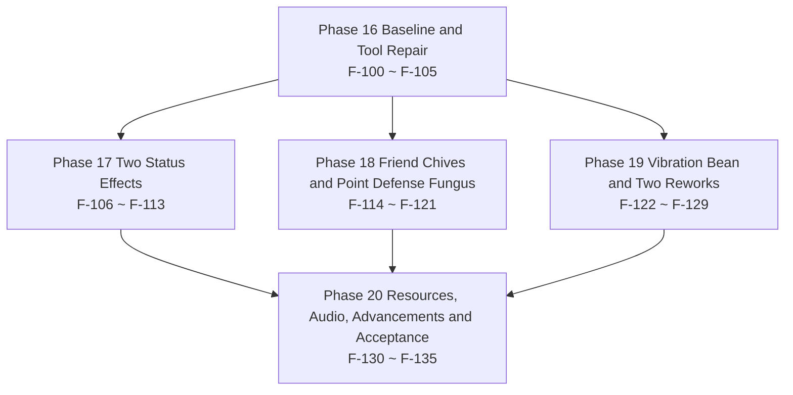

# 19 · v0.0.3 Task Breakdown & Roadmap

> Project: Farmstorm · v0.0.3
> Basis: `docs/zh/16-DECISIONS-0.0.3.md` (D-80 ~ D-102, 23 entries) + `docs/zh/17-DESIGN-0.0.3.md` (full specs of the 7 items) + `docs/zh/18-TECH-0.0.3.md` (registration increment / class design / resource and config list / RT-17 ~ RT-23 / the 17 acceptance self-checks of §11)
> This file breaks the 18-TECH spec into **36** tasks that can each be committed and verified independently, numbered **F-100 ~ F-135**, continuing from F-99 of `13-TASKS-0.0.2.md`. Phase 16 ~ Phase 20 map one-to-one onto milestones M12 ~ M16.
> Coverage: 13 new registered objects, 19 lines of config change (16 pure additions + 3 existing defaults changed), 31 new resource files (PNG 8 + OGG 1 + JSON 22), 9 data entries, 7 RT risks; 0 uncovered (item-by-item mapping in §9).
> This file only reads upstream: it does not modify documents `16` / `17` / `18`, documents 00 – 18 of `docs/zh` or any single file of `docs/en`, and does not touch `src/` (D-80).

---

## 0. Reading Conventions

### 0.1 Task Granularity

A task = one change that can be committed and verified independently. The criteria follow the three of `13-TASKS-0.0.2.md §0.1`, and v0.0.3 carries over its two supplements (supplemented by this file):

1. After the commit, `.tools\gw.cmd build` exits with code 0, and the task does not depend on a task of the same batch that is not yet committed.
2. The task carries at least one acceptance assertion observable at a location listed in §0.3.
3. Reverting that commit does not invalidate other completed tasks (a revert only affects later tasks that depend on it).
4. No Phase boundary is crossed: all deliverables of a task fall inside the name scope of the Phase it belongs to; a cross-Phase prerequisite is written only in the “Depends on” column.
5. Touch only the files named by the overview table of `18-TECH-0.0.3.md §3.0` (11 new classes + 6 existing files + the wiring files) and the config keys and resource files named by `18-TECH-0.0.3.md §8.1 / §9`; any change outside that table first amends document 16 and only then gets broken into tasks.

### 0.2 Complexity and Workload Conversion

The conversion basis is exactly that of `13-TASKS-0.0.2.md §0.2` and is not adjusted midway:

| Complexity | Meaning | Converted person-days |
|---|---|---|
| S | Single file or pure data; ≤ 1 class, or ≤ 20 JSON files | 0.5 |
| M | 2 ~ 4 files, across 1 ~ 2 packages, or 1 new full behavior implementation | 1.5 |
| L | ≥ 5 files or across 3 packages, including a runtime state machine / serialization / transaction / render pipeline | 3.0 |

Distributed under this rule, the 36 tasks of v0.0.3 are **S 6 / M 22 / L 8**, converting to `6 × 0.5 + 22 × 1.5 + 8 × 3.0 = 3.0 + 33.0 + 24.0 = 60.0` person-days (buffer excluded).

### 0.3 How Acceptance Criteria Are Written

Every acceptance item must be observable at one of the following locations: the assertion output in `logs/latest.log`; the return value of `/execute` `/data get` `/damage` `/advancement` `/playsound` in game; an F3 / F3+B overlay reading; the content of `src/generated/resources` or `config/farmstorm-server.toml`; an artifact under `build/libs` or `dist`. Unobservable phrasing such as “behaves normally” or “feels good” is forbidden.

Four writing conventions of this file (supplemented by this file):

1. An assertion must contain a concrete number, key name or file path (e.g. “`interceptCount` reads 1..6 in order”, not “the count is normal”).
2. A manual-test assertion must state the control scenarios (e.g. “drop once each with `cancelFallDamage` on / off”).
3. When referencing an upstream self-check item, cite its number (e.g. `18-TECH-0.0.3.md §11 #15`) instead of restating the criterion.
4. A few assertions use structural evidence (a `grep` match count of 0, an empty `git diff`, the codec output of `ffprobe`, the entry list of `jar tf`) — they point at definite file content, are as valid as the five locations above, and are used only where those five cannot decide (e.g. the red line “0 custom network packets” has no runtime reading of its own).

### 0.4 Document Adjudication Record

The 9 items below are this round's convention disagreements together with this file's rulings, numbered on from A-09 of `13-TASKS-0.0.2.md §0.4`. Later tasks all follow the “Ruling” column; the former upstream inconsistencies of A-15 ~ A-17 have already been corrected upstream according to the rulings and are registered in §12.3 as a traceability record.

| # | Conflict point | Documents involved | Ruling | Implementing tasks |
|---|---|---|---|---|
| A-10 | What the Fang Trap Cactus rename must carry along: only the Chinese display name, or the registry id and the English name with it | `16-DECISIONS-0.0.3.md` §3.4 D-93, §5.2; `17-DESIGN-0.0.3.md` §7.2 | **Change only the value in `zh_cn.json`**: the Chinese name “赢过输过没死过” → “刺球”; the registry id is still `fang_trap_cactus`, the block id is still `fang_trap_cactus_block`, the `DeployedKind` constant is still `FANG_TRAP_CACTUS`, and the English name is still Fang Trap Cactus. This is the **first and only** explicit exception to C-10 (Chinese and English no longer translate each other); a second one may not be opened anywhere else | F-125 |
| A-11 | Whether the Vibration Bean profile's `DeployedKind` is filled with `null` or with `VIBRATION_BEAN` | `16-DECISIONS-0.0.3.md` §4 line 22 (that line **once read “—”** and has been corrected to `VIBRATION_BEAN`); `18-TECH-0.0.3.md` §1.4(b), §2.2 note 3 | **Fill in `DeployedKind.VIBRATION_BEAN`**: `DeployedCropBlockEntity#kindOf` throws `IllegalStateException` outright for any block that is not a `DeployedCropBlock`, and `kind` is taken from `profile.kind()`, so filling in `null` falls back to `BLAST_CARROT` and the trap turns into an explosion trap. The enum goes from 6 values to **8** (`POINT_DEFENSE_FUNGUS`, `VIBRATION_BEAN`); an enum constant is not a registered object, so the registration total is unaffected. **Upstream corrected**: §4 line 22 of document 16 now reads `VIBRATION_BEAN`; this item is kept as traceability | F-103, F-105 |
| A-12 | What carries the mount in Q-Bounce's `mount` branch | `16-DECISIONS-0.0.3.md` §3.6 D-102; `18-TECH-0.0.3.md` §4.3 | **`minecraft:armor_stand`** (a vanilla existing entity type), no new `entity_type`, and the `entity_types` increment is always **+2**; five attribute overrides `setInvisible` / `setNoGravity` / `setInvulnerable` / `setSilent` / `setMarker`, discarded with `discard()` the instant the creature dies | F-109, F-112 |
| A-13 | Whether the Point Defense Fungus intercept sound and the Vibration Bean explosion sound need new `sound_event`s | `16-DECISIONS-0.0.3.md` §3.6 D-100; `18-TECH-0.0.3.md` §8.4, §9.2 appendix | **Both reuse vanilla events**: the intercept sound `SoundEvents.SHIELD_BLOCK`, the explosion sound `SoundEvents.GENERIC_EXPLODE`; the code writes the Java constants only, never a `minecraft:***` string. The `sound_events` increment is **always +1** (only `friend_chives`), and the event count of `sounds.json` goes 2 → 3 | F-120, F-124, F-131 |
| A-14 | When `tools/verify_project.py` lags behind the implementation, whether acceptance may be downgraded to a handwritten signature | `16-DECISIONS-0.0.3.md` §6 item 10; `18-TECH-0.0.3.md` §1.4(c), §11 #1 | **No downgrade allowed**: the tool must be fixed to the 0.0.2 baseline **77 / 77** (config 139, lang 263, `结论：FAIL 0 项`, exit code 0), and after v0.0.3 lands be raised to **90 / 90** (config 155, lang 297). The “keep the tool red + sign by hand” fallback cell of RT-23 is enabled only when the author explicitly rejects fixing the tool; it does not apply this round | F-100, F-135 |
| A-15 | The default values of the three `qbounce` pose parameters once had two readings: `rotateDegreesPerTick` and `squashPeriodTicks` at 24.0 / 6, or at 12.0 / 10 | `17-DESIGN-0.0.3.md` §2.3, §2.5, §11.1 (once read 24.0 / 0.15 / 6); `18-TECH-0.0.3.md` §4.2, §8.1 #2–#4, §8.2, §11 #3 (once read 12.0 / 0.15 / 10) | **Take 24.0 degrees/tick, 0.15, 6 ticks** (= 480 degrees/s, one turn in 15 ticks, and 1 second holds about 3.3 squash cycles): that is the same set of values D-81 carries in document 17 §2.3 and in the construction fact card §3.3, while those three rows of document 18 §8.1 carry the note “default values supplemented by this document” (i.e. they are not derived from a decision). **The range column still has document 18 §8.1 as its only source** (0.0–360.0 / 0.0–0.90 / 2–100). The 12.0 / 10 ticks / 240 degrees per second of document 18 §4.2, §8.1 #2–#4, §8.2 and §11 #3 have been changed to 24.0 / 6 ticks / 480 degrees per second under this item. **Upstream corrected**; this item is kept as traceability | F-104, F-107, F-108 |
| A-16 | The PNG increment once appeared in two writings, 7 files and 8 files | `16-DECISIONS-0.0.3.md` §8 (once read +7 / +1); `17-DESIGN-0.0.3.md` §1.3 (once read +7 / +1); `18-TECH-0.0.3.md` §1.4(d), §9.1 (8 rows) | **8 files**: the 8th is the Vibration Bean item icon (the `basicItem` fallback branch of `ModItemModelProvider` always references `farmstorm:item/<id>`, handled the same way as the three invisible traps of 0.0.2). The resource increment is PNG 8 + OGG 1 + JSON 22 = **31**. **Upstream corrected**: §1.3 of document 17 now reads +8, and §8 of document 16 was changed to +8 in the same batch; this item is kept as traceability | F-130, F-135 |
| A-17 | The IDs and file names of the three new advancements once had two sets of writings | `17-DESIGN-0.0.3.md` §10.1 (`first_q_bounce` / `point_defense_intercept` / `vibration_bean_trigger`); `18-TECH-0.0.3.md` §2.3, §9.3 #20–#22 (once read `first_q_bounce` / `first_intercept` / `first_vibration_bean`) | **Take the three of document 17 §10.1**: `farmstorm:first_q_bounce`, `farmstorm:point_defense_intercept`, `farmstorm:vibration_bean_trigger`, with the JSON file names equal to the IDs. The two short names in document 18 §2.3 and §9.3 #21 / #22 have been changed to the same IDs under this item (document 17 §10.1 is the only source for the display names, parents and trigger criteria of these three). **Upstream corrected**; this item is kept as traceability | F-133 |
| A-18 | Sub-table 3 (31 resource files) and sub-table 4 (9 data entries) of §9 overlap in 6 entries — how is that counted | `18-TECH-0.0.3.md` §9.3 (22 rows by file), §2.3 (5 rows by data entry, not counted into registration) | **The two tables count different things and are not added into one total**: sub-table 3 counts **by file** (PNG 8 + OGG 1 + JSON 22 = 31 files); sub-table 4 counts **by data entry** (2 converting recipes + 3 advancements + 1 item tag + 2 appends to vanilla / own block tags + 1 `damage_type` data json = 9 entries), of which 6 (2 recipes + 3 advancements + 1 `damage_type`) have already appeared once in sub-table 3 as files. The two totals are not added together, and the “0 uncovered” of each holds on its own | F-132, F-133 |

#### 0.4.1 Relationship With A-01 ~ A-09 of Document 13

The 9 rulings of document 13 belong to the 0.0.2 conventions (the Molotov probability key, the Wild Apple duration, the Zangief Cane phase driver, the config key form, the spin rate 72.0, the resistance matrix, what Compressed Puffed Wheat reuses, the two paths of triggered drops, and short phrases for advancement display names). v0.0.3 carries over only two of them: **the two-path convention of A-08** (triggered silent removal bypasses the loot table, while the player mining it personally still gets the drop; this version carries it over through the Point Defense Fungus 6th-intercept cap and the Vibration Bean trigger) and **the short-phrase convention of A-09** (the three advancement titles of F-133). The other seven are unrelated to v0.0.3 and are not re-adjudicated.

---

## 1. Task Dependency Graph

### 1.1 Phase-Level Dependencies



Phase 17 / 18 / 19 do not depend on one another; they share only the registry layer, config layer and profile layer of Phase 16, so they can be handed to three different people. The only crossing point of the three lines is the progress in Phase 20 (`first_q_bounce` needs Q-Bounce to be appliable, `point_defense_intercept` needs intercepts to be countable, `vibration_bean_trigger` needs the trap to settle), so Phase 20 has to wait until all three lines have closed.

### 1.2 Trunk Chains (Text Tree)

```text
F-100 Fix verify_project.py 0.5
├─ F-101 Baseline three-ledger reconciliation 0.5 ── F-102 Version and build baseline 0.5 ── F-103 Registry wiring 3.0
│   ├─ F-104 config 16 keys 1.5
│   ├─ F-105 Three profiles and a 19-entry pool 1.5 ── F-114 Friend Chives planting form 1.5 ── F-115 Impact settlement 1.5 ── F-116 Hit sound 0.5
│   ├─ F-106 Two effect classes 1.5
│   │   ├─ F-107 Client state machine 1.5 ── F-108 render branch 3.0
│   │   │                    └─ F-110 Input lock reuse 1.5
│   │   ├─ F-109 mount branch 3.0
│   │   └─ F-111 Confusion reversal 1.5
│   ├─ F-117 Point Defense Fungus block 1.5 ── F-118 Target acquisition and the four filters 3.0 ── F-119 Count and dedup 1.5 ── F-120 VFX and discard 1.5
│   ├─ F-123 Unattached mode 3.0 ── F-122 Vibration Bean impact placement 1.5
│   ├─ F-125 Fang Trap Cactus rename 0.5 ── F-126 Fang Trap Cactus four values 1.5 ── F-127 Hit definition 3.0
│   └─ F-128 Zangief Cane fixed 7.5 1.5
├─ Convergence layer: F-112 Real-machine comparison 0.5 (F-108 + F-109) ── F-113 Phase 17 exit 1.5 (F-110 + F-111 + F-112)
├─ Convergence layer: F-121 Phase 18 exit 1.5 (F-116 + F-120)
├─ Convergence layer: F-124 Vibration Bean trigger settlement 1.5 (F-123 + F-111) ── F-129 Phase 19 exit 1.5 (F-124 + F-127 + F-128)
└─ Phase 20: F-130 PNG 8 files 1.5, F-131 audio pipeline 1.5 (both wait only on F-102)
    └─ F-132 DataGen 19 JSON 3.0 (F-103 + F-123 + F-128)
        └─ F-133 Three advancements 1.5 (F-115 + F-119 + F-124)
            └─ F-134 Language keys 34 entries 1.5 (F-104 + F-132 + F-133)
                └─ F-135 Full acceptance 3.0 (F-113, F-121, F-129, F-130 ~ F-134)
```

Only the chains that decide the total duration are drawn. **Each task appears exactly once in the tree, and a node's parent on the tree is always one of the tasks listed in that node's “Depends on” field**; prerequisites not drawn in the tree follow the “Depends on” field of each task block. Three supplementary prerequisites: `F-126` also waits on `F-104` (the two new config keys), `F-124` also waits on `F-111` (it has to apply `confusion`), and `F-132` also waits on `F-128` (the `damage_type` data json is landed in the same batch).

---

## 2. Overview

| Phase | Name | Tasks | Task IDs | Person-days | Milestone |
|---|---|---|---|---|---|
| Phase 16 | Baseline and Tool Repair | 6 | F-100 ~ F-105 | 7.5 | M12 |
| Phase 17 | Two Status Effects | 8 | F-106 ~ F-113 | 14.0 | M13 |
| Phase 18 | Friend Chives and Point Defense Fungus | 8 | F-114 ~ F-121 | 12.5 | M14 |
| Phase 19 | Vibration Bean and Two Reworks | 8 | F-122 ~ F-129 | 14.0 | M15 |
| Phase 20 | Resources, Audio, Advancements and Acceptance | 6 | F-130 ~ F-135 | 12.0 | M16 |
| **Total** | | **36** | **F-100 ~ F-135** | **60.0** | **M12 ~ M16** |

- **Raw person-day total: 60.0 person-days** (= the sum of the row subtotals = the sum of the per-task converted person-days; see the reconciliation below).
- **Total after a 25% buffer: 75.0 person-days** (`60.0 × 1.25 = 75.0`).
- Critical path length: **18.0 person-days / 11 tasks** (derivation in §11.1).

Complexity distribution and reconciliation:

| Complexity | Tasks | Person-days each | Subtotal | Task IDs |
|---|---|---|---|---|
| S | 6 | 0.5 | 3.0 | F-100, F-101, F-102, F-112, F-116, F-125 |
| M | 22 | 1.5 | 33.0 | F-104, F-105, F-106, F-107, F-110, F-111, F-113, F-114, F-115, F-117, F-119, F-120, F-121, F-122, F-124, F-126, F-128, F-129, F-130, F-131, F-133, F-134 |
| L | 8 | 3.0 | 24.0 | F-103, F-108, F-109, F-118, F-123, F-127, F-132, F-135 |
| **Total** | **36** | — | **60.0** | Full coverage of 1 – 36 |

Reconciliation equation: `6 × 0.5 + 22 × 1.5 + 8 × 3.0 = 3.0 + 33.0 + 24.0 = 60.0`, digit-for-digit equal to the total of the table above; `60.0 × 1.25 = 75.0`.

---

## 3. Phase 16 · Baseline and Tool Repair (F-100 ~ F-105)

Phase goal: first fix “getting the numbers” (RT-23) so that the 0.0.2 baseline **77** becomes a recomputable measured value instead of an assertion; then stand up all at once the 13 registered objects, 19 lines of config change and 3 new crop profiles of v0.0.3, so that the four later phases only fill in behavior.

Phase exit criteria: `tools/verify_project.py` outputs `77 / 77` and `结论：FAIL 0 项` (A-14); `.tools\gw.cmd build` exits with code 0; the registration self-check line of the startup log reads 31 / 25 / 6 / 13 / 4 / 3 / 1 / 1 / 1 / 3 / 1 / 1 per category (90 in total), the crop self-check 22 species and the pool 19 species; `config/farmstorm-server.toml` has 155 leaf nodes.

#### F-100 · Fix `tools/verify_project.py` to the 0.0.2 Baseline 77

- **Complexity**: S | **Person-days**: 0.5
- **Depends on**: —
- **Deliverables**: `tools/verify_project.py`, landing the four-part change of `18-TECH-0.0.3.md §1.4(c)` part by part — ① the expected key set of §1 goes from 117 (reading only `01-DESIGN.md` §3.8) to 139 (reading the 22 rows of `12-TECH-0.0.2.md` §8.1 as well); ② the `EXPECTED` of §2 goes from items 22 / blocks 20 / entity 9 to items 27 / blocks 22 / entity 11; ③ the denominator of §2 goes from 64 to 77, and the 12 per-category subtotals are made equal to `18-TECH-0.0.3.md §1.2`; ④ the remaining 5 bare-ID literals are filled in (including recipe serializer and menu), so that all 12 categories go through per-category subtotals.
- **Acceptance**:
  1. `python -X utf8 tools/verify_project.py` outputs `已核 registry 对象: 77 / 77`, a config section of 139 keys with no FAIL, `lang 键集一致，共 263 键` and `结论：FAIL 0 项`, and exits with code 0 (the “target of fixing to the 0.0.2 baseline” table of `18-TECH-0.0.3.md §1.4(c)` + §11 #1; A-14).
  2. The 12 per-category subtotals are item-for-item equal to `18-TECH-0.0.3.md §1.2`: 27 / 22 / 6 / 11 / 2 / 2 / 1 / 1 / 1 / 2 / 1 / 1, summing to 77.
  3. Fixing the tool may not write back into frozen areas: in `git diff --stat`, `docs/` is empty and `01-DESIGN.md` has not been touched (RT-23 risk ③; `16-DECISIONS-0.0.3.md` §6 item 1).
  4. No second hard-coded total appears in the tool: the `grep -c "64"` hits no longer include a denominator (RT-23 risk ①).

#### F-101 · Reconciliation and Data Extraction of the 0.0.2 Baseline's Three Ledgers

- **Complexity**: S | **Person-days**: 0.5
- **Depends on**: F-100
- **Deliverables**: one read-only recomputation and reconciliation (no source change): the four startup self-check lines of `logs/latest.log`, the four-section output of `tools/verify_project.py` and the 12-row table of `12-TECH-0.0.2.md §2.1`, reconciled item by item, with the conclusion written into the commit message.
- **Acceptance**:
  1. The registration self-check line of the startup log (`Farmstorm#logRegistrySelfCheck`, the assertions of L138–L141) is per-category equal to the `77 / 77` of F-100 (the equality of columns 4 / 5 / 6 of `18-TECH-0.0.3.md §1.2`).
  2. The 7 cross-check rows of `18-TECH-0.0.3.md §1.3` hold row by row: 19 profiles, 16 pool entries, types 10 / 6 / 3 with Demolition 4, 77 registered, 2 events in `sounds.json`, config 139, language keys 263.
  3. `git diff --stat` contains only `tools/` (the change of F-100) and is empty for `src/` and `docs/` — the task shape of this item is exactly “get the numbers first, change no code” (the primary mitigation of RT-23).

#### F-102 · Version Bump and Build Baseline

- **Complexity**: S | **Person-days**: 0.5
- **Depends on**: F-101
- **Deliverables**: `gradle.properties` `mod_version=0.0.2` → `0.0.3` (currently on line 11); zero changes to `build.gradle`.
- **Acceptance**:
  1. `.tools\gw.cmd build` exits with code 0 and the artifact is `build/libs/farmstorm-0.0.3+mc1.21.1.jar` (the version in the file name follows `gradle.properties`).
  2. `jar tf` shows `META-INF/neoforge.mods.toml`, whose `version` is 0.0.3.
  3. The `git diff` of `build.gradle` is empty (`18-TECH-0.0.3.md §0.1`: the build baseline MC 1.21.1 / NeoForge / Java 21 is unchanged).

#### F-103 · 13 Registered Objects, `DeployedKind` +2 and the 11 New Class Skeletons

- **Complexity**: L | **Person-days**: 3.0
- **Depends on**: F-102
- **Deliverables**:
  - The seven registry classes of `registry/`: (items +4) `friend_chives` / `chive_seeds` / `point_defense_fungus` / `vibration_bean`; (blocks +3) `friend_chives_crop` / `point_defense_fungus` / `vibration_bean`; (entity_types +2) `friend_chives` / `vibration_bean`; (mob_effects +2) `q_bounce` / `confusion`; (sound_events +1) `friend_chives`; (damage_types +1) `zangief_slam` (the 13 rows of `18-TECH-0.0.3.md §2.2`, named one by one).
  - `behavior/DeployedKind.java`: +`POINT_DEFENSE_FUNGUS(10)`, +`VIBRATION_BEAN(10)`, enum 6 → 8 (A-11).
  - `registry/FarmstormBlockEntities.java`: append `vibration_bean` to the type of `fang_trap_cactus` and `point_defense_fungus` to the type of `blast_carrot`; `block_entities` stays 6 (§2.2 note 3).
  - The two new `case`s of `behavior/DeployedBehaviors.java` and `behavior/FarmstormBlockEntities.deployedOf` (exhaustive switches — miss one and it does not compile).
  - The compile-time skeletons of the 11 new classes (the overview table of `18-TECH-0.0.3.md §3.0`): `effect/` 2, `client/` 3, `behavior/` 1, `behavior/impl/` 3, `entity/thrown/` 2. A skeleton holds only constructors and empty overrides; behavior is filled in in Phase 17 ~ 19.
  - `Farmstorm.java`: the 12 assertions of `logRegistrySelfCheck` go from 77 to 90, and `mobEffects` goes from 2 to 4.
  - `tools/verify_project.py`: the expected values and denominators of §2 go from the 77 that F-100 fixed (items 27 / blocks 22 / entity_types 11) to 90 (items 31 / blocks 25 / entity_types 13, 12 categories each); the config section stays 139 (it only moves after F-104) and the lang section is not changed by a single line (that section only compares key sets and prints the actual key count — it has no expected value to change).
- **Acceptance**:
  1. The startup log prints verbatim `自检 注册对象 90 个：items 31 / blocks 25 / block_entities 6 / entity_types 13 / mob_effects 4 / sound_events 3 / recipe_types 1 / recipe_serializers 1 / creative_tabs 1 / damage_types 3 / data_components 1 / menu_types 1 → OK` (the v0.0.3 column of `18-TECH-0.0.3.md §2.1` + §11 #2).
  2. On the v0.0.3 code, `tools/verify_project.py` outputs `90 / 90` and the registry section `结论` is a pass (at this point the config section is still 139 and the lang section prints the actual key count of the moment, 263; both sections still pass — config's 155 is closed in F-104, and lang's 297 grows naturally out of F-104's 16 and F-134's 18, with no expected value on the tool side).
  3. The 13 new IDs agree character for character with the 13 rows of `18-TECH-0.0.3.md §2.2` (once each for `/give` on the four items, once each for `/setblock` on the three blocks, once each for `/summon` on the two entities, `/effect` completion for both effects, and `/playsound` completion for one sound event).
  4. All 8 values of `DeployedKind` print, and `VIBRATION_BEAN`'s scan interval is 10 ticks; `git diff behavior/DeployedKind.java` contains added lines only and not one of the six existing constants is changed (A-11).
  5. `.tools\gw.cmd build` exits with code 0 and the compile log has no `the switch expression does not cover all possible input values`.

#### F-104 · The 19 config Lines and the 16 `configuration` Language Keys

- **Complexity**: M | **Person-days**: 1.5
- **Depends on**: F-103
- **Deliverables**: `config/FarmstormConfig.java` — four new groups `qbounce` 4 keys / `friend_chives` 3 keys / `point_defense_fungus` 3 keys / `vibration_bean` 2 keys (12 pure additions) + `fang_trap_cactus` gaining 2 new keys and changing 3 existing defaults + `zangief_cane` gaining 2 new keys (19 lines in total = 16 pure additions + 3 existing defaults changed); the 16 `farmstorm.configuration.*` entries of `datagen/ModLangProvider`; the generated `config/farmstorm-server.toml`; the expected key set of §1 of `tools/verify_project.py` updated from 139 to **155** (the 16 pure-addition lines added line by line, not one total changed).
- **Acceptance**:
  1. `config/farmstorm-server.toml` has **155** leaf nodes (139 + 16), and the four new groups are appended at the end of the file in alphabetical order (the TOML fragment of `18-TECH-0.0.3.md §8.2`).
  2. The three changed existing defaults read back: `fang_trap_cactus.triggerRadius = 2.5`, `outerDelayTicks = 4`, `innerDelayTicks = 2`; the `min` / `max` of the existing keys and their language keys are kept character for character (the note under the §8.1 table).
  3. The three pose parameters read back 24.0 / 0.15 / 6 (A-15); the defaults of the other 16 pure additions are row-for-row equal to §8.1.
  4. The `confusion` group holds no key at all: `grep -c "[confusion]" config/farmstorm-server.toml` is 0 (the 1 non-key line of §8.1; D-83).
  5. `farmstorm.configuration.*` language keys are likewise 155 entries, always equal to the config key count, with identical Chinese and English key sets (character for character, §8.3).
  6. Change `point_defense_fungus.maxIntercepts` to 3 → `/reload` → read back 3, then change it back to 6 and read back 6 (the existing `bake()` convention).

#### F-105 · Three New Profiles, `ALL` at 22 Entries and the Lucky Berry Pool at 19 Entries

- **Complexity**: M | **Person-days**: 1.5
- **Depends on**: F-103
- **Deliverables**: `util/CropProfile.java` (+3 constants `FRIEND_CHIVES` (THROWABLE / BUFF, block `friend_chives_crop`, seed `chive_seeds`), `POINT_DEFENSE_FUNGUS` (DEPLOYABLE / TURRET, block and seed both null, `kind = POINT_DEFENSE_FUNGUS`), `VIBRATION_BEAN` (THROWABLE / TRAP, block and seed both null, `kind = VIBRATION_BEAN`); `ALL` at 22 entries; `LUCKY_BERRY_POOL` not changed by a single line); the two wording lines of the crop self-check and the pool self-check in `Farmstorm.java`.
- **Acceptance**:
  1. The startup log prints verbatim `自检 作物 22 种：投掷型 12 / 部署型 7 / 食用型 3；破障类 4 → OK` (the count self-consistency table of `16-DECISIONS-0.0.3.md` §4 + `18-TECH-0.0.3.md §11 #2`).
  2. The startup log prints verbatim `自检 幸运浆果池 19 种（排除 lucky_berry / wild_apple / compressed_puffed_wheat）→ OK` (D-97; the pool going from 16 to 19 is the natural result of the derivation).
  3. In `git diff util/CropProfile.java`, not one character of the eight fields of the 19 existing profiles is changed; the `git diff` of the `LUCKY_BERRY_POOL` line is empty (D-97's “do not change that derivation line”; `16-DECISIONS-0.0.3.md` §5.7).
  4. `CropProfile.VIBRATION_BEAN.kind() == DeployedKind.VIBRATION_BEAN`, not `null`: setting `null` falls back to `BLAST_CARROT` and makes the trap run as an explosion trap (A-11; `18-TECH-0.0.3.md §1.4(b)`).
  5. The two new Deployable profiles have no crop block and no seed: `block()` / `seed()` of `POINT_DEFENSE_FUNGUS` and `VIBRATION_BEAN` return `null`, and `/give` hands out no seed (“Friend Chives has no converting recipe” of `18-TECH-0.0.3.md §2.3` and §3.2 item 1).

Phase subtotal: **6 tasks, 7.5 person-days** (S 3 / M 2 / L 1).

---

## 4. Phase 17 · Two Status Effects (F-106 ~ F-113)

Phase goal: finish the two status effects `q_bounce` and `confusion` — Q-Bounce has to deliver the four things “sitting pose + rotation + squash-and-stretch + full lock” with both sitting branches implemented, while Confusion reverses only the movement-direction component and yields while the lock is in effect.

Phase exit criteria: all five of #3 ~ #7 in `18-TECH-0.0.3.md §11` pass; both branches of `qbounce.poseMode` pass #3 / #4 once each; the `entity_types` increment is still +2; the match counts of `CustomPacketPayload` and `Mixin` are both 0.

#### F-106 · Two Effect Classes: `QbounceEffect` and `ConfusionEffect`

- **Complexity**: M | **Person-days**: 1.5
- **Depends on**: F-103
- **Deliverables**: `effect/QbounceEffect.java` (`super(MobEffectCategory.HARMFUL, 0xFF6EC7)`; does not override `applyEffectTick` or `isDurationEffectTick`; sets no duration key of its own; reads no config key at all); `effect/ConfusionEffect.java` (same shape, hidden, no icon registered); neither effect body knows whether it is 10 seconds or 4 seconds.
- **Acceptance**:
  1. `/effect give @s farmstorm:q_bounce 10 0` and `/effect give @s farmstorm:confusion 4 0` both succeed (note: the **3rd argument of `/effect` is in seconds** — 10/4 s ⇒ 200/80 ticks; writing 200/80 yields 4000/1600 ticks); `/data get entity @s active_effects` shows both records, with `amplifier` 0 and `duration` 200 and 80 respectively (the constructor line of `18-TECH-0.0.3.md §3.1`).
  2. The two effect classes read no config: `grep -c "FarmstormConfig" effect/QbounceEffect.java effect/ConfusionEffect.java` is 0 (“which config keys it reads: none” of §3.1). **Scope is these two classes only** — `effect/WildHunterEffect.java` reading config per D-61/D-62 is existing design, not a violation.
  3. `confusion` registers no icon: `grep -rc "mob_effect/confusion" src/main/java/` is 0 and there is no `confusion.png` under `textures/mob_effect/` (D-83; §3.2).
  4. The dedicated server's startup log has no `NoClassDefFoundError` (both effect classes sit on the common side and do not depend on `Dist.CLIENT`).

#### F-107 · The Three-Piece Client State Machine and the Compile-Time Mirror Constants

- **Complexity**: M | **Person-days**: 1.5
- **Depends on**: F-106
- **Deliverables**: `client/QbounceClientState.java` (`t` accumulating tick by tick, `θ = 24.0 × t mod 360`, `s = 0.15 × sin(2π × t / 6)`, `scale = (1 − s ÷ 2, 1 + s, 1 − s ÷ 2)`; reset to zero when the effect disappears; never written back to the entity and never sent in a packet); the three compile-time mirror constants (following the existing writing of `client/ZangiefClientState`, the “compile-time mirror constants + a comment saying they must be changed in step” convention of `18-TECH-0.0.3.md`).
- **Acceptance**:
  1. The three mirror constants equal `qbounce.*` of `config/farmstorm-server.toml` value by value: 24.0 / 0.15 / 6 (A-15) — one value off is a failure (the key-reading line of §4.2 + §3.12).
  2. `t` accumulates only locally on the client and is never back-derived from “total duration − remaining duration”: after changing the remaining duration to 100 with `/effect`, `t` does not jump phase (item 2 of the three implementation constraints of `17-DESIGN-0.0.3.md` §2.5).
  3. On the tick after the effect disappears, `t` is zeroed and exactly one line `q_bounce t=0` is printed (no log flooding).
  4. Nothing is sent in a packet and nothing is written back to the entity: `grep -c "CustomPacketPayload" src/main/java/` is 0 and `grep -c "setYRot" client/QbounceClientState.java` is 0 (D-50, `17-DESIGN-0.0.3.md` §2.5 item 3).

#### F-108 · The `render` Branch: Model `riding`, Lowering, Rotation, Squash

- **Complexity**: L | **Person-days**: 3.0
- **Depends on**: F-107
- **Deliverables**: `client/QbouncePoseRenderer.java` — inside `RenderLivingEvent.Pre`, in order `pushPose()`, `translate(0, −0.35, 0)`, `scale`, rotation about `Axis.YP`, paired with `popPose()` in `Post`; the only entry condition is `hasEffect(Q_BOUNCE)`; the `riding` flag changes only this frame's model instance.
- **Acceptance**:
  1. `18-TECH-0.0.3.md §11 #3` passes in full: the zombie takes on a riding pose (legs pressed down), is lowered 0.35 blocks, rotates at about 480 degrees/s (24.0 degrees/tick, A-15) and squashes and stretches on a 6-tick period; the AI still walks (the position keeps changing) and the collision box is unchanged.
  2. `push` / `pop` are paired: after 30 seconds of continuous rendering the picture shows no overall drift (verification ③ of RT-17).
  3. With 3 affected creatures on screen at once, each viewed for one frame, the three do not accumulate displacement into one another; in third person, “I see others sitting” and “others see me sitting” are the same piece of logic (`17-DESIGN-0.0.3.md` §2.4.1).
  4. For a model that does not read `riding` (pick any vanilla creature that is not a `HumanoidModel` as the control), it degrades to “rotate but do not press into a sitting pose” and throws no exception (RT-17 fallbacks ②③).
  5. The `entity_types` increment is still +2 and the registration self-check is still 90 (this item only changes the render layer and registers no new object).

#### F-109 · The `mount` Branch: an Invisible `minecraft:armor_stand` Mount and the Bookkeeping Table

- **Complexity**: L | **Person-days**: 3.0
- **Depends on**: F-106
- **Deliverables**: `behavior/QbounceMountController.java` — `EntityType.ARMOR_STAND.create(level)` + five attribute overrides (`setInvisible` / `setNoGravity` / `setInvulnerable` / `setSilent` / `setMarker`), `startRiding(stand, true)`, a `Map<UUID, MountRecord>` bookkeeping table (in memory only), three checks every tick, four exit paths (death / disconnect / dimension change / server stop) + a per-tick fallback, giving up after more than 20 re-mounts with one warning line; `qbounce.poseMode` is read only in this branch.
- **Acceptance**:
  1. With `qbounce.poseMode = mount`, the mount side can see the affected zombie — `/execute as @e[type=minecraft:armor_stand] run data get entity @s Passengers` contains it (A-12). **Do not use the rider-side `RootVehicle`**: on 21.1.213 that key is not readable from the rider (`Found no elements matching RootVehicle`), and the original criterion is corrected accordingly; after the zombie dies no such ArmorStand remains in the world (`18-TECH-0.0.3.md §11 #4`).
  2. During the effect, `kill` the creature, drop and reconnect, and walk through a portal once each: no ArmorStand is left behind in the world (verified with `/data get entity` or the log line; verification ② of RT-18).
  3. Switch `poseMode` twice (render → mount → render): after every switch the bookkeeping table is cleared and all mounts are `discard()`ed (the switch-timing line of §4.1).
  4. The mount type is not a custom entity: `entity_types` of the registration self-check is still 13 and the increment is still +2 (D-102).
  5. If `setMarker(true)` also cancels the sitting pose, fall back to `setMarker(false) + setSmall(true) + setInvisible(true)` with unchanged behavior (RT-18 fallback ①).

#### F-110 · Q-Bounce Reuses the Seven-Segment Input Lock

- **Complexity**: M | **Person-days**: 1.5
- **Depends on**: F-107
- **Deliverables**: `client/InputLockHandler.java` — the criterion of `locked()` is extended to `ZangiefClientState.active() || QbounceClientState.active()`; the seven segments and “ESC only” are not changed by a single character, and no second set of locks is added.
- **Acceptance**:
  1. `18-TECH-0.0.3.md §11 #5` passes in full: W / A / space / sneak / left click / right click / scroll wheel / number keys each respond nothing once, ESC still opens the pause menu, and the lock log is printed only once.
  2. The lock is defined in exactly one place: every hit of `grep -rn "isLocked" src/main/java/com/dashpig/farmstorm/client/` points at `InputLockHandler` (the fallback cell of RT-19; “do not reuse a second set of locks” of D-79).
  3. On the tick after the effect ends, all input is restored (`QbounceClientState.active()` false releases it).

#### F-111 · Confusion's Movement Reversal and “Lock First”

- **Complexity**: M | **Person-days**: 1.5
- **Depends on**: F-106
- **Deliverables**: `client/ConfusionInputHandler.java` — inside `MovementInputUpdateEvent`, first `if (InputLockHandler.isLocked()) return;`, then negate `forwardImpulse` and `leftImpulse` each; jumping, sneaking, the camera, attacking and using are left entirely alone.
- **Acceptance**:
  1. `18-TECH-0.0.3.md §11 #6`: with Confusion alone applied, W walks backwards and A strafes right, with the speed magnitude equal to normal (computed tick by tick from the F3 coordinates), and the camera / jump / sneak / left click all behave normally.
  2. `18-TECH-0.0.3.md §11 #7`: with Q-Bounce and Confusion present together, pressing W gives a displacement of 0, the lock log has already been printed, and the reversal is restored on the tick after the effect ends.
  3. Exactly one event is subscribed: `grep -c "@SubscribeEvent" client/ConfusionInputHandler.java` is 1; no second set of locks is written (D-83, D-79). **Do not use `grep -c "MovementInputUpdateEvent"` as the criterion** — any normal implementation imports that class, so the import line and the parameter each match once and the count is always 2; rewriting it as a fully-qualified name just to reach 1 is putting the cart before the horse.
  4. Speed and camera are untouched: `grep -c "MOVEMENT_SPEED" client/ConfusionInputHandler.java` is 0 and `grep -c "Sensitivity" client/ConfusionInputHandler.java` is 0 (`17-DESIGN-0.0.3.md` §3.4).

#### F-112 · Real-Machine Comparison of the Two Sitting Branches and the Retention Conclusion

- **Complexity**: S | **Person-days**: 0.5
- **Depends on**: F-108, F-109
- **Deliverables**: a record of one real-machine comparison (written into the commit message): the feel, the AI behavior, the collision difference, whether third-party custom models honor `riding`, and which branch is finally retained; the losing branch is switched to off by default and **not one line of code is deleted**.
- **Acceptance**:
  1. Both branches can be selected by a single value of `qbounce.poseMode`, and each passes `18-TECH-0.0.3.md §11 #3` / #4 on its own.
  2. The losing branch's code is still there: both `client/QbouncePoseRenderer.java` and `behavior/QbounceMountController.java` still exist and `git diff` contains no deleted line (`16-DECISIONS-0.0.3.md` §6 item 8).
  3. The default of `qbounce.poseMode` is still `render` (D-82 is not changed); if `mount` is the one retained, only register “the default has to be changed upstream in D-82” — this item does not touch the config default.
  4. The record gives one conclusion each for RT-17 and RT-18 (which risk really materialized, and whether the mitigation was enough).

#### F-113 · Phase 17 Exit Regression

- **Complexity**: M | **Person-days**: 1.5
- **Depends on**: F-110, F-111, F-112
- **Deliverables**: one regression run (no new behavior; it only fills in the handling of the five boundaries of `17-DESIGN-0.0.3.md` §12.1 / §12.2 / §12.3 / §12.12 / §12.13).
- **Acceptance**:
  1. During Q-Bounce, the player dies, quits and changes dimension once each: no mount is left over and the lock is released after respawn (`17-DESIGN-0.0.3.md` §12.2, §12.3; RT-18).
  2. Q-Bounce coexists with the Zangief Cane phase lock: only one lock log line is printed and Confusion still exits early as usual (§12.13; RT-19).
  3. Creative players and spectators: spectators are unaffected, and the effect and lock of creative players work as usual (§12.12).
  4. While Q-Bounce is active, the target is leashed and then ridden, once each: behavior does not roll back and does not crash (§12.3).
  5. The five items #3 ~ #7 of `18-TECH-0.0.3.md §11` all pass on re-run; the registration self-check is still 90 and `block_entities` is still 6.

Phase subtotal: **8 tasks, 14.0 person-days** (S 1 / M 5 / L 2).

---

## 5. Phase 18 · Friend Chives and Point Defense Fungus (F-114 ~ F-121)

Phase goal: take the two new crops from profile to behavior — Friend Chives runs the loop “seed → crop → harvest → throw → 6-block sphere at the impact point + hit sound”, and Point Defense Fungus runs the intercept loop “deploy block → 8-block Euclidean target acquisition → four filters (non-ally included) → 6-count → discard after the VFX”.

Phase exit criteria: all five of #8 / #9 / #12 / #13 / #14 in `18-TECH-0.0.3.md §11` pass; `interceptCount` is unchanged in both the “an ally passes through” and the “a vanilla projectile passes through” case; the `sound_events` increment is still +1 and `block_entities` is still 6.

#### F-114 · Friend Chives: the Item, Chive Seeds, the Crop Block and 4 Ages

- **Complexity**: M | **Person-days**: 1.5
- **Depends on**: F-103, F-105
- **Deliverables**: `friend_chives` (`ThrowableCropItem`) and `chive_seeds` (`SeedItem`) in `registry/FarmstormItems.java`; `friend_chives_crop` (`FarmstormCropBlock`, 4 ages) in `registry/FarmstormBlocks.java`; the crop-block and seed wiring of `util/CropProfile.FRIEND_CHIVES`; the `converter_fuel` constant membership of `FarmstormTags` (the tag file is in F-132).
- **Acceptance**:
  1. `/give @s farmstorm:friend_chives` and `/give @s farmstorm:chive_seeds` both succeed, and both entries are visible in the creative tab `farmstorm:main` (rows 1 and 2 of `18-TECH-0.0.3.md §2.2`).
  2. Planting Chive Seeds on farmland produces `farmstorm:friend_chives_crop`, with `age` stepping from 0 to 3 visibly (verify once each with `/setblock ... age=3` and with natural growth); the block id agrees with row 5 of `18-TECH-0.0.3.md §2.2`.
  3. There is no converting recipe: `grep -c "FRIEND_CHIVES" datagen/ModRecipeProvider.java` is 0 (“it has no vanilla counterpart, therefore no converter recipe” of D-84).
  4. The seed only goes through the farmland path: `/setblock`-ing the seed on non-farmland produces no crop (“there is only one acquisition path” of D-84).
  5. The throwing entry exists: `/summon farmstorm:friend_chives ~ ~2 ~` succeeds and does not error out on landing (the impact settlement is in F-115; at this point `onImpact` is the skeleton version).

#### F-115 · `FriendChivesProjectile`'s Impact Settlement: a Euclidean 6-Block Sphere and 200 Ticks of Q-Bounce

- **Complexity**: M | **Person-days**: 1.5
- **Depends on**: F-114, F-106
- **Deliverables**: `entity/thrown/FriendChivesProjectile.java` — `onImpact` takes the impact point as the sphere centre and a Euclidean radius of 6.0, writes 200 ticks of `q_bounce` to every `LivingEntity` inside the sphere (amplifier 0; the last two of the six-argument constructor are `false` and `true` respectively), and accumulates the number `n` of successful applications for F-116 to decide “whether to play the sound”; `profile()` returns `FRIEND_CHIVES`.
- **Acceptance**:
  1. The first half of `18-TECH-0.0.3.md §11 #12`: when 1 creature is hit, every creature within 6 blocks gains Q-Bounce, with `duration` 200 and `amplifier` 0 in `/data get entity`.
  2. Euclidean, not Chebyshev: within the sphere, 6.0 blocks are affected and a diagonal 8.4 blocks is not (`17-DESIGN-0.0.3.md` §4.5's “6.0 (Euclidean)” convention; the same ruler as the Euclidean recheck of RT-20).
  3. The thrower himself, if inside the sphere, also gains Q-Bounce (the last column of `17-DESIGN-0.0.3.md` §4.5).
  4. No friend-or-foe filtering: teammates and opposing players are both affected (D-85, the one-shot AoE convention of D-27).
  5. There is exactly one criterion: `n` is the count of successful applications, and no second “is there a creature nearby” query is made (item 1 of the four conventions of `17-DESIGN-0.0.3.md` §4.6).

#### F-116 · The Friend Chives Hit Sound: Played Once Only on a Hit, Audible Within 32 Blocks

- **Complexity**: S | **Person-days**: 0.5
- **Depends on**: F-115
- **Deliverables**: the sound-playing section of `FriendChivesProjectile#onImpact` — plays only when `n ≥ 1`, only once per throw, with `SoundSource.PLAYERS`, a volume of 2.0 (broadcast radius 16 × 2.0 = 32 blocks), and the event `farmstorm:friend_chives`.
- **Acceptance**:
  1. The second half of `18-TECH-0.0.3.md §11 #12`: audible within 32 blocks on a hit and inaudible at 33 blocks; an empty throw (`n = 0`) plays nothing at all.
  2. The broadcast radius and the config are two writings of the same number: `soundRange = 32.0` ↔ volume 2.0 (the “where does 32 blocks come from” line of `17-DESIGN-0.0.3.md` §4.6); after changing `soundRange` to 16.0 it is audible within 16 blocks — change it back after verifying.
  3. The play count is independent of the number of creatures hit: one hit on 3 creatures still sounds once (“play the sound once” of D-85).
  4. The sound source category is `PLAYERS` and does not interrupt background music (`17-DESIGN-0.0.3.md` §4.6).

#### F-117 · The Point Defense Fungus Block, the `POINT_DEFENSE_FUNGUS` Category Name and the Deploy Entry

- **Complexity**: M | **Person-days**: 1.5
- **Depends on**: F-103, F-105
- **Deliverables**: `deployed(POINT_DEFENSE_FUNGUS, …)` in `registry/FarmstormBlocks.java` (Turret appearance, not invisible, borrowing the vanilla `warped_fungus`); the `POINT_DEFENSE_FUNGUS` → `PointDefenseFungusBehavior` dispatch in `behavior/DeployedBehaviors.java`; the profile wiring of `CropProfile.POINT_DEFENSE_FUNGUS` (no crop block, no seed).
- **Acceptance**:
  1. `/setblock ~ ~ ~ farmstorm:point_defense_fungus` succeeds, the geometry is visible in the world, and `/data get block` returns the `owner` field (it reuses the existing `DeployedCropBlockEntity`; `block_entities` is still 6).
  2. All 8 values of `DeployedKind` print and `POINT_DEFENSE_FUNGUS`'s scan interval is 10 ticks (the enum value of F-103 is really dispatched here).
  3. The existing caps of 32 per player / 8 per chunk still apply (the cap line of `18-TECH-0.0.3.md §6.4`).
  4. The item and the block share one ID and `Item.BY_BLOCK` has a mapping: `lootTableItem(block)` can land on the item (note 1 of `18-TECH-0.0.3.md §2.2`).
  5. 0 new textures: both the block and the item borrow the vanilla `warped_fungus`, and there is no new `point_defense_fungus` file under `textures/` (the “no new PNG” line of §9.1).

#### F-118 · Point Defense Fungus Target Acquisition and the Four Filters (Including “Non-Ally”)

- **Complexity**: L | **Person-days**: 3.0
- **Depends on**: F-117
- **Deliverables**: `behavior/impl/PointDefenseFungusBehavior.java` (a `TurretBehavior` subclass) — an 8-block AABB cube used for a coarse filter only → `getEntitiesOfClass(ThrownCropEntity.class, box, predicate)` → four filters in a fixed order ① `!isRemoved()` ② `!isSubmunition()` ③ `center.distanceTo(...) <= 8.0` (Euclidean recheck) ④ non-ally (`!(owner instanceof Player p && be.isAlly(p))`) → the nearest one is handed to the subsequent `fire`.
- **Acceptance**:
  1. `18-TECH-0.0.3.md §11 #13`: one throw each of a vanilla arrow / snowball / trident / ender pearl / man瓜 missile (`farmstorm:turret_bullet`) all pass through and `interceptCount` is unchanged; then one more throw of Friend Chives is intercepted and `interceptCount` goes +1.
  2. A diagonal 7.9 blocks is intercepted and 8.1 blocks is not (Euclidean, not Chebyshev; step 4 of `18-TECH-0.0.3.md §6.2` and verification ③ of RT-20).
  3. An ally's projectile (the placer himself, a teammate) passes through: no count is consumed and there are no particles (D-98; the third paragraph of `18-TECH-0.0.3.md §11 #8`).
  4. When the owner is not a player (a dispenser / command-spawned / `getOwner()` is `null`), it is treated as a non-ally and intercepted as usual (the ally-exclusion row of `18-TECH-0.0.3.md §6.1`).
  5. A wind charge for which `isSubmunition()` is true is not intercepted (the extra exclusion row of §6.1).

#### F-119 · Intercept Counting, Same-Tick Dedup and the 6th Silent Removal

- **Complexity**: M | **Person-days**: 1.5
- **Depends on**: F-118
- **Deliverables**: `interceptCount` and `recordIntercept(now)` in `blockentity/DeployedCropBlockEntity.java`; `lastInterceptTick` and `markIntercepted(now)` in `entity/ThrownCropEntity.java` (which is **not** written into `addAdditionalSaveData`); after the 6th time it goes `consume()` → `removeBlock` and never touches the loot table.
- **Acceptance**:
  1. The first paragraph of `18-TECH-0.0.3.md §11 #8`: throwing 6 Friend Chives at one fungus in a row, the log shows `interceptCount` reading 1..6 in order, and at the instant the 6th completes the block disappears with no drops (the D-72 convention).
  2. `18-TECH-0.0.3.md §11 #9`: one fungus facing 2 projectiles in the same tick intercepts only 1 and the count goes +1 only. **How the "already intercepted this tick" branch is evidenced has changed** (V-112/V-115): with the same-tick screen added in `findTarget`, the normal two-fungus flow is stopped during targeting and never reaches that branch inside `fire`, so the branch is now a **fallback** and can only be evidenced by a **probe calling `fire` directly** (measured: calling `fire` twice on the same entity in one tick raises the count by 1 only and logs `近防菌 本刻已拦过 … 跳过`). Do not require that line in production logs any more.
  3. With 3 Point Defense Fungi around the same projectile: `interceptCount` goes +1 in total, and the other 2 fungi show no particles (the dedup of D-88; verification ① of RT-20).
  4. Loading the save leaves no residue: the `grep -c "lastInterceptTick"` hits near `addAdditionalSaveData` are 0 (“never persisted” of §6.3).
  5. The cap is adjustable: change `maxIntercepts` to 2 and the block disappears after the 2nd intercept (row 9 of §8.1); change it back to 6 after verifying.

#### F-120 · Intercept VFX and `discard()` (No Impact Settlement)

- **Complexity**: M | **Person-days**: 1.5
- **Depends on**: F-119
- **Deliverables**: the fixed four-step order of `PointDefenseFungusBehavior#fire` — ① `if (target.markIntercepted(now)) return;` ② `sendParticles` (the particle count taken from `interceptParticles`, the type `ParticleTypes.CRIT`) ③ `playSound` (the constant `SoundEvents.SHIELD_BLOCK`) ④ `recordIntercept(now)` followed by `target.discard()`; **there is no branch at all that goes through `onImpact`**.
- **Acceptance**:
  1. `18-TECH-0.0.3.md §11 #14`: a full-health player standing within 8 blocks lets 6 projectiles be intercepted; health / hunger / coordinates are unchanged point by point, the block and its block state do not change, and the log has no `Explosion` constructor line (D-89).
  2. An intercepted projectile has no follow-up on landing: it does not explode, writes no block, applies no effect and drops nothing (D-99; `18-TECH-0.0.3.md §6.5`).
  3. No new sound event is added: the event count of `sounds.json` is still 2 (`friend_chives` is only appended in F-131, A-13; D-100).
  4. `grep -c "hurt(" behavior/impl/PointDefenseFungusBehavior.java` is 0 and `grep -c "new Explosion"` is 0 (the three things of §6.5).
  5. The particle count stays in step with the config: after changing `interceptParticles` to 0 an intercept shows no particles; changing it back to 8 restores them (row 10 of §8.1).

#### F-121 · Phase 18 Exit Regression

- **Complexity**: M | **Person-days**: 1.5
- **Depends on**: F-116, F-120
- **Deliverables**: one regression run (covering the five items #8 / #9 / #12 / #13 / #14 of `18-TECH-0.0.3.md §11` + the chunk-unload boundary of `17-DESIGN-0.0.3.md` §12.4).
- **Acceptance**:
  1. The five self-checks above all pass, and `interceptCount` is unchanged in both the “an ally passes through” and the “a vanilla projectile passes through” case.
  2. Half-way through intercepting, unload and reload the chunk: `interceptCount` does not reset and is not double-added (`17-DESIGN-0.0.3.md` §12.4).
  3. Friend Chives and Point Defense Fungus on the same field: hit first then intercepted, and intercepted first so no settlement — the two orders produce only one result (D-99 and D-85 do not stack; `17-DESIGN-0.0.3.md` §12.14).
  4. The registration self-check is still 90, and the three subtotals `entity_types` 13, `sound_events` 3 and `block_entities` 6 are item-for-item unchanged.

Phase subtotal: **8 tasks, 12.5 person-days** (S 1 / M 6 / L 1).

---

## 6. Phase 19 · Vibration Bean and Two Reworks (F-122 ~ F-129)

Phase goal: three things — Vibration Bean (throw → place an unattached invisible block at the impact point → trigger on strictly less than 4.0 → 4 seconds of Confusion for every player within the radius → silent removal), Fang Trap Cactus (change only the Chinese name + four values + apply Slowness V on a hit), and Zangief Cane (phase 2 cancels natural falling, and landing does a fixed 7.5 points). The latter two are the only places in v0.0.3 authorized to change existing 0.0.2 content.

Phase exit criteria: all four of #10 / #11 / #15 / #16 in `18-TECH-0.0.3.md §11` pass; the 8-row delta table of `16-DECISIONS-0.0.3.md` §5.3 matches row by row (4 rows changed, 4 rows unchanged); the `damage_types` subtotal is 3.

#### F-122 · The Vibration Bean Projectile and Impact Placement

- **Complexity**: M | **Person-days**: 1.5
- **Depends on**: F-105, F-123
- **Deliverables**: `entity/thrown/VibrationBeanProjectile.java` — `onImpact` places `farmstorm:vibration_bean` at the impact point (unattached mode, with the block entity reusing `DeployedCropBlockEntity`); `vibration_bean` in `registry/FarmstormItems.java` is a `ThrowableCropItem` and does **not extend** `BlockItem`.
- **Acceptance**:
  1. After the throw, the impact point generates a `farmstorm:vibration_bean` block + block entity, with `unattached` true and `FLOATING` false in the block state (D-91).
  2. When the impact point is an air cell, the block is still kept floating — it does not drop and does not vanish by itself (D-91's “only particles reveal the position”).
  3. The item has no BlockItem mapping: `Item.BY_BLOCK.get(FarmstormBlocks.VIBRATION_BEAN)` is `null` (note 2 of `18-TECH-0.0.3.md §2.2`) — the loot table must point explicitly at the item, which lands in F-132's acceptance.
  4. The projectile's lifetime and stack size reuse the existing keys: `throwable.lifetimeTicks` 100, `stack.throwable` 16 (`18-TECH-0.0.3.md §8.4` and `17-DESIGN-0.0.3.md` §6.3; no new key).

#### F-123 · `DeployedCropBlock`'s “Unattached” Mode

- **Complexity**: L | **Person-days**: 3.0
- **Depends on**: F-103
- **Deliverables**: `block/DeployedCropBlock.java` — a 5th **independent flag** `unattached`, orthogonal to `supportsFloating`: `canSurvive` always true, `updateShape` returns itself, the FACE support check exits early, and block updates do not remove it; `PushReaction.BLOCK` follows the existing line.
- **Acceptance**:
  1. `18-TECH-0.0.3.md §11 #10`: after placing it, mine one of each of the 6 neighbours (north / south / east / west / up / down) and the block is still in place, with `FLOATING` always false.
  2. Walk 200 blocks away and come back (forcing a chunk unload / reload) and both the block and the block entity are still there, with the `owner` field readable (verification ② of RT-21).
  3. One push of a piston arm does not move it (RT-21's `PushReaction.BLOCK`, the existing line of `FarmstormBlocks`).
  4. Orthogonal to `supportsFloating`: regress the existing `supportsFloating` blocks (`blast_carrot` and the others) one by one — not one behavior changes (`16-DECISIONS-0.0.3.md` §5.7 row 1).
  5. A block-block entity mismatch fails fast: `kindOf` still throws `IllegalStateException` for a non-`DeployedCropBlock` (A-11; the fast-fail path of §1.4(b)).

#### F-124 · The Vibration Bean Trigger and Settlement (Both Ends Strictly Less Than 4.0)

- **Complexity**: M | **Person-days**: 1.5
- **Depends on**: F-123, F-111
- **Deliverables**: `behavior/impl/VibrationBeanTrap.java` — trigger: a non-ally player with `distanceTo < 4.0` from the trap; settlement: **every player** within the radius (no friend-or-foe filtering) gets 80 ticks of `confusion`; one play of the constant `SoundEvents.GENERIC_EXPLODE` at the trap; single use, with `consume()` silent removal after triggering and no drops.
- **Acceptance**:
  1. `18-TECH-0.0.3.md §11 #11`: triggers at 3.9 blocks and does not trigger at 4.1 blocks; after triggering, every player within 4 blocks (allies included) gains 80 ticks of Confusion, and one explosion sound plays at the trap.
  2. One ruler at both ends: `< 4.0` appears as exactly one constant reference, and `grep -c "4.0" behavior/impl/VibrationBeanTrap.java` is 1 (D-101; the two-end table of `18-TECH-0.0.3.md §3.6`).
  3. After triggering it is silently removed with no drop, and stepping on it again does not trigger a second time (the D-72 convention; the “single use” of D-92).
  4. It constructs no `Explosion`, calls no `hurt` and writes no block: `grep -c "new Explosion"` and `grep -c "hurt("` are both 0 (the basis paragraph of D-92).
  5. The trigger end honors only non-ally players and the effect end does no friend-or-foe filtering: the placer himself walking to 3.9 blocks does not trigger it; but when another player triggers it, the placer within 4 blocks is still given Confusion (the basis paragraph of D-92).

#### F-125 · Fang Trap Cactus Rename: Exactly One Value in `zh_cn.json`

- **Complexity**: S | **Person-days**: 0.5
- **Depends on**: F-103
- **Deliverables**: `assets/farmstorm/lang/zh_cn.json`'s Fang Trap Cactus display-name value changed from “赢过输过没死过” to “刺球”; `en_us.json` not changed by a single character; key count and key set unchanged.
- **Acceptance**:
  1. In game, both the block and the item display the name “刺球”, while the English is still `Fang Trap Cactus` (D-93; the first explicit exception to C-10).
  2. Not one thing of its registry identity moves: the registry id `fang_trap_cactus`, the block id `fang_trap_cactus_block`, `DeployedKind.FANG_TRAP_CACTUS`, the loot table, the fang entity and its ownership are all unchanged (the 8-row comparison table of `16-DECISIONS-0.0.3.md` §5.2; A-10).
  3. `git diff --numstat assets/farmstorm/lang/` shows **3** lines added and 3 removed (not 1), landing only in `zh_cn.json`; `en_us.json` has no change. **Why 3 rather than 1**: the Fang Trap Cactus display name is carried by 3 language keys (`item.farmstorm.fang_trap_cactus` / `block.farmstorm.fang_trap_cactus` / `block.farmstorm.fang_trap_cactus_block`); changing only one would leave either the block or the item showing the old name, violating acceptance 1 outright. The key set and count (263) are unchanged.
  4. The language key total is unchanged: this item adds and removes no key (“change only the value, add or remove no key” of `16-DECISIONS-0.0.3.md` §5.2).

#### F-126 · Fang Trap Cactus Four Values: Trigger ≤ 2.5, Outer Ring 4 Ticks, Inner Ring 2 Ticks

- **Complexity**: M | **Person-days**: 1.5
- **Depends on**: F-125, F-104
- **Deliverables**: `behavior/impl/FangTrapCactusTrap.java` — the trigger distance now reads `fang_trap_cactus.triggerRadius` (2.5) and the comparison operator is **≤**; the inner ring uses `innerDelayTicks` = 2 and the outer ring uses `outerDelayTicks` = 4; the ring counts 5 / 8 and the distribution radii 1.0 / 2.0 do not move; the inner ring still comes out first and the outer ring still comes out last.
- **Acceptance**:
  1. The first half of `18-TECH-0.0.3.md §11 #15`: no trigger at 3.0 blocks and a trigger at 2.5 blocks (the operator ≤, “do not write the number alone” of `16-DECISIONS-0.0.3.md` §5.3).
  2. The 5 inner-ring fangs come out first on tick 2 and the 8 outer-ring fangs come out later on tick 4, an interval of 2 ticks between the two rings (rows 3 and 6 of the 8-row delta table).
  3. The boundaries outside those four values are not changed by a single line: the counts 8 / 5 and the radii 2.0 / 1.0 have no changed line in `git diff` (the four “unchanged” rows of `16-DECISIONS-0.0.3.md` §5.3).
  4. It is revertible: set `triggerRadius` back to 3.0 and the trigger distance returns to the 0.0.2 behavior; set it back to 2.5 and it is restored (`18-TECH-0.0.3.md §8.1` row 13).
  5. The fangs are still the vanilla `EvokerFangs` and the ownership is still the deployer (the status row of `16-DECISIONS-0.0.3.md` §1.2; D-94 does not change these two).

#### F-127 · Fang Trap Cactus's “Hit” Definition and Slowness V

- **Complexity**: L | **Person-days**: 3.0
- **Depends on**: F-126
- **Deliverables**: `behavior/impl/FangTrapFangs.java` — a fang ownership table + a damage-event subscription: Slowness is applied only to “a player whom this trap's fangs **actually dealt damage to**”, with the duration taken from `slownessDurationTicks` 60 and `amplifier = slownessLevel − 1` = 4; one player is affected only once.
- **Acceptance**:
  1. The second half of `18-TECH-0.0.3.md §11 #15`: a player actually damaged by the fangs gains Slowness V (amplifier 4) for 60 ticks, and it is applied only once.
  2. A player brushed by the animation but losing no health (the damage swallowed by invulnerability frames, or hit by another fang in the same tick) does **not** gain Slowness (D-95).
  3. Ownership is unchanged: the `Owner` of `/data get entity` points at the deployer, and the kill is still credited to the deployer (the second paragraph of D-95 in `16-DECISIONS-0.0.3.md` §3.4).
  4. The level conversion is paired: with `slownessLevel` changed to 1 the amplifier is 0 (level I), with 5 it is 4; change it back to 5 after verifying (“write amplifier = level − 1” of row 17 in `18-TECH-0.0.3.md §8.1`).
  5. When no fang instance can be obtained, take the `Set<Integer>` + `getPersistentData()` marker of RT-22 fallback ③ and write the conclusion into the acceptance record (RT-22 fallback ③).

#### F-128 · Zangief Cane: Phase 2 Cancels Natural Falling, Landing Fixed at 7.5

- **Complexity**: M | **Person-days**: 1.5
- **Depends on**: F-104, F-103
- **Deliverables**: `behavior/ZangiefPiledriverController.java` — during phase 2, cancel the natural fall damage the target takes (the criterion is “effect present + `amplifier == 2`”; nothing global is changed); in the `onGround()` branch **settle first, then `finish`**: apply `farmstorm:zangief_slam` for a fixed `slamDamage` (7.5) points, then do the existing silent removal; the two new config keys are consumed here.
- **Acceptance**:
  1. `18-TECH-0.0.3.md §11 #16`: with the default 16-block lift and then a natural fall, health drops by exactly 7.5 points at the instant of landing (= 3.75 hearts), and the log has no vanilla fall-damage line.
  2. Control experiment: turn off `cancelFallDamage` and drop once more — the damage is > 7.5 and varies with height (verification ② of RT-22); change it back to `true` after verifying.
  3. The death message shows `death.attack.farmstorm.zangief_slam` and the damage is still credited to the trap owner (row 14 of `18-TECH-0.0.3.md §9.3`; the basis paragraph of D-96).
  4. Nothing global is changed: slow falling / immunity / flying, tested once each, are all unaffected (RT-22 risk ③).
  5. The rest of 0.0.2 stays as it was: the phase timings 14 / 15 / 22 ticks, the 14.86-block lift, the yaw self-rotation of +72 degrees per tick, the world invisibility and the silent removal (the “left as it was” row of `16-DECISIONS-0.0.3.md` §5.5).

#### F-129 · Phase 19 Exit Regression

- **Complexity**: M | **Person-days**: 1.5
- **Depends on**: F-124, F-127, F-128
- **Deliverables**: one regression run (no new behavior): the 8 rows of `16-DECISIONS-0.0.3.md` §5.3 item by item, the 3.9 / 4.1 boundary of Vibration Bean, and the four heights and two-state control of Zangief Cane.
- **Acceptance**:
  1. The 8-row delta table matches row by row: 4 rows changed (trigger distance ≤ 2.5, outer ring 4 ticks, inner ring 2 ticks, Slowness V 60 ticks) and 4 rows unchanged (outer ring 8 fangs, outer ring radius 2.0, inner ring 5 fangs, inner ring radius 1.0).
  2. Vibration Bean: 3.9 blocks and 4.1 blocks once each, with a consistent comparison operator at both ends (D-101); the block is still there after a chunk reload (a re-run of F-123).
  3. Zangief Cane: the two heights 16 blocks and 4 blocks once each, with cancellation and settlement paired — neither of the two errors (0 damage, and the double damage of “7.5 + natural fall”) may appear (the pairing constraint of `16-DECISIONS-0.0.3.md` §5.5).
  4. All four of #10 / #11 / #15 / #16 in `18-TECH-0.0.3.md §11` pass; the registration self-check is still 90, the `damage_types` subtotal is 3 and `block_entities` is still 6.

Phase subtotal: **8 tasks, 14.0 person-days** (S 1 / M 5 / L 2).

---

## 7. Phase 20 · Resources, Audio, Advancements and Acceptance (F-130 ~ F-135)

Phase goal: deliver all at once the three kinds of work the first four phases left behind — 8 PNGs (4 of them magenta placeholders), 1 OGG plus the expanded media pipeline, 22 new JSON files plus the 5 appends to existing files, 3 advancements and 34 language keys; finally run the 17 self-checks and the four counts of `18-TECH-0.0.3.md §11`.

Phase exit criteria: `tools/verify_project.py` outputs `90 / 90`, config 155, lang 297, `结论：FAIL 0 项`; resources 8 PNG + 1 OGG + 22 JSON; `dist/farmstorm-0.0.3+mc1.21.1.jar` exists.

#### F-130 · 8 PNGs (4 of Them Magenta Placeholders)

- **Complexity**: M | **Person-days**: 1.5
- **Depends on**: F-102
- **Deliverables**: `assets/farmstorm/textures/mob_effect/q_bounce.png` (18×18, scaled from a conversion of `preview.jpg`) + `textures/item/friend_chives.png`, `textures/item/chive_seeds.png`, `textures/item/vibration_bean.png` (16×16 each) + `textures/block/friend_chives_stage0..3.png` (4 files at 16×16, **magenta #D81E8A placeholders, not final art**).
- **Acceptance**:
  1. The first half of `18-TECH-0.0.3.md §11 #17`: exactly **8** new PNGs appear under `textures/`, with file names identical to the 8 rows of §9.1 (A-16).
  2. The pixel colour of the 4 stage textures is `#D81E8A` (verified by colour picking), and they are annotated there as “placeholder, not final art” (`17-DESIGN-0.0.3.md` §4.7).
  3. The two “no new texture” cases line up: there is no block texture for `point_defense_fungus` or `vibration_bean` under `textures/` (the former borrows `minecraft:block/warped_fungus`, the latter is an empty model with `particle` borrowing `minecraft:block/cocoa_stage2` — the two rows of §9.1).
  4. The effect icon is 18×18 (the effect icon spec of D-53; D-81).

#### F-131 · Media Pipeline Expansion and `friend_chives.ogg`

- **Complexity**: M | **Person-days**: 1.5
- **Depends on**: F-102
- **Deliverables**: the processing surface of `tools/convert_media.ps1` widened from the two sounds and one image of 0.0.2 to the material of 0.0.3 — the `preview.jpg` → 18×18 icon route (handed to file 1 of F-130) and the `pengyoudejiu.mp3` → mono 64 kbps OGG route (`-Ffmpeg` pointing at `D:\dsh\default\sf6_audio\tools\ffmpeg.exe`, which is not on PATH); `assets/farmstorm/sounds/friend_chives.ogg` (mono 64 kbps, source file `pengyoudejiu.mp3` 7,450,588 B, source file name unchanged); 1 event appended to `assets/farmstorm/sounds.json`.
- **Acceptance**:
  1. `ffprobe` reports the ogg as mono, 64 kbps (the spec row of `18-TECH-0.0.3.md §9.2`; the audio spec of D-53).
  2. The event count of `sounds.json` is **3** (2 → 3); the new event's `subtitle` is `subtitles.farmstorm.friend_chives`, with a single sound, `stream: false` and `category: player` (the A1 row of §9.3).
  3. The script is still the same one, not a second one: `git diff tools/convert_media.ps1` contains added branches only, and the two sounds and one image of 0.0.2 still run through it (“do not write another one” of D-53).
  4. `/playsound farmstorm:friend_chives master @s` succeeds and the event is visible in the completion list.

#### F-132 · DataGen: 19 New JSON Files and 3 of the 5 Existing-File Appends

- **Complexity**: L | **Person-days**: 3.0
- **Depends on**: F-103, F-123, F-128
- **Deliverables**: the 19 new JSON files #1–#19 of `18-TECH-0.0.3.md §9.3` (blockstate 3 + block model 6 + item model 4 + damage_type 1 + recipe 2 + loot_table 3) + 3 of the appends to existing files (A4 `converter_fuel` +1 entry; A5's `deployed_crops.json` and `data/minecraft/tags/block/mineable/pickaxe.json` +2 entries each).
- **Acceptance**:
  1. All 19 new JSON files exist one by one with file names matching §9.3 #1–#19; the parent model of `friend_chives_stage0..3` is `minecraft:block/crop` and `render_type: cutout`.
  2. Both converting recipes are `farmstorm:converting`, bidirectional, experience 3, no catalyst (D-86, D-90); the counterpart of the `vibration_bean` one is `minecraft:cocoa_beans` and that of the `point_defense_fungus` one is `minecraft:warped_fungus`.
  3. Friend Chives has **no** converting recipe (D-84): there is no file for it under `data/farmstorm/recipe/`, and it only appears in the `farmstorm:converter_fuel` tag (A4).
  4. The block loot table of `vibration_bean` explicitly says `LootItem.lootTableItem(FarmstormItems.VIBRATION_BEAN)` — writing `lootTableItem(block)` would resolve to air (note 2 of §2.2; row 19 of §9.3).
  5. The four fields of `data/farmstorm/damage_type/zangief_slam.json` agree character for character with row 14 of §9.3: `message_id` is `farmstorm.zangief_slam`, `WHEN_CAUSED_BY_LIVING_NON_PLAYER`, `exhaustion 0.0`, `HURT`.

#### F-133 · Three Advancements

- **Complexity**: M | **Person-days**: 1.5
- **Depends on**: F-115, F-119, F-124
- **Deliverables**: 3 advancement JSON files — `first_q_bounce` (first time gaining `farmstorm:q_bounce`), `point_defense_intercept` (first successful interception of a non-ally projectile), `vibration_bean_trigger` (first time stepping on a Vibration Bean and completing its settlement), with IDs and file names per A-17; three server-side `award` trigger points.
- **Acceptance**:
  1. Each of the three advancements pops one toast and can be queried with `/advancement`, in the shape `frame = task`, `show_toast = true`, `announce_to_chat = false` (`17-DESIGN-0.0.3.md` §10.1).
  2. The parents are `farmstorm:root` (Q-Bounce) and `farmstorm:first_deploy` (the other two); no new root node is created (the parent row of §10.3).
  3. Each of the three trigger rules is verified once: `first_q_bounce` does not restrict the source (applying it with `/effect` also advances it), `point_defense_intercept` honors only the 1st non-ally interception (an ally passing through does not advance it), and `vibration_bean_trigger` also advances when an ally steps on it (the three of §10.2).
  4. The 15 existing advancements are all unchanged: `git diff` contains only the 3 new files, and the advancement total goes 15 → 18 (the count row of §10.3).

#### F-134 · 34 Language Keys (297 Each in Chinese and English)

- **Complexity**: M | **Person-days**: 1.5
- **Depends on**: F-104, F-132, F-133
- **Deliverables**: +34 keys in each of `assets/farmstorm/lang/zh_cn.json` and `en_us.json` — `item` +4, `block` +3, `effect` +2, `subtitles` +1, `farmstorm.configuration.*` +16, `advancements` +6, `death.attack` +2; the other three categories (`tooltip` / `entity` / `gui` and the rest) stay +0. **The §3 language section of `tools/verify_project.py` needs no change** — it only compares whether the Chinese and English key sets are equal and prints the actual key count, with no hard-coded expected value; the acceptance of this task becomes “run the tool and record the actual key count of the moment in the report” (279 after F-104, 297 when this task closes).
- **Acceptance**:
  1. The second half of `18-TECH-0.0.3.md §11 #17`: both files carry **297** keys each and their key sets are identical character for character (the 7-row subtotals of §9.4 add up to 34).
  2. The 16 `farmstorm.configuration.*` entries share names key by key with the 16 pure-addition lines landed in F-104, and the key count equals the 155 config keys (§8.3).
  3. `advancements.farmstorm.*` gains 6 entries (3 advancements × title + description), with short phrases for the titles (carrying over the A-09 convention of document 13).
  4. `death.attack.farmstorm.*` gains 2 entries: `zangief_slam` and `zangief_slam.player` (following the shape of 2 keys each for the two existing damage types; row 7 of §9.4).
  5. The Chinese name of the Fang Trap Cactus is still “刺球” and the English is still `Fang Trap Cactus`; this item may not change it back (A-10).
  6. `tooltip.farmstorm.*` is still 16 entries and `entity.farmstorm.*` is still 11 entries (“why the three +0 categories do not move” under the §9.4 table).
  7. §3 of `python -X utf8 tools/verify_project.py` prints `lang 键集一致，共 297 键`, and `git diff` shows `tools/verify_project.py` **unchanged** in this task (it should only have moved in F-100 and F-104).

#### F-135 · Full Acceptance: the 17 Items of §11 and the Four Counts

- **Complexity**: L | **Person-days**: 3.0
- **Depends on**: F-113, F-121, F-129, F-130, F-131, F-132, F-133, F-134
- **Deliverables**: an execution record, item by item, of the 17 self-checks of `18-TECH-0.0.3.md §11`; the two expected values of `tools/verify_project.py` (registry 90 from F-103, config 155 from F-104) closed into their final values, with the lang section setting no expected value and recording **297** as the measured key count in the output, together with the final output; `dist/farmstorm-0.0.3+mc1.21.1.jar`.
- **Acceptance**:
  1. The tool outputs `已核 registry 对象: 90 / 90`, a config section of **155** keys with no FAIL, `lang 键集一致，共 297 键` and `结论：FAIL 0 项`, and exits with code 0 (the v0.0.3 closure of §11 #1; A-14).
  2. All four startup self-check lines are OK: registered **90** (per category 31 / 25 / 6 / 13 / 4 / 3 / 1 / 1 / 1 / 3 / 1 / 1), crops **22** (Throwable 12 / Deployable 7 / Edible 3, Demolition 4) and the lucky berry pool **19** (§11 #2); entity renderers **13 / 13** (supplemented by this file: `entity_types` grows from 11 to 13, so the “11 / 11” of 0.0.2 becomes 13 / 13 with it).
  3. Each of #3 – #17 of §11 has an observable record: Q-Bounce 3 items (#3 / #4 / #5), Confusion 2 items (#6 / #7), Point Defense Fungus 4 items (#8 / #9 / #13 / #14), Vibration Bean 2 items (#10 / #11), Friend Chives 1 item (#12), Fang Trap Cactus 1 item (#15), Zangief Cane 1 item (#16), resources and language keys 1 item (#17).
  4. The four counts: PNG +8, OGG +1, JSON +22, `sounds.json` events 3 (§11 #17).
  5. `dist/farmstorm-0.0.3+mc1.21.1.jar` exists and `jar tf` shows `assets/farmstorm/sounds/friend_chives.ogg` and `assets/farmstorm/textures/mob_effect/q_bounce.png`.
  6. Red-line re-run: 0 `CustomPacketPayload`, 0 `Mixin`, and `git diff docs/zh/` is empty for documents 00 – 18 (D-80; `16-DECISIONS-0.0.3.md` §6 item 1).

Phase subtotal: **6 tasks, 12.0 person-days** (S 0 / M 4 / L 2).

---

## 8. Parallelism Analysis

### 8.1 Parallelizable Task Clusters

| Cluster | Location | Parallelizable tasks | Parallelism | Notes |
|---|---|---|---|---|
| A | Phase 16 | F-104, F-105 | 2 | Both wait only on F-103; F-100 → F-101 → F-102 → F-103 is a serial chain (the tool and the registry layer have a hard order) |
| B | Phase 17 | F-108, F-109, F-110, F-111 | 4 | Four mutually independent branches after F-106 (render / mount / lock / Confusion); F-112 is the join point and F-113 the exit |
| C | Phase 18 | F-114, F-117 | 2 | Both lines wait only on F-103 / F-105; after that 115 → 116 and 118 → 119 → 120 each form a chain, and F-121 is the join point |
| D | Phase 19 | F-122, F-124, F-126, F-128 | 3 | The four lines share only F-103 / F-104; F-123 → F-124 and F-125 → F-126 → F-127 are serial each, and F-129 is the join point |
| E | Phase 20 | F-130, F-131, F-132, F-133 | 4 | Four independent production lines — resources / audio / DataGen / advancements; F-134 waits on F-132 + F-133, and F-135 is the mandatory join point |

Of the four lines in cluster D, what can really open at the same time is 3 lanes: F-123 (3.0 person-days) is the common prerequisite of F-122 and F-124 and takes up the first stretch of Phase 19.

### 8.2 Serial Bottlenecks

| # | Bottleneck chain | Length | Why it cannot be split |
|---|---|---|---|
| 1 | F-100 → F-101 → F-102 → F-103 | 4.5 person-days | The only entry into getting the numbers → reconciling → versioning → the registry layer: unless the 13 objects and the 8 `DeployedKind` values stand first, not one of the 30 later tasks compiles (RT-23) |
| 2 | F-103 → F-117 → F-118 → F-119 | 9.0 person-days | The hard order of Point Defense Fungus: block and category name → target acquisition and the four filters → counting and dedup. The “non-ally” filter already sorts out allies during target acquisition, which is what makes the count meaningful (D-98) |
| 3 | F-119 → F-133 → F-134 → F-135 | 7.5 person-days | The acceptance chain: the trigger point of `point_defense_intercept` grows on the intercept code, the language keys have to wait for the advancement IDs to be final, and the final acceptance has to wait for all three advancements to land |
| 4 | F-103 → F-106 → F-107 → F-108 | 9.0 person-days | Q-Bounce's render chain: effect class → client state machine → render branch. All 4 APIs of RT-17 that are pending verification sit on this chain, and the later they are found the more expensive they are |
| 5 | F-103 → F-123 → F-132 | 9.0 person-days | The unattached block → its loot table and blockstate. Unless the block mode stands first, the “empty model + particle” of the template and the model cannot be verified at all |

### 8.3 Parallelism Ceiling and Scheduling Advice

- The theoretical ceiling is **4** (cluster B and cluster E). In practice it is constrained by **same-file conflicts**: F-103 / F-117 / F-122 / F-123 all change `registry/FarmstormBlocks.java`, F-107 / F-108 / F-110 / F-111 all change `client/` (the wiring of `FarmstormClient.java`), F-115 / F-122 both change the new files under `entity/thrown/` and `ThrownCropEntity`, and F-132 / F-133 / F-134 all change the datagen providers and the two language files. With the “one task appends only its own segment” convention, **3 lanes** can run in parallel reliably.
- Recommended 3-lane schedule (1 lead programmer owns `registry/` + `behavior/` + `entity/`, 1 parallel programmer owns the `client/` three-piece set and the visuals, 1 parallel programmer owns datagen and resources): total workload 60.0 person-days ÷ 3 = **20.0 person-days**, plus a 25% buffer ≈ **25.0 person-days (about 5 weeks @ 5 days/week)**.
- Single-person serial work with no parallelism: `60.0 × 1.25 = 75.0` person-days (about 15 weeks).
- The critical path is only **18.0 person-days / 11 tasks** (see §11.1), **30 %** of the 60.0 total. More than half of the duration is decided by total workload, not by the longest chain: subcontracting cluster B (`client/`) and cluster E (resources and datagen) are the two most effective moves for shortening total duration.

---

## 9. Coverage Mapping Tables

Counting basis: registered objects, config keys and resource files follow `18-TECH-0.0.3.md §2.2 / §8.1 / §9` (isomorphic to the 22-row profile table of `16-DECISIONS-0.0.3.md` §4 and the number-source table of §8); RT risks follow the 7 of `18-TECH-0.0.3.md §10`. Every sub-table gives both the “object → task ID” mapping and this table's covered / total counts. **Sub-table 3 and sub-table 4 count differently and their totals are not added together** (A-18).

### 9.1 13 New Registered Objects (coverage 13 / 13)

| # | registry | Full ID | Task that lands it |
|---|---|---|---|
| 1 | items | `farmstorm:friend_chives` | F-103 (registration), F-114 (item and planting form) |
| 2 | items | `farmstorm:chive_seeds` | F-103 (registration), F-114 (seed item) |
| 3 | items | `farmstorm:point_defense_fungus` | F-103 (registration), F-117 (deploy entry) |
| 4 | items | `farmstorm:vibration_bean` | F-103 (registration), F-122 (throwing entry) |
| 5 | blocks | `farmstorm:friend_chives_crop` | F-103 (registration), F-114 (4 ages) |
| 6 | blocks | `farmstorm:point_defense_fungus` | F-103 (registration), F-117 (deploy block) |
| 7 | blocks | `farmstorm:vibration_bean` | F-103 (registration), F-123 (unattached mode) |
| 8 | entity_types | `farmstorm:friend_chives` | F-103 (registration), F-115 (impact settlement) |
| 9 | entity_types | `farmstorm:vibration_bean` | F-103 (registration), F-122 (impact placement) |
| 10 | mob_effects | `farmstorm:q_bounce` | F-103 (registration), F-106 (effect class) |
| 11 | mob_effects | `farmstorm:confusion` | F-103 (registration), F-106 (effect class) |
| 12 | sound_events | `farmstorm:friend_chives` | F-103 (registration), F-116 (playback side), F-131 (audio file and sounds.json) |
| 13 | damage_types | `farmstorm:zangief_slam` | F-103 (registration), F-128 (damage source), F-132 (data json) |
| **Total** | **6 registries have an increment** | | **13 / 13, 0 uncovered** |

Regression basis: the other 6 categories of `18-TECH-0.0.3.md §2.1` are all +0 — `block_entities` +0, `recipe types` +0, `recipe serializers` +0, `creative tabs` +0, `data_components` +0, `menu types` +0 — so no separate task is needed for them; that they are “not broken” is verified once each by F-103 (`block_entities` still 6 and the six categories item-for-item unchanged) and by F-135 (the per-category subtotals of 90 / 90).

### 9.2 19 Lines of config Change (coverage 19 / 19)

All 19 lines land their keys in F-104; the “Consuming task” column names the implementation task that actually reads the key, used to check that no key falls through. Defaults and ranges follow `18-TECH-0.0.3.md §8.1`, with the defaults of #2 and #4 taken as 24.0 and 6 per A-15.

| # | Key (`<group>.<key>`) | Default | Type | Landing task | Consuming task |
|---|---|---|---|---|---|
| 1 | `qbounce.poseMode` | `render` | enum | F-104 | F-109, F-112 |
| 2 | `qbounce.rotateDegreesPerTick` | 24.0 (A-15) | double | F-104 | F-107 (mirror constant), F-108 |
| 3 | `qbounce.squashAmplitude` | 0.15 | double | F-104 | F-107, F-108 |
| 4 | `qbounce.squashPeriodTicks` | 6 (A-15) | int | F-104 | F-107, F-108 |
| 5 | `friend_chives.hitRadius` | 6.0 blocks | double | F-104 | F-115 |
| 6 | `friend_chives.effectTicks` | 200 ticks | int | F-104 | F-115 |
| 7 | `friend_chives.soundRange` | 32.0 blocks | double | F-104 | F-116 |
| 8 | `point_defense_fungus.interceptRadius` | 8.0 blocks | double | F-104 | F-118 |
| 9 | `point_defense_fungus.maxIntercepts` | 6 times | int | F-104 | F-119 |
| 10 | `point_defense_fungus.interceptParticles` | 8 particles | int | F-104 | F-120 |
| 11 | `vibration_bean.triggerRadius` | 4.0 blocks | double | F-104 | F-124 |
| 12 | `vibration_bean.confusionTicks` | 80 ticks | int | F-104 | F-124 |
| 13 | `fang_trap_cactus.triggerRadius` | **2.5** (was 3.0, an existing default changed) | double | F-104 | F-126 |
| 14 | `fang_trap_cactus.outerDelayTicks` | **4** (was 10, an existing default changed) | int | F-104 | F-126 |
| 15 | `fang_trap_cactus.innerDelayTicks` | **2** (was 4, an existing default changed) | int | F-104 | F-126 |
| 16 | `fang_trap_cactus.slownessDurationTicks` | 60 ticks | int | F-104 | F-127 |
| 17 | `fang_trap_cactus.slownessLevel` | level 5 | int | F-104 | F-127 |
| 18 | `zangief_cane.slamDamage` | 7.5 points | double | F-104 | F-128 |
| 19 | `zangief_cane.cancelFallDamage` | `true` | boolean | F-104 | F-128 |
| **Total** | **19 lines = 16 pure additions (#1–#12, #16–#19) + 3 existing defaults changed (#13–#15)** | | | **19 / 19** | **19 / 19 with an implementation read point** |

`139 + 16 = 155`, aligned item by item with the “155 toml leaf nodes” of F-104 and F-135; the 16 `farmstorm.configuration.*` language keys for the 16 keys are landed by F-104 and rechecked by F-134 (the equality of §8.3). That 1 row outside the table is not a key: the `confusion` group **sets no key at all** (the duration is written by `vibration_bean.confusionTicks`), so it is not counted into the 19 lines (the note under the table of `18-TECH-0.0.3.md §8.1`).

### 9.3 31 New Resource Files (coverage 31 / 31)

The 8 PNG rows are named one by one, the OGG occupies 1 row, and the 22 JSON rows are listed grouped by the seven subtotals of `18-TECH-0.0.3.md §9.3` (every file name is given one by one). **Counting by file = 8 + 1 + 22 = 31**.

| # | File | Category | Task that lands it |
|---|---|---|---|
| 1 | `assets/farmstorm/textures/mob_effect/q_bounce.png` (18×18) | PNG | F-130 |
| 2 | `assets/farmstorm/textures/item/friend_chives.png` (16×16) | PNG | F-130 |
| 3 | `assets/farmstorm/textures/item/chive_seeds.png` (16×16) | PNG | F-130 |
| 4 | `assets/farmstorm/textures/item/vibration_bean.png` (16×16) | PNG | F-130 |
| 5 | `assets/farmstorm/textures/block/friend_chives_stage0.png` (magenta placeholder) | PNG | F-130 |
| 6 | `assets/farmstorm/textures/block/friend_chives_stage1.png` (magenta placeholder) | PNG | F-130 |
| 7 | `assets/farmstorm/textures/block/friend_chives_stage2.png` (magenta placeholder) | PNG | F-130 |
| 8 | `assets/farmstorm/textures/block/friend_chives_stage3.png` (magenta placeholder) | PNG | F-130 |
| 9 | `assets/farmstorm/sounds/friend_chives.ogg` (mono 64 kbps) | OGG | F-131 |
| 10 | blockstates 3: `friend_chives_crop.json`, `point_defense_fungus.json`, `vibration_bean.json` | JSON | F-132 |
| 11 | block models 6: `friend_chives_stage0..3.json`, `point_defense_fungus.json`, `vibration_bean.json` | JSON | F-132 |
| 12 | item models 4: `friend_chives.json`, `chive_seeds.json`, `point_defense_fungus.json`, `vibration_bean.json` | JSON | F-132 |
| 13 | damage_type 1: `data/farmstorm/damage_type/zangief_slam.json` | JSON | F-132 |
| 14 | recipes 2: `point_defense_fungus.json`, `vibration_bean.json` | JSON | F-132 |
| 15 | loot_table 3: `blocks/friend_chives_crop.json`, `blocks/point_defense_fungus.json`, `blocks/vibration_bean.json` | JSON | F-132 |
| 16 | advancements 3: `first_q_bounce.json`, `point_defense_intercept.json`, `vibration_bean_trigger.json` (file names per A-17) | JSON | F-133 |
| **Total** | **PNG 8 + OGG 1 + JSON 22 = 31 files** | | **31 / 31, 0 uncovered** |

**Append-only changes (they create no new file and therefore do not count toward the 31)** 5 spots: A1 `sounds.json` +1 event (F-131), A2 / A3 +34 keys in each of the two language files (F-134), A4 `data/farmstorm/tags/item/converter_fuel.json` +1 entry (F-132), A5 `data/farmstorm/tags/block/deployed_crops.json` and `data/minecraft/tags/block/mineable/pickaxe.json` +2 entries each (F-132).

### 9.4 9 Data Entries (coverage 9 / 9)

**Counted by data entry**, which differs from the by-file counting of sub-table 3 (A-18): 6 of them (2 recipes + 3 advancements + 1 damage_type) have already appeared in sub-table 3 as files.

| # | Entry | Type | Content | Task that lands it |
|---|---|---|---|---|
| 1 | `minecraft:warped_fungus` ⇄ `farmstorm:point_defense_fungus` | Recipe · converting | Bidirectional, experience 3, no catalyst (D-86) | F-132 |
| 2 | `minecraft:cocoa_beans` ⇄ `farmstorm:vibration_bean` | Recipe · converting | Bidirectional, experience 3, no catalyst (D-90) | F-132 |
| 3 | `farmstorm:first_q_bounce` | Advancement | First gain of Q-Bounce, parent `farmstorm:root` (the extension of D-63) | F-133 |
| 4 | `farmstorm:point_defense_intercept` | Advancement | First successful interception of a non-ally projectile, parent `farmstorm:first_deploy` (the D-98 convention) | F-133 |
| 5 | `farmstorm:vibration_bean_trigger` | Advancement | First time stepping on a Vibration Bean and completing its settlement, parent `farmstorm:first_deploy` (D-92) | F-133 |
| 6 | `farmstorm:converter_fuel` += `farmstorm:friend_chives` | item tag · append | Friend Chives can serve as converter fuel (D-84; it has no converting recipe of its own) | F-132 |
| 7 | `data/farmstorm/tags/block/deployed_crops.json` += 2 entries | own block tag · append | `point_defense_fungus`, `vibration_bean` (A5) | F-132 |
| 8 | `data/minecraft/tags/block/mineable/pickaxe.json` += 2 entries | vanilla tag · append | the same two blocks (A5) | F-132 |
| 9 | `data/farmstorm/damage_type/zangief_slam.json` | damage_type · data json | `message_id` / `WHEN_CAUSED_BY_LIVING_NON_PLAYER` / `exhaustion 0.0` / `HURT` (D-96) | F-132 |
| **Total** | **2 recipes + 3 advancements + 1 item tag + 2 block-tag appends + 1 damage_type data json** | | | **9 / 9, 0 uncovered** |

Count check: converting recipes `21 → 23` (+2, D-86 / D-90); advancements `15 → 18` (+3, the extension of D-63); 1 item-tag append and 2 block-tag appends (+2 entries each); damage types `2 → 3` (`zangief_slam`, D-96). None of these five enters the registered-object total (`18-TECH-0.0.3.md §2.3`), so the 90 account is unaffected.

### 9.5 7 RT Risks (coverage 7 / 7, each with at least one task responsible for verifying it)

| # | Risk | Title (`18-TECH-0.0.3.md §10`) | Task responsible for verification |
|---|---|---|---|
| 1 | RT-17 | Q-Bounce render branch: the model flag and the PoseStack lifecycle | F-108 (minimal cases for the 4 APIs pending verification + push/pop balance), F-112 (real-machine comparison conclusion) |
| 2 | RT-18 | Q-Bounce mount branch: entity relationships and mount residue | F-109 (the bookkeeping table and the four exit paths), F-112, F-113 (no residue after respawn) |
| 3 | RT-19 | Confusion and the input lock coexisting: two sets of logic touching the same `Input` | F-110 (the lock defined in exactly one place), F-111 (lock-first early return), F-113 (three sources coexisting) |
| 4 | RT-20 | Point Defense Fungus: per-tick scanning, counting and “deduct only once per tick” | F-118 (the Euclidean recheck and the non-ally filter), F-119 (the dedup marker and the 6-intercept cap), F-121 (several fungi in the same tick) |
| 5 | RT-21 | Vibration Bean: the unattached block and world maintenance | F-123 (`unattached` orthogonal to `supportsFloating`, chunk reload), F-124 (the operator at both ends), F-129 (boundary re-run) |
| 6 | RT-22 | Zangief Cane and Fang Trap Cactus: hooking onto the damage event chain | F-127 (the fang ownership table and the hit definition), F-128 (cancellation and settlement paired), F-129 (the two-state control) |
| 7 | RT-23 | Number discipline and the gap in `tools/verify_project.py` | F-100 (fixed to 77 / 77), F-101 (three-ledger reconciliation), F-135 (90 / 90, 155, 297) |
| **Total** | **7 items** | | **7 / 7, 0 uncovered** |

---

## 10. Milestones (M12 ~ M16)

M12 ~ M16 map one-to-one onto Phase 16 ~ Phase 20. Each milestone gives two workload figures: the **bare workload** and the **workload with a 25% buffer** (the buffer absorbs rework and debugging only, never scope changes).

| Milestone | Name | Phases included | Tasks | Bare workload | With 25% buffer | Cumulative (after buffer) | One-line exit |
|---|---|---|---|---|---|---|---|
| M12 | Baseline and Tool Repair | Phase 16 | 6 | 7.5 | 9.375 | 9.375 | The tool starts at 77 / 77 and closes at 90 / 90; all 90 registered objects sit inside the registry and 155 config keys are generated |
| M13 | Two Status Effects | Phase 17 | 8 | 14.0 | 17.500 | 26.875 | One chive bounces a creature up: sitting pose + rotation + squash-and-stretch + full lock, and Confusion applied alone only reverses the direction |
| M14 | Friend Chives and Point Defense Fungus | Phase 18 | 8 | 12.5 | 15.625 | 42.500 | Plant chives → harvest → throw → a 6-block sphere hit; the Point Defense Fungus disappears after intercepting 6 chives from its own side |
| M15 | Vibration Bean and Two Reworks | Phase 19 | 8 | 14.0 | 17.500 | 60.000 | The floating trap triggers below 4.0 and is silently removed; all eight rows of the Fang Trap Cactus values are right; Zangief Cane lands for exactly 7.5 points |
| M16 | Resources, Audio, Advancements and Acceptance | Phase 20 | 6 | 12.0 | 15.000 | 75.000 | 8 / 1 / 22 / 297 / 297 / 155 / 90 all align, the jar is releasable |
| **Total** | | **5 Phases** | **36** | **60.0** | **75.000** | | |

### M12 · Baseline and Tool Repair (Phase 16)

- **Completion criteria**: ① the tool first outputs `已核 registry 对象: 77 / 77` and `结论：FAIL 0 项` on the 0.0.2 baseline (F-100 / F-101), then `90 / 90`, config 155 and `lang 键集一致，共 279 键` (263 + the 16 config keys of F-104) with `结论：FAIL 0 项` and exit code 0 on the v0.0.3 code (F-103 / F-104); ② `.tools\gw.cmd build` exits with code 0 and produces `build/libs/farmstorm-0.0.3+mc1.21.1.jar`; ③ the startup log reads 31 / 25 / 6 / 13 / 4 / 3 / 1 / 1 / 1 / 3 / 1 / 1 per category (90 in total), 22 crop species and 19 pool species, all four lines OK; ④ `config/farmstorm-server.toml` has 155 leaf nodes; ⑤ the five-part change of `18-TECH-0.0.3.md §1.4(c)` lands part by part and `01-DESIGN.md` is not written back into.
- **What is playable at the end of this milestone**: a trustworthy count of the registry / config / language trio from one command; the 4 new items in the creative tab; `/setblock` places the 3 new blocks; `/summon` brings out the 2 new throwables (no behavior on impact — that arrives in M13 ~ M15); `/effect` tries out the two new effects; every new ID is visible in the `/give` and `/playsound` completion lists.

### M13 · Two Status Effects (Phase 17)

- **Completion criteria**: ① all five of #3 / #4 / #5 / #6 / #7 in `18-TECH-0.0.3.md §11` pass; ② both branches of `qbounce.poseMode` pass #3 / #4 on one run each, and the losing branch's code is still there; ③ the seven-segment lock has exactly one criterion and Confusion subscribes to exactly one event; ④ the match counts of `CustomPacketPayload` and `Mixin` are both 0.
- **What is playable at the end of this milestone**: throw one Friend Chives at a zombie (the skeleton version may apply it with `/effect` instead) and it spins while sitting, bounces up and down on a 6-tick period, and responds to no key at all (ESC excepted); with Confusion applied to the player alone, W walks backwards and A strafes right, with everything else working normally; with both stacked, take your hands off the keyboard — not a twitch.

### M14 · Friend Chives and Point Defense Fungus (Phase 18)

- **Completion criteria**: ① all five of #8 / #9 / #12 / #13 / #14 in `18-TECH-0.0.3.md §11` pass; ② ally projectiles and all four kinds of vanilla projectile pass through with `interceptCount` unchanged; ③ one fungus is silently removed after 6 intercepts with no drops; ④ the `sound_events` increment is +1 and `block_entities` is still 6.
- **What is playable at the end of this milestone**: plant a patch of chives, harvest one round, throw them and bounce monsters and teammates up together (it sounds only on a hit, audible within 32 blocks); set down one Point Defense Fungus and your own side's projectiles go straight through while the ones thrown from the other side are intercepted with particles and a sound; after 6 intercepts the fungus disappears and nothing is left on the ground.

### M15 · Vibration Bean and Two Reworks (Phase 19)

- **Completion criteria**: ① all four of #10 / #11 / #15 / #16 in `18-TECH-0.0.3.md §11` pass; ② the 8-row delta table of `16-DECISIONS-0.0.3.md` §5.3 matches row by row (4 changed, 4 unchanged); ③ the comparison operators at both ends of Vibration Bean are consistent and the block is still there after a chunk reload; ④ Zangief Cane lands for exactly 7.5 points and the damage varies with height when `cancelFallDamage = false`; ⑤ the `damage_types` subtotal is 3.
- **What is playable at the end of this milestone**: fling a Vibration Bean and an invisible block hangs at the impact point; when an opposing player comes within 3.9 blocks the whole room is confused for 4 seconds and the trap vanishes; within 2.5 blocks of the Fang Trap Cactus two rings of fangs close on ticks 2 / 4 one after the other, and whoever is hit loses health and takes Slowness V; Zangief Cane lifts a player to 16 blocks and slams them down, for a fixed 3.75 hearts on landing and a death message reading `death.attack.farmstorm.zangief_slam`.

### M16 · Resources, Audio, Advancements and Acceptance (Phase 20)

- **Completion criteria**: ① `tools/verify_project.py` outputs `90 / 90`, config 155, lang 297 and `结论：FAIL 0 项`; ② resources PNG 8 / OGG 1 / JSON 22 and `sounds.json` events 3; ③ both language files carry 297 keys each with identical key sets character for character; ④ each of the three new advancements pops one toast; ⑤ all 17 items of `18-TECH-0.0.3.md §11` pass; ⑥ `dist/farmstorm-0.0.3+mc1.21.1.jar` exists and `jar tf` shows `friend_chives.ogg` and `q_bounce.png`.
- **What is playable at the end of this milestone**: the all-Chinese interface has no missing glyphs (the Fang Trap Cactus displays as “刺球”); the 8 new images each sit in their place (the 4 crop textures are magenta placeholders — visible, but obviously not final art); the hit sound is audible; each of the three advancements pops one toast (“弹起来了 / 一颗都不放 / 留个纪念”); drop the jar into a dedicated server and players need only the mod itself to take part.

---

## 11. Critical Path and Critical Chain

### 11.1 Critical Path (What Decides the Shortest Calendar Duration)

Taking the longest predecessor at every node of the dependency graph in §1 yields the chain below:

```text
F-100 Fix verify_project.py 0.5            (cumulative 0.5)
 └─ F-101 Baseline three-ledger reconciliation 0.5                (cumulative 1.0)
     └─ F-102 Version and build baseline 0.5           (cumulative 1.5)
         └─ F-103 Registry wiring and the enum 3.0       (cumulative 4.5)
             └─ F-105 Three profiles and a 19-entry pool 1.5 (cumulative 6.0)
                 └─ F-117 Point Defense Fungus block 1.5   (cumulative 7.5)
                     └─ F-118 Four filters 3.0 (cumulative 10.5)
                         └─ F-119 Count and dedup 1.5 (cumulative 12.0)
                             └─ F-133 Three advancements 1.5 (cumulative 13.5)
                                 └─ F-134 Language keys 34 entries 1.5 (cumulative 15.0)
                                     └─ F-135 Full acceptance 3.0 (cumulative 18.0)
```

**Critical path length = 18.0 person-days / 11 tasks**, **30 %** of the 60.0 total. The skeleton of this chain is “tool → registry layer → Point Defense Fungus → advancements → language → acceptance”: Point Defense Fungus is the longest behavior chain in the whole project (block → four filters → counting), and its intercept count is in turn the only trigger point of the `point_defense_intercept` advancement; the advancement ID then has to enter the language file first, and the language file has to wait for every resource and JSON to be final — three links hooked together, which nails this chain down as the critical path.

### 11.2 The Next-Longest Chains

| Rank | Chain | Total person-days | Tasks |
|---|---|---|---|
| 1 (critical) | F-100 → F-101 → F-102 → F-103 → F-105 → F-117 → F-118 → F-119 → F-133 → F-134 → F-135 | 18.0 | 11 |
| 2 (Q-Bounce / Confusion) | F-100 → F-101 → F-102 → F-103 → F-106 → F-107 → F-108 → F-112 → F-113 → F-135 | 15.5 | 10 |
| 3 (Friend Chives) | F-100 → F-101 → F-102 → F-103 → F-105 → F-114 → F-115 → F-116 → F-121 → F-135 | 14.0 | 10 |
| 4 (Fang Trap Cactus) | F-100 → F-101 → F-102 → F-103 → F-125 → F-126 → F-127 → F-129 → F-135 | 14.0 | 9 |
| 5 (Vibration Bean) | F-100 → F-101 → F-102 → F-103 → F-123 → F-124 → F-129 → F-135 | 13.5 | 8 |

All five chains end at F-135, so M16 is the junction of every content line. Chain 2 is the only one carrying a render pipeline (all 4 APIs of RT-17 pending verification sit on F-108); chain 4 is the shortest but contains two L tasks (the damage-event subscription of F-127 and the control experiments of F-129), so in real scheduling it is tighter than the number suggests.

### 11.3 Conclusions and Compressible Points

- The critical path of 18.0 person-days is 30 % of the 60.0 total. **More than half of the duration is pinned by total workload and parallelism**, not by the longest chain: serial work by one person is 60.0 person-days, 3 lanes in parallel about 20.0 person-days (25.0 after the buffer). To shorten the duration, add parallelism first and squeeze the critical path only second.
- Three compressible points:
  1. **Split F-133's three advancements into three 0.5 person-day tasks**: their trigger points can each land right after F-115, F-119 and F-124, without waiting for all three lines to close. Once split, `point_defense_intercept` can finish right behind F-119, and the critical path drops from `F-119 → F-133 → F-134 → F-135` to `F-119 → F-134 → F-135` (the language keys only wait for the advancement IDs to be final, not for all three implementations), making the critical path **17.0 person-days / 11 tasks** and saving 1.0 person-day.
  2. **Relax F-117's prerequisites**: work can start as soon as the Point Defense Fungus block registration (F-103) lands, and `F-105` is only a soft prerequisite for the profile it reads. Changing F-117's prerequisites from “F-103, F-105” to “F-103” lets it start at the same time as F-105, whose 1.5 person-days on the critical path then overlap with F-105's, saving another 1.5 person-days. The price: F-117 verifies early with an `owner` fabricated by hand through `/setblock`, and re-runs once after the profile is settled.
  3. **Two segments not recommended for compression**: `F-100 → F-101` (getting the numbers before fixing the tool is impossible — compress it away and you are back on the old path of “declare 90 on the strength of +13”, exactly what RT-23 guards against) and `F-134 → F-135` (the 34 language keys and the 17-item acceptance are M16's DoD threshold; compressing them defers §11 #17 to after the release).
- The real calendar bottleneck is **M12**: within its 7.5 person-days, 4.5 are the sequential chain of the tool and the registry layer (F-100 → F-101 → F-102 → F-103), and with no parallelism in M12 not one of the four later milestones can start. It is recommended that M12 be owned exclusively by the lead programmer and not compete for people with other lines.

---

## 12. Consistency of This File With the Upstream Documents (Self-Check Record)

### 12.1 Where the Cited Numbers Come From

Every key number appearing in this file has its upstream location in the table below. Numbers are copied verbatim, never recomputed or rewritten; only one number (the person-days) is estimated by this file itself, and it is reconciled by the S / M / L conversion of §0.2.

| # | Number | Where this file cites it | Source (document + section) | Consistent with upstream |
|---|---|---|---|---|
| 1 | Registered objects **77** (v0.0.2 baseline) | F-100, F-101, §0.4 A-14 | `18-TECH-0.0.3.md §1.2` (measured per category, 12 categories), the v0.0.2 column of §2.1, the note under the §2.2 table | Consistent |
| 2 | Registered objects **90** (v0.0.3) | F-103, F-121, F-135, §10 | `18-TECH-0.0.3.md §2.1` (12 categories + an increment of 13), the two algorithms of §2.4, §11 #2 | Consistent |
| 3 | config **139** (v0.0.2) | F-100, F-104, F-135 | `18-TECH-0.0.3.md §0.4` (133 + 4 + 2 = 139), §8.3; `16-DECISIONS-0.0.3.md` §1, §8 | Consistent |
| 4 | config **155** (v0.0.3) | F-104, F-134, F-135, §10 | `18-TECH-0.0.3.md §8.3` (139 + 16) | Consistent |
| 5 | Language keys **263** (v0.0.2) | F-100, F-135 | `18-TECH-0.0.3.md §0.4`, the total row of §9.4; `16-DECISIONS-0.0.3.md` §1, §8 | Consistent |
| 6 | Language keys **297** (v0.0.3) | F-134, F-135, §10 | `18-TECH-0.0.3.md §9.4` (263 + 34) | Consistent |
| 7 | PNG **8** | F-130, F-135, §9.3 | `18-TECH-0.0.3.md §9.1` (8 rows), the closing item of §1.4(d) | Consistent (A-16: +7 is the old value; §8 of document 16 and §1.3 of document 17 have been corrected to +8) |
| 8 | OGG **1** | F-131, §9.3 | `18-TECH-0.0.3.md §9.2` (1 row) | Consistent (the +1 of document 16 §8 has the same value) |
| 9 | JSON **22** | F-132, F-133, F-135, §9.3 | `18-TECH-0.0.3.md §9.3` (22 rows) + the seven subtotals under the table | Consistent |
| 10 | config **19 lines** (16 pure additions + 3 existing defaults changed) | F-104, §9.2, §2 | `18-TECH-0.0.3.md §8.1` (19 rows + the row count and category subtotals under the table); the “19 / 16 / 3 / 1” row of `16-DECISIONS-0.0.3.md` §8 | Consistent |
| 11 | Decisions **23 entries** (D-80 ~ D-102) | the §0 file header, §12.3 | `16-DECISIONS-0.0.3.md` §1 (the number range and the entry count), the five groups of §3 | Consistent |
| 12 | RT **7 entries** (RT-17 ~ RT-23) | §9.5, §1, §11 | `18-TECH-0.0.3.md §10` (7 entries); the last row of `16-DECISIONS-0.0.3.md` §8 | Consistent |
| 13 | `ThrownCropEntity` family **12** (10 in 0.0.2 + 2 in 0.0.3) | F-118, the §5 phase exit | `16-DECISIONS-0.0.3.md` §3.6 D-98; the 12-row table of `18-TECH-0.0.3.md §6.1` | Consistent (the “9 kinds” of D-87 has been corrected by D-98; this file does not cite the old value) |
| 14 | `DeployedKind` **6 → 8** | F-103, F-105, F-117, §0.4 A-11 | `18-TECH-0.0.3.md §1.4(b)` (+2 values, enum 6 → 8); `16-DECISIONS-0.0.3.md` §4 line 21 | Consistent (§4 line 22 of document 16 once read “—” and has been corrected to `VIBRATION_BEAN` per A-11) |
| 15 | Crop profiles **19 → 22** | F-105, §5, §9.2 | `16-DECISIONS-0.0.3.md` §4 (the 22-row table and the count under it); `18-TECH-0.0.3.md §1.3` (19 constant rows, `ALL` at 19 entries) | Consistent |
| 16 | Language key increment **34** | F-134, the append-only changes of §9.3 | the seven-row subtotal of `18-TECH-0.0.3.md §9.4` | Consistent |
| 17 | Registration increment **+13** and its breakdown (items 4 / blocks 3 / entity_types 2 / mob_effects 2 / sound_events 1 / damage_types 1) | F-103, §9.1 | `18-TECH-0.0.3.md §2.1`, the 13 rows of §2.2; the table of `16-DECISIONS-0.0.3.md` §3.1 | Consistent |
| 18 | Acceptance self-checks **17 entries** | F-135, §10 | `18-TECH-0.0.3.md §11` (#1 – #17 and the coverage statement at the end of the table) | Consistent |
| 19 | Lucky berry pool **16 → 19** | F-105, §5 | `16-DECISIONS-0.0.3.md` §3.5 D-97; `18-TECH-0.0.3.md §1.3` | Consistent |
| 20 | Advancements **15 → 18**, converting recipes **21 → 23** | F-133, §9.4 | `17-DESIGN-0.0.3.md` §10.1, §10.3; `18-TECH-0.0.3.md §2.3` | Consistent |

Reconciliation conclusion: 18 of the 20 rows above are character-for-character equal to upstream; row 7 takes 8 per A-16 of §0.4 (+7 is the old value; §8 of document 16 and §1.3 of document 17 have been corrected) and row 14 takes 6 → 8 per A-11 (§4 line 22 of document 16 once read “—” and has been corrected to `VIBRATION_BEAN`). This file contains no self-computed registered-object total of its own: **the pair 77 and 90 are the measured values of §1.2 and §2.1 of document 18, and this file only cites them, never recomputes them**.

### 12.2 Self-Check of Task Totals and Phase Boundaries

| Phase | Task range given by the skeleton | Range in this file | Tasks | Boundary moved? |
|---|---|---|---|---|
| Phase 16 | F-100 ~ F-105 | F-100 ~ F-105 | 6 | No |
| Phase 17 | F-106 ~ F-113 | F-106 ~ F-113 | 8 | No |
| Phase 18 | F-114 ~ F-121 | F-114 ~ F-121 | 8 | No |
| Phase 19 | F-122 ~ F-129 | F-122 ~ F-129 | 8 | No |
| Phase 20 | F-130 ~ F-135 | F-130 ~ F-135 | 6 | No |
| **Total** | **F-100 ~ F-135** | **F-100 ~ F-135** | **36** | **no boundary moved at all** |

The four conclusions of the numbering self-check:

1. **Contiguous**: it starts at F-100 and ends at F-135 with no gap in between, 36 numbers in all (`135 − 100 + 1 = 36`). Check method: `grep -c "^#### F-" 19-TASKS-0.0.3.md` should be **36**, and `grep -oE "F-[0-9]{3}" docs/zh/19-TASKS-0.0.3.md | sort -u | wc -l` should be **36** as well.
2. **No duplicates**: each number appears in exactly one task heading, and every other occurrence is a dependency / coverage reference; there is no duplicate at the task-heading level.
3. **Person-days self-consistent**: `7.5 + 14.0 + 12.5 + 14.0 + 12.0 = 60.0`; `6 × 0.5 + 22 × 1.5 + 8 × 3.0 = 60.0`; `60.0 × 1.25 = 75.0`. The three calculations check one another, and the milestone table of §10 also adds up row by row to the same 60.0 / 75.0.
4. **Coverage self-consistent**: registered objects 13 / 13, config 19 / 19, resource files 31 / 31, data entries 9 / 9, RT risks 7 / 7 (the five tables of §9), 0 uncovered. Sub-table 3 and sub-table 4 are not added together, per the A-18 convention.

### 12.3 Registration and Landing of Upstream Inconsistencies

The four items below are inconsistencies that **once existed** among the three upstream documents 16 / 17 / 18. **All four have been corrected upstream according to the rulings of §0.4 and closed**; this table keeps them as a traceability record. Every task of this file follows the rulings; this file does not change a single line of 16 / 17 / 18 (D-80).

| # | Inconsistency | The two sides' original text | Where this file lands | Status |
|---|---|---|---|---|
| 1 | The defaults of the three `qbounce` pose parameters | The old values disagreed on the two sides: `17-DESIGN-0.0.3.md` §2.3 / §2.5 / §11.1 once read 24.0 degrees/tick, 0.15, 6 ticks (480 degrees/s, one turn in 15 ticks); `18-TECH-0.0.3.md` §4.2 / §8.1 #2–#4 / §8.2 / §11 #3 once read 12.0 degrees/tick, 10 ticks (240 degrees/s) | Take **24.0 / 0.15 / 6** (A-15); F-104's acceptance reads back 24.0 and 6, F-107's three mirror constants follow 24.0 / 0.15 / 6, and F-108's rotation feel follows 480 degrees/s | **Closed**: upstream corrected (document 18 §4.2, §8.1 #2–#4, §8.2 and §11 #3 now read 24.0 / 6 ticks); this item is kept as traceability |
| 2 | The PNG increment | The old values disagreed on the two sides: `16-DECISIONS-0.0.3.md` §8 and `17-DESIGN-0.0.3.md` §1.3 once read “+7 / +1”; `18-TECH-0.0.3.md` §1.4(d) and §9.1 wrote 8 files (the 8th is the Vibration Bean item icon) | Take **8** (A-16); §9.3 counts 8 + 1 + 22 = 31 | **Closed**: upstream corrected (§1.3 of document 17 now reads +8, and §8 of document 16 was changed to +8 in the same batch); this item is kept as traceability |
| 3 | The IDs of the three new advancements | Two sets of old writings: `17-DESIGN-0.0.3.md` §10.1 wrote `first_q_bounce` / `point_defense_intercept` / `vibration_bean_trigger`; `18-TECH-0.0.3.md` §2.3 and §9.3 #21 / #22 once wrote `first_intercept` / `first_vibration_bean` | Take **the three of document 17 §10.1** (A-17); the JSON file names of F-133 equal the IDs, and row 16 of §9.3 is named accordingly | **Closed**: upstream corrected (§2.3 and §9.3 #21 / #22 of document 18 now read the same IDs); this item is kept as traceability |
| 4 | The `DeployedKind` of the Vibration Bean profile | The old values disagreed on the two sides: `16-DECISIONS-0.0.3.md` §4 line 22 **once read “—”** (the note under the table once said all three columns of line 22 were empty); `18-TECH-0.0.3.md` §1.4(b) took “+2, filled with `VIBRATION_BEAN`” | Take **`VIBRATION_BEAN`** (A-11); F-105's acceptance asserts outright that `kind()` is not `null` | **Closed**: upstream corrected (§4 line 22 of document 16 now reads `VIBRATION_BEAN`); this item is kept as traceability |

There is one further place that **is not a conflict among 16 / 17 / 18** but will be met when scheduling: the range column of `18-TECH-0.0.3.md §8.1` and the range column of the construction fact card §3.3 differ in value at 8 places (`squashAmplitude` upper bound 0.90 vs 1, `squashPeriodTicks` 2–100 vs 1–40, `effectTicks` 20–1200 vs 1–72000, `confusionTicks` 20–600 vs 1–7200, `slownessDurationTicks` 0–600 vs 0–7200, `slownessLevel` 1–10 vs 1–255, `interceptRadius` 0–16 vs 0–32, `slamDamage` 0–40 vs 0–100). This file always follows **document 18 §8.1**, because the preface of document 17 §11 states outright that “the range column, the comment wording and the language keys are defined once in that document, and this document does not repeat them”, and document 18 §8.1 is the **only itemised list that gives min / max**; neither document 16 nor document 17 defines ranges, so these 8 places do not constitute a conflict among the three deliverables.

The four former inconsistencies share one trait: **none of them changes any registered-object count, config key count or resource file count, nor this file's 36 tasks / 60.0 person-days / critical path of 18.0 person-days**. They only decide the concrete readings of four acceptance points (the rotation speed, the number of PNGs, the advancement file names and one enum field), all of which are already registered in §0.4 and written hard into the corresponding task acceptances; all four are closed together with the upstream corrections, and the tasks always follow the rulings of §0.4.

---

## Translator's notes

1. The source letter-spaces nothing and uses no typographic device, but it does keep several Chinese **string literals** in code spans — the startup self-check lines (`自检 注册对象 90 个：… → OK`, `自检 作物 22 种：… → OK`, `自检 幸运浆果池 19 种（…）→ OK`), the tool output lines (`已核 registry 对象: 77 / 77`, `lang 键集一致，共 263 键`, `lang 键集一致，共 297 键`, `结论：FAIL 0 项`), the log fragments (`q_bounce t=0`, `本刻已拦过` / “already intercepted this tick”) and the language values (`刺球`, “赢过输过没死过”). They are kept character for character, because they are Java literals, log lines or `zh_cn.json` values, not prose.
2. `man瓜 missile` (acceptance 1 of F-118) is an in-game item name that mixes Latin letters and Chinese characters; it is left verbatim rather than translated, since the source gives no English reading for it.
3. The Fang Trap Cactus is the one place where the Chinese and English names deliberately do not correspond (A-10 / D-93): the Chinese display name is “刺球” while the English name is Fang Trap Cactus and the registry id stays `fang_trap_cactus`. No attempt was made to align them, and no “Spike Ball” reading was introduced.
4. The buffer total is written `75.0` in §2 and **75.000** in the §10 table, and the source keeps them that way; this file preserves the precision of each occurrence instead of normalising them.
5. The parenthetical “弹起来了 / 一颗都不放 / 留个纪念” in M16 is a set of advancement display-name values, so it is kept in Chinese inside the English sentence.
6. The §0.4 rulings A-11, A-15, A-16, A-17 and §12.3's four rows all describe **superseded** upstream wording (“once read”, “has been corrected”); the past-tense framing of the source is preserved, and none of them is written as “upstream currently says”.
