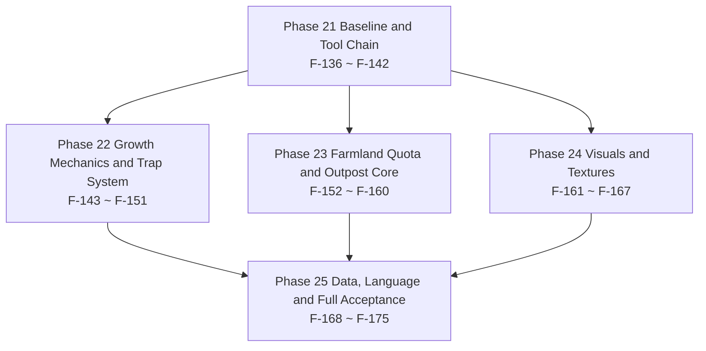

# 25 · v0.1.0 Task Breakdown & Roadmap

> Project: Farmstorm · v0.1.0
> Basis: `docs/zh/22-DECISIONS-0.1.0.md` (D-103 ~ D-123, **21 entries**, the single source of truth) + `docs/zh/23-DESIGN-0.1.0.md` (the design increment of the 9 requirements, 13 chapters + the 13 boundaries of §11) + `docs/zh/24-TECH-0.1.0.md` (the measured registration increment 90 → 93, the class design, config 12 lines, RT-24 ~ RT-30, the 18 acceptance self-checks of §11, the 8 “to be verified” APIs of §1)
> This file breaks document 24's spec into **40** tasks that can each be committed and verified independently, numbered **F-136 ~ F-175**, continuing from F-135 of `19-TASKS-0.0.3.md`. Phase 21 ~ Phase 25 map one-to-one onto milestones M17 ~ M21.
> Coverage: the **19 change surfaces** of document 22 §4.2 (table A 5 + table B 14), the **3 new registered objects**, the **12 config lines** (11 new + 1 default changed), the **11 PNGs** (5 new + 6 replaced in place) and the **7 JSONs** (5 new + 2 replaced in place), the **seven entries of RT-24 ~ RT-30**, and the **8 to-be-verified APIs** of document 24 §1 (①~⑧); 0 uncovered (item-by-item mapping in §9).
> This file only reads upstream: it does not modify `docs/zh/00` ~ `24`, does not modify `docs/en`, and does not touch `src/` (document 22 §6 clause 15).

---

## 0. Reading Conventions

### 0.1 Task Granularity

A task = one change that can be committed and verified independently. The criteria follow the three of `13-TASKS-0.0.2.md §0.1` / `19-TASKS-0.0.3.md §0.1`, and v0.1.0 adds two (supplemented by this file):

1. After the commit, `.tools\gw.cmd build` exits with code 0, and the task does not depend on a task of the same batch that is not yet committed.
2. The task carries at least one acceptance assertion observable at a location listed in §0.3.
3. Reverting that commit does not invalidate other completed tasks (a revert only affects later tasks that depend on it).
4. No Phase boundary is crossed: all deliverables of a task fall inside the name scope of the Phase it belongs to; a cross-Phase prerequisite is written only in the “Depends on” column.
5. Touch only the overview table of document 24 §3.0, the 19 entries of §3.7, the 12 config lines of §8.1 and the files named item by item in §9; any change outside that table first amends document 22 and only then gets broken into tasks.

One boundary specific to this version (supplemented by this file): **after F-140 → F-141 → F-142 are committed, the tool is red in the intermediate state**. This is not a defect, it is the causality written out in G2 of document 24 §1.4 — adding only the ID list without changing the count goes red (A-21). The three tasks run serially in this order, and the red intermediate state in between is written into acceptance as an “expected intermediate state” and is not absorbed into the same commit by the following task. There is a companion scheduling convention (A-21): F-139 (pushing config to 166) can run in parallel with this chain, but **not before F-141** — landing it first pushes the config section from green to red, and although the red is closed by F-142, the causality of the intermediate state would be misread; the recommended order is F-138 → F-140 → F-141 → F-139 → F-142.

### 0.2 Complexity and Workload Conversion

The conversion basis is exactly that of `13-TASKS-0.0.2.md §0.2` and is not adjusted midway:

| Complexity | Meaning | Converted person-days |
|---|---|---|
| S | Single file or pure data; ≤ 1 class, or ≤ 20 JSON files | 0.5 |
| M | 2 ~ 4 files, across 1 ~ 2 packages, or 1 new complete behavior implementation | 1.5 |
| L | ≥ 5 files or across 3 packages, including a runtime state machine / serialization / transaction / render pipeline | 3.0 |

Distributed under this rule, the 40 tasks of v0.1.0 are **S 9 / M 23 / L 8**, converting to `9 × 0.5 + 23 × 1.5 + 8 × 3.0 = 4.5 + 34.5 + 24.0 = 63.0` person-days (buffer excluded).

Rows 9 / 13 / 14 / 18 of document 22 §4.2 table B are **new or structural changes** (new classes, the command tree, event subscriptions) and are not estimated as “changing one line”: F-143 (table B row 9) and F-152 / F-153 / F-156 / F-157 (the new classes carried along by table B rows 13, 14, 18) all count as L at 3.0 person-days, and F-160's command tree counts as M at 1.5 person-days rather than 0.5 for “adding one subscription”.

### 0.3 How Acceptance Criteria Are Written

Every acceptance item must be observable at one of the following locations: the assertion output of `logs/latest.log`; the return value of `/execute` `/data get` `/setblock` `/loot` `/clear` `/effect` in game; an F3 / F3+B overlay reading; the content of `config/farmstorm-server.toml` or `src/generated/resources`; an artifact under `build/libs` and `dist` (including the entry list of `jar tf`). Unobservable phrasing such as “behaves normally” or “feels good” is forbidden.

The four writing conventions of this file (carried over from document 19 §0.3, none newly invented):

1. An assertion must contain a concrete number, key name or file path (e.g. “`已核 registry 对象: 93 / 93`” rather than “the count is right”).
2. A manual-test assertion must state the control scenarios (e.g. “cast once each with `compressed.replaceOnlyAirAndFluid` on / off”).
3. When referencing an upstream self-check item, cite its number (e.g. `24-TECH-0.1.0.md §11 #3`) instead of restating the criterion.
4. A few assertions use structural evidence (a `grep` match count of 0, an empty `git diff`, the entry list of `jar tf`, a byte-for-byte comparison of a PNG) — they point at definite file content, are as valid as the five locations above, and are used only where those five cannot decide.

### 0.4 Document Adjudication Record

The 10 items below are this round's convention disagreements together with this file's rulings, numbered on from A-18 of `19-TASKS-0.0.3.md §0.4`. **A-19 ~ A-23 are the five the task book names by hand**; A-24 ~ A-28 are the five disagreements this file reconciled among the three upstream documents 22 / 23 / 24 (item by item in §12.3). Later tasks all follow the “Ruling” column.

| ID | Conflict point | Documents involved | Ruling | Implementing tasks |
|---|---|---|---|---|
| A-19 | Whether the farmland rule is a gamerule | `22-DECISIONS-0.1.0.md` §0 (the naming of the farmland rule), §2.6 D-116; `23-DESIGN-0.1.0.md` §8.1; `24-TECH-0.1.0.md` §7.4 | **Not a gamerule**: there are only two carriers — the `/farmstorm farmlandlimit <n>` subcommand + the server config `farmland.limitPerPlayer` (default **0**); 1.21.1 cannot register a `GameRule` inside the no-Mixin red line (`GameRules.register` is `private static`). No deliverable writes “gamerule” and none registers any `GameRule`; the command value acts only on the current process and returns to the config default on restart | F-160 (the command tree), F-156 (the consumption side of the quota), F-171 (#10's return to the default on restart), F-175 (the red-line recheck) |
| A-20 | Which texture set the Outpost Core uses | `22` §2.7 D-123, §3.3; `24` §9.1 #1–#3; `23` §8.3 | **The three 32 × 32 of `outpost_core_all_textures\32x32\a_runic`** (`_top` 2,745 B / `_side` 2,534 B / `_bottom` 2,513 B), taken into the repository as-is; the `512x512` version is **not used**, and the three sets `b_industrial` / `c_obsidian` / `d_royal` do not enter this version; `outpost_core.png` does **not** appear under `textures/item/` (the item model has the block model as its parent) | F-166 (three PNGs + three JSONs), F-167 (the three-face look re-run) |
| A-21 | Whether `tools/verify_project.py` is currently red or green | `22` §4.2 row 5; `24` §1.4's G1 / G2 / G3 | **Green**: measured `FAIL 0` / `退出码 0`, and it is a **silent blind spot** rather than a red light — touch neither side and it stays all-green while new objects go unchecked; **only adding the list without changing the counts goes red**. The three-step action is fixed as “① add the 3 IDs to the lists → ② change the 3 counts and the denominator (93 / 32 / 26 / 7) → ③ add a fourth config source (expected 166)”, carried out serially by the three tasks F-140 / F-141 / F-142 in exactly that order; F-139 (config landing) is not on the chain but is scheduled after F-141, so that the “config section 155 green” of F-140 / F-141 becomes an unconditional assertion; the counts only ever walk to the set **93 / 166 / 315**. The sentence in document 24 §1.4 that “document 22 wrote the tool up as red” is void per document 22's current text (22 now reads “measured FAIL 0 / exit code 0 (not broken)”) | F-140, F-141, F-142, F-170 (#1's re-run) |
| A-22 | Whether Zangief Cane's phase 1 is levitation or servo lift | `22` §7.2's D-71 row, §8 #91; `24` §5.3's terminology convention; `23` §7.5 | **Servo lift to a fixed height, not levitation**: gravity off + every tick “remaining height ÷ remaining ticks”, `riseHeightBlocks` 16 (measured about 15 blocks) / `riseTicks` 15 / per-tick ceiling `MAX_RISE_SPEED = 4.0`; phase 2 turns yaw **+72°** per tick and lands for a flat 7.5 points; `amplifier` is only the phase number (`PHASE_REVERSED` 0 / `PHASE_LEVITATING` 1 / `PHASE_FALLING` 2, the constant names being a historical misnomer), and `MobEffects.LEVITATION` is only ever removed. Documents and acceptance always write “phase 1 servo lift to a fixed height”, never “levitation”, “floating” or “applying LEVITATION”; the mob branch **does not enter the phase chain** and only settles 7.5 + knockback | F-148 (mob branch against the player branch), F-175 (wording recheck) |
| A-23 | How the Compressed Wheat item model and block model change | `22` §2.2 D-107; `24` §9.2 #6 / #7; `23` §4.6 | **The item model turns 3D and the block distinguishes six faces**: `models/item/compressed_puffed_wheat.json` drops `item/generated` + `layer0` and its parent becomes `farmstorm:block/compressed_hay_block`; `models/block/compressed_hay_block.json` goes from `cube_all` to `cube_bottom_top`, with the three `textures` keys `top` / `side` / `bottom` each taking one 16 × 16 (the side 9 bands of yellow-brown, the top 5 bands, the bottom 5 bands darkened + a cross binding); the block properties and id do not move by a single character | F-164 (the three images and the generator), F-165 (the two models), F-167 (the six-face look re-run) |
| A-24 | The boundary particle's particle type, colour and packets per round | `23` §8.7 (`minecraft:dust`, colour **(0.30, 0.85, 0.90)**, scale 1.0, 1 packet / 48 particles per round, two attenuation tiers); `24` §6.6 (`ParticleTypes.END_ROD`, **4 packets / ring** sent per edge, three attenuation tiers, and the claim that “this version produces no RGB constant and does not conflict with document 23's colour table”) | **Take document 23 §8.7**: clause 2 of D-121 in document 22 only asks for “vanilla particle packets”, the look and the packet volume being aligned by document 23 (the supplementary item of document 22 §2.6 D-121 states that “the measured packet volume and look are reconciled against document 23's timing table”); document 24 §6.6's “produces no RGB constant” contradicts the fact that document 23 does give an RGB, and 4 packets / ring is 4 times the packet volume of 1 packet / ring, i.e. the opposite of RT-30's direction. Landing takes dust cyan-blue, 48 points per ring, 1 packet per round, two attenuation tiers (full points inside the range / one send every 4 rounds in the 16-block margin band) | F-155 (implementation), F-171 (#14 / #15 observations), F-172 (§11.2's unload section) |
| A-25 | The trap dust's colour, offset and position | `23` §7.4 (`minecraft:dust`, colour **(0.62, 0.56, 0.44)** neutral earth, position `(x+0.5, y+0.15, z+0.5)`, spread `0.25 / 0.10 / 0.25`, 32-block broadcast, first at tick 100); `24` §5.2 (`DustParticleOptions(1.0F, 0.15F, 0.15F)` red, offset `(0.2, 0.1, 0.2)`, `Vec3.atCenterOf`) | **Take document 23 §7.4**: the supplementary item of D-113 in document 22 states outright that “the particle's colour, scale and spread radius take their values from the existing particle constant table, **and are aligned by `23-DESIGN-0.1.0.md`**” — the authorisation chain points at document 23, document 24's switch to Wild Hunter's red smoke `(1, 0.15, 0.15)` steps over that authorisation, and document 23 has already given the reason that “taking red would confuse it with Wild Hunter's red smoke”. Landing takes the neutral earth colour, offset `0.25 / 0.10 / 0.25`, position y + 0.15 | F-147 (implementation), F-170 (#7's observation) |
| A-26 | The carrier and the lower bound of the growth segment length | `22` §2.4 D-110 clause 3 (draw a random total tick count T first, `d1 = d2 = floor(T/3)`, `d3 = T − 2×d1`); `23` §6.3 (draw an integer T uniformly from the closed interval **[400, 900]**, independently per plant); `24` §4.2 (T is a multiple of 3, `d = 134 + floorMod(pos.hashCode(), 167)`, T = 3d ∈ **[402, 900]**) | **Take the carrier and endpoints of document 24 §4.2**: D-111 rules out block entities, and “draw T once and carry the remainder into the third segment” is not implementable on a stateless carrier (the remainder is only known if it is placed in the first segment), so T is always a multiple of 3 and the coordinate hash decides the per-segment length — the formula of D-110 clause 3, `d3 = T − 2×d1`, still holds exactly (remainder r = 0), and the total 402 – 900 ticks = 20.1 – 45.0 seconds still falls inside [20, 45] seconds. “Draw T uniformly per plant” and the 400 lower bound of document 23 §6.3 are void, and acceptance always follows **402 – 900 ticks** | F-143 (implementation), F-144 (measurement), F-170 (#3 / #4 / #5) |
| A-27 | Whether the JSON additions are 4 or 5 | `22` §3.3 (**5**, including `loot_table/blocks/outpost_core.json`); `23` §1.3 and §10.3 (**4**); `24` §9.2 (**5**, but putting the “4” on document 22's account) | **Take 5**: document 22 §3.3 lists the loot table item by item, so 5 is the correct value; the omission is in document 23 §1.3 / §10.3 (only 3 models + the recipe were counted), and the last paragraph of document 24 §9.2 attributing the omission to document 22 is a **misattribution**. Landing is 5 additions (blockstate / block model / item model / recipe / loot table) + 2 replacements | F-166 (the first 3), F-168 (the last 2), F-174 (the jar entry check) |
| A-28 | Whether the Wild Apple's current texture is 11 colours or 12 | `22` §2.1 D-105's basis and §8 #32 (**12 colours** / 126 transparent); `23` §9.4 (colour by colour, **11 colours**); `BRIEF` §1.11 (“**11 colours**, the often-misremembered ‘12 colours’ being 11 colours + the transparent entry”) | **Take 11 colours**: the finished product quantises back to 11 colours (the palette and pixel counts per the five groups of document 23 §9.4); those two cells of document 22 repeat a misremembering the construction fact card had already explicitly corrected; this item changes only the reading of the “colour count” cell and none of D-105's conclusions (the finished product 16 × 16, the model and the registration surface do not move) | F-163 (the finished product), F-167 (the edge re-run) |

#### 0.4.1 Relationship With A-10 ~ A-18 of Document 19

The 9 rulings of document 19 belong to the 0.0.3 conventions (the Fang Trap Cactus rename, Vibration Bean's `DeployedKind`, Q-Bounce's mount, the Point Defense Fungus and Vibration Bean sounds, `verify_project.py` not being downgradable, the three pose parameters, PNG 8 files, three advancement IDs, and the two sub-tables not being added together). v0.1.0 carries over only one of them: **A-14's “the tool may not be downgraded to a handwritten signature”** — #1 of this version's F-170 still requires the tool itself to output `93 / 93`, `166`, `315` and `FAIL 0`, with no manual cross-check standing in for it. The other eight are unrelated to v0.1.0 and are not re-adjudicated.

### 0.5 Quick Reference of Number Conventions

The numbers appearing in this file are only the 14 groups below; the source section number of each group is listed in §12.1, and the table does not repeat the provenance.

| Number | Meaning | Convention in this version |
|---|---|---|
| **90 / 93** | Registered objects (0.0.4 baseline / v0.1.0 target) | Write only this pair; `blocks` +1, `block_entities` +1, `items` +1, the other 9 classes +0 |
| **155 / 166** | config keys | 155 + 11 (row 10 changes the default of an existing key; no key is added) |
| **299 / 315** | Language keys (one copy each in Chinese and English) | 299 + 16 = 1 + 1 + 11 + 1 + 2 |
| **19 = 5 + 14** | The change surfaces of document 22 §4.2 | Table A's 5 rows of numbers and assertions + table B's 14 other code-surface rows |
| **12 = 11 + 1** | Rows of the config change table | 11 new + 1 default changed |
| **5 / 6** | PNG new / replaced in place | outpost_core 3 + Compressed Wheat top and bottom 2 / chives 4 + Wild Apple 1 + Compressed Wheat side 1 |
| **5 / 2** | JSON new / replaced in place | Core 3 + recipe 1 + loot table 1 / Compressed Wheat block model + Compressed Wheat item model |
| **7** | Number of RT-24 ~ RT-30 risks | Each one has at least one task responsible for verifying it |
| **18** | Number of acceptance self-checks in document 24 §11 | #1 – #18 |
| **8** | The “to be verified” APIs of document 24 §1 (①~⑧) | Each one names the task that confirms it during implementation |
| **13** | Number of boundaries in document 23 §11 | 11.1 – 11.13 |
| **21** | Number of decisions | D-103 ~ D-123, contiguous with no gap |
| **40** | Number of tasks in this file | F-136 ~ F-175, contiguous with no gap |
| **63.0 / 78.75** | Raw person-days / after a 25% buffer | `63.0 × 1.25 = 78.75`; critical path **22.0** person-days / 11 tasks |

---

## 1. Task Dependency Graph

### 1.1 Phase-Level Dependencies



Phase 22 / 23 / 24 do not depend on one another; they share only Phase 21's registry layer (F-138), config layer (F-139) and tool chain (F-140 ~ F-142), and can be handed to three different people. The three lines converge in Phase 25: the data surface (F-168) has to wait for the core block and its model, the language keys (F-169) for the command and the wording, and acceptance (F-170 / F-171) for all three lines to close.

### 1.2 Trunk Chains (Text Tree)

```text
F-136 Baseline three-ledger reconciliation 0.5 ── F-137 Version and build 0.5
├─ F-138 Registry surface +3 and two skeleton classes 3.0
│   ├─ F-140 Tool ① add the 3 IDs 0.5 ── F-141 Tool ② change the counts 0.5 ── F-142 Tool ③ fourth source 0.5
│   └─ F-152 Core block: ownership and cap 3.0
│       └─ F-153 Core index 3.0
│           ├─ F-154 Block entity: three fields and range query 1.5
│           │   ├─ F-155 Boundary particles 1.5
│           │   ├─ F-157 Till interception (range → quota) 3.0 ── F-158 Trample protection 1.5
│           │   └─ F-159 Core removal to dirt 1.5
│           └─ F-156 Farmland ledger and capacity 1.5 ── F-160 Command tree 1.5
├─ F-139 config 12 lines 1.5
│   ├─ F-143 Growth plan tick chain 3.0 ── F-144 Growth measurement 1.5
│   ├─ F-145 Trap signature widening 3.0
│   │   ├─ F-146 5-second family immunity 1.5
│   │   ├─ F-147 dust particles 0.5
│   │   ├─ F-148 Mobs can trigger 1.5
│   │   └─ F-149 Trap FIFO and index persistence 3.0
│   ├─ F-150 Puffed Wheat whitelist 1.5
│   └─ F-151 The two melons and the landing-point tightening 1.5
├─ Four texture lines (waiting only on F-137): F-161 charge bar 0.5, F-162 the four chives sheets 1.5, F-163 Wild Apple 0.5, F-166 core resources 1.5
│   └─ F-162 ── F-164 Compressed Wheat three sheets 1.5 ── F-165 Compressed Wheat models 1.5
│       └─ F-167 Texture three-place re-run 1.5 (F-161 + F-162 + F-164 + F-165 + F-166)
└─ Convergence layer: F-168 Data surface 1.5 (F-152 + F-166) ── F-169 Language keys 1.5 (F-168 + F-160)
    ├─ F-170 §11 #1–#9 1.5 (F-142 + F-143 + F-144 + F-146 ~ F-149)
    ├─ F-171 §11 #10–#18 1.5 (F-155 ~ F-160)
    │   ├─ F-172 Boundaries 11.1–11.6 1.5 (F-170 + F-171)
    │   └─ F-173 Boundaries 11.7–11.13 1.5 (F-170 + F-171)
    ├─ F-174 Build and dist 0.5 (F-169 + F-170 + F-171)
    └─ F-175 Full acceptance summary 3.0 (F-167 + F-172 + F-173 + F-174)
```

Only the chains that decide the total duration are drawn. **Each task appears exactly once in the tree, and a node's parent on the tree is always one of the tasks listed in that task's “Depends on” field**; prerequisites not drawn in full in the tree follow the “Depends on” field of each task block.

---

## 2. Overview

| Phase | Name | Tasks | Task IDs | Person-days | Milestone |
|---|---|---|---|---|---|
| Phase 21 | Baseline and Tool Chain | 7 | F-136 ~ F-142 | 7.0 | M17 |
| Phase 22 | Growth Mechanics and Trap System | 9 | F-143 ~ F-151 | 17.0 | M18 |
| Phase 23 | Farmland Quota and Outpost Core | 9 | F-152 ~ F-160 | 18.0 | M19 |
| Phase 24 | Visuals and Textures | 7 | F-161 ~ F-167 | 8.5 | M20 |
| Phase 25 | Data, Language and Full Acceptance | 8 | F-168 ~ F-175 | 12.5 | M21 |
| **Total** | | **40** | **F-136 ~ F-175** | **63.0** | **M17 ~ M21** |

- **Raw person-day total: 63.0 person-days** (= the sum of the row subtotals = the sum of the per-task converted person-days; see the reconciliation below).
- **Total after a 25% buffer: 78.75 person-days** (`63.0 × 1.25 = 78.75`).
- Critical path length: **22.0 person-days / 11 tasks** (derivation in §11.1).

Complexity distribution and reconciliation:

| Complexity | Tasks | Person-days each | Subtotal | Task IDs |
|---|---|---|---|---|
| S | 9 | 0.5 | 4.5 | F-136, F-137, F-140, F-141, F-142, F-147, F-161, F-163, F-174 |
| M | 23 | 1.5 | 34.5 | F-139, F-144, F-146, F-148, F-150, F-151, F-154, F-155, F-156, F-158, F-159, F-160, F-162, F-164, F-165, F-166, F-167, F-168, F-169, F-170, F-171, F-172, F-173 |
| L | 8 | 3.0 | 24.0 | F-138, F-143, F-145, F-149, F-152, F-153, F-157, F-175 |
| **Total** | **40** | — | **63.0** | Full coverage of 1 – 40 |

Reconciliation equation: `9 × 0.5 + 23 × 1.5 + 8 × 3.0 = 4.5 + 34.5 + 24.0 = 63.0`, digit-for-digit equal to the total of the table above; `63.0 × 1.25 = 78.75`; the five Phase subtotals added row by row `7.0 + 17.0 + 18.0 + 8.5 + 12.5 = 63.0`. The three calculations check one another.

---

## 3. Phase 21 · Baseline and Tool Chain (F-136 ~ F-142)

Phase goal: first nail “getting the numbers” onto the measured values of 0.0.4 (registration 90 / config 155 / language keys 299), then stand up all at once v0.1.0's **3 new registered objects** and **12 config lines**, and finally push `tools/verify_project.py` to **93 / 166 / 315** in the fixed order of document 24 §1.4. The four later phases only fill in behaviour.

Phase exit criteria: `python -X utf8 tools/verify_project.py` outputs `已核 registry 对象: 93 / 93`, a config section of 166, `lang 键集一致，共 310 键` (299 + F-139's 11, the remaining 5 in F-169), `结论：FAIL 0 项` and exit code 0; the registration self-check line of the startup log reads 93 with per-class 32 / 26 / 7 / 13 / 4 / 3 / 1 / 1 / 1 / 3 / 1 / 1; `config/farmstorm-server.toml` has 166 leaf nodes; `.tools\gw.cmd build` exits with code 0 and the artifact is `farmstorm-0.1.0+mc1.21.1.jar`.

#### F-136 · Reconciliation and Data Extraction of the 0.0.4 Baseline's Three Ledgers

- **Complexity**: S | **Converted person-days**: 0.5
- **Depends on**: —
- **Deliverables**: one read-only recomputation and reconciliation (no source change): the four startup self-check lines of `logs/latest.log`, the four-section output of `python -X utf8 tools/verify_project.py` and the 12-row per-class measurement table of document 24 §1.2, reconciled item by item; the factory-method call-count table of document 24 §1.1 walked through row by row (`crop` 15, `deployed` 8, `registerBlock` 2, `cropItem` 22, `seedItem` 7, `registerItem` 2, `projectile` 12, direct call 1, `BlockEntityType` 6, `damageTypes` 3); the conclusion written into the commit message.
- **Acceptance**:
  1. The four startup log lines are character-for-character equal to the 0.0.4 version of `24-TECH-0.1.0.md §11 #2`: **90** registered and per class 31 / 25 / 6 / 13 / 4 / 3 / 1 / 1 / 1 / 3 / 1 / 1, crops **22** species (Throwable 12 / Deployable 7 / Edible 3), lucky berry pool **19**, Demolition **4**.
  2. `python -X utf8 tools/verify_project.py` outputs `已核 registry 对象: 90 / 90`, the config section `155 个配置键与文档逐字一致`, `lang 键集一致，共 299 键`, `结论：FAIL 0 项`, exit code 0 (the measured output of document 24 §1.4; A-21).
  3. The 12 class subtotals of document 24 §1.2 add up to 90 and are item-for-item equal to the hard-coded subtotals of the tool's §2 section (evidence chain 3 of document 24 §1.1).
  4. `git status` is clean and `git diff --stat` is empty for `src/` / `docs/` / `tools/` — the task shape of this item is “get the numbers first, change no code”.

#### F-137 · Version Number 0.1.0 and the Build Baseline

- **Complexity**: S | **Converted person-days**: 0.5
- **Depends on**: F-136
- **Deliverables**: `gradle.properties`'s `mod_version` changes from `0.0.4` to `0.1.0`; zero changes to `build.gradle` (MC 1.21.1 / NeoForge 21.1.213 / Java 21 unchanged, document 22 §1.1).
- **Acceptance**:
  1. `.tools\gw.cmd build` exits with code 0 and the artifact is `build/libs/farmstorm-0.1.0+mc1.21.1.jar`.
  2. `jar tf` shows `META-INF/neoforge.mods.toml`, whose `version` is 0.1.0.
  3. The `git diff` of the remaining lines of `build.gradle` and `gradle.properties` is empty.

#### F-138 · Registry Surface +3 and the Skeletons of Two Classes

- **Complexity**: L | **Converted person-days**: 3.0
- **Depends on**: F-137
- **Deliverables**:
  - `registry/FarmstormBlocks.java`: +1 line `registerBlock("outpost_core", OutpostCoreBlock::new, properties)`, with the properties `mapColor(MapColor.STONE).strength(30.0F, 1200.0F).requiresCorrectToolForDrops().sound(SoundType.STONE).pushReaction(PushReaction.BLOCK)` (document 22 §4.2 table B row 11, document 24 §3.1).
  - `registry/FarmstormBlockEntities.java`: +1 `BlockEntityType` for `outpost_core` (a single-block instance, the same shape as `converter`; document 22 §4.2 table B row 12, the three reasons of document 24 §2.2 note 1).
  - `registry/FarmstormItems.java`: +1 `BlockItem` (document 24 §2.2 row 3).
  - The compile-time skeletons of `block/OutpostCoreBlock.java` and `blockentity/OutpostCoreBlockEntity.java`: the constructor, `newBlockEntity` returning the skeleton BE, `getTicker` returning null; the behaviour is filled in in Phase 23.
  - `Farmstorm.java`: `logRegistrySelfCheck`'s `total == 90` → **93**, `items == 31` → **32**, `blocks == 25` → **26**, `blockEntities == 6` → **7** (`:138-141`; the first four items of document 24 §3.7 row 4).
- **Acceptance**:
  1. The startup log prints verbatim `自检 注册对象 93 个：items 32 / blocks 26 / block_entities 7 / entity_types 13 / mob_effects 4 / sound_events 3 / recipe_types 1 / recipe_serializers 1 / creative_tabs 1 / damage_types 3 / data_components 1 / menu_types 1 → OK` (document 24 §11 #2).
  2. `/setblock ~ ~ ~ farmstorm:outpost_core` succeeds and `/give @s farmstorm:outpost_core` yields the item; F3 shows the block entity as `farmstorm:outpost_core`.
  3. The `block_entities` increment really is +1: `git diff registry/FarmstormBlockEntities.java` contains added lines only, and not one line of the six existing types is changed.
  4. The `switch` of `deployedOf(DeployedKind)` is unchanged by a single character and the enum still has 8 values (document 24 §2.2 note 3); `CropProfile.ALL` is still 22 entries and `DeployedKind` still 8 values (the two notes of document 22 §3.1, §3.2).
  5. `.tools\gw.cmd build` exits with code 0.

#### F-139 · The 12 config Lines and the 11 `configuration` Language Keys

- **Complexity**: M | **Converted person-days**: 1.5
- **Depends on**: F-137
- **Deliverables**: `config/FarmstormConfig.java` — 5 new groups with 10 lines in all (`growth` 2 / `trap` 3 / `farmland` 1 / `outpost_core` 3 / `compressed` 1) + 1 new line for `melon_grenade.submunitionSpeed` + `melon_grenade.horizontalJitter` changing its default from 0.3 to **0.05**, giving **12 lines = 11 new + 1 default changed** (the 12 rows of document 22 §5.2 and document 24 §8.1, types and defaults copied row by row); the 11 `farmstorm.configuration.*` entries of `datagen/ModLangProvider`; the generated `config/farmstorm-server.toml` (the 5 group fragments of document 24 §8.2, the key order inside a group following §8.1's row order, appended after `vibration_bean`).
- **Acceptance**:
  1. `config/farmstorm-server.toml` has **166** leaf nodes (155 + 11) — **12 rows is not the same as 12 new keys** (the note under document 24 §8.1's table).
  2. The 12 rows read back row by row: 20 / 45 / 100 / 100 / 16 / 0 / 16 / 2 / 40 / **0.05** / **0.1** / `true`; row 10's `min` 0.0 / `max` 8.0 and its translation key are kept character for character (conclusion 2 of the check under document 24 §8.1's table).
  3. The `farmstorm.configuration.*` language keys go 155 → **166**, and the Chinese and English key sets are character-for-character equal; at this point the two language files hold 299 + 11 = **310** keys in total, the remaining 5 being closed by F-169.
  4. Top-level groups 30 → **35** (the three-column equality of document 24 §8.3).
  5. No key at all is added for the 3 × 3 range, the 48 × 48 boundary, the boundary granularity or Zangief Cane's mob settlement: the `outpost_core` group has only 3 keys and the `git diff` of the `zangief_cane` group is empty (document 22 §6 clause 9, document 24 §8.4).

#### F-140 · `verify_project.py` Part 1: `outpost_core` in the Three ID Lists

- **Complexity**: S | **Converted person-days**: 0.5
- **Depends on**: F-138
- **Deliverables**: each of the three `EXPECTED` lists of `tools/verify_project.py:120-146` (`items` / `blocks` / `block_entity_type`) gains `"outpost_core"` (G1 of document 24 §1.4). **The tool turning red after this commit is an expected intermediate state**: the §2 section reports “清单 26 个 ID，但 §2.1 的 v0.0.3 列是 25 个” (G2 of document 24 §1.4, A-21).
- **Acceptance**:
  1. Each of the three lists holds one more literal: `grep -c '"outpost_core"' tools/verify_project.py` is 3.
  2. The §2 section of `python -X utf8 tools/verify_project.py` is red in **exactly one type** of place: the three lines `items` 32 / `blocks` 26 / `block_entity_type` 7 share one shape; the §3 lang section is still 310 green. The §1 config section has two readings and one and the same criterion: **this task has not touched the config expectation set** (`git diff tools/verify_project.py` contains only §2's ID lists) — while F-139 has not landed, the config section reads `155 个配置键与文档逐字一致` (green); once F-139 has landed in parallel it is 166 hitting `real_extra` (red, closed by F-142, and not a failure of this task, A-21).
  3. No 93 appears in the tool: `grep -c "93" tools/verify_project.py` is 0 (93 is introduced only in F-141; the order may not be reversed — document 24 §1.4 and the primary mitigation of RT-27).
  4. The frozen zone has not been written back into: `git diff --stat docs/` is empty (the last sentence of G3 in document 24 §1.4).

#### F-141 · `verify_project.py` Part 2: `EXPECTED_COUNTS` and the Denominator 90 → 93

- **Complexity**: S | **Converted person-days**: 0.5
- **Depends on**: F-140
- **Deliverables**: the 12 class subtotals of `tools/verify_project.py:150-163` — `items` 31 → **32**, `blocks` 25 → **26**, `block_entity_type` 6 → **7**; the footnote `90` under the table becomes **93**; the denominator printed by §2 synced accordingly (the fix list of G2 in document 24 §1.4).
- **Acceptance**:
  1. The tool outputs `已核 registry 对象: 93 / 93`, the 12 classes equal document 24 §2.1's v0.1.0 column class by class (32 / 26 / 7 / 13 / 4 / 3 / 1 / 1 / 1 / 3 / 1 / 1), `结论：FAIL 0 项`, exit code 0.
  2. Neither the config section nor the lang section changes because of this task (it touches only §2's counts and denominator): the lang section prints 310; the config section is 155 green while F-139 has not landed, and 166 reporting `real_extra` (red, closed by F-142) once it has — neither reading constitutes a failure of this task (criterion as in F-140, A-21).
  3. The denominator 90 no longer appears in the tool: the hits of `grep -n "90" tools/verify_project.py` include neither the registration denominator nor its footnote.
  4. The registry line is no longer red: the three lines counted by `grep -c "清单 .* 个 ID" tools/verify_project.py` all print green.

#### F-142 · `verify_project.py` Part 3: the Fourth config Source and the Expectation 166

- **Complexity**: S | **Converted person-days**: 0.5
- **Depends on**: F-141, F-139
- **Deliverables**: `tools/verify_project.py:174-189` gains a fourth source — it parses the 12 rows of `docs/zh/24-TECH-0.1.0.md` §8.1, takes the 11 key names of the “new” column and unions them with the key sets of the three already frozen documents; the expected key count goes 155 → **166**. **Documents 01 / 12 / 18 may not be written back into** (those three files are in the frozen zone).
- **Acceptance**:
  1. The §1 config section outputs `166 个配置键与文档逐字一致`, with no `MISMATCH`, no `real_extra`, exit code 0 (G3 of document 24 §1.4).
  2. `git diff --stat docs/` is empty: the fourth source only reads documents and never writes them back.
  3. A parse failure reports a locatable error (file + table row number) instead of skipping silently; the tool still has only one piece of config logic and no second hard-coded key list.

Phase subtotal: **7 tasks, 7.0 person-days** (S 5 / M 1 / L 1).

---

## 4. Phase 22 · Growth Mechanics and Trap System (F-143 ~ F-151)

Phase goal: finish the two “behaviour change” items — this mod's crop growth goes from the vanilla random tick to a **plan tick chain** (D-110 / D-111, RT-24, the version's only mechanism replacement), plus the trap's four adjustments (D-112 ~ D-115) and the three changes on the projectile / explosion behaviour surface (the Puffed Wheat write whitelist, and the two melons' category and landing point).

Phase exit criteria: #3 ~ #9 of document 24 §11 all seven pass; with `randomTickSpeed` temporarily set to 1000 the maturation time is unchanged; the same player's 17th trap evicts the earliest one with no drop; a zombie can trigger the four traps and cannot get Confusion; dust 2 every 5 seconds; `compressed.replaceOnlyAirAndFluid` thrown once in each of its two states; the startup log's crop self-check reads `22 种、投掷型 12 / 部署型 7 / 食用型 3；破障类 2 → OK`; the match counts of `CustomPacketPayload` and `@Mixin` are both 0.

#### F-143 · `FarmstormCropBlock`'s Plan Tick Chain and the Three-Piece Anti-Dual-Source Set

- **Complexity**: L | **Converted person-days**: 3.0
- **Depends on**: F-139
- **Deliverables**: `block/FarmstormCropBlock.java` — `onPlace` schedules for the first time (calling the private `scheduleNext` only when `oldState.getBlock() != this` and `level instanceof ServerLevel`), `tick` advances (first line tests `state.getBlock() != this`, second line tests `age >= MAX_CUSTOM_AGE`, passes the brightness gate `getRawBrightness(pos, 0) >= 9`, `setBlock(..., UPDATE_ALL)`, schedules again after advancing), when the brightness is insufficient it schedules a 20-tick retry, `segmentTicks` per `d = 134 + floorMod(pos.hashCode(), 167)`, total duration `T = 3d ∈ [402, 900]` ticks, `isRandomlyTicking` returns `false`, **does not override** `randomTick`, **does not override** `performBonemeal`; `registry/FarmstormBlocks.java:88` deletes `.randomTicks()` (document 22 §4.2 table B rows 9, 10; document 24 §4.2 / §4.3 / §4.4; A-26 of §0.4).
- **Acceptance**:
  1. All three pieces hold at once (document 24 §4.4): the `git diff` of `.randomTicks()` contains deletion lines only; `grep -c "randomTick" block/FarmstormCropBlock.java` is 0; `isRandomlyTicking` contains one `return false` line.
  2. Planting 4 crops at different coordinates in a field with light 15, every maturation time falls in **402 – 900 ticks** (20.1 – 45.0 seconds) and the four values are not all equal (document 24 §11 #3).
  3. The same plant's advance log shows exactly **3** entries (not 6, not 30); `age` never exceeds 3 (document 24 §4.5, the last sentence of §11 #4).
  4. The minimal cases of pending verification ① and ② pass: the 1.21.1 signatures of `scheduleTick` / `tick` / `onPlace` / `isRandomlyTicking` compile, and repeated scheduling for the same `(pos, this)` is an **overwrite** rather than a coexistence — the same plant does not advance twice within 1 second (document 24 §0.5's ① ②, RT-24 fallback ①).
  5. Not one vanilla criterion changes: the brightness threshold, bone meal, `AGE_3`'s four stages and the four `VoxelShape`s have an empty `git diff` (document 24 §4.5).

#### F-144 · The Four Measurements of Growth Duration and the RT-24 Fallback

- **Complexity**: M | **Converted person-days**: 1.5
- **Depends on**: F-143
- **Deliverables**: one measurement and evidence-gathering session (no source change apart from a fallback patch): the three control groups #3 / #4 / #5 of document 24 §11, the evidence for the re-scheduling after bone meal, the save → stop server → start server → resume advancing comparison (pending verification ③), and the conclusion plus the fallback choices (RT-24 fallbacks ①②③, each given “enabled / not enabled”) written into the commit message.
- **Acceptance**:
  1. With `randomTickSpeed` temporarily set to 1000, the per-plant times are equal to #3 (difference ≤ 20 ticks) and the same plant still advances 3 times (document 24 §11 #4).
  2. Walking 200 blocks away immediately after planting (forcing a chunk unload) and coming back: the total duration still falls in 402 – 900 ticks, and there is no “everything ripens instantly” at the moment of return (document 24 §11 #5).
  3. Save → stop server → start server: crops keep advancing through the remaining segments; if the measurement does not hold, enable the `ChunkEvent.Load` re-scheduling patch authorised by D-111 and state in the commit message that “the carrier detail is changed, D-111's convention is not” (the supplementary item of document 22 §2.4 D-111, step 6 of document 24 §4.3).
  4. After bone meal advances one level there is only one extra plan tick (not two), and the next segment is re-scheduled per the new `age` (document 23 §11.8, step 4 of document 24 §4.3).

#### F-145 · Widening `TrapBehavior`'s Signature to `LivingEntity` and Closing the Four Implementations

- **Complexity**: L | **Converted person-days**: 3.0
- **Depends on**: F-137
- **Deliverables**: `behavior/TrapBehavior.java:5`'s import and `:18-24`'s two method signatures go from `Optional<Player>` / `trigger(be, Player)` to `Optional<LivingEntity>` / `trigger(be, LivingEntity)` (the before / after code of document 24 §3.5); the four implementations' signatures follow (`BlastCarrotTrap:38`, `:58`; `FangTrapCactusTrap:33`, `:53`; `ZangiefCaneTrap:48`, `:61`, `:108`; `VibrationBeanTrap:43`, `:66`, `:88`); `VibrationBeanTrap:88`'s `target.getGameProfile().getName()` becomes `target.getName().getString()` (`LivingEntity` has no `getGameProfile`, which is this task's only compile-time hard blocker; the first half of document 22 §4.2 table B row 17, row 5 of document 24 §3.5).
- **Acceptance**:
  1. `.tools\gw.cmd build` exits with code 0 and the compile log has no `incompatible types`; the return type of all four `findTrigger`s is `Optional<LivingEntity>` (`grep -rn "Optional<LivingEntity> findTrigger" src/main/java` hits 4).
  2. `grep -c "getGameProfile" behavior/impl/VibrationBeanTrap.java` is 0.
  3. Zero behaviour change: the four traps' trigger radii are still **1 / 2.5 / 1.5 / 4.0** (the metrics being Chebyshev / Euclidean / spherical / strictly less than, document 22 §8 #57), and the four existing exemptions (creative / spectator / ally / mobs do not take part) are unchanged by a single character.
  4. The scan interval is still 10 ticks and the three deployment safety valves 5 / 8 / 32 still do not move (document 22 §8 #56 / #59).

#### F-146 · 5-Second Family Immunity After a Trigger and `TrapImmunity`

- **Complexity**: M | **Converted person-days**: 1.5
- **Depends on**: F-145, F-139
- **Deliverables**: `trap/TrapImmunity.java` (`Map<UUID, Long> UNTIL`, the value being the `gameTime` at which immunity expires, with a `MinecraftServer` instance guard, the same shape as `ledgerOf`); the immunity gate `passGate` in `TrapBehavior#tick`'s default implementation (anything that is not a `Player` passes straight through; for a `Player` the window is tested first and written afterwards); the call order is fixed as `findTrigger → passGate → trigger`, and when the gate holds it back the code **does not `consume`, does not apply the effect and does not write immunity** (document 22 §2.5 D-112, the immunity segment of §4.2 table B row 15; document 24 §5.1).
- **Acceptance**:
  1. The same player steps on a Blast Carrot first and on a Fang Trap Cactus within 2 seconds: the second **does not trigger** (no explosion, no sound, the cactus block still in place); a third one 6 seconds later triggers normally (document 24 §11 #6).
  2. Immunity records players only: one zombie steps on two traps in a row and both trigger as usual (clause 3 of document 22 §2.5 D-112).
  3. Timing uses `gameTime` and writes no save: `grep -c "SavedData" trap/TrapImmunity.java` is 0; immunity is cleared after a relog (clause 4 of D-112).
  4. The endpoint is the half-open interval `[t0, t0 + 100)`: triggering is possible again from tick 100 (the endpoint row and the 5-row timing example of document 23 §7.3).

#### F-147 · dust Particles Every 5 Seconds After Deployment, and Phase Alignment

- **Complexity**: S | **Converted person-days**: 0.5
- **Depends on**: F-145, F-139
- **Deliverables**: the default implementation of `TrapBehavior#emitDust(be)` (called **before** the immunity gate, because dust has nothing to do with whether anybody stepped on it); the emission condition `floorMod(now + floorMod(pos.hashCode(), dustInterval), dustInterval) == 0`; **2** particles per round; the values per **document 23 §7.4**: `minecraft:dust`, colour **(0.62, 0.56, 0.44)** neutral earth, scale 1.0, position `(x + 0.5, y + 0.15, z + 0.5)`, spread `0.25 / 0.10 / 0.25`, velocity 0, 32-block broadcast; only the 4 TRAP-class deployments emit (document 22 §2.5 D-113, the dust segment of §4.2 table B row 15; document 24 §5.2, A-25 of §0.4).
- **Acceptance**:
  1. Deploy 1 trap (nobody nearby): within 10 seconds the block centre shows exactly **2** dust bursts of **2** particles each; the first appears at tick **100** and not tick 0 (document 24 §11 #7, the first-occurrence row of document 23 §7.4).
  2. The turrets (`pumpkin_turret` / `awakened_*` / `point_defense_fungus`) and the aura blocks never emit dust (clause 4 of document 22 §2.5 D-113, the “who it is emitted for” row of document 24 §5.2).
  3. The phase does not skip: recording continuously for 60 seconds within 1 second gives 12 dust bursts (not 0, not 120) — `dustInterval` 100 is an integer multiple of `scanInterval` 10, so the staggering never skips dust (the phase row of document 24 §5.2).
  4. Vanilla particle packets are still used: `grep -rn "CustomPacketPayload" src/main/java` is 0 (document 24 §11 #18).

#### F-148 · Hostile Mobs Can Trigger: the Second Pass of the Four Traps and Zangief Cane's Mob Branch

- **Complexity**: M | **Converted person-days**: 1.5
- **Depends on**: F-145, F-146
- **Deliverables**: each of the four `findTrigger`s gains a second pass `level.getEntitiesOfClass(Monster.class, box)`, the `box` using the same radius-wrapped `AABB` as the player pass, the distance criterion reusing the same metric and the same config key (**no second number is written**), and mobs always counted as non-ally (no `isAlly` call); `ZangiefCaneTrap:61-81`'s `trigger` becomes two branches — `ServerPlayer` goes through the existing phase chain, everyone else only settles a flat **7.5** points of `FarmstormDamageTypes.zangiefSlam(...)` + `knockback(0.4, -dx, -dz)` with one knockback sound and **does not enter the phase chain**; no new `config` key (document 22 §2.5 D-114, the second half of §4.2 table B row 17; document 24 §5.3, A-22 of §0.4).
- **Acceptance**:
  1. A zombie pushes a Blast Carrot / Fang Trap Cactus / Vibration Bean once each: all three trigger (explosion / fangs / explosion sound + `consume`); the zombie only gets the generic effects, and `/data get entity @e[type=zombie,limit=1] active_effects` contains **no** `farmstorm:confusion` (document 24 §11 #8).
  2. A zombie pushes a Zangief Cane: it loses **7.5** points and is knocked back, and it has **no** `farmstorm:zangief_piledriver` effect (which shows it did not enter the phase chain; the D-71 row of document 22 §7.2, A-22).
  3. Zero change on the player branch: phase 1 is still a **servo lift to a fixed height** (`riseHeightBlocks` 16 / `riseTicks` 15 / per-tick ceiling 4.0), phase 2 turns yaw **+72°** per tick and lands for a flat 7.5; documents and commit messages always write “phase 1 servo lift to a fixed height”, never “levitation”, “floating” or “LEVITATION” (document 22 §8 #91, A-22).
  4. Creative / spectator players still do not trigger; animals and villagers do not trigger (only the vanilla `Monster` counts, clauses 1 and 4 of document 22 §2.5 D-114).
  5. The turret set does not change: man瓜 still locks only non-ally players + hostile mobs, and the other turrets still lock players only (clause 5 of D-114).

#### F-149 · 16 Traps per Player and `TrapFifoIndex` Persistence

- **Complexity**: L | **Converted person-days**: 3.0
- **Depends on**: F-145, F-138
- **Deliverables**: `trap/TrapFifoIndex.java` (server-side `SavedData`; the format `UUID → a coordinate list in ascending placedGameTime order`; `count` counting only the 4 kinds for which `CropProfile.byKind(kind).has(CropCategory.TRAP)`; **lazy validation** after loading — the block at a coordinate must still be a TRAP deployment registered under that player, otherwise the entry is dropped); **the `count >= trap.maxTrapsPerPlayer` test and the choice of the queue head happen in `DeployedCropBlock#getStateForPlacement` (`:163`), and the removal is executed through `DeployedCropBlockEntity#consume()` (defined at `:322-330`, called at `:166` / `:194` / `:317`)** — the decision and the execution sit in two classes and neither half stands alone; the eviction comes before the new block is written (after `canDeploy(...)`, before `return defaultBlockState()`), at most 1 eviction per round, via `removeBlock(pos,false)` + breaking particles and **with no drop**; `DeployedCropBlockEntity`'s `setOwner` does `record` and `setRemoved` does `remove` (the FIFO segment of document 22 §4.2 table B row 15 and row 16; document 24 §5.4, pending verification ⑤).
- **Acceptance**:
  1. One player places 17 traps in a row: after the 17th is placed the **earliest** one's coordinate becomes air, **there is no drop**, and the player's trap total is still 16 (document 24 §11 #9).
  2. The server `stop`s and `start`s, then the 17th is placed again: the one evicted is still the earliest (not the last); the index's persisted format is readable in the save as “UUID → ascending coordinate list” (risk 2 of RT-26 and its primary mitigation).
  3. With 16 traps + 8 turrets mixed together, placing a 17th trap: what is evicted is the earliest **trap**, and not one of the 8 turrets is evicted or moved (document 24 §11 #17).
  4. After `/setblock air` on one trap's coordinate and then placing a 17th: the lazy validation skips that empty slot and the eviction does not spin on nothing (risk 6 of RT-26).
  5. The three safety valves 5 / 8 / 32 are untouched: `git diff blockentity/DeployedCropBlockEntity.java` does not contain the three lines `:48-50` (document 22 §6 clause 7).

#### F-150 · Puffed Wheat Lands Only in Air and Fluids

- **Complexity**: M | **Converted person-days**: 1.5
- **Depends on**: F-139
- **Deliverables**: `entity/thrown/PuffedWheatProjectile.java:99-113`'s `fillHay` gains a whitelist **on top of** the existing “skip above resistance ≥ 3.6e6” (it does not replace that floor): the target must be air or a block in a fluid state, while ordinary blocks / block entities / non-replaceable blocks are all skipped; the read point of `compressed.replaceOnlyAirAndFluid` (both states `true` / `false`); `CompressedPuffedWheatProjectile.java:35-37` is **not changed** (it only overrides `fillBlock()` and inherits the determination) (document 22 §2.2 D-106, §4.2 table B row 7; the five gates of document 23 §4.2, §4.3, §11.13).
- **Acceptance**:
  1. Throwing one Puffed Wheat at stone / dirt / a chest (which has a block entity) each: none is overwritten and the blocks stay as they are; at pure water and pure lava: the hay block is written as usual (clause 1 of document 22 §2.2 D-106, document 23 §4.8).
  2. Waterlogged stairs / waterlogged fences / kelp / seagrass positions are **not written** (rows 1 and 2 of document 23 §4.8 and §11.13).
  3. With the switch off (`false`) the behaviour is exactly that of 0.0.4 square by square: only the resistance floor is left and the stone is covered whole — this is the acceptance's control experiment (document 23 §4.3, the last row of §4.8).
  4. Compressed Puffed Wheat goes through the same determination: `git diff entity/thrown/CompressedPuffedWheatProjectile.java` is empty (row 9 of document 24 §3.7, “not changed after checking”).

#### F-151 · The Two Melons Lose Demolition and the Melon Slice Bomb's Landing Point Is Tightened

- **Complexity**: M | **Converted person-days**: 1.5
- **Depends on**: F-139
- **Deliverables**: `util/CropProfile.java:58-63` drops `DEMOLITION` from two `categorySet`s (both items are left with `DAMAGE` only); `Farmstorm.java:104`'s `demolition == 4` → **2** (the assertion is at `:103-104`; `:99-106` is the whole self-check method's output range; table A row 1); `entity/thrown/MelonGrenadeProjectile.java:26` deletes the `SUBMUNITION_SPEED` constant, `:25`'s comment “an implementation-detail constant, does not go into config” is deleted, `:66` reads `melon_grenade.submunitionSpeed` instead (default **0.1**), and `:56`'s jitter goes through the existing key (default **0.05**) (document 22 §2.3 D-108 / D-109, §4.2 table A rows 1–3 and table B rows 6, 8).
- **Acceptance**:
  1. The startup log prints verbatim `自检 作物 22 种：投掷型 12 / 部署型 7 / 食用型 3；破障类 2 → OK` (document 24 §11 #2).
  2. Melon Grenade and Melon Slice Bomb are each detonated once: not a single block breaks (dirt and planks included), and damage and knockback are as before — `explosionPower` 3 / 2, `maxDamage` 8 / 6 and both thresholds 6.0 do not move (clauses 2–5 of document 22 §2.3 D-108, §5.3).
  3. The hits of `grep -rn "DEMOLITION" src/main/java` are reduced to the enum definition and 2 read points (`canBreakBlocks()`, `BlastRule.forCrop`); `Farmstorm.java`'s self-check no longer references it, and neither profile carries the category any more (the 3 read points in document 22 §2.3's basis column become 2 + the enum itself; “Demolition 4 → 2” of §3.1).
  4. Melon Slice Bomb still has **4** slices; the jitter 0.05 and the radial initial speed 0.1 read back from the toml, and a changed value takes effect with `/reload` (document 23 §5.5, the spread comparison of §5.6).
  5. `grep -c "SUBMUNITION_SPEED" src/main/java` is 0; `Farmstorm.java`'s four assertions 22 / 12 / 7 / 3 are unchanged by a single character (risk 2 of RT-27).

Phase subtotal: **9 tasks, 17.0 person-days** (S 1 / M 5 / L 3).

---

## 5. Phase 23 · Farmland Quota and Outpost Core (F-152 ~ F-160)

Phase goal: bind “the range in which tilling is allowed” and “the farmland quota” to the Outpost Core, and finish all five links — the quota's carrier, its bookkeeping, the interception, the protection and the settlement — in one go: this is the only part of this version that “opens a link from zero” (RT-28: `FARMLAND` / `FarmlandBlock` / `turnToDirt` / `HoeItem` / `Tillable` / `BlockEvent` have 0 hits under `src/`).

Phase exit criteria: #10 ~ #16 of document 24 §11 all seven pass + #17's slot convention; with the default quota 0 no tilling is possible and no durability is lost; one core gives a quota of 16 and the 9th chunk outside the 3 × 3 cannot be tilled; inside the range nothing is trampled apart, and a core removal only digs up the plots on that side's own ledger; a 3rd core is refused and the item is not consumed; allies see the boundary particles and non-allies do not; `/farmstorm farmlandlimit` needs permission 2 and returns to the config default on restart; `GameRules.register` is still 0 hits.

#### F-152 · `OutpostCoreBlock`: Ownership Writing and the Cap of 2 per Player

- **Complexity**: L | **Converted person-days**: 3.0
- **Depends on**: F-138, F-139
- **Deliverables**: `block/OutpostCoreBlock.java` fills F-138's skeleton out into a complete block — `getStateForPlacement` first tests `OutpostCoreIndex.countOwned(player) >= outpost_core.maxPerPlayer` ⇒ returns `null` (the placement does not happen, the item is **not** consumed, there is no drop and **no FIFO** is done); `setPlacedBy` writes `ownerUuid` / `ownerName` and registers the index (reusing the write shape of `util/DeployedOwnership`); `onRemove` hands ownership over to `OutpostCoreBlockEntity#release()`; `getTicker` returns a ticker on the server side (precedent `block/DeployedCropBlock.java:146-158`, including the `level.isClientSide` early return); `getDestroyProgress` goes through the vanilla formula (no instant breaking by allies) (document 22 §2.6 D-119 / D-122, the ownership and cap segment of §4.2 table B row 13; document 24 §3.1).
- **Acceptance**:
  1. The same player places a 3rd core: the block does not appear, the item is **not consumed** (the count before and after `/clear` is unchanged) and there is no drop; the 2 already placed are unaffected (document 24 §11 #16).
  2. The properties read back: hardness **30** / blast resistance **1200** / `requiresCorrectToolForDrops()` / `pushReaction(BLOCK)`; a wooden pickaxe already yields the drop (no stone / iron / diamond tool required), and a piston can neither push nor pull it (clauses 1–3 of document 22 §2.6 D-119, document 23 §11.1).
  3. Breaking the core releases the slot immediately: placing a 3rd then succeeds, with no deferred release needed (the supplementary item of document 22 §2.6 D-122).
  4. It can be placed anywhere (once in mid-air / once against a wall / once in water), with no attachment or support required (clause 4 of document 22 §2.6 D-119).
  5. The cap counts **players**, not teams: in a 2-player team each player can place their own 2 (clause 4 of D-122).

#### F-153 · `OutpostCoreIndex`: the Persisted Player → Core Coordinate Index

- **Complexity**: L | **Converted person-days**: 3.0
- **Depends on**: F-152
- **Deliverables**: `outpost/OutpostCoreIndex.java` (server-side `SavedData`, the same “UUID → coordinate list + lazy validation” shape as `TrapFifoIndex` / `FarmlandLedger`); `countOwned(player)` / `record` / `remove` / `owned(player)` / `isOwnerOrAlly(server, core, player)`; lazy validation after loading — the block at a coordinate must still be an `outpost_core` registered under that player, otherwise the entry is dropped; this query serves D-120's quota, D-121's boundary particles and D-122's cap alike (the supplementary item of document 22 §2.6 D-122, the index segment of §4.2 table B row 14; document 24 §3.2; pending verifications ⑤, RT-26).
- **Acceptance**:
  1. After a server restart `countOwned` equals what it was before the restart; a core cleared with `/setblock air` is dropped on the next read (the “known cost” row of document 23 §11.2).
  2. The two indexes do not share a class but do share one shape: `TrapFifoIndex` and `OutpostCoreIndex` are each independent, and both persisted formats are “UUID → coordinate list” (RT-26's primary mitigation, “the three indexes share one format”).
  3. Ownership stores only the UUID and the name and **keeps no team snapshot**: team relations are resolved live at read time by `TeamResolver` (the extension of C-9, document 22 §7.2).
  4. A team change takes effect immediately: moving the placer to another team makes the new teammates count as “ally” at once and the old ones stop counting (the “core ownership does not change with a team change” row of document 23 §11.4).

#### F-154 · `OutpostCoreBlockEntity`: Three Fields, Ownership Resolution and the 3 × 3 Chunk Range Query

- **Complexity**: M | **Converted person-days**: 1.5
- **Depends on**: F-152, F-153
- **Deliverables**: `blockentity/OutpostCoreBlockEntity.java` — the `saveAdditional` / `loadAdditional` of the three fields `ownerUuid` / `ownerName` / `placedGameTime` (reading and writing reusing `util/DeployedOwnership`'s `write` / `readUuid` / `readName`, with no prefix added to the NBT key names); `owner()` taking the online entity via `getPlayerList().getPlayer(uuid)` and `isAlly(Player)` going through `DeployedOwnership.isAlly`; `inRange(BlockPos)`: the core's chunk `(cx, cz)` and the target chunk `(tx, tz)` satisfying `max(|tx − cx|, |tz − cz|) ≤ 1`; the static `serverTick` skeleton and `setRemoved`'s one-shot flag (the range-query segment of document 22 §4.2 table B row 14; document 24 §3.2, §6.2).
- **Acceptance**:
  1. With the core in chunk (0, 0): `inRange` is true for the 9 chunks of `[−1, 1] × [−1, 1]` and false beyond the 9th (the chunk-boundary worked example of document 23 §8.2, the three lines of pseudocode in document 24 §6.2).
  2. Multiple cores take the union: with the two core chunks 3 apart the union joins end to end and has no hole; 4 apart and a 16-block-wide gap appears (the union-continuity table of document 23 §8.8).
  3. `/data get block` reads the three fields back and they survive a restart; the one-shot flag makes `setRemoved`'s settlement run exactly once (the “finish computing, then touch the world” order row of document 24 §6.5).
  4. Chunk unload then load: the block entity comes back, and the range determination does not depend on whether it is in memory (document 23 §11.2).

#### F-155 · Boundary Particles: One Round Every 40 Ticks, Visible to Allies, Two Distance Tiers

- **Complexity**: M | **Converted person-days**: 1.5
- **Depends on**: F-154, F-139
- **Deliverables**: the particle round of `OutpostCoreBlockEntity` — it runs one round when `floorMod(now + floorMod(pos.hashCode(), interval), interval) == 0` (so several cores in one chunk are staggered); the geometry is the four edges of a 48 × 48-block ground rectangle, one point every 4 blocks, **48** points per ring; it is sent only to players who are “allies and inside the visible range”, packet by packet per player (vanilla `ClientboundLevelParticlesPacket` + `ServerPlayer#connection.send`, pending verification ⑧; the fallback is a `ServerLevel#sendParticles` broadcast); the values per **document 23 §8.7**: `minecraft:dust`, colour **(0.30, 0.85, 0.90)**, scale 1.0, height core y + 0.1, two attenuation tiers (a full 48 points inside the range / once every 4 rounds in the 16-block margin band) (document 22 §2.6 D-121; document 24 §6.6; A-24 of §0.4, RT-30).
- **Acceptance**:
  1. An ally player standing within 48 blocks of the core: a ring of points appears on the four edges of the ground rectangle every 2 seconds, spaced about 4 blocks apart; walking into the 16-block margin band makes it fire only once every 4 rounds; leaving the margin band makes it disappear (the distance segment of document 24 §11 #14, the two attenuation tiers of document 23 §8.7).
  2. A non-ally player standing at the same point sees no boundary particles at all (document 24 §11 #14).
  3. When two cores' ranges are adjacent, the junction shows only **one** ring rather than two overlapping: each round is de-duplicated by player UUID (the control item of document 24 §11 #15, RT-30 fallback ③ of §10).
  4. 0 custom network packets: `grep -rn "CustomPacketPayload" src/main/java` is 0; with 10 ally players all inside the range, the number of particle packets within 10 seconds can be recorded and reconciled against the packet account of document 23 §8.7 (RT-30).
  5. The sampling and colour conventions do not change: no colour constant beyond the RGB is added (the cyan-blue is document 23 §8.7's only value), and changing `boundaryParticleIntervalTicks` to 60 changes the frequency accordingly (config only, no code change, RT-30 fallback ②).

#### F-156 · `FarmlandLedger`: Coordinate Set, Count Cache and `capacity`

- **Complexity**: M | **Converted person-days**: 1.5
- **Depends on**: F-153, F-139
- **Deliverables**: `farmland/FarmlandLedger.java` — `Map<UUID, LinkedHashSet<BlockPos>>` + a count cache, persisted (`SavedData`, the same shape as F-153); `setBase(int)` (the command's only write entry), `capacity(ServerLevel, Player)` = base + `outpost_core.farmlandBonus` × the number of cores registered under that player, the team convention being Σ of the members' personal quotas, `used` = the cardinality of the coordinate set, `add` / `remove` / `ownedBy`; entity validation on read (the coordinate must still be `minecraft:farmland`); when a farmland block is dug up or blown up the entry is decremented **on the spot** (document 22 §2.6 D-117, the ledger segment of §4.2 table B row 15; document 24 §3.4, §6.1; pending verification ⑤).
- **Acceptance**:
  1. The five worked examples match one by one (the sum table of document 23 §8.1): **0 / 32 / 26 / 48 / 62** — solo default 0, solo with 2 cores 32, solo with command 10 + 1 core 26, a 3-player team with 3 cores 48, a 3-player team with command 10 + 2 cores 62.
  2. After a restart `used` reads the same as before it (it does not reset to zero, risk 4 of RT-28).
  3. After a player digs up a farmland block himself `used` drops by 1 at once (a pure count cannot do this, clause 4 of document 22 §2.6 D-117).
  4. The same farmland block inside the union of two cores' ranges counts as **one** block (coordinate-set de-duplication, the three hard conventions of document 24 §6.1).
  5. The command changes only `base`, never the amount already tilled: after lowering the quota not one already tilled block disappears (clause 3 of D-116, document 24 §7.6).

#### F-157 · `FarmlandGuard`'s Till Interception: Range → Quota

- **Complexity**: L | **Converted person-days**: 3.0
- **Depends on**: F-154, F-156
- **Deliverables**: the till interception of `farmland/FarmlandGuard.java` — `canTill(level, player, pos) = inOwnRange(...) && used < capacity`, with the test order fixed as “**range first, quota after**”; the interception point uses `PlayerInteractEvent.RightClickBlock` and calls `setUseBlock(Result.DENY)` on cancellation (pending verification ⑥); neither refusal **produces farmland or costs durability**, and each sends one action-bar message (`message.farmstorm.farmland.no_core` / `message.farmstorm.farmland.quota_full` with `%s/%s`); after passing, the coordinate is written into the ledger **in the same tick** (clause 4 of document 22 §2.6 D-116, clause 3 of D-118, the interception segment of §4.2 table B row 18; document 24 §6.3, §7.3).
- **Acceptance**:
  1. With the default quota 0 and no core: right-clicking a grass block with a hoe → no farmland is produced, the hoe's durability is **unchanged**, and the “no friendly Outpost Core nearby” message appears (document 24 §11 #10).
  2. Placing 1 core: tilling one block in the core's chunk and in each of the 8 chunks around it all succeed; the block in the 9th chunk fails; the core yields a quota of **16**, the 17th block is refused and the used / cap message appears (document 24 §11 #11).
  3. Two cores with adjacent ranges: the block at the junction tills normally (the union holds and no hole appears, document 24 §11 #15).
  4. The minimal case of pending verification ⑥ passes: after the cancellation no farmland is produced and no durability is spent; if that cannot be achieved, degrade per RT-28 fallback ① to “allowed to appear but not entered in the ledger”, and write “visually tillable, formally invalid” into the acceptance record.
  5. After passing, the ledger goes +1 on the spot: the `used` read by the very next till already includes that block (the write convention of step 4 in document 24 §6.3).

#### F-158 · Trample Protection for Ally Farmland Inside the Core's Range

- **Complexity**: M | **Converted person-days**: 1.5
- **Depends on**: F-156, F-157
- **Deliverables**: +1 trample event subscription in `event/FarmstormGameEvents.register(...)` (pending verification ⑦), the handler testing “the trampled coordinate is inside an ally core's 3 × 3 and is farmland on the ally's ledger” and cancelling if so; it intercepts only “trampled into dirt” and **does not intercept the loss-of-water degradation**; when cancellation is impossible it degrades to a 40-tick reconciliation + restore (`moisture` taking the default 0) (the trample segment of document 22 §4.2 table B row 18, item 3 of §2.6 D-120; document 24 §6.4).
- **Acceptance**:
  1. Jumping on ally farmland inside the range: it is still `minecraft:farmland`; the same action outside the range: it becomes `minecraft:dirt` (document 24 §11 #12).
  2. Only trampling is intercepted: the loss-of-water degradation of farmland inside the range happens as usual (the farmland inside the range is not turned into permanent land that never degrades, the supplementary item of document 22 §2.6 D-120).
  3. The conclusion of pending verification ⑦ goes into the commit message: whether a cancellable trample event exists or not, and which fallback is taken; the fallback's cost — “the trampled instant flashes one frame of dirt” — goes into the acceptance record (RT-28 fallback ②).
  4. The same criterion as D-116: the protection acts only on farmland on the ally's own ledger, and not one block of other people's or out-of-range farmland is protected (the exemption table of document 23 §8.5, §11.12).

#### F-159 · Ally Farmland Turns to Dirt When the Core Is Destroyed

- **Complexity**: M | **Converted person-days**: 1.5
- **Depends on**: F-154, F-156
- **Deliverables**: the settlement of `OutpostCoreBlockEntity#setRemoved` — it **iterates only the coordinates registered under that owner in the ledger** (no full-range scan), and only when three conditions hold at once does it `setBlock(DIRT, UPDATE_ALL)` and delete the entry from the ledger: ① it is still inside that core's 3 × 3, ② the block is still `minecraft:farmland`, ③ the ledger owner is the core's owner himself or one of his teammates; **first finish computing “which coordinates are to be converted”, then touch the world**; after converting it deletes from the index and the `+16` lapses on the spot (item 4 of document 22 §2.6 D-120; document 24 §6.5; document 23 §11.10 / §11.11).
- **Acceptance**:
  1. Note one ally plot inside the range, one ally plot outside it and one other player's plot, then break the core: the ally plot inside the range becomes dirt; the outside one and the other player's do not change (document 24 §11 #13).
  2. That core's `+16` lapses on the spot: the quota reading falls back to `base` (the command value or the config default).
  3. No full-range scan: farmland inside the range but not on the ledger (tilled by someone else) is not dug up (the supplementary item of document 22 §2.6 D-120).
  4. The known consequence in overlapping areas is carried out per document 23 §11.10 and written into the acceptance record: every ally plot inside the destroyed core's own 3 × 3 turns to dirt, even when it also lies inside another core's range.

#### F-160 · The `/farmstorm farmlandlimit <n>` Command Tree, Permissions and Feedback

- **Complexity**: M | **Converted person-days**: 1.5
- **Depends on**: F-156, F-139
- **Deliverables**: the new class `command/FarmstormCommands.java` (the repository has no `command/` directory at present; this version creates it) + +1 `RegisterCommandsEvent` subscription in `event/FarmstormGameEvents.register(...)` (pending verification ④); the command tree `/farmstorm farmlandlimit <value>` — the literal copied character for character (not `farmland_limit`, not `farmlandLimit`), the argument `IntegerArgumentType.integer(0, 4096)`, `.requires(src -> src.hasPermission(2))`, execution writing `FarmlandLedger.setBase(value)` and then `sendSuccess` with one piece of feedback carrying the new value, returning `Command.SINGLE_SUCCESS`; **no `GameRule` is registered** (document 22 §2.6 D-116, the command segment of §4.2 table B row 18; document 24 §7.1 / §7.2 / §7.4; A-19 of §0.4).
- **Acceptance**:
  1. After the server starts `/farmstorm` completes to `farmlandlimit`; a player with permission 1 is refused (with the vanilla permission message) (how to verify ① / ② in RT-25's implementation stage).
  2. After running `farmlandlimit 8`: a player with no core is refused at a quota of 8; after placing 1 core up to 24 blocks can be tilled (clause ③ of RT-25).
  3. After a restart the quota returns to the config default **0** (the last sentence of document 24 §11 #10, item 5 of document 22 §2.6 D-116); `/reload` does not reset the command value (the `bake()` row of document 24 §7.5).
  4. The feedback echoes **the new quota** and the two facts “valid within this process, back to the config default on restart”, and carries no player name (this is a global value, document 24 §7.3).
  5. `grep -rn "GameRules.register" src/main/java` is 0; `GameRule`'s only read point is still `explosion/FarmstormExplosion.java:109`'s `RULE_MOBGRIEFING` (document 24 §11 #18).

Phase subtotal: **9 tasks, 18.0 person-days** (S 0 / M 6 / L 3).

---

## 6. Phase 24 · Visuals and Textures (F-161 ~ F-167)

Phase goal: finish in one go the purely “visible” items among the 9 requirements — the charge bar moved up 13 px, Friend Chives' four stages, the Wild Apple's new image, Compressed Wheat's six faces and 3D, the Outpost Core's three 32 × 32 and three models — and change the generator so that “re-running equals what is committed”.

Phase exit criteria: **11 PNGs** (5 new + 6 replaced in place) and **5 JSONs** (Core 3 + Compressed Wheat 2) all in place; deleting the images and re-running `tools/gen_textures.py` produces output **byte-for-byte identical** to what is committed; after placement Compressed Wheat's top / side / bottom differ and the inventory shows a small block; the core's three faces differ from one another and none is a purple-black cell; the charge bar falls in the [44, 48) band and overlaps none of the three row bands.

#### F-161 · The Charge Bar's `BAR_Y_FROM_BOTTOM` 39 → 52

- **Complexity**: S | **Converted person-days**: 0.5
- **Depends on**: F-137
- **Deliverables**: `client/WildHunterHud.java:26`'s constant `39` → **52** (moved up 13 GUI pixels as a whole); the form `int y = screenHeight - BAR_Y_FROM_BOTTOM` is unchanged and no second, resolution-adaptive formula is introduced; bar width 20 / bar height 4 / gap 4 / total width 44 / the centring algorithm / the four colours / the per-cell fill order all stay put; `HOTBAR_WIDTH = 182` is not deleted (document 22 §2.1 D-103, §6 clause 10; §4.2 table A row 4).
- **Acceptance**:
  1. In game the two charge bars' ordinate falls in the **[44, 48)** band from the bottom: it no longer overlaps any of the three row bands — the hotbar `[0, 22)`, the experience bar `[24, 29)`, health / hunger `[30, 39)` (document 22 §8 #23, document 23 §2.3 / §2.5).
  2. One frame each with the charge full and empty: the charge bar is no longer covered by the health and hunger values (the arithmetic of document 23 §2.4).
  3. `git diff client/WildHunterHud.java` contains only this one constant line; `grep -c "HOTBAR_WIDTH" client/WildHunterHud.java` is 1 (the declaration is still there, document 22 §6 clause 10).
  4. The code block of bar width, height, gap, total width, the four colours and the per-cell fill order has an empty `git diff` (the do-not-touch list of document 23 §2.6).

#### F-162 · Friend Chives' Four 16 × 16 Stages and the Generator's Dedicated Branch

- **Complexity**: M | **Converted person-days**: 1.5
- **Depends on**: F-137
- **Deliverables**: 4 `assets/farmstorm/textures/block/friend_chives_stage0..3.png` replaced in place — per the shape table of document 23 §3.4: texture height 4 / 8 / 12 / 16 (aligned with `SHAPE_BY_AGE`'s four collision boxes), blade count 2 / 3 / 5 / 7, the four colours `#266325` / `#2B702A` / `#4A8F28` / `#55AB2D`, target opaque pixel counts 6 / 14 / 40 / 90, alpha only ever 0 or 255; `tools/gen_textures.py` gains a dedicated per-stage drawing branch (`STAGE_DRAWERS` + the 4-sheet loop of `build_additions_specs()` gaining a `drawer`, **using no random numbers**), with `PLACEHOLDER_COLOR` and `make_placeholder()` kept for the other placeholder items (document 22 §2.1 D-104, the chives segment of §4.2 table B row 19; document 23 §3.4 / §3.5; item 1 of document 24 §9.3).
- **Acceptance**:
  1. Delete these 4 PNGs and re-run `tools/gen_textures.py`: the 4 produced files are **byte-for-byte identical** to the committed ones (document 23 §3.5's only criterion, the determinism of D-104's supplementary item).
  2. The four are no longer pure magenta `#D81E8A`: a pixel count reads the four opaque pixel counts as **6 / 14 / 40 / 90**, with no more than 4 colours.
  3. Models and render type do not move: the blockstate's four variants and the 4 model jsons have an empty `git diff`, still `parent: minecraft:block/crop` + `render_type: cutout` (document 23 §3.6).
  4. The registry id `farmstorm:friend_chives_crop`, the language keys and the crop profile are unchanged by a single character (document 22 §2.1 D-104).

#### F-163 · Wild Apple's 16 × 16 Finished Product and the 11-Colour Quantisation

- **Complexity**: S | **Converted person-days**: 0.5
- **Depends on**: F-137
- **Deliverables**: `assets/farmstorm/textures/item/wild_apple.png` replaced in place — resampled from the 1294 × 1216 RGBA (1,113,442 B) desktop asset onto a 16 grid and quantised back to **11 colours**, the palette and pixel counts per the six groups of document 23 §9.4; the model's `layer0 = farmstorm:item/wild_apple` unchanged, no second image added, the item name and language keys unchanged (document 22 §2.1 D-105; document 23 §9.3 / §9.4 / §9.5; document 24 §9.1 #10; A-28 of §0.4).
- **Acceptance**:
  1. The finished product is 16 × 16 with **11** colours, **145 / 256** opaque and **111 / 256** transparent pixels (**measured when F-163 landed**: 126 is the reading under the old composition and is unreachable from the new source image; see the implementation-feedback row of document 23 §9.3 (the “12” of document 22 §8 #32 is a misremembering the construction fact card has already corrected; take 11; BRIEF §1.11 and document 23 §9.4 agree).
  2. There are only 4 + 2 = 6 highlight pixels and they are concentrated at the upper left; a 1 px dark separator (`#542409`) is left between the fruit and the leaf (the three shape requirements of document 23 §9.4).
  3. Models and ids do not move: the `git diff` of `assets/farmstorm/models/item/wild_apple.json` is empty; the jar holds only one `item/wild_apple.png` (document 23 §9.5).
  4. The source image does not enter the jar: `jar tf` holds no 1294 × 1216 source file, and the jar size does not grow by three orders of magnitude because of it (row 1 of document 23 §9.6).

#### F-164 · Compressed Wheat's Three Textures: the Side Goes Yellow-Brown and Top / Bottom Are Added

- **Complexity**: M | **Converted person-days**: 1.5
- **Depends on**: F-162
- **Deliverables**: `assets/farmstorm/textures/block/compressed_hay_block.png` recoloured in place — the relative brightness of every pixel is kept, the hue is twisted to H 42° / S 0.55, and the 9 greyscale bands are replaced band by band per the mapping table of document 23 §4.6 (`#ADADAD` → `#DABF80` and 8 more rows), with the pixel layout and distribution kept as they are; `compressed_hay_block_top.png` / `_bottom.png` added as two 16 × 16 files — the top is horizontal binding lines in groups of every 2 rows + a 1 px outline all round (5 bands `#9D7B2D` ~ `#DABF80`), the bottom is the same pattern darkened one band as a whole + a 2 px cross binding in the central 4 × 4 (5 bands `#745B22` ~ `#BF9637`); `tools/gen_textures.py` takes three changes — `monochrome` `True` → `False` plus a `tint` making it yellow-brown, and `BLOCK_SPECS` gaining the two top / bottom entries (item 3 of document 22 §2.2 D-107, §3.3's PNG new 2 + replaced 1; document 23 §4.6; document 24 §9.1 #4 / #5 / #11, items 2 and 3 of §9.3).
- **Acceptance**:
  1. The 9 bands of the side equal document 23 §4.6's mapping table pixel by pixel, and the pixel distribution is unchanged (29 / 40 / 65 / 54 / 36 / 15 / 4 / 12 / 1, 256 in total).
  2. Top and bottom are distinguishable at a glance: the bottom is darkened one band as a whole and has a cross binding in the centre (constraint ③ of the three in document 23 §4.6).
  3. After re-running `tools/gen_textures.py` the three PNGs' byte sizes are the same as the committed ones (the generator has been synced, the “why the generator must change” column of document 24 §9.3).
  4. All three are **16 × 16**, and the top / bottom each use only 5 bands (unlike the side's 9, constraint ② of document 23 §4.6).

#### F-165 · Compressed Wheat's Models: the Block `cube_bottom_top` and the 3D Item

- **Complexity**: M | **Converted person-days**: 1.5
- **Depends on**: F-164
- **Deliverables**: `assets/farmstorm/models/block/compressed_hay_block.json` replaced in place — `minecraft:block/cube_all` → `minecraft:block/cube_bottom_top`, the three `textures` keys `side` pointing at `farmstorm:block/compressed_hay_block` and `top` / `bottom` at F-164's two; `assets/farmstorm/models/item/compressed_puffed_wheat.json` replaced in place — `item/generated` and `layer0` deleted, the parent changed to `farmstorm:block/compressed_hay_block` (a small 3D block) (items 1 and 2 of document 22 §2.2 D-107, the knock-on changes of §4.2 table B; document 24 §9.2 #6 / #7; A-23 of §0.4).
- **Acceptance**:
  1. In the inventory Compressed Puffed Wheat shows as a small block (its top and side visibly differ), not as a flat image (how to verify ② in RT-29's implementation stage).
  2. After placement its top / side / bottom differ, and none of them is a purple-black cell (RT-29 ①).
  3. Not one block property changes: the `git diff` of `strength(30.0F, 6.0F)` / `requiresCorrectToolForDrops()` / `sound(SoundType.GRASS)` / `mapColor(MapColor.COLOR_BROWN)` is empty (item 4 of document 22 §2.2 D-107).
  4. The block id, the item id, the shapeless recipe and the loot table are untouched by a single line (the supplementary item of document 22 §2.2 D-107).
  5. No second item texture is added: the jar holds no Compressed Wheat item image other than `textures/item/compressed_puffed_wheat.png` (the “two places where no PNG is added” of document 24 §9.1).

#### F-166 · The Outpost Core's Three 32 × 32 and Three JSONs

- **Complexity**: M | **Converted person-days**: 1.5
- **Depends on**: F-137
- **Deliverables**: 3 PNGs added — `outpost_core_top.png` (2,745 B) / `_side.png` (2,534 B) / `_bottom.png` (2,513 B), 32 × 32, taken from `outpost_core_all_textures\32x32\a_runic` and committed as-is; 3 JSONs added — `assets/farmstorm/blockstates/outpost_core.json` (a single variant pointing at `farmstorm:block/outpost_core`), `models/block/outpost_core.json` (parent `minecraft:block/cube_bottom_top`, the three `textures` keys `top` / `side` / `bottom`), `models/item/outpost_core.json` (parent `farmstorm:block/outpost_core` and **no `layer0` written**); `textures/item/` holds **no** `outpost_core.png` (document 22 §2.7 D-123, §3.3; document 24 §2.3, §9.2 #1–#3; A-20 of §0.4).
- **Acceptance**:
  1. The three PNGs' byte sizes match the source byte for byte (2745 / 2534 / 2513), the size being **32 × 32** (document 22 §8 #74).
  2. Place the core and capture one frame each of the four sides / top / bottom: the three faces differ from one another and none is a purple-black cell (RT-29 ①).
  3. In the inventory it is a small block rather than a flat image; `models/item/outpost_core.json` has no `layer0` (RT-29 ②, item 2 of document 22 §2.7 D-123).
  4. A 32 × 32 texture mixed with 16 × 16 in the atlas does not bleed: the edge frame shows no purple fringe; if bleeding is visible, shrink the edge 1 pixel inwards per RT-29 fallback ① and write the conclusion into the acceptance record.
  5. The 512 × 512 version is not used, and neither are `b_industrial` / `c_obsidian` / `d_royal` (document 22 §6 clause 5).

#### F-167 · The Re-run of the Three Boundary Items of Textures and Visuals

- **Complexity**: M | **Converted person-days**: 1.5
- **Depends on**: F-161, F-162, F-164, F-165, F-166
- **Deliverables**: one read-only acceptance session (no code change apart from fallback items): the generator re-run being byte-for-byte identical (the 4 chives + the 3 Compressed Wheat sheets), RT-29's three in-game looks (the core's three faces, Compressed Wheat's six faces, the 3D item), no semi-transparent black edge under `cutout`, and the HUD's four row bands not overlapping; the conclusion and the fallback choices written into the commit message (document 23 §3.7 / §4.8 / §9.6; the three “how to verify in the implementation stage” entries of RT-29 in document 24 §10).
- **Acceptance**:
  1. With a clean working tree, re-running `tools/gen_textures.py`: `git diff --stat src/main/resources/assets` and `src/generated/resources` are both empty (the generated output equals what is committed, document 23 §3.5).
  2. The four chives stage textures' alpha is only ever 0 or 255; there is no black edge under `cutout` (row 3 of document 23 §3.7).
  3. Compressed Wheat placed → dug up → replaced three times gives the same six-face look; the core's `_top` / `_side` / `_bottom` differ from one another (RT-29).
  4. At both 1280 × 720 and 1920 × 1080 the HUD falls in the [44, 48) band (the measurement convention of document 23 §2.5).
  5. If any of the three fallbacks is enabled, state its trigger condition and its cost one by one (RT-29 fallbacks ①②, row 2 of document 23 §9.6).

Phase subtotal: **7 tasks, 8.5 person-days** (S 2 / M 5 / L 0).

## 7. Phase 25 · Data, Language and Full Acceptance (F-168 ~ F-175)

Phase goal: close in one go datagen's three data surfaces, the 5 remaining keys of the two language files, the 18 self-checks of document 24 §11 and the 13 boundaries of document 23 §11, and produce a releasable 0.1.0 build together with a re-checkable acceptance record.

Phase exit criteria: the tool outputs `93 / 93`, `166`, `315`, `FAIL 0` and exit code 0; all 18 of document 24 §11 and all 13 of document 23 §11 pass, 0 failing; `dist/farmstorm-0.1.0+mc1.21.1.jar` exists and `jar tf`'s entries match the 18 resources of §9.4 item by item; the counts of the three red lines (`@Mixin` / `CustomPacketPayload` / `GameRules.register`) are all 0.

#### F-168 · DataGen's Three Data Surfaces: the Recipe, the Loot Table and the `mineable/pickaxe` Tag

- **Complexity**: M | **Converted person-days**: 1.5
- **Depends on**: F-152, F-166
- **Deliverables**: `datagen/ModRecipeProvider` — +1 3 × 3 shaped recipe (the four corners `minecraft:stone`, the centre `minecraft:diamond`, the other four cells `minecraft:redstone`, yielding **1**) → `data/farmstorm/recipe/outpost_core.json`; `datagen/ModLootTableProvider` — `data/farmstorm/loot_table/blocks/outpost_core.json` (drops itself, `LootItem.lootTableItem(block)`; the block **has** a `BlockItem`, unlike `vibration_bean`, which has none); `datagen/ModBlockTagsProvider` — `farmstorm:outpost_core` appended to `minecraft:mineable/pickaxe`, and **not** going into any of the three tier tags `needs_stone_tool` / `needs_iron_tool` / `needs_diamond_tool` (items 2 and 5 of document 22 §2.6 D-119, item 3 of D-122; document 24 §2.2, §2.3, §9.2 #4 / #5, A1; A-27 of §0.4).
- **Acceptance**:
  1. The 3 × 3 layout (stone at the corners / diamond in the centre / redstone in the rest) yields 1 core; moving the redstone to the corners yields nothing (clause 3 of document 22 §2.6 D-122).
  2. Mining the core drops exactly 1 of itself (a wooden pickaxe suffices; there is no “instant breaking by allies”), and `/loot give` and mining directly produce the same result (item 5 of document 22 §2.6 D-119).
  3. `farmstorm:outpost_core` appears in `data/minecraft/tags/block/mineable/pickaxe.json`; `grep -c outpost_core` is 0 in all three `needs_*_tool` files (item 2 of D-119).
  4. `src/generated/resources`' resource surface corresponds to the registration surface: blockstates 25 → **26**, `loot_table/blocks` 25 → **26**, `models/item` 31 → **32** (the correspondence rows of document 24 §1.3).

#### F-169 · The Remaining 5 Language Keys and the 299 → 315 Recheck

- **Complexity**: M | **Converted person-days**: 1.5
- **Depends on**: F-168, F-160, F-139
- **Deliverables**: +5 keys in each of the two language files — `block.farmstorm.outpost_core`, `item.farmstorm.outpost_core`, `command.farmstorm.farmlandlimit.set`, `message.farmstorm.farmland.no_core`, `message.farmstorm.farmland.quota_full` (the Chinese and English key sets character-for-character identical, the wording written per the three points of document 24 §7.3); together with F-139's 11 `farmstorm.configuration.*` this gives **+16**, 299 → **315** (the language-key row of document 22 §3.3; document 24 §7.3, §9.4).
- **Acceptance**:
  1. **315** keys each in Chinese and English, with character-for-character equal key sets: the tool's §3 section outputs `lang 键集一致，共 315 键` (the two-column check of document 24 §9.4).
  2. The six items reconcile at once: `26 + 32 + 166 + 1 + 2 + 88 = 315`; the increment `1 + 1 + 11 + 1 + 2 + 0 = 16` (the three simultaneous truths of document 24 §9.4).
  3. All three texts use `Component.translatable(...)`; `quota_full` carries `%s/%s` (used / cap); the refusal texts play no sound (the last row of document 24 §7.3).
  4. The other categories +0: advancements still **18**, `tooltip` still 16, `entity` still 13, `subtitles` still 3 (the advancement +0 note of document 22 §3.2, the `+0` row of document 24 §9.4).

#### F-170 · The Nine Acceptances #1 – #9 of Document 24 §11

- **Complexity**: M | **Converted person-days**: 1.5
- **Depends on**: F-140, F-141, F-142, F-143, F-144, F-146, F-147, F-148, F-149
- **Deliverables**: one complete acceptance record (no code change) — #1 the tool's four readings (93 / 166 / 315 / FAIL 0 and the exit code), #2 the two startup self-check lines, #3 the four plants' growth durations, #4 the `randomTickSpeed` 1000 control, #5 walking 200 blocks away and back, #6 immunity, #7 dust, #8 mob triggering, #9 the FIFO of 17 traps; each with its measured reading and the log / screenshot path (document 24 §11's #1–#9).
- **Acceptance**:
  1. All nine pass one by one; any failure sends you back to the corresponding task (F-142 / F-138 / F-143 / F-144 / F-146 / F-147 / F-148 / F-149) to run it again, not to a re-judging of the criterion on the spot.
  2. The three counts are read in one go: `已核 registry 对象: 93 / 93`, `166 个配置键与文档逐字一致`, `lang 键集一致，共 315 键` (document 24 §11 #1).
  3. The two startup self-check lines appear verbatim: 93 registered with per class 32 / 26 / 7 / 13 / 4 / 3 / 1 / 1 / 1 / 3 / 1 / 1; crops 22 species 12 / 7 / 3, Demolition 2 (document 24 §11 #2).
  4. The acceptance record is committed as a table (four columns per row: action / expected / actual / conclusion), and “passed” alone is not allowed.

#### F-171 · The Nine Acceptances #10 – #18 of Document 24 §11

- **Complexity**: M | **Converted person-days**: 1.5
- **Depends on**: F-155, F-157, F-158, F-159, F-160
- **Deliverables**: one complete acceptance record (no code change) — #10 tilling at the default quota 0, #11 the core's quota 16 and the 9th chunk, #12 trample protection, #13 core removal turning farmland to dirt, #14 the boundary particles' ally / non-ally comparison, #15 two cores' union and the single particle ring, #16 the 3rd core being refused, #17 the slot convention with 16 traps + 8 turrets, #18 the three red-line scans (the three counts of `@Mixin` / `CustomPacketPayload` / `GameRules.register` are all 0, and `GameRule` may only be read at `explosion/FarmstormExplosion.java:109` for `RULE_MOBGRIEFING`) (document 24 §11's #10–#18).
- **Acceptance**:
  1. All nine pass one by one; #18's three `grep -c` are all 0.
  2. #16's “the item is not consumed” is evidenced by the count before and after `/clear`; #13's “+16 lapses on the spot” by the quota reading (no impressionistic description).
  3. #14 / #15's particle observation captures one frame on each of two clients: allies see it, non-allies do not, and the junction shows only one ring.
  4. #10's “durability unchanged” is evidenced by an `ItemDamage` reading; the behaviour is unchanged when tried again after a restart (the last sentence of document 24 §11 #10).

#### F-172 · The Six Boundary Re-runs §11.1 – §11.6 of Document 23

- **Complexity**: M | **Converted person-days**: 1.5
- **Depends on**: F-170, F-171
- **Deliverables**: the control experiments and conclusions of six boundaries — §11.1 the core pushed by a piston / exploded / dropped into the void, §11.2 the core's chunk unloading, §11.3 quota recovery when a player leaves, §11.4 a team being dissolved or changed, §11.5 FIFO and chunk unloading, §11.6 the ally determination when a mob triggers (document 23 §11).
- **Acceptance**:
  1. §11.1: a piston can neither push nor pull it and an explosion cannot destroy the core; `/setblock air` goes through “the core is removed” and turns the ally farmland inside the range into dirt.
  2. §11.2: while the core's chunk is unloaded no particles are emitted, and they come back after a reload (the phase restarts from 0); neither the range determination nor the quota sum depends on whether the core is in memory.
  3. §11.3 and §11.4: a player logging off does not recover the farmland already tilled; after a team change the quota is summed over the new team and the core's ownership takes effect for the new teammates (`TeamResolver` resolves live).
  4. §11.5: a trap in an unloaded chunk still occupies its slot; when it cannot be evicted the 17th is still placed as usual (this section's known boundary: no deferral, no queueing).
  5. §11.6: a zombie inside ally territory triggers ally traps as usual (intentional behaviour); creative / spectator players still do not trigger.

#### F-173 · The Seven Boundary Re-runs §11.7 – §11.13 of Document 23

- **Complexity**: M | **Converted person-days**: 1.5
- **Depends on**: F-170, F-171, F-150
- **Deliverables**: the control experiments and conclusions of seven boundaries — §11.7 growth advancing across a chunk boundary, §11.8 bone meal racing the plan tick, §11.9 whether a refused till costs durability, §11.10 two cores' ranges overlapping, §11.11 farmland being trampled at the very moment the core is destroyed, §11.12 the four places of the creative / spectator exemption, §11.13 waterlogged blocks and the landing write whitelist (document 23 §11).
- **Acceptance**:
  1. §11.7 and §11.8: the plan tick travels with the chunk (“you cannot see it grow” does not mean “it does not grow”); `scheduleTick` de-duplicates by overwriting the same position — after bone meal advances, the re-scheduling produces no second chain and only one level is advanced at a time; if the target version coexists instead, take that section's generation-number fallback and record it (the last row of document 23 §11.8).
  2. §11.9: both refusals — quota exhausted and out of range — cost no durability and produce no farmland, and each message text appears once.
  3. §11.10 and §11.11: a core removal digs up only the ally farmland inside the destroyed core's own 3 × 3 (the overlap area is dug up as well, a known consequence); in the same tick both paths turn the farmland into dirt only once, and the ledger has no dirty entry reading “already dirt but still on the ledger”.
  4. §11.13: waterlogged stairs / waterlogged fences / kelp positions get no hay; with the switch off those positions are overwritten (the control that makes the 0.0.4 behaviour reproducible).

#### F-174 · The 0.1.0 Build Artifact and the `dist/` Release

- **Complexity**: S | **Converted person-days**: 0.5
- **Depends on**: F-169, F-170, F-171
- **Deliverables**: the final artifact of `.tools\gw.cmd build`, `build/libs/farmstorm-0.1.0+mc1.21.1.jar`, copied to `dist/farmstorm-0.1.0+mc1.21.1.jar`; the `jar tf` entry list checked (3 `outpost_core_*.png`, 2 `compressed_hay_block_top/bottom.png`, 4 `friend_chives_stage*.png`, the two `lang` files, `blockstates/outpost_core.json` and so on).
- **Acceptance**:
  1. `dist/farmstorm-0.1.0+mc1.21.1.jar` exists; `jar tf` counts the entries corresponding to PNG 5 new + 6 replaced in place and JSON 5 new (the rows of document 24 §9.1 / §9.2).
  2. The jar holds no `textures/item/outpost_core.png` and no second Compressed Wheat item texture (the “two places where no PNG is added” of document 24 §9.1).
  3. `META-INF/neoforge.mods.toml`'s `version` is **0.1.0**; `build/libs` holds no leftover 0.0.4 artifact.
  4. It starts as a pure server: a player who installs only the mod itself can join the server (zero new client code, the “server-only?” row of document 24 §7.1).

#### F-175 · The Full Acceptance Summary and the Consistency Signature on the Three Upstream Documents

- **Complexity**: L | **Converted person-days**: 3.0
- **Depends on**: F-167, F-172, F-173, F-174
- **Deliverables**: one summary record (no code change) — all **18** entries of document 24 §11 and all **13** of document 23 §11 itemised (31 in all), plus the completion status of the 40 tasks and this file's number recheck (90 / 93, 155 / 166, 299 / 315, 19, 12, 5 / 6, 5 / 2, 7, 18, 8, 13, 40); the disagreements still open among the three upstream documents listed one by one with a pointer to the §0.4 ruling ID; the delivery conclusion written into the commit message (the number convention of document 22 §1.1, the row-count recheck row at the end of document 24 §11's table).
- **Acceptance**:
  1. All 31 (18 + 13) have “pass” evidence, **0** failing.
  2. The five counts are read in one go and aligned with document 22 §1.1: registration **93**, config **166**, language keys **315 × 2**, crop profiles **22**, advancements **18** (document 22 §8's #7 / #8 / #9 / #10 / #11).
  3. The six sub-tables of this file's §9 each hold: 19 / 19, 3 / 3, 12 / 12, the 18 resources item by item, 7 / 7, 8 / 8.
  4. The 10 rulings of §0.4 each have an implementing task, and the five registrations of §12.3 each have a status; **0** disagreements remain open.

Phase subtotal: **8 tasks, 12.5 person-days** (S 1 / M 6 / L 1).

---

## 8. Parallelism Analysis

### 8.1 Parallelizable Task Clusters

| Cluster | Location | Parallelizable tasks | Parallelism | Notes |
|---|---|---|---|---|
| A | Phase 21 | F-138, F-139 | 2 | F-136 → F-137 → F-138 is a serial chain (get the numbers, then move the version); F-139 waits only on F-137 and could run parallel to F-138, but by A-21's scheduling convention it lands after F-141. F-140 → F-141 → F-142 is **mandatorily serial** (A-21's action order) |
| B | Phase 22 | the five lines after F-139 | 4 | Four of them — F-143 the growth chain, F-145 the trap signature, F-150 Puffed Wheat, F-151 the two melons — share only F-139; after F-145, four more lanes open with F-146 / F-147 / F-148 / F-149 |
| C | Phase 23 | the four lines after F-153 | 4 | F-154 the block entity, F-156 the ledger, F-159 the conversion to dirt, F-160 the command — four mutually independent lines; F-157 needs F-154 + F-156, and F-158 needs F-156 + F-157 |
| D | Phase 24 | F-161, F-162, F-163, F-166 | 4 | All four wait only on F-137; F-162 → F-164 → F-165 is the serial chain of the generator and the models, and F-167 is the join point |
| E | Phase 25 | F-168, F-170, F-171 | 3 | Three independent production lines — the data surface and the two acceptance batches; F-169 waits on F-168 + F-160, F-172 / F-173 wait on F-170 + F-171, F-174 waits on those three, and F-175 is the mandatory join point |

### 8.2 Serial Bottlenecks

| # | Bottleneck chain | Length | Why it cannot be split |
|---|---|---|---|
| 1 | F-136 → F-137 → F-138 → F-152 → F-153 | 10.0 person-days | Getting the numbers → version → registry layer → core block → core index: unless the 3 new objects stand first, not one of the 30-odd tasks behind them compiles; the core's ownership and index are the common prerequisite of four things — quota, range, particles, cap (RT-27 / RT-26) |
| 2 | F-152 → F-153 → F-154 → F-157 → F-158 | 12.0 person-days | The hard order of the farmland chain: block → index → range query → till interception → trample protection. Unless the range determination (the 3 × 3 union) stands first, the quota gate can only judge blindly (RT-28) |
| 3 | F-140 → F-141 → F-142 | 1.5 person-days | The tool's three-segment fixed order: add the lists → then change the counts → then add the fourth source; reversed, it goes red once first (A-21, G2 of document 24 §1.4) |
| 4 | F-137 → F-139 → F-143 → F-144 | 6.5 person-days | The growth chain: two config keys → the plan tick chain → the four measurements. All four to-be-verified APIs of RT-24 (①②③ and `isRandomlyTicking`) lie on this chain, and the later they are found the more expensive they are |
| 5 | F-137 → F-145 → F-149 | 6.5 person-days | The trap side's two longest lines joined together: the widened signature is the compile prerequisite of four implementations, and the FIFO index has to wait for both the signature and the registration to close (RT-26's pending verification ⑤) |

### 8.3 Parallelism Ceiling and Scheduling Advice

- The theoretical ceiling is **4** (cluster B / cluster C / cluster D). In practice it is constrained by **same-file conflicts**: F-139 lands all 12 config keys in one go (the four later Phases only read `FarmstormConfig.java` and never write it); F-138 and F-143 both change `registry/FarmstormBlocks.java` (one adds a registration line, the other deletes `.randomTicks()`, and F-143 sits in Phase 22, so they are naturally staggered); F-145 / F-146 / F-147 all change `behavior/TrapBehavior.java` (chained in the order F-145 → F-146 / F-147); F-162 and F-164 both change `tools/gen_textures.py` (already chained into F-162 → F-164); F-139 and F-169 both change the two language files (`farmstorm.configuration.*` and the other 5 keys in two batches, no key in common). With the “one task appends only its own segment” convention, **3 lanes** can run in parallel reliably.
- The first stretch inside Phase 21 is fixed as **F-138 → F-140 → F-141 → F-142** (A-21): F-139 runs parallel to this chain but lands after F-141, otherwise the config section would be pushed from 155 to 166 ahead of time and the config-section assertions of F-140 / F-141 would turn red with it (the red is closed by F-142, but the causality of the intermediate state would get muddied).
- Recommended 3-lane schedule (1 lead programmer owns `registry/` + `block/` + `blockentity/` + `command/`, 1 parallel programmer owns `behavior/` + `entity/thrown/` + `farmland/` + `trap/`, 1 parallel programmer owns resources, datagen and acceptance): total workload 63.0 person-days ÷ 3 = **21.0 person-days**, plus a 25% buffer ≈ **26.25 person-days (about 5 weeks @ 5 days/week)**.
- Single-person serial work with no parallelism: `63.0 × 1.25 = 78.75` person-days (about 16 weeks).
- The critical path is only **22.0 person-days / 11 tasks** (see §11.1), **35 %** of the 63.0 total. Most of the duration is decided by total workload and parallelism, not by the longest chain: subcontracting Phase 22 (the four `behavior/` items) and Phase 24 (resources and the generator) are the two most effective moves for shortening the total duration.

---

## 9. Coverage Mapping Tables

Statistical basis: registered objects, config keys and resource files follow document 22 §3.2 / §5.2 / §3.3 and document 24 §2.2 / §8.1 / §9 (the two agree item by item, the only exception being the JSON addition count recorded in A-27, where document 22's 5 is taken); RT risks follow the 7 of document 24 §10; the “to be verified” APIs follow the 8 places of document 24 §1 (§0.5's registration table). Each sub-table gives “object → task ID” together with this table's coverage count / total.

### 9.1 The 19 Change Surfaces of Document 22 §4.2 (coverage 19 / 19)

Table A's 5 rows (numbers and assertions) + table B's 14 rows (the other code surfaces). In the “implementing tasks” column, before the slash is the primary task and after it the checking task.

| # | Location | What changes | Implementing tasks |
|---|---|---|---|
| 1 (table A) | `Farmstorm.java:104` (the assertion at `:103-104`; `:99-106` is the whole self-check) | `demolition == 4` → **2** | F-151 |
| 2 (table A) | `entity/thrown/MelonGrenadeProjectile.java:26` | delete `SUBMUNITION_SPEED`, read `melon_grenade.submunitionSpeed` instead (0.1) | F-151 |
| 3 (table A) | the `melon_grenade.horizontalJitter` default | 0.3 → **0.05** | F-139 (lands the key) / F-151 (the read point) |
| 4 (table A) | `client/WildHunterHud.java:26` | `BAR_Y_FROM_BOTTOM` 39 → **52** | F-161 |
| 5 (table A) | `tools/verify_project.py`'s `EXPECTED` / `EXPECTED_COUNTS` | add 3 IDs, counts and denominator → 93, a fourth config source → 166 | F-140 / F-141 / F-142 |
| 6 (table B) | `util/CropProfile.java:58-63` | drop `DEMOLITION` from two profiles | F-151 |
| 7 (table B) | `entity/thrown/PuffedWheatProjectile.java:99-113` | `fillHay` gains a “write air and fluids only” criterion before writing | F-150 |
| 8 (table B) | `entity/thrown/MelonGrenadeProjectile.java:56`, `:66` | the jitter goes through the existing key, the radial speed reads the new key | F-151 |
| 9 (table B) | `block/FarmstormCropBlock.java` | the plan tick chain advances (`onPlace` / `tick` / re-scheduling after bone meal) | F-143 / F-144 |
| 10 (table B) | `registry/FarmstormBlocks.java:82-91` | the `crop(...)` factory loses `.randomTicks()` | F-143 |
| 11 (table B) | `registry/FarmstormBlocks.java` (one new registration line) | register `outpost_core`: 30 / 1200 / `requiresCorrectToolForDrops()` / `pushReaction(BLOCK)` | F-138 / F-152 |
| 12 (table B) | `registry/FarmstormBlockEntities.java` | `block_entities` +1: the type of `outpost_core` | F-138 |
| 13 (table B) | `block/OutpostCoreBlock.java` (new) | `setPlacedBy` writes ownership, the placement cap of 2 is decided, ally farmland turns to dirt when it is destroyed | F-152 / F-159 |
| 14 (table B) | `blockentity/OutpostCoreBlockEntity.java` (new) | the 3 × 3 chunk range query, the boundary particle tick (every 40 ticks) | F-154 / F-155 |
| 15 (table B) | `blockentity/DeployedCropBlockEntity.java` | the 5-second family immunity gate, dust scheduling, the read, write and eviction of the trap FIFO index | F-146 / F-147 / F-149 |
| 16 (table B) | `block/DeployedCropBlock.java:163` (the decision and the choice of the queue head) + `blockentity/DeployedCropBlockEntity.java:322-330` (`consume()` performs the removal, called at `:166` / `:194` / `:317`) | the FIFO's decision and removal are the two halves of one link, and the eviction comes before the new block is written | F-149 |
| 17 (table B) | `behavior/TrapBehavior.java:18-24` and the four `behavior/impl/*Trap` | the trigger type widens to `LivingEntity`; Zangief Cane gains the mob branch | F-145 / F-148 |
| 18 (table B) | `event/FarmstormGameEvents.java` | register the `/farmstorm farmlandlimit` subcommand; subscribe the trample event | F-160 / F-158 |
| 19 (table B) | `tools/gen_textures.py` | the 4 dedicated chives sheets; Compressed Wheat's `monochrome` / `tint` and the two top / bottom entries | F-162 / F-164 |
| **Total** | **table A 5 + table B 14 = 19** | | **19 / 19, 0 uncovered** |

### 9.2 The 3 New Registered Objects (coverage 3 / 3)

| # | registry | Full ID | Registering task | Consuming tasks |
|---|---|---|---|---|
| 1 | blocks | `farmstorm:outpost_core` | F-138 | F-152 (properties and ownership), F-166 (model), F-168 (drop and tag) |
| 2 | block_entities | `farmstorm:outpost_core` | F-138 | F-154 (three fields and range), F-155 (particles), F-159 (settlement) |
| 3 | items | `farmstorm:outpost_core` | F-138 | F-168 (crafting recipe and drop), F-169 (item name language keys) |
| **Total** | **3 registries +1 each** | | **3 / 3** | **90 → 93, 0 uncovered** |

Regression convention: the other 9 classes are all +0 (`entity_type` / `mob_effect` / `sound_event` / `damage_type` / `recipe_type` / `recipe_serializer` / `creative_mode_tab` / `data_component_type` / `menu_type`), so no task is opened for them; their “not broken” is verified twice, by F-138 (the 12-class per-class self-check) and by F-170 (#2's per-class reading).

### 9.3 The 12 config Lines (coverage 12 / 12)

All 12 lines land their keys in F-139; the “consuming task” column holds the implementation task that actually reads the key, and is used to check that no key falls flat.

| # | Key (`<group>.<key>`) | Default | New / changed | Key-landing task | Consuming task |
|---|---|---|---|---|---|
| 1 | `growth.minSeconds` | 20 | New | F-139 | F-143 |
| 2 | `growth.maxSeconds` | 45 | New | F-139 | F-143 |
| 3 | `trap.immunityTicks` | 100 | New | F-139 | F-146 |
| 4 | `trap.dustIntervalTicks` | 100 | New | F-139 | F-147 |
| 5 | `trap.maxTrapsPerPlayer` | 16 | New | F-139 | F-149 |
| 6 | `farmland.limitPerPlayer` | 0 | New | F-139 | F-156, F-160 |
| 7 | `outpost_core.farmlandBonus` | 16 | New | F-139 | F-156 |
| 8 | `outpost_core.maxPerPlayer` | 2 | New | F-139 | F-152, F-153 |
| 9 | `outpost_core.boundaryParticleIntervalTicks` | 40 | New | F-139 | F-155 |
| 10 | `melon_grenade.horizontalJitter` | **0.05** (was 0.3) | **Changed** | F-139 | F-151 |
| 11 | `melon_grenade.submunitionSpeed` | 0.1 | New | F-139 | F-151 |
| 12 | `compressed.replaceOnlyAirAndFluid` | `true` | New | F-139 | F-150 |
| **Total** | **12 lines = 11 new (#1–#9, #11, #12) + 1 default changed (#10)** | | | **12 / 12** | **12 / 12 with an implementation read point** |

`155 + 11 = 166`, aligned item by item with F-139's and F-170's “166 toml leaf nodes”; the 11 `farmstorm.configuration.*` language keys corresponding to the 11 new keys land in F-139 and are rechecked by F-169 (the equality of document 24 §8.3).

### 9.4 Resources: PNG 5 New + 6 Replaced in Place, JSON 5 New + 2 Replaced in Place (coverage 18 / 18)

| # | File | Category | Treatment | Implementing task |
|---|---|---|---|---|
| 1 | `textures/block/outpost_core_top.png` (32 × 32, 2,745 B) | PNG new | committed as-is | F-166 |
| 2 | `textures/block/outpost_core_side.png` (32 × 32, 2,534 B) | PNG new | committed as-is | F-166 |
| 3 | `textures/block/outpost_core_bottom.png` (32 × 32, 2,513 B) | PNG new | committed as-is | F-166 |
| 4 | `textures/block/compressed_hay_block_top.png` (16 × 16) | PNG new | binding lines + 1 px outline, 5 bands | F-164 |
| 5 | `textures/block/compressed_hay_block_bottom.png` (16 × 16) | PNG new | darkened one band + cross binding, 5 bands | F-164 |
| 6 | `textures/block/friend_chives_stage0.png` (16 × 16) | PNG replacement | magenta → stage 0 (6 / 256) | F-162 |
| 7 | `textures/block/friend_chives_stage1.png` (16 × 16) | PNG replacement | stage 1 (14 / 256) | F-162 |
| 8 | `textures/block/friend_chives_stage2.png` (16 × 16) | PNG replacement | stage 2 (40 / 256) | F-162 |
| 9 | `textures/block/friend_chives_stage3.png` (16 × 16) | PNG replacement | stage 3 (90 / 256) | F-162 |
| 10 | `textures/item/wild_apple.png` (16 × 16) | PNG replacement | 1294 × 1216 → 16 grid, 11 colours | F-163 |
| 11 | `textures/block/compressed_hay_block.png` (16 × 16) | PNG replacement | 9 greyscale bands → yellow-brown (same layout) | F-164 |
| 12 | `blockstates/outpost_core.json` | JSON new | a single variant | F-166 |
| 13 | `models/block/outpost_core.json` | JSON new | parent `cube_bottom_top`, three keys | F-166 |
| 14 | `models/item/outpost_core.json` | JSON new | parent is the block model, no `layer0` | F-166 |
| 15 | `data/farmstorm/recipe/outpost_core.json` | JSON new | 3 × 3 shaped, yields 1 | F-168 |
| 16 | `data/farmstorm/loot_table/blocks/outpost_core.json` | JSON new | drops itself | F-168 |
| 17 | `models/block/compressed_hay_block.json` | JSON replacement | `cube_all` → `cube_bottom_top` | F-165 |
| 18 | `models/item/compressed_puffed_wheat.json` | JSON replacement | `item/generated` → a small 3D block | F-165 |
| **Total** | **PNG 5 new + 6 replaced = 11 files, JSON 5 new + 2 replaced = 7 files, 18 in all** | | | **18 / 18, 0 uncovered** |

Files that are not added (this must be stated, or somebody will go and add the image): the Outpost Core has **no** `textures/item/outpost_core.png` (the item model has the block model as its parent); Compressed Puffed Wheat **adds no** second item texture (the item is a 3D model). The two places are each asserted once by F-166's / F-165's acceptance, and asserted once more by F-174's `jar tf` (the “two places where no PNG is added” of document 24 §9.1).

### 9.5 The 7 RT-24 ~ RT-30 Risks (coverage 7 / 7)

| # | Risk | Title (document 24 §10) | Task responsible for verifying |
|---|---|---|---|
| 1 | RT-24 | Growth compressed from 10~44 minutes to 20~45 seconds: random tick → plan tick chain | F-143 (the three-piece set and the ①② minimal cases), F-144 (③ and the #3 / #4 / #5 controls), F-170 (#3–#5 re-run) |
| 2 | RT-25 | A custom `GameRule` cannot be registered on 1.21.1: go through `/farmstorm farmlandlimit` instead | F-160 (④'s minimal case, permission 2, return to default on restart), F-171 (#10's restart segment) |
| 3 | RT-26 | FIFO and the three server-side indexes: the existing ledger only counts and does not persist | F-149 (⑤ and the eviction position), F-153 (index of the same shape), F-156 (ledger persistence), F-170 (#9), F-172 (§11.5) |
| 4 | RT-27 | Three count assertions: `demolition == 4`, `total == 90`, the tool's hard-coded subtotals | F-138 (`total` 93 and the three per-class numbers), F-140 / F-141 / F-142 (the tool's three parts), F-151 (`demolition` 2), F-170 (#1 / #2) |
| 5 | RT-28 | Zero foundation for farmland intervention: till interception + bookkeeping + trample protection, three chains | F-156 (ledger), F-157 (⑥'s interception), F-158 (⑦'s protection), F-159 (settlement), F-171 (#10–#13), F-173 (§11.9) |
| 6 | RT-29 | The Outpost Core's 32 × 32 differs in specification from other blocks' 16 × 16 + the six-face distinction | F-164 (three images), F-165 (Compressed Wheat's six faces and 3D), F-166 (the core's three faces), F-167 (the three in-game looks) |
| 7 | RT-30 | Boundary particles: the volume at 48 × 48 blocks | F-155 (⑧ and the two attenuation tiers, de-duplication), F-167 (the visual re-run), F-171 (#14 / #15) |
| **Total** | **7 entries** | | **7 / 7, 0 uncovered** |

### 9.6 The 8 “to be verified” APIs of Document 24 §1 (①~⑧, coverage 8 / 8)

| # | The call to verify | Hangs on | Confirmed by which task at implementation time |
|---|---|---|---|
| 1 | ① the 1.21.1 signatures and call timing of `Level#scheduleTick` / `Block#tick` / `Block#onPlace` / `isRandomlyTicking` | RT-24 | F-143 (write the minimal case and get it running first, then write the real logic) |
| 2 | ② whether repeated `scheduleTick` on the same `(BlockPos, Block)` overwrites or coexists | RT-24 | F-143 (the minimal case) + F-144 (the measurement of the bone-meal re-scheduling) |
| 3 | ③ whether the plan tick is written into `block_ticks` with the chunk and keeps advancing after a restart | RT-24 | F-144 (the save → stop server → start server control) |
| 4 | ④ how `RegisterCommandsEvent` is subscribed and how Brigadier is written | RT-25 | F-160 (get the “command tree registered” log line running first, then write the subcommand) |
| 5 | ⑤ the factory signature and save form of `SavedData` / `DimensionDataStorage#computeIfAbsent` | RT-26 | F-153 (the first landing) + F-156 / F-149 (reuse of the same shape) |
| 6 | ⑥ the interception point of dirt → farmland: the shape of `HoeItem` and the cancellation semantics of `RightClickBlock` | RT-28 | F-157 (the minimal case confirming “after the cancellation no farmland is produced and no durability is spent”) |
| 7 | ⑦ the interception point of farmland trampling: whether a cancellable trample event is offered | RT-28 | F-158 (subscribe if available, otherwise reconcile every 40 ticks) |
| 8 | ⑧ the constructor arguments of `ClientboundLevelParticlesPacket` and how to “send only to the named players” | RT-30 | F-155 (send per player; the fallback is a `sendParticles` broadcast) |
| **Total** | **8 places (①~⑧)** | | **8 / 8, 0 uncovered** |

---

## 10. Milestones (M17 ~ M21)

M17 ~ M21 map one-to-one onto Phase 21 ~ Phase 25. Each milestone gives two workload figures: the **raw workload** and the **workload with the 25% buffer** (the buffer absorbs rework and debugging only, not scope change).

| Milestone | Name | Phases | Tasks | Raw workload | With 25% buffer | Cumulative (buffered) | One-line exit |
|---|---|---|---|---|---|---|---|
| M17 | Baseline and Tool Chain | Phase 21 | 7 | 7.0 | 8.750 | 8.750 | the tool itself all green on 93 / 166 / 310; the startup self-check 93 with every class right; 166 config keys generated |
| M18 | Growth Mechanics and Trap System | Phase 22 | 9 | 17.0 | 21.250 | 30.000 | one crop matures in 20.1 – 45.0 seconds and is unaffected by the random tick; the four traps make you wait 5 seconds after one step; the 17th trap evicts the earliest |
| M19 | Farmland Quota and Outpost Core | Phase 23 | 9 | 18.0 | 22.500 | 52.500 | no core, no tilling; one core gives a quota of 16 blocks and a 3 × 3 range; a core removal digs up only the plots on the ally's own ledger |
| M20 | Visuals and Textures | Phase 24 | 7 | 8.5 | 10.625 | 63.125 | the 11 PNGs each in place; re-running the generator produces no diff; Compressed Wheat and the core are distinguishable on all six faces |
| M21 | Data, Language and Full Acceptance | Phase 25 | 8 | 12.5 | 15.625 | 78.750 | all 31 acceptances pass, 315 keys with no missing glyph, the jar releasable |
| **Total** | | **5 Phases** | **40** | **63.0** | **78.750** | | |

### M17 · Baseline and Tool Chain (Phase 21)

- **Completion criteria**: ① the three ledgers F-136 took are character-for-character equal to document 24 §1.2 / §1.4 (registration 90, config 155, language keys 299, `FAIL 0`, exit code 0); ② on the v0.1.0 code the tool outputs `已核 registry 对象: 93 / 93`, a config section of 166, a lang section of 310, `结论：FAIL 0 项` and exit code 0 (F-140 → F-141 → F-142 landed in that order, A-21); ③ the startup log `自检 注册对象 93 个：items 32 / blocks 26 / block_entities 7 / …→ OK`; ④ `config/farmstorm-server.toml` has 166 leaf nodes and 35 top-level groups; ⑤ `.tools\gw.cmd build` exits with code 0 and the artifact is `farmstorm-0.1.0+mc1.21.1.jar`.
- **What is playable at the end of this milestone**: one command gives trustworthy registration / config / language counts; `/setblock` places the skeleton Outpost Core and `/give` yields its item; `config/farmstorm-server.toml` shows the 5 new groups and the 12 new keys (the keys have no consumer yet; the behaviour comes in M18 ~ M19).

### M18 · Growth Mechanics and Trap System (Phase 22)

- **Completion criteria**: ① #3 ~ #9 of document 24 §11 all seven pass; ② with `randomTickSpeed` set to 1000 the maturation time is unchanged and the same plant still advances 3 times; ③ walking 200 blocks away and back does not ripen everything at once, and stopping and restarting the server keeps the crop advancing; ④ the 17th trap evicts the earliest with no drop, the index keeps its order after a restart, and not one turret is evicted; ⑤ a zombie can trigger the four traps, cannot get Confusion, and Zangief Cane settles only 7.5 + knockback against mobs; ⑥ dust 2 every 5 seconds, emitted by the 4 TRAP-class deployments only; ⑦ the startup log's crop self-check reads `22 种、投掷型 12 / 部署型 7 / 食用型 3；破障类 2 → OK`, the two melons no longer break blocks but deal the same damage, and both states of the Puffed Wheat switch are reproducible.
- **What is playable at the end of this milestone**: plant it and harvest 20 to 45 seconds later (changing the random-tick multiplier does not help); once you have stepped on a trap, no trap will notice you for 5 seconds; every deployed trap puffs two earth-coloured particles every 5 seconds; one player can hold at most 16 traps at a time and the 17th silently removes the earliest; a zombie stepping on a trap loses health but is not confused, and Zangief Cane deals a zombie 7.5 points without launching it; the melons no longer move blocks but still cost health; Puffed Wheat only ever lands in air and liquids.

### M19 · Farmland Quota and Outpost Core (Phase 23)

- **Completion criteria**: ① #10 ~ #16 of document 24 §11 all seven pass + #17's slot convention; ② with the default quota 0, tilling produces no farmland and costs no durability; ③ one core gives a quota of 16, the 9th chunk outside the 3 × 3 cannot be tilled, and two cores take the union with no hole; ④ inside the range nothing is trampled apart, outside it the block turns to dirt as usual; ⑤ a core removal digs up only the plots on the ally's own ledger and the `+16` lapses on the spot; ⑥ the 3rd core is refused and the item is not consumed; ⑦ allies see the boundary particles, non-allies do not, and the junction shows only one ring; ⑧ `/farmstorm farmlandlimit` needs permission 2 and returns to the config default on restart; ⑨ `GameRules.register` is still 0 hits.
- **What is playable at the end of this milestone**: at the start nobody can till anything — you first have to craft an Outpost Core (stone at the corners / diamond in the centre / redstone in the four cells) and place it; once placed, the 3 × 3 chunks can be tilled with a quota of 16, and jumping on them inside the range does not break them; break the core and every ally field inside the range turns to dirt and the quota is recovered on the spot; the command `/farmstorm farmlandlimit 8` temporarily adds 8 base blocks for the whole server (back to 0 after a restart).

### M20 · Visuals and Textures (Phase 24)

- **Completion criteria**: ① all **11** PNGs (5 new + 6 replaced in place) are in place and countable item by item with `jar tf`; ② the **5** JSONs are in place (Core 3 + Compressed Wheat 2; the remaining 2 come in M21); ③ deleting the images and re-running `tools/gen_textures.py` produces output **byte-for-byte identical** to what is committed; ④ after placement Compressed Wheat's top / side / bottom differ and the inventory shows a small block; ⑤ the core's three faces differ from one another, none is a purple-black cell, and the 32 × 32 does not bleed; ⑥ the charge bar falls in the [44, 48) band and overlaps none of the three row bands; ⑦ the four chives stage textures' alpha is only ever 0 or 255, with no black edge under `cutout`.
- **What is playable at the end of this milestone**: while sprinting the two charge bars no longer sit on the hearts and the drumsticks; the chives in the field are four-stage plant images rather than four magenta blocks; the Wild Apple has a new image (11 colours, 16 × 16); Compressed Puffed Wheat shows its orientation both as a small block and on all six faces of the block; the Outpost Core is a 32 × 32 runic stone with three distinguishable faces.

### M21 · Data, Language and Full Acceptance (Phase 25)

- **Completion criteria**: ① the tool outputs `93 / 93`, `166`, `315`, `FAIL 0` and exit code 0; ② all **18** entries of document 24 §11 and all **13** of document 23 §11 pass (0 failing); ③ **315** keys each in Chinese and English, with character-for-character equal key sets; ④ the counts of the three red lines (`@Mixin` / `CustomPacketPayload` / `GameRules.register`) are all 0; ⑤ `dist/farmstorm-0.1.0+mc1.21.1.jar` exists and `jar tf`'s entries match the 18 resources of §9.4 item by item; ⑥ the 10 rulings of §0.4 each have an implementing task, and the five registrations of §12.3 each have a status.
- **What is playable at the end of this milestone**: drop the jar onto a dedicated server and a player who installs only the mod itself can join and play the complete 9 requirements; the all-Chinese interface has no missing glyphs (the Outpost Core, the quota messages and the command feedback are all there); a 0.1.0 release package is available for the author to accept item by item against the 9 entries of `plan0.1.0.txt`.

---

## 11. Critical Path and Critical Chain

### 11.1 Critical Path (What Decides the Shortest Calendar Duration)

Taking the longest predecessor node by node over §1's dependency graph gives the chain below:

```text
F-136 Baseline three-ledger reconciliation 0.5                     (cumulative 0.5)
 └─ F-137 Version and build 0.5                                   (cumulative 1.0)
     └─ F-138 Registry surface +3 and skeleton 3.0                (cumulative 4.0)
         └─ F-152 Core block: ownership and cap 3.0               (cumulative 7.0)
             └─ F-153 Core index 3.0                              (cumulative 10.0)
                 └─ F-154 Block entity and range 1.5              (cumulative 11.5)
                     └─ F-157 Till interception 3.0               (cumulative 14.5)
                         └─ F-158 Trample protection 1.5          (cumulative 16.0)
                             └─ F-171 §11 #10–#18 1.5             (cumulative 17.5)
                                 └─ F-172 Boundaries 11.1–11.6 1.5 (cumulative 19.0)
                                     └─ F-175 Full acceptance summary 3.0 (cumulative 22.0)
```

**Critical path length = 22.0 person-days / 11 tasks**, **35 %** of the 63.0 total. The skeleton of this chain is “get the numbers → registry layer → core block → core index → range query → till interception → trample protection → two acceptance batches → summary”: the Outpost Core is the project's longest implementation chain (registration → ownership → index → range → interception → protection → settlement → quota → particles), while its interception and protection are the only observation surface of §11's #10 ~ #13 and §11.9, and the acceptance record in turn has to wait for both self-check batches to finish — the three interlock and nail this chain down as the critical path.

### 11.2 The Next-Longest Chains

| Rank | Chain | Total person-days | Tasks |
|---|---|---|---|
| 1 (critical) | F-136 → F-137 → F-138 → F-152 → F-153 → F-154 → F-157 → F-158 → F-171 → F-172 → F-175 | 22.0 | 11 |
| 2 (core settlement) | F-136 → F-137 → F-138 → F-152 → F-153 → F-154 → F-159 → F-171 → F-173 → F-175 | 19.0 | 10 |
| 3 (command and language) | F-136 → F-137 → F-138 → F-152 → F-153 → F-156 → F-160 → F-169 → F-174 → F-175 | 17.5 | 10 |
| 4 (traps) | F-136 → F-137 → F-145 → F-149 → F-170 → F-173 → F-175 | 13.0 | 7 |
| 5 (growth) | F-136 → F-137 → F-139 → F-143 → F-144 → F-170 → F-173 → F-175 | 13.0 | 8 |
| 6 (textures) | F-136 → F-137 → F-162 → F-164 → F-165 → F-167 → F-175 | 10.0 | 7 |

All six chains end in F-175, so M21 is the convergence point of every content line. Chains 3 and 1 differ only by one ordering of “convert to dirt” and “trample protection”; chain 2 is the only one that crosses the command tree and the language keys (RT-25's pending verification ④ sits on F-160); chain 5 is the shortest but carries the version's only mechanism replacement (RT-24's ①②③ all sit on F-143 / F-144), so in real scheduling it is tighter than the numbers look.

### 11.3 Conclusions and Compressible Points

- The critical path of 22.0 person-days is 35 % of the 63.0 total. **Most of the duration is held back by total workload and parallelism**, not by the longest chain: single-person serial work is 63.0 person-days and 3 lanes in parallel are about 21.0 person-days (26.25 after the buffer). To shorten the duration, add parallelism first and compress the critical path only afterwards.
- Three compressible points:
  1. **Move the two acceptance batches F-170 / F-171 forward and split them finer**: the observation surfaces of those two lines actually belong to three lines (growth, traps, farmland); splitting #3–#9 into two small tasks of 0.5 person-days each (“the three growth items” and “the four trap items”) lets the growth batch finish right after F-144, compressing the critical path from `F-158 → F-171 → F-172` to `F-158 → F-172`, saving 1.5 person-days and turning the critical path into **20.5 person-days / 10 tasks**.
  2. **Relax F-152's prerequisite**: the core block's registration (F-138) is all it needs to start, and F-139's `outpost_core.maxPerPlayer` is only a soft prerequisite for reading config. Changing F-152's prerequisite from “F-138, F-139” to “F-138” lets it start together with F-139, at the cost of verifying the cap early with a hard-coded 2 and re-running the acceptance once after the config has landed (saving 1.5 person-days but adding one re-run, a net gain of about 1.0 person-day).
  3. **The two stretches not recommended for compression**: `F-136 → F-137` (getting the numbers precedes moving the version; compress it and you are back on the old path of “announce 93 from +3”, exactly what RT-27 and A-21 guard against) and `F-172 → F-173 → F-175` (the two boundary re-runs and the summary signature are M21's DoD gate; compressing them amounts to deferring the 13 boundaries until after the release).
- The real calendar bottleneck is **M17**: of its 7.0 person-days, 4.0 are the ordered chain of the tool and the registry layer (F-136 → F-137 → F-138), and until M17 is done, not one of M18 ~ M21 can start. M17 is best owned exclusively by the lead programmer, not competed for with the other lines.

---

## 12. Consistency With the Upstream Documents (Self-Check Record)

### 12.1 Provenance of the Cited Numbers

Every key number in this file is given its upstream location in the table below. Numbers are copied verbatim, never recomputed and never rewritten; only person-days are this file's own estimate, rechecked by §0.2's S / M / L conversion.

| # | Number | Where this file cites it | Source (document + section) | Consistent with upstream? |
|---|---|---|---|---|
| 1 | Registered objects **90** (0.0.4 baseline) | F-136, F-138, §0.5, §9.2 | `22-DECISIONS-0.1.0.md` §1.1, §3.2; `24-TECH-0.1.0.md` §1.2 (the 12-class per-class measurement), the 0.0.4 column of §2.1 | Consistent |
| 2 | Registered objects **93** (v0.1.0) | F-138, F-141, F-170, §9.2, §10 | `24` §2.1 (32 / 26 / 7 / … summing to 93), the three calculations of §2.4, §11 #2 | Consistent (only the pair 90 → 93 is written) |
| 3 | config **155** (0.0.4 baseline) | F-136, F-139, F-142, §9.3 | `24` §0.4, the 0.0.4 column of §8.3; `22` §1.1, §5.3 | Consistent |
| 4 | config **166** (v0.1.0) | F-139, F-142, F-170, §9.3, §10 | `24` §8.3 (155 + 11); `22` §5.3 | Consistent |
| 5 | Language keys **299** (0.0.4 baseline) | F-136, F-139, F-169 | `24` §0.4, the total row of §9.4; `22` §1.1 | Consistent |
| 6 | Language keys **315** (v0.1.0) | F-169, F-170, §9.4 (carried along), §10 | `24` §9.4 (299 + 16), the three recheck equations | Consistent |
| 7 | Increment **+3** (registration) / **+11** (config keys) / **+16** (language keys) | §0.5, §9.2, §9.3, F-169 | `22` §3.2, §5.2; `24` §2.1, §8.1, §9.4 | Consistent |
| 8 | Decisions **21 entries** (D-103 ~ D-123) | the file header, §0.5, the basis columns of F-151 / F-152 / F-155 / F-160 and others | `22` §0 (the numbering relay), §2 (the 21 entries and the seven groups) | Consistent |
| 9 | Change surfaces **19 = 5 + 14** | §0.5, §9.1 | `22` §4.2's two tables (table A 5 rows + table B 14 rows), §8 #77 | Consistent |
| 10 | Rows of the config table **12 = 11 + 1** | §0.5, §9.3, F-139 | `22` §5.2, §5.3; the note under the table in `24` §8.1 | Consistent |
| 11 | PNG **5 new + 6 replaced in place** | §0.5, §9.4, F-162 / F-163 / F-164 / F-166 | `22` §3.3, §8 #19; `24` §9.1 (11 rows) | Consistent |
| 12 | JSON **5 new + 2 replaced in place** | §0.5, §9.4, F-165 / F-166 / F-168 | `22` §3.3, §8 #20; `24` §9.2 (7 rows) | Consistent (A-27: document 23's “4” is an omission) |
| 13 | RT **7 entries** (RT-24 ~ RT-30) | §9.5, §1, F-144 / F-160 / F-172 | `24` §10 (7 entries, none added, deleted or merged); `22` §1.2 and §8 #77 | Consistent |
| 14 | Acceptance self-checks **18 entries** | F-170, F-171, F-175, §10 | `24` §11 (#1 – #18 and the four table row-count rechecks at the end) | Consistent |
| 15 | “To be verified” **8 places** (①~⑧) | §9.6, F-143 / F-144 / F-149 / F-153 / F-155 / F-157 / F-158 / F-160 | the registration table of `24` §0.5 and §1 (distributed as RT-24 three, RT-25 one, RT-26 one, RT-28 two, RT-30 one) | Consistent |
| 16 | Boundaries **13 entries** (11.1 ~ 11.13) | F-172, F-173, F-175 | `23-DESIGN-0.1.0.md` §11 (13 entries) | Consistent |
| 17 | Tasks **40**, **63.0** person-days, **78.75** person-days, critical path **22.0** person-days | §2, §10, §11, §12.2 | this file's own estimate (S = 0.5 / M = 1.5 / L = 3.0) + §1's dependency graph | A self-estimate, rechecked by §12.2's three equations |
| 18 | Crop profiles **22**, advancements **18** (+0 in this version) | F-136, F-138, F-169, F-175 | `22` §3.1, §3.2 (the two notes), §6 clauses 3 and 14; `24` §1.3 | Consistent |

Reconciliation conclusion: 16 of the 18 rows above are character-for-character equal to upstream (rows 4 and 6 are the sums `155 + 11` and `299 + 16`, with the addition written in the source column of the same row); row 12 takes 5 per A-27 (the 4 of document 23 §1.3 / §10.3 is an omission); row 17 is this file's own estimate (rechecked by §12.2's three equations). **This file contains no self-computed registered-object total of its own**: the pair 90 and 93 are the measured values of document 24 §1.2 and §2.1, and this file only cites them, never recomputes them.

### 12.2 Self-Check of Task Totals and Phase Boundaries

| Phase | Task count the skeleton suggested | Task count in this file | Range in this file | Boundary moved? |
|---|---|---|---|---|
| Phase 21 | 8 | 7 | F-136 ~ F-142 | Yes (1 fewer: “the startup self-check assertion” is merged into F-138, so that the registry layer committed with it is not split into two) |
| Phase 22 | 8 | 9 | F-143 ~ F-151 | Yes (1 more: D-112's immunity and D-113's dust are split into two tasks, since they are two independently verifiable changes) |
| Phase 23 | 8 | 9 | F-152 ~ F-160 | Yes (1 more: D-121's boundary particles are listed separately, since they and the range query are two different things and carry ⑧'s pending verification) |
| Phase 24 | 8 | 7 | F-161 ~ F-167 | Yes (1 fewer: the Outpost Core's 3 PNGs and 3 JSONs are merged into F-166, since they reference one another and splitting them would leave the JSONs pointing at textures that do not exist) |
| Phase 25 | 8 | 8 | F-168 ~ F-175 | No |
| **Total** | **40** | **40** | **F-136 ~ F-175** | **The total is unchanged; only the internal counts of Phase 21 / 22 / 23 / 24 were adjusted** |

The four conclusions of the numbering self-check:

1. **Contiguous**: it starts at F-136 and ends at F-175 with no gap in between, 40 numbers in all (`175 − 136 + 1 = 40`). Check method: `grep -c "^#### F-" docs/zh/25-TASKS-0.1.0.md` should be **40**, and `grep -oE "F-[0-9]{3}" docs/zh/25-TASKS-0.1.0.md | sort -u | wc -l` should be **40** as well.
2. **No duplicates**: each number appears in exactly one task heading, and every other occurrence is a dependency / coverage reference; there is no duplicate at the task-heading level, and each of the five Phases covers one contiguous range with no overlap between ranges.
3. **Person-days self-consistent**: `7.0 + 17.0 + 18.0 + 8.5 + 12.5 = 63.0`; `9 × 0.5 + 23 × 1.5 + 8 × 3.0 = 63.0`; `63.0 × 1.25 = 78.75`. The three calculations check one another, and the milestone table of §10 also adds up row by row to the same 63.0 / 78.75.
4. **Coverage self-consistent**: change surfaces 19 / 19, registered objects 3 / 3, config 12 / 12, resources 18 / 18, RT risks 7 / 7, to-be-verified APIs 8 / 8 (the six tables of §9), 0 uncovered.

There is one further registration, that **the task count differs from the skeleton** (supplemented by this file): the skeleton suggested 8 / 8 / 8 / 8 / 8, and this file changes it to 7 / 9 / 9 / 7 / 8 in line with reality, with the reasons written row by row in the “Boundary moved?” column of the table above; **the total is still 40 and the numbering still runs contiguously from F-136**, and the five Phases still each cover one contiguous range (F-136 ~ F-142, F-143 ~ F-151, F-152 ~ F-160, F-161 ~ F-167, F-168 ~ F-175).

### 12.3 Registration and Landing of Upstream Inconsistencies

The five items below are inconsistencies **among the three upstream documents 22 / 23 / 24**, **all of them already adjudicated item by item by A-24 ~ A-28 of §0.4**. This file does not change a single line of the three upstream documents (document 22 §6 clause 15); it only lands the rulings on tasks and acceptances; none of the five changes the registered-object count, the config key count or the resource file count, nor this file's 40 tasks / 63.0 person-days / critical path of 22.0 person-days — they only decide the readings of five acceptance points (the boundary particle's type and packet count, the dust's colour and offset, the growth duration's lower bound, the JSON addition count, the Wild Apple's colour count).

| # | Inconsistency | The two sides' original text | Where this file lands | Status |
|---|---|---|---|---|
| 1 | The boundary particle's particle type, colour, packets per round and attenuation tiers | `23` §8.7: `minecraft:dust`, colour `(0.30, 0.85, 0.90)`, 1 packet / 48 particles per round, two attenuation tiers; `24` §6.6: `ParticleTypes.END_ROD`, 4 packets per ring sent per edge, three attenuation tiers, plus the claim that it “conflicts with none of document 23's colour table” | Take **document 23 §8.7** (A-24): dust cyan-blue, 48 points per ring, 1 packet per round, two attenuation tiers. Document 24's sentence “produces no RGB constant of any kind” contradicts the fact that document 23 does give an RGB, and 4 packets / ring is 4 times the packet volume, the opposite of RT-30's direction. Landed in F-155, observed in F-171's #14 / #15 | **Adjudicated** (A-24) |
| 2 | The trap dust's colour, offset and position | `23` §7.4: `(0.62, 0.56, 0.44)`, position `(x+0.5, y+0.15, z+0.5)`, spread `0.25 / 0.10 / 0.25`, 32-block broadcast; `24` §5.2: `(1.0, 0.15, 0.15)`, offset `(0.2, 0.1, 0.2)`, `Vec3.atCenterOf` | Take **document 23 §7.4** (A-25): the supplementary item of document 22's D-113 authorises document 23 to fix the colour / scale / radius values, and document 24's switch to Wild Hunter's red smoke steps over that authorisation. Landed in F-147, observed in F-170's #7 | **Adjudicated** (A-25) |
| 3 | The carrier and lower bound of the growth segment length | `22` D-110 clause 3 and `23` §6.3: draw T at random first (from the closed interval **[400, 900]**), then take `d1 = d2 = floor(T/3)`, `d3 = T − 2×d1`; `24` §4.2: T is a multiple of 3, `d = 134 + floorMod(pos.hashCode(), 167)`, T ∈ **[402, 900]** | Take **document 24 §4.2** (A-26): with no block entity, “carry the remainder into the third segment” is not implementable, and the coordinate hash keeps D-110's formula exact (r = 0), the total 402 – 900 ticks = 20.1 – 45.0 seconds still lying inside [20, 45] seconds. Landed in F-143, measured in F-144, accepted as 402 – 900 ticks (F-170's #3) | **Adjudicated** (A-26) |
| 4 | Whether the JSON additions are 4 or 5, and on which document's account the omission is booked | `22` §3.3: **5** (including the loot table); `23` §1.3 and §10.3: **4**; `24` §9.2: **5**, but the last paragraph says “document 22 records the JSON additions as 4 … missing the loot table on row 5” | Take **5** (A-27): document 22 §3.3 already lists the loot table item by item; the omission is in document 23, and booking the “4” on document 22's account, as document 24 does, is a misattribution. Landed in F-166 (3) and F-168 (2), checked once more by F-174's `jar tf` | **Adjudicated** (A-27) |
| 5 | The colour count of the Wild Apple's current texture | `22` §2.1 D-105's basis and §8 #32: **12 colours**; `23` §9.4: colour by colour, **11 colours**; construction fact card §1.11: **11 colours** (“the often-misremembered ‘12 colours’ being 11 colours + the transparent entry”) | Take **11 colours** (A-28): the finished product quantises back to 11 colours with **145 / 256 opaque (111 transparent)**, those two cells of document 22 repeating a misremembering the construction fact card has already corrected. Landed in F-163, edge re-run in F-167 | **Adjudicated** (A-28) |

There are three further items that are **not inconsistencies among the three upstream documents** but will be met when scheduling and writing acceptance, registered here as well:

- **Document 24 §1.4's description of document 22 §4.2 row 5 is out of date**: document 24 writes in two places that “document 22 wrote ‘the tool is red now’ down as fact” and that “the wording ‘red forever if nothing changes’ does not hold either”, whereas document 22's current text already reads “measured FAIL 0 / exit code 0 (not broken)” and “a silent blind spot, not a red light”. Take document 22's current text per A-21; those two sentences of document 24 serve only as provenance and affect no task's actions (the tool's three-step action still has to be done).
- **The FIFO eviction's `consume()` is recorded with the wrong class path**: document 22 §4.2 table B row 16 and document 23 §7.6 both record `:322-330` as `block/DeployedCropBlock.java`, whereas the source measures it as `blockentity/DeployedCropBlockEntity.java:322-330` (the definition of `consume()`, called at `:166` / `:194` / `:317`), the decision side being in `block/DeployedCropBlock.java:163`'s `getStateForPlacement`; step 3 of document 24 §5.4 agrees with the source. F-149 is written per the source as one link of “decision + removal”, and row 16 of §9.1 is synced; the original text of 22 / 23 is not changed back.
- **Q-Bounce appears in item 2 of document 22's D-114 and in the “player-only” list of document 23 §7.5**, while item 17 of the construction fact card §2 explicitly notes that “Q-Bounce is not a trap effect (it comes from Friend Chives' projectile) and this row does not cover it”. This affects the wording only and produces no code action: F-148's two branches handle only “damage, slowness, knockback” taking effect on every trigger and “Confusion” being skipped for mobs, and implement and accept no trap behaviour related to Q-Bounce.

## Translator's notes

1. **Chinese string literals are kept verbatim**: the startup self-check lines (`自检 注册对象 93 个：… → OK`, `自检 作物 22 种：投掷型 12 / 部署型 7 / 食用型 3；破障类 2 → OK`), the tool output lines (`已核 registry 对象: 93 / 93`, `155 个配置键与文档逐字一致`, `166 个配置键与文档逐字一致`, `lang 键集一致，共 310 键`, `lang 键集一致，共 315 键`, `结论：FAIL 0 项`, `退出码 0`, and the failure string `清单 .* 个 ID`) and `man瓜` (F-148 acceptance 5) are Java literals, log lines or tool output, so a translation would make the acceptance criteria unmatchable; `man瓜` is an in-game item name mixing Latin letters and Chinese characters and is left as it stands.
2. **Every other Chinese quotation is translated**: quoted descriptions of upstream sections and columns — the farmland rule's naming, the “who it is emitted for” row, the “why the generator must change” column, the “two places where no PNG is added”, the “server-only?” row and “how to verify ② in RT-29's implementation stage” — are descriptive cross-references rather than identifiers, so they are rendered in English; the document, section, row and item numbers that locate them are unchanged.
3. **One unreadable source phrase**: §8.2 row 2's Chinese “耕地降系的硬顺序” is not standard Chinese (the intended word is probably 降维 “dimensionality reduction” or simply 整链 “the whole chain”); it is rendered as “the hard order of the farmland chain”, which is what the rest of the sentence and RT-28 support. The ambiguity is recorded here rather than resolved silently.
4. **A count that does not add up inside the source is preserved**: §9.5's RT-29 row assigns the core's three textures to F-164 in the source (“F-164（三张图）”), although the core's images are F-166's deliverable and F-164's are Compressed Wheat's. The assignment is reproduced as written; the two sibling rows of §9.4 still point at the right tasks.
5. **The percentages keep the source's spacing**: `30 %` and `35 %` keep the space before the percent sign, and the buffered totals keep the source's varying precision — `78.75` in §2, the M17–M20 rows of §10 in three decimals (`8.750`, `21.250`, `22.500`, `10.625`, `63.125`, `15.625`, `78.750`) and the grand total `78.750`. Nothing was normalised.
6. **The RT-24 title's `10~44` / `20~45` keep the unspaced tilde**: ranges elsewhere are written with spaces or an en dash (`402 – 900`, `11.1 – 11.13`); both forms are reproduced as found, and the Chinese unit 分钟 is rendered as minutes.