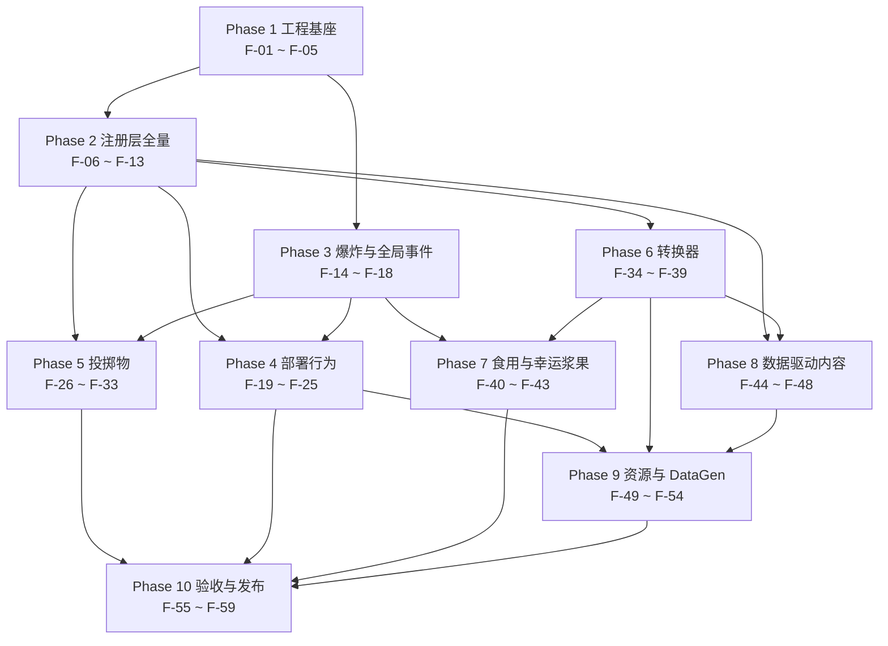

# 03 · 任务拆分（Task Breakdown）

> **文档状态**：本文件是 v0.0.1 施工期的历史记录，其中的数值与结构描述可能已被实现修正。**实现口径以 00-DECISIONS.md 为准**（见 D-42~D-48），完整差异清单见 09-IMPL-VS-PLAN.md。

> 项目：农场风云 / Farmstorm · v0.0.1
> 依据：`plan0.0.1.txt` + `docs/zh/00-DECISIONS.md`（D-01 ~ D-41）+ `docs/zh/01-DESIGN.md` + `docs/zh/02-TECH-SPEC.md`
> 本文件把技术规格拆成「一次可独立提交、可独立验证」的任务。**Phase 编号与 `04-ROADMAP.md` 的里程碑划分完全一致**（Phase 1 ~ Phase 10 → M1 ~ M6）。
> 任务总数 **59**；覆盖 `02-TECH-SPEC.md §3` 的 **64 个注册对象**，未覆盖 **0** 个（逐条对照见 §14）。

---

## 0. 阅读约定

### 0.1 任务粒度

一个任务 = 一次可独立提交、可独立验证的改动。判据三条，缺一不算合格任务：

1. 提交后 `./gradlew build` 通过，且不依赖同一批次中尚未提交的任务。
2. 任务自带至少一条可在日志、`/execute`、`/data get`、F3 界面或产物文件里观察到的验收断言。
3. 回滚该提交不会让其它已完成任务失效（回滚只影响依赖它的后续任务）。

### 0.2 复杂度与工作量换算

| 复杂度 | 含义 | 折算人日 |
|---|---|---|
| S | 单文件或纯数据；≤ 1 个类，或 ≤ 20 个 JSON | 0.5 |
| M | 2 ~ 4 个文件，跨 1 ~ 2 个包，或新增 1 个完整行为实现 | 1.5 |
| L | ≥ 5 个文件或跨 3 个包，含运行期状态机 / 序列化 / 事务 | 3.0 |

全项目合计 **96.0 人日**（不含 25% 缓冲）。折算口径在全项目内统一，不在中途调整。

### 0.3 验收标准写法

每条验收必须能在下列位置之一被观察到：`logs/latest.log` 的断言输出、游戏内 `/execute` `/data get` `/damage` `/advancement` 的返回值、F3 / F3+B 的界面读数、`src/generated/resources` 或 `config/farmstorm-server.toml` 的文件内容、`build/libs` 的产物。禁止「表现正常」「手感良好」这类不可观测表述。

### 0.4 文档裁决记录

三份上游文档在下列三点上不一致。调度者在此裁决，后续任务一律按裁决执行；上游文档的修订另行登记，不阻塞本文件。

| # | 冲突点 | 涉及文档 | 裁决 | 落地任务 |
|---|---|---|---|---|
| 1 | 进度条数 12 还是 6 | `01-DESIGN.md §6` 列 12 条；`02-TECH-SPEC.md §6.7` 列 6 条 | 按 **12 条**交付（内容更完整的一份）；02 的 6 条视为其子集（已登记为 **C-7**）。连带口径：资源总数 251 → **257**（+6 个进度 JSON），lang 键 204 → **216**（+12 个进度文案键） | F-47、F-52、F-53 |
| 2 | 部署物是否记录队伍快照 | `01-DESIGN.md §7.2`「只记 ownerUuid」；`02-TECH-SPEC.md §4.2 / §4.5`「UUID + 队伍名快照」 | 按 **`00-DECISIONS.md` C-9** 交付：部署方块**只存 `ownerUuid` + `ownerName`，不存任何队伍快照**；己方判定在**触发瞬间**由 `TeamResolver` 实时解析归属者的**当前**队伍；归属者离线时用 `ownerName` 在 Scoreboard 成员表反查**最后已知队伍**；归属者无队伍时按 D-31 的 `self` 口径 | F-03、F-10、F-20 |
| 3 | 硬挖 10 秒的适用范围 | `01-DESIGN.md §7.1` 把火把花 / 瓶子草也算进去；`00-DECISIONS.md` D-37 收窄到 `pumpkin_turret` | 以 **DEC 为准**（D-37，并已登记为 **C-8**）：只有 `pumpkin_turret` 固定 10 秒；火把花 / 瓶子草走「非己方零进度 + 己方正常速度」 | F-09、F-23、F-24 |

---

## 1. 任务依赖图

### 1.1 Phase 级依赖



### 1.2 主干链（文本树）

只画决定总工期的那几条链；完整依赖以各阶段表格的「依赖」列为准。

```text
F-01 构建基线
└── F-02 主类与注册骨架
    ├── F-03 己方判定 ────────────────┐
    ├── F-04 静态档案与距离工具        │
    │   ├── F-06 14 个作物方块 ──┐    │
    │   └── F-07 9 个实体类型 ───┤    │
    │                            └ F-08 22 个物品 ── F-11 创造标签页
    ├── F-05 配置 58 键 ──────────────┼── F-34 ConverterRecipe
    │                                 │      └── F-35 CBE 容器
    │                                 │            ├── F-36 Menu ── F-37 Screen
    │                                 │            │        └── F-38 ConverterBlock ── F-49 DataGen ──┐
    │                                 │            └── F-39 tryConvert ── F-47 进度 ── F-52 语言 ──┐   │
    │                                 │                                                          │   │
    │   F-09 5 个部署方块 ── F-10 5 个 BE ── F-19 行为框架 ── F-22 炮台 / F-23 / F-24 光环          │   │
    │   F-13 伤害类型 ── F-14 爆炸 ── F-20 陷阱                                                     │   │
    ├── F-15 玩家事件 ── F-16 批处理 / F-17 爆炸免疫 / F-18 临时附魔                                 │   │
    └── F-41 Roller ── F-42 六分支 / F-43 创造分支                                                  │   │
                                                                                             └───┴ F-53 产物核对 ── F-55 服务器回归 ── F-59 发布
```

---

## 2. 总览

| Phase | 名称 | 任务数 | 任务 ID | 人日 | 对应里程碑 |
|---|---|---|---|---|---|
| Phase 1 | 工程基座 | 5 | F-01 ~ F-05 | 7.0 | M1 |
| Phase 2 | 注册层全量 | 8 | F-06 ~ F-13 | 18.5 | M1 |
| Phase 3 | 爆炸与全局事件 | 5 | F-14 ~ F-18 | 9.5 | M2 |
| Phase 4 | 部署行为 | 7 | F-19 ~ F-25 | 12.0 | M2 |
| Phase 5 | 投掷物 | 8 | F-26 ~ F-33 | 11.5 | M3 |
| Phase 6 | 转换器 | 6 | F-34 ~ F-39 | 10.5 | M4 |
| Phase 7 | 食用型与幸运浆果 | 4 | F-40 ~ F-43 | 6.5 | M4 |
| Phase 8 | 数据驱动内容 | 5 | F-44 ~ F-48 | 5.5 | M5 |
| Phase 9 | 资源与 DataGen | 6 | F-49 ~ F-54 | 8.5 | M5 |
| Phase 10 | 验收与发布 | 5 | F-55 ~ F-59 | 6.5 | M6 |
| **合计** | | **59** | | **96.0** | |

---

## 3. Phase 1 · 工程基座（F-01 ~ F-05）

阶段目标：让一个还没有任何注册内容的空模组在 ModDevGradle 上四端可跑，并把注册骨架、己方判定、静态档案、配置框架一次性立稳——后续所有阶段只往里追加条目。

阶段出口判据：`./gradlew build` 产出 jar、`runServer` 打印 `Done`、`config/farmstorm-server.toml` 生成 58 个键、`Farmstorm.id()` 可用。

| ID | 标题 | 目标 | 涉及文件 / 类 | 依赖 | 验收标准 | 复杂度 |
|---|---|---|---|---|---|---|
| F-01 | 构建基线落地 | 让空模组在 MDG 下完成 build / runClient / runServer / runData 四端首次成功运行 | `gradle.properties`、`settings.gradle`、`build.gradle`、`gradle/wrapper/gradle-wrapper.properties`、`src/main/resources/META-INF/neoforge.mods.toml`、`src/main/resources/pack.mcmeta` | — | ① `./gradlew build` 产出 `build/libs/farmstorm-0.0.1+mc1.21.1.jar`；② `./gradlew runServer` 日志出现 `Done (` 且无 `ERROR` 行；③ `build.gradle` 扩展块名为 `neoForge`（大小写敏感），`neo_version` 写具体补丁号、不含通配符；④ `./gradlew runData` 退出码 0 | M |
| F-02 | 主类与注册骨架 | 建立模组入口与 8 个 `DeferredRegister` 骨架，使后续注册任务只需追加条目 | `Farmstorm.java`、`registry/FarmstormItems.java`、`registry/FarmstormBlocks.java`、`registry/FarmstormBlockEntities.java`、`registry/FarmstormEntityTypes.java`、`registry/FarmstormMenus.java`、`registry/FarmstormRecipes.java`、`registry/FarmstormDataComponents.java`、`registry/FarmstormCreativeTabs.java`、`registry/FarmstormDamageTypes.java` | F-01 | ① 构造器把 8 个 `REGISTER` 挂到 mod 总线并调用 `container.registerConfig(ModConfig.Type.SERVER, ...)`；② `Farmstorm.id("converter").toString()` 等于 `farmstorm:converter`；③ `runClient` 启动日志无 `Missing registry` 与注册异常 | M |
| F-03 | 己方判定与归属工具 | 把「是不是部署者的己方」抽成接口 + 唯一实现，并提供只存 UUID + 玩家名的归属读写工具 | `team/TeamResolver.java`、`team/ScoreboardTeamResolver.java`、`util/DeployedOwnership.java` | F-02 | ① `/team add red` 后同队玩家 `isAlly` 为 true、非同队为 false、部署者本人恒为 true；② 无队伍玩家在 `teams.untamedFallback=self` 下只对自身友好；③ 归属只写 UUID 与玩家名两个字段，`/data get block` 中不存在 `ownerTeam` 键（C-9）；④ 归属者离线时用 `ownerName` 在 Scoreboard 成员表反查最后已知队伍，查询结果与在线时一致；⑤ 不缓存队伍对象（`grep -rn "PlayerTeam" team/` 仅命中实现类内部局部变量） | S |
| F-04 | 静态档案与距离工具 | 集中 15 个作物的静态档案，并提供切比雪夫 / 欧氏两种距离工具 | `util/CropProfile.java`、`behavior/DeployedKind.java`、`util/DistanceMetrics.java` | F-02 | ① `CropProfile.ALL` 恰好 15 条，ID 与 `00-DECISIONS.md §4` 逐字一致；② `DistanceMetrics.chebyshev(3,1,3)==3`、`euclidean(3,4,0)==5.0`（启动日志断言）；③ `DeployedKind` 含 5 个枚举值 | S |
| F-05 | 配置通用项与效果模板键 | 落地 7 个通用分组与 22 组效果键（14 + 44 = 58 键），并搭好重载后重建缓存的钩子 | `config/FarmstormConfig.java` | F-02 | ① `runServer` 后 `config/farmstorm-server.toml` 出现 `[converter]` `[stack]` `[deploy]` `[teams]` `[explosion]` `[throwable]` `[food]` 七段；② 文件内键总数 = 58；③ 改 `converter.xpCost` 为 7 后 `/reload`，`FarmstormConfig.converterXpCost` 读到 7 且日志打印一行 `bake()` | L |

---

## 4. Phase 2 · 注册层全量（F-06 ~ F-13）

阶段目标：把 64 个注册对象中的 **59 个**落进 registry（转换器相关的 5 个在 Phase 6 落地），并让它们能被放置、被召唤、被查询。

阶段出口判据：创造标签页出现 22 个物品；14 个作物方块与 5 个部署方块可 `/setblock`；9 个实体可 `/summon`；6 个 BlockEntityType 中 5 个已注册。

| ID | 标题 | 目标 | 涉及文件 / 类 | 依赖 | 验收标准 | 复杂度 |
|---|---|---|---|---|---|---|
| F-06 | 作物方块与 14 个注册 | 实现 14 个作物方块的唯一类并完成注册（无 BlockItem，D-34） | `block/FarmstormCropBlock.java`、`registry/FarmstormBlocks.java` | F-04 | ① 14 条 `/setblock ~ ~ ~ farmstorm:<id>` 全部成功；② 每个方块含 `age` 属性且 0 ~ 3 四值合法；③ `melon_slice_bomb` 无作物方块（`grep` 命中 0）；④ `/gamerule randomTickSpeed 100` 下 5 分钟内 `age` 递增到 3 | L |
| F-07 | 投掷物基类与 9 个实体类型 | 实现 `ThrownCropEntity` 基类并把 8 个投掷物 + 1 个炮台导弹登记为 EntityType | `entity/ThrownCropEntity.java`、`registry/FarmstormEntityTypes.java` | F-04 | ① `FarmstormEntityTypes` 内恰好 9 个 `DeferredHolder`；② 9 条 `/summon farmstorm:<id> ~ ~ ~` 全部成功且不崩；③ 实体参数为 `sized(0.25,0.25)`（`turret_bullet` 0.3）、`clientTrackingRange(4)`、`updateInterval(10)`；④ `submunition` 经 `SynchedEntityData` 同步，客户端日志打印到值 | L |
| F-08 | 物品体系与 22 个物品注册 | 实现 5 个物品类并注册 15 个作物 + 6 个播种物 + 1 个转换器物品 | `item/ModifiedCropItem.java`、`item/ThrowableCropItem.java`、`item/DeployableCropItem.java`、`item/SeedItem.java`、`item/FoodCropItem.java`、`registry/FarmstormItems.java` | F-06、F-07、F-05 | ① 创造标签页 22 个物品齐全；② 服务端启动日志打印 22 个物品的 `stacksTo`：8 个投掷型为 16、其余 14 个为 64（D-16）；③ 6 个播种物对着泥土右键放置对应 `_crop` / `_stem` / `_stalk` / `_block` / `_bush` 方块；④ 5 个部署型物品在耕地上右键走播种分支 | L |
| F-09 | 部署方块与 5 个注册 | 实现部署方块的附着 / 悬空 / 破坏规则并注册 5 个方块 | `block/DeployedCropBlock.java`、`registry/FarmstormBlocks.java` | F-04、F-05 | ① 对着玻璃 / 半砖 / 树叶右键被拒绝且物品不消耗；② `pumpkin_turret` 顶 / 底 / 侧三面均可放置，其余 4 个仅顶面；③ 依附方块被挖掉后 `pumpkin_turret` / `awakened_torchflower` / `awakened_pitcher_plant` 变 `floating=true` 不下落，`blast_carrot` / `fang_trap_cactus` 直接消失并掉落本体；④ `/setblock ~ ~ ~ farmstorm:pumpkin_turret[face=wall,facing=east,floating=false]` 成功 | L |
| F-10 | 部署物 BlockEntity 与 5 个类型 | 落地部署物的运行时状态、存档与同步，并用同一个类注册 5 个 BlockEntityType | `blockentity/DeployedCropBlockEntity.java`、`registry/FarmstormBlockEntities.java` | F-09、F-03 | ① 5 个 ID 独立但共用同一个类与同一个 factory；② 放置后 `/data get block` 能读到 `ownerUuid` `ownerName` `placedGameTime` `detached` `pendingWaves` `fuseTicks` 六个存档字段，且**不存在 `ownerTeam` 键**（C-9：不存任何队伍快照）；③ 退出重进世界后这六个字段原样保持；④ 存档字段共 6 个，且这 6 个全部参与 `getUpdateTag` 同步，`behavior` 与 `cooldown` 既不存档也不同步；⑤ `getTicker` 在客户端返回 null（`runClient` 无服务端 tick 日志） | L |
| F-11 | 创造模式标签页 | 注册自定义标签页并按「作物 → 播种物 → 工具方块」排序 | `registry/FarmstormCreativeTabs.java`、`event/FarmstormModEvents.java` | F-08 | ① `itemGroup.farmstorm.main` 显示为「农场风云」；② 标签页内 22 个物品顺序为 15 作物 → 6 播种物 → converter；③ `BuildCreativeModeTabContentsEvent` 只往本标签页追加（其它标签页条目数不变） | S |
| F-12 | 数据组件 temporary_enchantments | 注册临时附魔账本组件并确定其序列化形态 | `registry/FarmstormDataComponents.java`、`util/TempEnchantRecord.java` | F-02 | ① `DataComponentType` 注册成功且 ID 为 `farmstorm:temporary_enchantments`；② `stack.set(...)` 后 `stack.get(...)` 往返一致；③ 启动日志打印 `Codec` 编解码后的等价比较结果为 `true`；④ 物品放入箱子再取出后组件仍在 | M |
| F-13 | 伤害类型 void_bolt / crop_blast | 用数据驱动方式提供 2 个伤害类型并把它们并入原版标签 | `registry/FarmstormDamageTypes.java`、`data/farmstorm/damage_type/void_bolt.json`、`data/farmstorm/damage_type/crop_blast.json`、`data/minecraft/tags/damage_type/is_projectile.json`、`data/minecraft/tags/damage_type/is_explosion.json` | F-02 | ① `/damage @s 1 farmstorm:void_bolt` 与 `farmstorm:crop_blast` 均成功；② 死亡信息显示「被虚空撕碎」与「被作物炸飞了」；③ `/damage` 自动补全出现两条 ID；④ 穿爆炸保护 IV 皮甲受 `crop_blast` 伤害明显低于裸装 | M |

---

## 5. Phase 3 · 爆炸与全局事件（F-14 ~ F-18）

阶段目标：先把「破坏 / 伤害 / 表现」三段式爆炸、爆炸批处理、爆炸免疫、临时附魔账本与玩家事件总线立起来——后面所有含爆炸或光环的作物都复用它，避免先写作物再回头改爆炸。

阶段出口判据：能构造一次 `FarmstormExplosion` 并观察到「按规则破坏 + 伤害封顶 + 死因正确」；同 tick 12 次爆炸被摊到 2 个 tick；火把花在 TNT 下存活。

| ID | 标题 | 目标 | 涉及文件 / 类 | 依赖 | 验收标准 | 复杂度 |
|---|---|---|---|---|---|---|
| F-14 | 三段式爆炸与伤害封顶 | 实现 `FarmstormExplosion` 与 `BlastRule`，把方块破坏、逐实体封顶伤害、粒子音效拆成三段 | `explosion/FarmstormExplosion.java`、`explosion/BlastRule.java` | F-13 | ① 威力 2 / 封顶 7 的爆炸对裸装玩家造成 0 < 伤害 ≤ 7；② `COBBLESTONE_6` 规则下圆石不破、泥土破；③ 死因显示 `death.attack.farmstorm.crop_blast` 且击杀归属为部署者 / 投掷者；④ `power=4, cap=2` 时站在中心的玩家只掉 2 点血 | L |
| F-15 | 事件总线与玩家事件 | 建立 game 总线事件类，承载玩家 tick、登录 / 登出与爆炸事件的统一入口 | `event/FarmstormGameEvents.java`、`Farmstorm.java` | F-02 | ① `PlayerTickEvent.Post` 每 20 tick 打印一次心跳日志（可开关）；② `PlayerLoggedInEvent` / `PlayerLoggedOutEvent` 各打印一行含玩家名与 UUID 的日志；③ 事件类不注册任何方块实体 tick | M |
| F-16 | 爆炸批处理队列 | 用内部常量 `MAX_EXPLOSIONS_PER_TICK = 8` 把同 tick 超量爆炸推迟到下一 tick | `explosion/ExplosionQueue.java`、`event/FarmstormGameEvents.java` | F-14、F-15 | ① 同 tick 抛出 12 次爆炸：前 8 次立即执行、后 4 次下一 tick 执行，日志打印 `deferred=4`；② 破坏方块总数与逐个执行一致；③ `/debug` 观察单 tick 时间 < 5 ms | S |
| F-17 | 爆炸免疫与 Detonate 拦截 | 让火把花 / 瓶子草对任何爆炸免疫（含原版 TNT 与其它模组） | `block/DeployedCropBlock.java`、`event/FarmstormGameEvents.java`、`util/FarmstormTags.java`、`data/farmstorm/tags/block/explosion_immune.json` | F-15、F-09、F-14 | ① TNT / 苦力怕 / 末地水晶各炸一次，两个方块仍在；② 同一位置 `blast_carrot` 被炸掉；③ `ExplosionEvent.Detonate` 日志打印从 `getAffectedBlocks()` 移除的数量 > 0；④ `getExplosionResistance` 返回 3600000F 与 tag 形成双保险 | M |
| F-18 | 临时附魔账本 | 实现 `TempEnchantHandler` 的授予 / 撤销 / 过期，并在撤销时不覆盖玩家真实附魔 | `util/TempEnchantHandler.java`、`event/FarmstormGameEvents.java` | F-12、F-15 | ① 给木剑授予火焰附加 I，工具提示出现 `tooltip.farmstorm.temporary_enchant` 行；② 到期后附魔消失、组件被移除（`/data get entity @s SelectedItem` 无该键）；③ 原等级 0 恢复为无附魔、原等级 2 不被降级；④ 剑放进箱子取出后下一次 tick 被清理 | L |

---

## 6. Phase 4 · 部署行为（F-19 ~ F-25）

阶段目标：把 5 个部署物从「能放下的方块」变成「会做事的装置」——行为接口 + 5 个实现 + 限流。

阶段出口判据：胡罗贝能自爆、仙人掌能出两圈尖牙、man瓜能开火、两种光环能上 effect、单区块与单玩家上限生效。

| ID | 标题 | 目标 | 涉及文件 / 类 | 依赖 | 验收标准 | 复杂度 |
|---|---|---|---|---|---|---|
| F-19 | 行为家族与 tick 分发 | 定义 `DeployedBehavior` / `TrapBehavior` / `TurretBehavior` / `AuraProvider` 与工厂，并把 tick 分发到行为对象 | `behavior/DeployedBehavior.java`、`behavior/TrapBehavior.java`、`behavior/TurretBehavior.java`、`behavior/AuraProvider.java`、`behavior/DeployedBehaviors.java`、`blockentity/DeployedCropBlockEntity.java` | F-10 | ① 5 种部署物各放 1 个，跑 600 tick 无异常；② 同区块 8 个部署物因 `stagger` 分摊到不同 tick（日志打印每 tick 触发数 ≤ 2）；③ 冷却窗口内不做扫描（炮台 60 tick 只出现 1 次索敌日志）；④ 客户端不 tick | M |
| F-20 | 胡罗贝陷阱 | 部署后对切比雪夫 ≤ 1 的非己方玩家自爆，威力 2 / 封顶 7 / 反胃 III | `behavior/impl/BlastCarrotTrap.java` | F-19、F-14 | ① 敌方玩家进入切比雪夫 1 触发；② 每名玩家伤害 ≤ 7；③ 爆炸半径 4 内**所有**玩家（含队友）获反胃 III 60 tick（D-27）；④ 触发后方块消失（`/execute if block` 返回 0）；⑤ 队友入队后不再触发、退队后再次触发，全程**无需重新部署**（C-9：触发瞬间实时解析） | M |
| F-21 | 仙人掌尖牙陷阱 | 欧氏 ≤ 3 触发后分两波生成 8 + 5 个尖牙并延迟出现 | `behavior/impl/FangTrapCactusTrap.java` | F-19 | ① 欧氏距离 ≤ 3 触发（4 格不触发）；② 外圈 8 个 `minecraft:evoker_fangs` 在 10 tick 后出现，内圈 5 个在 4 tick 后出现（F3+B 数 hitbox 与顺序）；③ 外圈半径 2.0、内圈半径 1.0；④ 两波出完方块消失 | M |
| F-22 | man瓜炮台与导弹 | 实现切比雪夫 5 格索敌、60 tick 开火与自定义导弹的性能 | `behavior/impl/PumpkinTurret.java`、`entity/TurretBullet.java` | F-19、F-13、F-07 | ① 非己方玩家进入范围后按 60 tick 间隔开火；② 命中造成 1 点 `farmstorm:void_bolt` 伤害；③ 击退方向为「南瓜 → 目标」连线且不施加漂浮；④ 撞方块即消失、不破坏方块；⑤ 己方玩家不成为目标；⑥ 配置开启拦截时对非己方投掷物也开火（C-3） | L |
| F-23 | 火把花光环 | 半径 20 内己方玩家每 100 tick 获得 6 个增益，并对持剑者授予临时火焰附加 | `behavior/impl/TorchflowerAura.java` | F-19、F-18 | ① 6 个效果数值与时长 300 tick 正确（力量 III / 抗性 II / 急迫 II / 速度 I / 水下呼吸 I / 夜视 I）；② 手持任意 `#minecraft:swords` 获得临时火焰附加 I；③ 每次施加出现 8 个 flame 粒子；④ 非己方玩家与创造模式玩家都挖不动（进度恒 0）；⑤ 离开半径后 100 tick 内撤销临时附魔 | M |
| F-24 | 瓶子草光环 | 半径 10 内己方玩家每 100 tick 获得 3 个增益并净化全部负面效果 | `behavior/impl/PitcherPlantAura.java` | F-19 | ① 生命回复 II / 饱和 II / 伤害吸收 I 各 300 tick；② 身上 `MobEffectCategory.HARMFUL` 的效果全部被移除（用 `/effect give @s poison` 验证）；③ 8 个 heart 粒子；④ 非己方玩家挖不动 | M |
| F-25 | 部署限流与防刷 | 用 3 个内部常量封住放置刷取与单区块堆积 | `blockentity/DeployedCropBlockEntity.java`、`block/DeployedCropBlock.java` | F-10、F-19 | ① 同一玩家第 33 个部署物被拒绝且不消耗物品；② 同区块第 9 个被拒绝；③ 「放 → 立刻拆 → 再放」在 5 tick 冷却内被拒绝；④ 被拒绝时不产生任何掉落 | M |

---

## 7. Phase 5 · 投掷物（F-26 ~ F-33）

阶段目标：把 8 种投掷型作物的命中效果逐个实现，并统一生命周期、命中分流与创造模式口径。

阶段出口判据：8 种投掷物全部可投出并产生 plan0.0.1.txt 描述的落点效果，伤害不超上限，创造模式不消耗。

| ID | 标题 | 目标 | 涉及文件 / 类 | 依赖 | 验收标准 | 复杂度 |
|---|---|---|---|---|---|---|
| F-26 | 膨胀麦 | 落点 3×3×3 替换为干草块，遇水扩到 5×5×5 | `entity/thrown/PuffedWheatProjectile.java` | F-07、F-05 | ① 干燥落点替换 27 格为 `minecraft:hay_block`；② 范围内放一格水后替换 125 格；③ 基岩 / 屏障 / 命令方块不被替换（T-05/§8.5）；④ 空气方块会被替换 | M |
| F-27 | 育碧服务器与瓜片子 | 实现两个破障 / 伤害型投掷物及其不同的抗性阈值 | `entity/thrown/UbiServerProjectile.java`、`entity/thrown/MelonSliceProjectile.java` | F-07、F-14 | ① 育碧服务器威力 4、每名玩家伤害 ≤ 2、可炸掉石头；② 瓜片子威力 2、伤害 ≤ 6；③ 圆石（6.0）不破、泥土破（D-19） | M |
| F-28 | 毒育碧服务器 | 爆炸后原地生成一片剧毒药水云 | `entity/thrown/ToxicUbiServerProjectile.java` | F-07、F-14 | ① 先爆炸（威力 2 / 伤害 ≤ 2）；② 再生成半径 3.0、600 tick 的 `AreaEffectCloud`；③ 云内玩家获得中毒；④ 60 秒后云消散 | M |
| F-29 | 瓜！子母弹 | 落点上方一格生成 4 片西瓜片，随后立刻产生威力 3 的爆炸 | `entity/thrown/MelonGrenadeProjectile.java` | F-27 | ① 在 `pos + (Δx, +1.0, Δz)`、Δ ∈ [-0.3, 0.3] 内生成 4 个 `melon_slice_bomb`；② `/data get entity` 读到 `submunition=true`；③ 立刻产生威力 3 / 伤害 ≤ 8 的爆炸；④ 4 片子母弹落地各自再炸一次，总爆炸次数 = 5 | M |
| F-30 | 爆竹 | 命中后存活 140 tick，每 5 tick 生成并引爆一个风弹 | `entity/thrown/BambooFirecrackerProjectile.java` | F-07 | ① 命中后不消失，`noPhysics=true`、速度为 0；② 每 5 tick 生成 `minecraft:wind_charge` 并立即引爆，共 28 次；③ 140 tick 后消失；④ 风弹不破坏方块 | L |
| F-31 | 红菇 / 棕菇投掷物 | 实现两个 AoE buff 类投掷物，范围效果不筛敌我 | `entity/thrown/RedMushroomPuffProjectile.java`、`entity/thrown/BrownMushroomPuffProjectile.java` | F-07 | ① 红菇：半径 4 内所有玩家（含队友）获反胃 V 60 tick + 失明 I 60 tick；② 棕菇：虚弱 II 200 tick + 缓慢 II 100 tick；③ 两者都不破坏方块、不造成伤害 | M |
| F-32 | 生命周期与命中分流 | 统一投掷物的存活上限与命中后行为，把公共部分锁进基类 | `entity/ThrownCropEntity.java` | F-07 | ① 存活超过 `throwable.lifetimeTicks`（默认 100）自动 `discard`；② `onHitBlock` / `onHitEntity` 只在基类实现（`grep -c "onHitBlock" entity/thrown/` 结果为 0）；③ 命中后立即消失（爆竹经 `keepAliveAfterImpact()` 例外） | S |
| F-33 | 创造模式消耗口径 | 统一「创造模式不消耗物品、不被陷阱锁定」的口径 | `item/ThrowableCropItem.java`、`item/DeployableCropItem.java`、`behavior/impl/BlastCarrotTrap.java` | F-08、F-09 | ① 创造模式投掷后物品数量不变；② 创造模式部署后物品数量不变；③ 创造模式玩家站在陷阱旁不触发；④ 创造模式挖掘 `pumpkin_turret` 仍需 10 秒 | S |

---

## 8. Phase 6 · 转换器（F-34 ~ F-39）

阶段目标：做出「原版 ↔ 改良」的完整闭环方块，包含配方类型、容器、菜单、屏与事务化转换。

阶段出口判据：放入小麦点一次转换得到膨胀麦并扣 3 点经验；反向可转回；经验不足被拒绝且不扣等级；转换器计入 64 对象中的 5 个。

| ID | 标题 | 目标 | 涉及文件 / 类 | 依赖 | 验收标准 | 复杂度 |
|---|---|---|---|---|---|---|
| F-34 | 配方类型与序列化器 | 定义 `ConverterRecipe` 与序列化器并注册 1 个 RecipeType + 1 个 Serializer | `recipe/ConverterRecipe.java`、`recipe/ConverterRecipeSerializer.java`、`registry/FarmstormRecipes.java` | F-02、F-05 | ① `farmstorm:converting` 的 RecipeType 与 Serializer 各 1 个；② 放入一条 `data/farmstorm/recipe/puffed_wheat.json` 后 `runServer` 无 `Parsing error`；③ `reverse()` 返回 input / result 互换的视图且不落盘 | M |
| F-35 | 转换器容器与存档 | 实现单槽位容器 BlockEntity 与内容物存档、破坏掉落 | `blockentity/ConverterBlockEntity.java`、`registry/FarmstormBlockEntities.java` | F-34 | ① 槽位放入 / 取出 / `stillValid` 正确；② 退出重进后槽内物品仍在；③ 破坏方块时内容物掉落、不吞物品 | M |
| F-36 | 转换器菜单 | 实现 1 输入 + 1 只读预览 + 3 个 `ContainerData` 的菜单并注册菜单类型 | `menu/ConverterMenu.java`、`registry/FarmstormMenus.java` | F-35 | ① `farmstorm:converter` 菜单类型注册成功；② `clickMenuButton(player, 0)` 只接受 0；③ `ContainerData` 的 `xpCost` / `canConvert` / `reverse` 随输入物品变化；④ `quickMoveStack` 只处理输入槽与玩家背包 | M |
| F-37 | 转换器界面与客户端注册 | 实现 GUI 背景 / 标题 / 按钮，并用客户端事件注册屏 | `client/ConverterScreen.java`、`client/FarmstormClient.java` | F-36 | ① `runClient` 打开转换器显示 176×166 背景与「农产品转换器」标题；② 转换按钮点击发出 `ServerboundContainerButtonClickPacket`（日志可见，无自定义包）；③ 关闭重开 10 次不崩 | M |
| F-38 | 转换器方块与破坏掉落 | 注册转换器方块，接上菜单提供者与破坏掉物 | `block/ConverterBlock.java`、`registry/FarmstormBlocks.java` | F-36 | ① `farmstorm:converter` 方块 ID 注册成功（blocks 第 20 个）；② 含 4 向 `facing`，`getRenderShape` 为 MODEL；③ 挖掘后掉方块本体 + 内容物；④ `#minecraft:mineable/pickaxe` 生效（镐快于空手） | M |
| F-39 | 转换事务 | 按「先全量校验再动状态」实现 `tryConvert`，覆盖经验、催化剂与双向 | `blockentity/ConverterBlockEntity.java` | F-34、F-35 | ① 正反双向 1:1 转换成功；② 经验不足被拒绝且**不扣等级**；③ 火把花 / 瓶子草仅正向、扣 1 个下界之星、反向免费；④ 校验失败时连点 10 次物品与经验均不变 | L |

---

## 9. Phase 7 · 食用型与幸运浆果（F-40 ~ F-43）

阶段目标：完成两个食用型作物，重点是 8 档概率表与创造模式分支的三级兜底。

阶段出口判据：甜菜！给 4 个增益；幸运浆果 8 档全部可被强制触发；创造模式分支在崩溃后不残留。

| ID | 标题 | 目标 | 涉及文件 / 类 | 依赖 | 验收标准 | 复杂度 |
|---|---|---|---|---|---|---|
| F-40 | 甜菜！食用效果 | 食用后一次性施加 4 个 600 tick 增益 | `item/FoodCropItem.java`（`onEaten` 实现）、`config/FarmstormConfig.java` | F-08、F-05 | ① 食用 32 tick 后获得力量 II / 速度 II / 急迫 II / 抗性 I 各 600 tick；② 营养 4、饱和度 0.3（`/data get` 读到 `food` 组件）；③ 饱食度满时仍可食用 | S |
| F-41 | 概率表与抽取 | 实现千分比权重表与单次 `nextInt(1000)` 抽取，并在重载时重建 | `util/LuckyBerryRoller.java`、`config/FarmstormConfig.java` | F-05 | ① 内部权重和恒为 1000（启动日志断言）；② 把 8 项配置分别调成 100 / 0 / … 各跑 100 次抽取，命中率 100%；③ 配置和 ≠ 100 时 `bake()` 拒绝该段、回退默认值并打印 warn | M |
| F-42 | 幸运浆果 6 个常规分支 | 实现闪电、随机作物、回复、宝箱、小爆炸、闪电苦力怕 6 个结果 | `util/LuckyBerryRoller.java` | F-41、F-14 | ① 闪电在玩家位置生成且无来源伤害；② 生成 16 个随机作物（除自身外 14 种，D-17），落点在半径 2 格可站立方块内（D-33）；③ 回复 V 100 tick；④ 2 个 `end_city_treasure` 宝箱；⑤ 威力 1 且不封顶的小爆炸；⑥ 苦力怕 `powered=true` 且未点燃 | L |
| F-43 | 创造模式分支与三级兜底 | 实现 0.1% 分支的 90 秒回滚、下线即还原与登录对账 | `util/LuckyBerryRoller.java`、`event/FarmstormGameEvents.java` | F-41、F-15 | ① 抽中后切创造，1800 tick 后自动还原；② 中途下线立即还原且不写存档；③ `kill -9` 服务端后重连，非 OP 玩家被还原为生存，OP 玩家不被改动（RT-05）；④ 本就是创造模式的玩家抽中该分支只播音效、不改模式 | M |

---

## 10. Phase 8 · 数据驱动内容（F-44 ~ F-48）

阶段目标：把配方、战利品表、标签、进度这些纯数据内容补齐，让玩法闭环在数据层成立。

阶段出口判据：21 条配方可正反转换；20 张战利品表可 `/loot give`；5 个标签可 `/execute if block`；12 条进度可解锁。

| ID | 标题 | 目标 | 涉及文件 / 类 | 依赖 | 验收标准 | 复杂度 |
|---|---|---|---|---|---|---|
| F-44 | 21 条转换配方 | 为 15 个作物与 6 个播种物各写一条转换配方 | `data/farmstorm/recipe/*.json`（21 个） | F-34、F-08 | ① `runServer` 无配方解析错误；② 15 个原版作物 + 6 个种子在转换器内全部可转；③ 15 条可反向、火把花 / 瓶子草 2 条不可反向；④ `/reload` 后上述结论不变 | M |
| F-45 | 20 张战利品表 | 为 14 个作物方块、5 个部署方块与 1 个转换器方块写战利品表 | `data/farmstorm/loot_table/blocks/*.json`（20 个） | F-06、F-09 | ① 成熟（`age=3`）按原版比例同时掉作物与播种物，未成熟只掉 1 个播种物；② 5 张部署表默认掉自身、被爆炸破坏掉 0 个；③ `/loot give @s loot farmstorm:blocks/puffed_wheat_crop` 逐表可执行无报错 | M |
| F-46 | 4 个方块 / 物品标签 | 提供部署物集合、改良作物集合、播种物集合与镐挖掘标签 | `data/farmstorm/tags/block/deployed_crops.json`、`data/farmstorm/tags/item/modified_crops.json`、`data/farmstorm/tags/item/seeds.json`、`data/minecraft/tags/block/mineable/pickaxe.json` | F-06、F-09 | ① 四个标签条目数为 5 / 15 / 6 / 6；② `/execute if block ~ ~ ~ #farmstorm:deployed_crops` 对 5 个部署方块均返回 1；③ `#farmstorm:modified_crops` 恰好 15 条、不含播种物 | S |
| F-47 | 12 条进度 | 按 `01-DESIGN.md §6` 交付 12 条进度，含 1 条隐藏 | `data/farmstorm/advancement/*.json`（12 个） | F-08、F-09、F-39 | ① `/advancement grant @s only farmstorm:root` 等 12 条全部成功；② 逐条触发条件可解锁；③ `lucky_jackpot` 为 `hidden: true`；④ 全部 `frame=task`、`announce_to_chat=false`；⑤ `root` 背景为 `minecraft:textures/block/hay_block_side.png` | M |
| F-48 | 配方缓存与 reload 回归 | 让 `/reload` 后转换器不再命中过期配方 | `blockentity/ConverterBlockEntity.java`、`event/FarmstormGameEvents.java` | F-39、F-44 | ① `/reload` 后连续转换 5 次成功、日志无 `Recipe not found`；② 删掉一条配方 JSON 再 `/reload`，对应物品立即不可转换；③ 恢复 JSON 后再次可转 | S |

---

## 11. Phase 9 · 资源与 DataGen（F-49 ~ F-54）

阶段目标：把 20 个 blockstate、62 个方块模型、22 个物品模型、87 个材质、216 个语言键与客户端渲染一次性补齐并全部由 DataGen 生成。

阶段出口判据：`./gradlew runData` 一次跑通，产物总数 257（JSON 169 + TOML 1 + PNG 87）；游戏内无紫黑方块、无原样显示的 lang 键。

| ID | 标题 | 目标 | 涉及文件 / 类 | 依赖 | 验收标准 | 复杂度 |
|---|---|---|---|---|---|---|
| F-49 | 方块状态与方块模型 | 用 DataGen 生成 20 个 blockstate 与 62 个方块模型 | `datagen/FarmstormDataGen.java`、`datagen/ModBlockStateProvider.java` | F-06、F-09、F-38 | ① `runData` 生成 `blockstates/*.json` 20 个、`models/block/*.json` 62 个；② 14 个作物各 4 阶段（age 0 ~ 3）变体齐全；③ 5 个部署方块的 blockstate 覆盖 face × facing × floating 且悬空复用同一模型 | L |
| F-50 | 物品模型 | 用 DataGen 生成 22 个物品模型 | `datagen/ModItemModelProvider.java` | F-08 | ① `models/item/*.json` 22 个；② 5 个部署型物品模型 `parent` 指向 `farmstorm:block/<id>`；③ 创造栏 22 个图标均非紫黑方块 | S |
| F-51 | 材质生成脚本 | 用脚本批量产出 87 个占位 PNG，并给 15 个作物图标加右下角绿色加号 | `tools/gen_textures.py` | F-02 | ① 一次运行产出 `textures/item` 22 张、`textures/block` 64 张、`textures/gui` 1 张；② 15 个作物物品图标右下角有绿色加号（逐张目测 + 尺寸断言 16×16）；③ 重复运行结果幂等（两次运行 md5 一致） | M |
| F-52 | 语言文件 216 键 | 生成中英两套键集完全一致的语言文件 | `datagen/ModLangProvider.java` | F-08、F-47、F-05 | ① `zh_cn.json` 与 `en_us.json` 键集合 diff 为空；② 键数 216（22 item + 20 block + 9 entity + 1 itemGroup + 1 container + 8 gui + 10 tooltip + 4 death + 24 advancement + 117 config）；③ 中文名与 `plan0.0.1.txt` 逐字一致（含全角标点）；④ 游戏内无 `item.farmstorm.*` 原样显示 | M |
| F-53 | DataGen 总装与产物核对 | 把 7 个 provider 挂到 `GatherDataEvent`，并核对产物总数与清单 | `datagen/FarmstormDataGen.java`、`event/FarmstormModEvents.java` | F-44、F-45、F-46、F-47、F-49、F-50、F-52 | ① `./gradlew runData` 一次生成 `src/generated/resources` 全量产物；② 产物总数 257（JSON 169 + TOML 1 + PNG 87），与 C-7 修正前的旧口径 251 相比 +6（进度 12 条替代 6 条；`02-TECH-SPEC.md §6.1` 已同步为 257）；③ 无手改 `src/generated` 的痕迹（再次运行 diff 为空） | M |
| F-54 | 炮台导弹渲染 | 让导弹在客户端可见并复用潜影贝导弹模型 | `client/render/TurretBulletRenderer.java`、`client/FarmstormClient.java` | F-07、F-22 | ① 客户端可见导弹且外形与潜影贝导弹一致；② 朝向随速度变化；③ `runServer` 不加载客户端渲染类（无 `NoClassDefFoundError`） | S |

---

## 12. Phase 10 · 验收与发布（F-55 ~ F-59）

阶段目标：把 9 条技术风险与 DoD 逐项跑一遍，产出可发布的 v0.0.1 jar。

阶段出口判据：`04-ROADMAP.md` 的 18 项 DoD 全部勾选；风险登记册中 RT-02 / RT-03 / RT-05 / RT-08 / RT-09 各有一次通过记录。

| ID | 标题 | 目标 | 涉及文件 / 类 | 依赖 | 验收标准 | 复杂度 |
|---|---|---|---|---|---|---|
| F-55 | 专用服务器与三模式回归 | 验证服务端权威与硬挖进度的稳定性 | 无新增源码（验收脚本与记录） | F-53、F-39 | ① `runServer` 独立启动 `Done` ≤ 120 s；② 两个客户端连入后陷阱 / 炮台 / 光环均生效；③ 创造 / 生存 / 旁观各挖一次 `pumpkin_turret`，进度条 10 秒不回弹（RT-02）；④ `/tp` 远处再回来触发区块重载后仍稳定 | M |
| F-56 | 数值对照验收 | 逐项核对 117 个配置键与规格一致 | `config/farmstorm-server.toml`（只读核对） | F-05、F-42、F-43 | ① 导出 toml 的 117 键与 `02-TECH-SPEC.md §4.11` 逐项比对，差异 0；② 随机抽 5 个键改值后行为随之变化；③ 8 项概率和恒为 100 的校验在改错时被拒绝并回退 | M |
| F-57 | 性能验收 | 验证光环叠加与部署密度的最坏情况 | 无新增源码（度量记录） | F-25、F-23 | ① 10 个光环 + 8 名玩家场景 `/debug profile` 单 tick < 1 ms（RT-06）；② 单区块 8 个部署物稳态无 tick 尖峰；③ 同 tick 12 次投掷命中无卡顿（批处理生效） | M |
| F-58 | 异常路径与崩溃回归 | 把 RT-03 / RT-05 / RT-08 / RT-09 的验证方式各跑一遍 | 无新增源码（回归记录） | F-17、F-18、F-43 | ① 岩浆 / 箱子 / 死亡掉落 / 下线四个场景后物品组件被清空；② `kill -9` 后重连模式正确；③ TNT / 苦力怕 / 末地水晶各炸一次火把花仍在；④ 抗性 6.0 与 5.99 的方块各一，前者不破后者破 | M |
| F-59 | 打包与 v0.0.1 发布 | 产出可发布 jar 并完成 DoD 签核 | `build/libs`（产物）、`04-ROADMAP.md`（签核记录） | F-55、F-56、F-57、F-58 | ① `./gradlew build` 产物名为 `farmstorm-0.0.1+mc1.21.1.jar`；② jar 内 `META-INF/neoforge.mods.toml` 版本解析为 0.0.1；③ 全仓无 mixin 配置与占位标记（grep 命中 0）；④ DoD 18 项逐项勾选完毕 | S |

---

## 13. 并行度分析

### 13.1 可并行的任务簇

| 簇 | 位置 | 可并行任务 | 并行度 | 说明 |
|---|---|---|---|---|
| A | Phase 2 | F-06、F-07、F-09、F-12、F-13 | 4 | 五者只共享 F-04 / F-02 前置；F-08 与 F-10 是汇合点，必须等上游 |
| B | Phase 4 | F-20、F-21、F-22、F-23、F-24 | 5 | F-19 完成后 5 个行为互不依赖，是全项目并行收益最高的一段 |
| C | Phase 5 | F-26、F-27、F-30、F-31、F-32、F-33 | 6 | 只依赖 F-07 / F-14；F-29 必须等 F-27（复用 `MelonSliceProjectile`） |
| D | Phase 6 | F-37 与 F-39 | 2 | 两者都只依赖 F-35 / F-36，可同时推进 |
| E | Phase 9 | F-49、F-50、F-51、F-52 | 4 | 四条资源链互不依赖；F-53 是强制汇合点 |
| F | Phase 10 | F-55、F-56、F-57、F-58 | 4 | 四条验收线互不阻塞，最后汇入 F-59 |

### 13.2 串行瓶颈

| # | 瓶颈链 | 长度 | 为什么不能拆 |
|---|---|---|---|
| 1 | F-01 → F-02 | 3.0 人日 | 全项目唯一入口：没有注册骨架，任何注册条目都无处安放 |
| 2 | F-04 → F-06 → F-08 | 6.5 人日 | 作物方块 → 物品的唯一生产者；F-08 同时等 F-06 与 F-07 两条上游 |
| 3 | F-05 → F-34 → F-35 → F-36 → F-38 → F-49 → F-53 | 12.0 人日 | 转换器与 DataGen 的 6 级链，是 Phase 9 完工的唯一通路；F-05 是扇出最广的节点（8 个下游直接消费方） |
| 4 | F-47 → F-52 | 3.0 人日 | 进度 JSON 是语言文件的硬前置（24 个文案键依赖 12 条进度路径） |
| 5 | F-10 → F-19 | 4.5 人日 | 5 个行为全部压在行为框架上；框架接口一旦晚交付，Phase 4 的 7 个任务同时停摆 |

### 13.3 并行度上限与排班建议

- 理论上限 **6**（簇 C），实际受**同文件冲突**约束：F-06 / F-08 / F-09 / F-38 都改 `registry/FarmstormBlocks.java` 或 `registry/FarmstormItems.java`，同一文件不能多任务同时写。把注册条目按「一个任务只追加自己那一段」约定后，可稳定并行 **3 ~ 4 路**。
- 建议 3 路排班（1 名主程负责 `registry/` + `blockentity/`，2 名并程分别负责 `item/`+`entity/` 与 `behavior/`+`datagen/`）：总工作量 96.0 人日 ÷ 3 ≈ 32 人日，加 25% 缓冲 ≈ **40 人日（约 8 周）**。
- 单人串行不做并行时：96.0 人日 × 1.25 ≈ **120 人日（约 24 周 @ 5 天/周）**。
- 关键路径（见 `04-ROADMAP.md §3`）只有 **18.5 人日 / 11 个任务**，因此**并行度而非关键路径**才是工期的决定因素：把簇 B 与簇 E 分包出去，是缩短总工期最有效的两个动作。

---

## 14. 注册对象 → 任务 ID 对照表（64 / 64）

统计口径与 `02-TECH-SPEC.md §3.11` 一致：registry 对象 64 个，跨 10 个 registry。**未覆盖 0 个。**

### 14.1 items（22 个，全部 F-08）

| # | ID | 任务 |
|---|---|---|
| 1 | `farmstorm:puffed_wheat` | F-08 |
| 2 | `farmstorm:blast_carrot` | F-08 |
| 3 | `farmstorm:ubi_server` | F-08 |
| 4 | `farmstorm:toxic_ubi_server` | F-08 |
| 5 | `farmstorm:power_beet` | F-08 |
| 6 | `farmstorm:melon_slice_bomb` | F-08 |
| 7 | `farmstorm:melon_grenade` | F-08 |
| 8 | `farmstorm:pumpkin_turret` | F-08 |
| 9 | `farmstorm:awakened_torchflower` | F-08 |
| 10 | `farmstorm:awakened_pitcher_plant` | F-08 |
| 11 | `farmstorm:fang_trap_cactus` | F-08 |
| 12 | `farmstorm:bamboo_firecracker` | F-08 |
| 13 | `farmstorm:red_mushroom_puff` | F-08 |
| 14 | `farmstorm:brown_mushroom_puff` | F-08 |
| 15 | `farmstorm:lucky_berry` | F-08 |
| 16 | `farmstorm:puffed_wheat_seeds` | F-08 |
| 17 | `farmstorm:power_beet_seeds` | F-08 |
| 18 | `farmstorm:melon_grenade_seeds` | F-08 |
| 19 | `farmstorm:pumpkin_turret_seeds` | F-08 |
| 20 | `farmstorm:awakened_torchflower_seeds` | F-08 |
| 21 | `farmstorm:awakened_pitcher_plant_pod` | F-08 |
| 22 | `farmstorm:converter`（物品） | F-08 |

### 14.2 blocks（20 个）

| # | ID | 任务 |
|---|---|---|
| 23 | `farmstorm:puffed_wheat_crop` | F-06 |
| 24 | `farmstorm:blast_carrot_crop` | F-06 |
| 25 | `farmstorm:ubi_server_crop` | F-06 |
| 26 | `farmstorm:toxic_ubi_server_crop` | F-06 |
| 27 | `farmstorm:power_beet_crop` | F-06 |
| 28 | `farmstorm:melon_grenade_stem` | F-06 |
| 29 | `farmstorm:pumpkin_turret_stem` | F-06 |
| 30 | `farmstorm:awakened_torchflower_crop` | F-06 |
| 31 | `farmstorm:awakened_pitcher_plant_crop` | F-06 |
| 32 | `farmstorm:fang_trap_cactus_block` | F-06 |
| 33 | `farmstorm:bamboo_firecracker_stalk` | F-06 |
| 34 | `farmstorm:red_mushroom_puff_block` | F-06 |
| 35 | `farmstorm:brown_mushroom_puff_block` | F-06 |
| 36 | `farmstorm:lucky_berry_bush` | F-06 |
| 37 | `farmstorm:blast_carrot`（方块） | F-09 |
| 38 | `farmstorm:pumpkin_turret`（方块） | F-09 |
| 39 | `farmstorm:awakened_torchflower`（方块） | F-09 |
| 40 | `farmstorm:awakened_pitcher_plant`（方块） | F-09 |
| 41 | `farmstorm:fang_trap_cactus`（方块） | F-09 |
| 42 | `farmstorm:converter`（方块） | F-38 |

### 14.3 block_entity_type（6 个）

| # | ID | 任务 |
|---|---|---|
| 43 | `farmstorm:blast_carrot` | F-10 |
| 44 | `farmstorm:pumpkin_turret` | F-10 |
| 45 | `farmstorm:awakened_torchflower` | F-10 |
| 46 | `farmstorm:awakened_pitcher_plant` | F-10 |
| 47 | `farmstorm:fang_trap_cactus` | F-10 |
| 48 | `farmstorm:converter` | F-35 |

### 14.4 entity_type（9 个，全部 F-07）

| # | ID | 任务 |
|---|---|---|
| 49 | `farmstorm:puffed_wheat` | F-07 |
| 50 | `farmstorm:ubi_server` | F-07 |
| 51 | `farmstorm:toxic_ubi_server` | F-07 |
| 52 | `farmstorm:melon_slice_bomb` | F-07 |
| 53 | `farmstorm:melon_grenade` | F-07 |
| 54 | `farmstorm:bamboo_firecracker` | F-07 |
| 55 | `farmstorm:red_mushroom_puff` | F-07 |
| 56 | `farmstorm:brown_mushroom_puff` | F-07 |
| 57 | `farmstorm:turret_bullet` | F-07 |

### 14.5 其余 7 个注册对象

| # | registry | ID | 任务 |
|---|---|---|---|
| 58 | `Registries.RECIPE_TYPE` | `farmstorm:converting` | F-34 |
| 59 | `Registries.RECIPE_SERIALIZER` | `farmstorm:converting` | F-34 |
| 60 | `Registries.CREATIVE_MODE_TAB` | `farmstorm:main` | F-11 |
| 61 | `Registries.DAMAGE_TYPE` | `farmstorm:void_bolt` | F-13 |
| 62 | `Registries.DAMAGE_TYPE` | `farmstorm:crop_blast` | F-13 |
| 63 | `Registries.DATA_COMPONENT_TYPE` | `farmstorm:temporary_enchantments` | F-12 |
| 64 | `Registries.MENU` | `farmstorm:converter` | F-36 |

### 14.6 计数核对

| registry | 数量 | 覆盖任务 | 覆盖面 |
|---|---|---|---|
| items | 22 | F-08 | 22 / 22 |
| blocks | 20 | F-06、F-09、F-38 | 20 / 20 |
| block_entity_type | 6 | F-10、F-35 | 6 / 6 |
| entity_type | 9 | F-07 | 9 / 9 |
| recipe_type | 1 | F-34 | 1 / 1 |
| recipe_serializer | 1 | F-34 | 1 / 1 |
| creative_mode_tab | 1 | F-11 | 1 / 1 |
| damage_type | 2 | F-13 | 2 / 2 |
| data_component_type | 1 | F-12 | 1 / 1 |
| menu_type | 1 | F-36 | 1 / 1 |
| **合计** | **64** | | **64 / 64，未覆盖 0** |