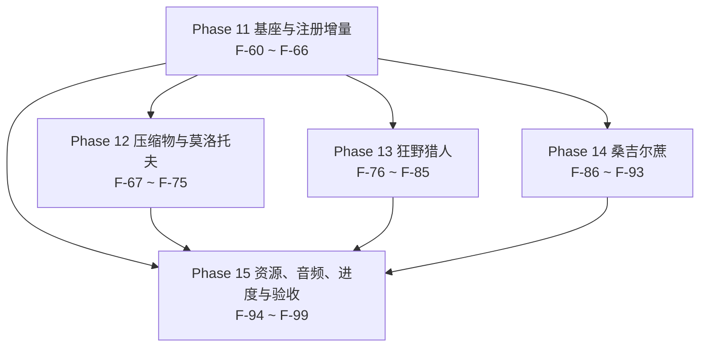

# 13 · v0.0.2 任务拆分与开发大纲（Task Breakdown & Roadmap）

> 项目：农场风云 / Farmstorm · v0.0.2
> 依据：`.work/v002-BRIEF.md`（口径定稿）+ `docs/zh/10-DECISIONS-0.0.2.md`（D-49 ~ D-79）+ `docs/zh/11-DESIGN-0.0.2.md`（7 个新功能的设计规格）+ `docs/zh/12-TECH-0.0.2.md`（注册对象 / 类设计 / 资源 / config 清单）
> 本文件把 12-TECH 的规格拆成 **40** 个「一次可独立提交、可独立验证」的任务，编号 **F-60 ~ F-99**，接 `03-TASKS.md` 的 F-59。Phase 11 ~ Phase 15 与 `04-ROADMAP.md` 的 M7 ~ M11 一一对应。
> 覆盖：13 个新增注册对象、22 条新增 config 键、40 个资源交付（37 已落地）、11 条数据条目（5 条配方 + 3 个进度 + 1 个物品标签 + 2 处 vanilla 标签），未覆盖 0 条（逐条对照见 §9）。
> 本文件只读上游：不改 `03-TASKS.md`、`04-ROADMAP.md`、`10` / `11` / `12` 号文件、`.work/v002-BRIEF.md` 与 `src/`。

---

## 0. 阅读约定

### 0.1 任务粒度

一个任务 = 一次可独立提交、可独立验证的改动。判据沿用 `03-TASKS.md §0.1` 的三条，v0.0.2 另加两条（本文补充）：

1. 提交后 `.tools\gw.cmd build` 退出码 0，且不依赖同一批次中尚未提交的任务。
2. 任务自带至少一条可在 §0.3 列出的位置观察到的验收断言。
3. 回滚该提交不会让其它已完成任务失效（回滚只影响依赖它的后续任务）。
4. 不跨 Phase 边界：一个任务的交付物全部落在它所属 Phase 的名称范围内；跨 Phase 的前置只写在「依赖」列里。
5. 只动白名单文件：`BRIEF §3.3` 的 19 个既有文件 + 该节白名单补的三处（`behavior/DeployedBehaviors.java`、`registry/FarmstormBlockEntities.java`、`entity/thrown/PuffedWheatProjectile.java`）+ 新增文件。白名单外的改动一律先改 `10-DECISIONS-0.0.2.md` 再拆任务。

### 0.2 复杂度与工作量换算

换算口径与 `03-TASKS.md §0.2` 完全一致，不在中途调整：

| 复杂度 | 含义 | 折算人日 |
|---|---|---|
| S | 单文件或纯数据；≤ 1 个类，或 ≤ 20 个 JSON | 0.5 |
| M | 2 ~ 4 个文件，跨 1 ~ 2 个包，或新增 1 个完整行为实现 | 1.5 |
| L | ≥ 5 个文件或跨 3 个包，含运行期状态机 / 序列化 / 事务 / 渲染管线 | 3.0 |

v0.0.2 的 40 个任务按此分布：**S 10 个 / M 23 个 / L 7 个**，折算合计 `10 × 0.5 + 23 × 1.5 + 7 × 3.0 = 5.0 + 34.5 + 21.0 = 60.5` 人日（不含缓冲）。

### 0.3 验收标准写法

每条验收必须能在下列位置之一被观察到：`logs/latest.log` 的断言输出；游戏内 `/execute` `/data get` `/damage` `/advancement` 的返回值；F3 / F3+B 的界面读数；`src/generated/resources` 或 `config/farmstorm-server.toml` 的文件内容；`build/libs` 或 `dist` 的产物。禁止「表现正常」「手感良好」这类不可观测表述。

本文件的四条写法约定（本文补充）：

1. 断言里必须出现具体数值、键名或文件路径（例：「剩余时长在 700 刻 ± 2 内」而不是「时长正常」）。
2. 手测类断言必须写清对照场景（例：「平地 / 两格高台 / 四格高台各测一次」）。
3. 引用上游自检项时写编号（例 `12-TECH-0.0.2.md §11 #9`），不重抄判据。
4. 少数断言用结构性证据（`grep` 匹配数为 0、`git diff` 为空、`ffprobe` 的编码输出、`jar tf` 的条目列表）——它们指向文件的确定内容，与上面五类位置同等有效，且只在无法用那五类判定时使用（如「0 个自定义网络包」这条红线本身就没有运行期读数）。

### 0.4 文档裁决记录

下面 9 条是施工期真实发生的口径分歧与本文的裁决。后续任务一律按「裁决」列执行。**A-01 ~ A-09 与 `BRIEF §8.1`、`15-PROMPT-TASKS-0.0.2.md §0.4` 的编号一致**；上游修订已在修订期完成，演变过程与最终落点见 §12.3。

| 编号 | 冲突点 | 涉及文档 | 裁决 | 落地任务 |
|---|---|---|---|---|
| A-01 | 莫洛托夫要几个概率键：`fireChance` + `magmaChance` 两个，还是只留一个 | `11-DESIGN-0.0.2.md §10.2` 旧稿 / `12-TECH-0.0.2.md §8.1` / `BRIEF §8` | **只留 `molotov.fireChance`（默认 85.0 %，范围 0.0–100.0）**，余下的百分比自动放岩浆块，不设第二个概率键 | F-61、F-70 |
| A-02 | 狂野苹果的时长归哪个键：`wild_apple.hunterDurationTicks` 还是 `wild_hunter.durationTicks` | 同上 | 归 **`wild_hunter.durationTicks`（默认 700 刻 = 35 秒，范围 1–72000）**；狂野苹果只负责施加效果，不单设时长键 | F-61、F-77 |
| A-03 | 桑吉尔蔗相位 2 的驱动方式：`dropVelocity` 定速，还是 `fallTicks` 逐刻伺服 | 同上 | 用 **`zangief_cane.fallTicks`（默认 40 刻）+ 每刻按「剩余高度 ÷ 剩余刻数」重设向下速度**；不设定速键。理由是 plan 的约束是「1.7–2.0 秒内落地」这个时间，定速在高度变化时必然失效 | F-61、F-90 |
| A-04 | config 键的书写形态 | `11-DESIGN-0.0.2.md §10.2` / `12-TECH-0.0.2.md §8.1` | 正文写 **`<group>.<key>`**（例 `molotov.fireChance`），语言键写 **`farmstorm.configuration.<group>.<key>`**，与 v0.0.1 的 117 条同构 | F-61、F-97 |
| A-05 | `zangief_cane.spinDegreesPerTick` 默认值 24 还是 72 | `BRIEF §8` 旧文（24）/ `BRIEF §2` D-70（1440 度/秒）/ `12-TECH-0.0.2.md §8.1` | **72.0 度/刻**（1440 ÷ 20 刻/秒 = 72；40 刻累计 2880° = 8 整圈）。24 是旧文算错 | F-61、F-91 |
| A-06 | 压缩干草块抗性取 6.0 的后果矩阵：`12-TECH-0.0.2.md §3.9` 表与 §11 #9 写「原版 TNT 破不动」，`BRIEF §2` D-57 与 `10-DECISIONS-0.0.2.md §5.3` 写「破得动」 | BRIEF §2 / 10-DECISIONS §5.3 / 12-TECH §3.9、§11 | 按 **BRIEF + 10-DECISIONS**：瓜！与瓜片子（阈值 6.0）**破不动**（判定 `resistance < maxResistance`，`6.0 < 6.0` 为假）；育碧服务器与毒育碧服务器（阈值 3.6e6）**破得动**；**原版爆炸（含 TNT）也破得动**（公式逐格累积 `f -= (resistance + 0.3) * 0.3`、`f > 0` 即破，TNT 威力 4 时 f 起始区间 [2.8, 5.2]）。`12-TECH-0.0.2.md §3.9` 与 §11 #9 在修订期已改为同一结论 | F-67 |
| A-07 | 压缩膨胀麦「沿用膨胀麦」的到底是什么 | `BRIEF §2` D-77 / `10-DECISIONS-0.0.2.md §3.3` | 沿用的是**落点写入**：干态立方体边长 3 / 遇水边长 5、覆盖空气与流体与实体方块直接写入、原方块不产生掉落、目标格原方块抗性 ≥ 3.6e6 时跳过。**不是沿用爆炸**——膨胀麦本身没有爆炸段（`PuffedWheatProjectile` 不调 `Explosion`），因此「爆炸威力」与「伤害上限」两项在两件投掷物上都不存在 | F-68 |
| A-08 | 桑吉尔蔗触发后不掉落，但玩家自己把它挖掉呢 | `10-DECISIONS-0.0.2.md` D-72 / `12-TECH-0.0.2.md §7.2 #34`、§3.14 / `BRIEF §8.1` A-08 | **两条路径分开**：触发消失走 `consume()` → `removeBlock`，不经过战利品表，因此不掉落；玩家自己把部署方块挖掉 → **正常走战利品表掉自身 1 个**（与 v0.0.1 的五个部署方块一致）。实现不许靠删战利品表来达成「触发不掉落」 | F-74（战利品表）、F-87（触发消失） |
| A-09 | 进度显示名用物品简介还是短句 | `11-DESIGN-0.0.2.md §9.1` / `12-TECH-0.0.2.md §7.3` / `BRIEF §8.1` A-09 | **用短句**：`first_molotov` = 火了！/ It's Lit!；`zangief_hit` = 手摇重 360 / Hand-Cranked 360；`first_wild_hunter` = 狂野猎人 / Wild Hunter。「火了！火了！」「吃我一个手摇重360！」「我是布洛特·亨德尔！」是 `plan0.0.2.txt` 的**物品简介**，属于 `item.farmstorm.*.tooltip` 命名空间，不是进度标题 | F-97（语言键）、F-98（进度引用） |

---

## 1. 任务依赖图

### 1.1 Phase 级依赖



P13 与 P14 互不依赖（狂野猎人读 `mob_effects.wild_hunter`，桑吉尔蔗读 `zangief_cane` 与隐藏效果，两条效果链各走各的），可以分别派给两个人。P12 与 P13 / P14 之间也没有边：莫洛托夫、压缩物与后两条内容线只共享 Phase 11 的注册层。

### 1.2 主干链（文本树）

```text
F-60 构建基线 0.5
├─ F-61 config 22 键 1.5
├─ F-62 19 条档案 1.5
│   ├─ F-63 DeployedKind 1.5 ── F-86 部署方块 1.5 ── F-87 触发判定 1.5 ── F-88 相位 0 1.5
│   │   ├─ F-89 漂浮 0.5 ── F-90 下坠伺服 1.5
│   │   ├─ F-91 相机 1.5
│   │   └─ F-92 输入锁 3.0
│   └─ F-65 5 物品 2 方块 1.5
│       ├─ F-66 2 投掷物 + 渲染器 1.5 ── F-69 落点触发 1.5 ── F-70 洒火 / 岩浆 1.5
│       ├─ F-67 压缩干草块 1.5
│       │   ├─ F-68 压缩膨胀麦 1.5
│       │   └─ F-74 战利品与标签 1.5
│       ├─ F-71 转换器合成 1.5 ── F-73 三条转化 0.5
│       ├─ F-72 无序合成 0.5
│       └─ F-95 6 张贴图 3.0 ── F-96 模型 9 JSON 1.5
└─ F-64 两个效果注册 3.0 ── F-76 属性加成 1.5
    ├─ F-77 狂野苹果 1.5
    ├─ F-78 索敌 1.5
    │   ├─ F-79 冲刺 3.0
    │   └─ F-80 复核结算 1.5 ── F-81 击杀续时 0.5
    ├─ F-82 世界灰度 3.0
    ├─ F-83 剪影 1.5
    └─ F-84 循环音 1.5 ── F-94 音频管线 3.0
汇聚层（Phase 出口与最终验收；每个节点只出现一次，前置逐条见任务块的「依赖」字段）：
F-75 Phase 12 出口 0.5   ← 莫洛托夫、压缩物与 5 条配方
F-85 Phase 13 出口 0.5   ← 狂野猎人七项能力
F-93 Phase 14 出口 0.5   ← 三相位与输入锁
F-98 三个进度 0.5 ── F-97 语言 39 键 0.5 ── F-99 四计数核对 + 回归 + 打包 3.0
```

只画决定总工期的那几条。**每个任务在树里只出现一次，且树上的父节点一定是该任务「依赖」字段里列出的任务之一**；树里没画全的前置以任务块的「依赖」字段为准。`F-97` 挂在 `F-98` 之下（`F-98` 是它「依赖」字段里列出的前置），`F-99` 的前置是上面全部节点。

---

## 2. 总览

| Phase | 名称 | 任务数 | 任务 ID | 人日 | 对应里程碑 |
|---|---|---|---|---|---|
| Phase 11 | 基座与注册增量 | 7 | F-60 ~ F-66 | 11.0 | M7 |
| Phase 12 | 压缩物与莫洛托夫！ | 9 | F-67 ~ F-75 | 10.5 | M8 |
| Phase 13 | 狂 野 猎 人 | 10 | F-76 ~ F-85 | 16.0 | M9 |
| Phase 14 | 桑吉尔蔗 | 8 | F-86 ~ F-93 | 11.5 | M10 |
| Phase 15 | 资源、音频、进度与验收 | 6 | F-94 ~ F-99 | 11.5 | M11 |
| **合计** | | **40** | **F-60 ~ F-99** | **60.5** | **M7 ~ M11** |

- **原始人日合计：60.5 人日**（= 各行小计之和 = 各任务折算人日之和，见下方复核）。
- **加 25% 缓冲后的合计：75.625 人日**（60.5 × 1.25 = 75.625；按一位小数记 **75.6** 人日）。
- 关键路径长度：**14.5 人日 / 9 个任务**（推导见 §11.1）。

复杂度分布与复核：

| 复杂度 | 任务数 | 单件人日 | 小计 | 任务号 |
|---|---|---|---|---|
| S | 10 | 0.5 | 5.0 | F-60、F-72、F-73、F-75、F-81、F-85、F-89、F-93、F-97、F-98 |
| M | 23 | 1.5 | 34.5 | F-61、F-62、F-63、F-65、F-66、F-67、F-68、F-69、F-70、F-71、F-74、F-76、F-77、F-78、F-80、F-83、F-84、F-86、F-87、F-88、F-90、F-91、F-96 |
| L | 7 | 3.0 | 21.0 | F-64、F-79、F-82、F-92、F-94、F-95、F-99 |
| **合计** | **40** | — | **60.5** | 1 – 40 全覆盖 |

复核等式：`10 × 0.5 + 23 × 1.5 + 7 × 3.0 = 5.0 + 34.5 + 21.0 = 60.5`，与 §2 第一张表的合计逐位相等；`60.5 × 1.25 = 75.625`。

---

## 3. Phase 11 · 基座与注册增量（F-60 ~ F-66）

阶段目标：把 v0.0.2 的注册增量一次立稳——版本号、22 个新 config 键、19 条作物档案、`DeployedKind` 新枚举值、两个新 `DeferredRegister`、5 物品 / 2 方块 / 2 实体类型——后续阶段只往里填行为。

阶段出口判据：`.tools\gw.cmd build` 退出码 0；启动日志四条自检全 OK（作物 19 种、注册对象 77 个、幸运浆果池 16 种、实体渲染器 11/11）；`config/farmstorm-server.toml` 叶节点 139 个。

#### F-60 · 构建基线切换与 5 个新资源目录

- **复杂度**：S ｜ **折算人日**：0.5
- **依赖**：—
- **交付物**：`gradle.properties`（`mod_version=0.0.1` → `0.0.2`）；`src/main/resources/assets/farmstorm/` 下 5 个新目录 `sounds/`、`textures/misc/`、`textures/mob_effect/`、`shaders/core/`、`post_effect/`；`build.gradle` 零改动
- **验收**：
  1. `.tools\gw.cmd build` 退出码 0，产物为 `build/libs/farmstorm-0.0.2+mc1.21.1.jar`（文件名版本号随 `gradle.properties` 变化）。
  2. 上述 5 个目录存在于 `src/main/resources/assets/farmstorm/`（`12-TECH-0.0.2.md §1.2` 的五目录表）。
  3. `build.gradle` 的 `git diff` 为空（`12-TECH-0.0.2.md §1.1`：本轮不引入任何依赖）。

#### F-61 · config 22 键四分组

- **复杂度**：M ｜ **折算人日**：1.5
- **依赖**：F-60
- **交付物**：`config/FarmstormConfig.java` 的 4 个新分组共 22 个键（`molotov` 3 / `wild_apple` 2 / `wild_hunter` 11 / `zangief_cane` 6）+ 烘焙快照 `bake()`；生成物 `config/farmstorm-server.toml`
- **验收**：
  1. `config/farmstorm-server.toml` 叶节点 **139** 个（117 + 22），4 个新分组按字母序出现在文件末尾（`12-TECH-0.0.2.md §8.2`）。
  2. 22 个键名与 `BRIEF §8` 唯一清单逐字一致；抽样三个默认值：`molotov.fireChance = 85.0`、`wild_hunter.durationTicks = 700`、`zangief_cane.spinDegreesPerTick = 72.0`（裁决 A-01 / A-02 / A-05）。
  3. 把 `molotov.fireChance` 改成 `50.0` 后执行 `/reload`，日志出现一行 `bake()`，读回值为 50.0；改回 85.0 后同样生效。

#### F-62 · 4 条新作物档案、`ALL` 19 条与幸运浆果池 16 条

- **复杂度**：M ｜ **折算人日**：1.5
- **依赖**：F-60
- **交付物**：`util/CropProfile.java`（+4 常量 `MOLOTOV` / `ZANGIEF_CANE` / `WILD_APPLE` / `COMPRESSED_PUFFED_WHEAT`，`ALL` 19 条，`LUCKY_BERRY_POOL` 改显式排除 `lucky_berry` / `wild_apple` / `compressed_puffed_wheat`）；`Farmstorm.java` 的两行自检文案
- **验收**：
  1. 启动日志逐字出现 `自检 作物 19 种：投掷型 10 / 部署型 6 / 食用型 3；破障类 4 → OK`（`BRIEF §4` 的启动自检文案）。
  2. 启动日志逐字出现 `自检 幸运浆果池 16 种（排除 lucky_berry / wild_apple / compressed_puffed_wheat）→ OK`（`12-TECH-0.0.2.md §11 #3`）。
  3. `git diff util/CropProfile.java` 只含新增行：15 条既有档案的任何字段一个字符都没改（`BRIEF §3.4`）。

#### F-63 · `DeployedKind` 新枚举值与两处穷尽 switch

- **复杂度**：M ｜ **折算人日**：1.5
- **依赖**：F-62
- **交付物**：`behavior/DeployedKind.java`（+`ZANGIEF_CANE(10)`）；`behavior/DeployedBehaviors.java`（+1 个静态单例字段 +1 个 `case`）；`registry/FarmstormBlockEntities.java`（+1 个 `case`，并把 `ZANGIEF_CANE` 方块加进既有 `BlockEntityType.Builder` 的方块列表）
- **验收**：
  1. 启动日志打印 `DeployedKind` 的 6 个枚举值与扫描间隔，`ZANGIEF_CANE` 的间隔为 10 刻。
  2. `.tools\gw.cmd build` 退出码 0，编译日志无 `the switch expression does not cover all possible input values`（`12-TECH-0.0.2.md §3.14` 的编译期强制）。
  3. 注册自检行里的 `block_entities` 仍是 **6**（一个 type 收两个方块，未新增 BE）。

#### F-64 · 两个新 `DeferredRegister`：`mob_effects` 与 `sound_events`

- **复杂度**：L ｜ **折算人日**：3.0
- **依赖**：F-60
- **交付物**：`effect/WildHunterEffect.java`（可见、带图标、三项属性修饰器的挂载与卸下）、`effect/ZangiefPiledriverEffect.java`（隐藏、amplifier 当相位号）、`registry/FarmstormMobEffects.java`、`registry/FarmstormSounds.java`、`Farmstorm.java`（挂两个 `REGISTER`）
- **验收**：
  1. `/effect give @s farmstorm:wild_hunter 10` 成功且 HUD 出现效果图标；`/effect give @s farmstorm:zangief_piledriver 10 2 true` 成功且 HUD 无图标、物品栏无描述（`12-TECH-0.0.2.md §3.6`）。**必须带第五个参数 `true`**：1.21.1 的 `MobEffect` 没有 `shouldRenderHUD()` / `shouldRenderIcon()`，`/effect` 的五参构造令 `showIcon = visible`，裸写三参会得到 `show_icon:1b`（裁决 V-08）。
  2. `/data get entity @s active_effects` 里 `farmstorm:zangief_piledriver` 的 `amplifier` 为 **2**、`show_icon` 为 **false**（D-50 的相位通道成立）。1.21.1 的实体 NBT 键名是小写 `active_effects`，写成 `ActiveEffects` 会报 `Found no elements matching`（裁决 V-09）。
  3. `/playsound farmstorm:zangief_piledriver master @s ~ ~ ~ 1 1` 与 `/playsound farmstorm:wild_hunter_loop master @s ~ ~ ~ 1 1` 都成功，两个事件在 `/playsound` 补全列表里可见（`12-TECH-0.0.2.md §11 #6`）。
  4. 专用服务器启动日志无 `NoClassDefFoundError`（两个效果类与两个注册类都在公共侧，不依赖 `Dist.CLIENT`）。

#### F-65 · 5 个物品、2 个方块与燃料标签键

- **复杂度**：M ｜ **折算人日**：1.5
- **依赖**：F-62
- **交付物**：`registry/FarmstormItems.java`（+5：`molotov` / `zangief_cane` / `wild_apple` / `compressed_puffed_wheat` / `compressed_hay_block` 的 BlockItem）；`registry/FarmstormBlocks.java`（+2：`compressed_hay_block` 与 `deployed(ZANGIEF_CANE, …)`）；`util/FarmstormTags.java`（+`TagKey<Item> CONVERTER_FUEL`）
- **验收**：
  1. `/give @s farmstorm:molotov 1`、`/give @s farmstorm:zangief_cane 1`、`/give @s farmstorm:wild_apple 1`、`/give @s farmstorm:compressed_puffed_wheat 1`、`/give @s farmstorm:compressed_hay_block 1` 五次全部返回成功，创造栏 `farmstorm:main` 可见这 5 条。
  2. `/setblock ~ ~ ~ farmstorm:compressed_hay_block` 与 `/setblock ~ ~1 ~ farmstorm:zangief_cane` 各返回成功；后者在世界里无可见几何体（空模型，D-68）。
  3. `/data get block <zangief_cane 坐标>` 返回 `owner` 字段（复用既有 `DeployedCropBlockEntity`，`block_entities` 增量 +0）。

#### F-66 · 2 个投掷物类骨架、2 个 entity_types 与渲染器 11/11

- **复杂度**：M ｜ **折算人日**：1.5
- **依赖**：F-64、F-65
- **交付物**：`entity/thrown/MolotovProjectile.java`（骨架：`profile()` 返回静态常量、`onImpact` 只接「每次生成只结算一次」的钩子）、`entity/thrown/CompressedPuffedWheatProjectile.java`（同形）、`registry/FarmstormEntityTypes.java`（+2 个 `projectile(...)`）、`client/FarmstormClient.java`（+2 个 `ThrownItemRenderer`，`ALL_ENTITY_TYPES` 从 9 条补到 11 条）、`Farmstorm.java`（新增 `自检 注册对象 77 个` 与 `自检 实体渲染器 11/11` 两行）
- **验收**：
  1. 启动日志逐字出现 `自检 注册对象 77 个：items 27 / blocks 22 / block_entities 6 / entity_types 11 / mob_effects 2 / sound_events 2 / recipe_types 1 / recipe_serializers 1 / creative_tabs 1 / damage_types 2 / data_components 1 / menu_types 1 → OK`（`12-TECH-0.0.2.md §11 #2`）。
  2. 客户端日志 `自检 实体渲染器 11/11 → OK`，紧随一行列出 11 个实体 ID，含 `farmstorm:molotov` 与 `farmstorm:compressed_puffed_wheat`（`12-TECH-0.0.2.md §11 #4`）。
  3. `/summon farmstorm:molotov ~ ~2 ~` 与 `/summon farmstorm:compressed_puffed_wheat ~ ~2 ~` 各返回成功；实体落地时周围方块 `/execute if block` 全部不变（骨架版 `onImpact` 未接行为，落点写入在 F-68 / F-69 实现）。

阶段小计：**7 个任务、11.0 人日**（S 1 / M 5 / L 1）。

---

## 4. Phase 12 · 压缩物与莫洛托夫！（F-67 ~ F-75）

阶段目标：把三件内容（D-57 压缩干草块、D-77 压缩膨胀麦、D-58 莫洛托夫）与 5 条新配方落地，并补齐压缩干草块的两条方块标签与两张战利品表。

阶段出口判据：工作台做出转换器 → 转换器换出 `molotov` / `zangief_cane` / `wild_apple` → 4 个膨胀麦合 1 个压缩膨胀麦 → 投出去火烧一片且原方块一个不少 → 压缩干草块瓜！炸不掉、育碧服务器与 TNT 炸得掉。

#### F-67 · 压缩干草块方块属性与抗性矩阵

- **复杂度**：M ｜ **折算人日**：1.5
- **依赖**：F-65
- **交付物**：`registry/FarmstormBlocks.java` 里 `COMPRESSED_HAY_BLOCK` 的 `BlockBehaviour.Properties.of().mapColor(MapColor.COLOR_BROWN).strength(30.0F, 6.0F).requiresCorrectToolForDrops().sound(SoundType.GRASS)`（普通 `Block`，不新增类）
- **验收**：
  1. `/setblock ~ ~ ~ farmstorm:compressed_hay_block` 后 F3 的目标方块面板硬度读数为 **30**；`/execute if block ~ ~ ~ farmstorm:compressed_hay_block run say ok` 回 `ok`。
  2. 空手 / 木镐左键该方块 30 秒（600 tick）后**方块仍在、进度约 0.400、掉落 0**（`requiresCorrectToolForDrops`）。**「钻石镐一次破坏并取出本体」移交 F-74 收口**：`minecraft:mineable/pickaxe`、`minecraft:needs_diamond_tool` 两条标签与战利品表都是 F-74 的交付物，本任务只做「属性核对 + 抗性矩阵实测」（裁决 V-14）。
  3. 用瓜！与瓜片子各炸一次，方块**保持**（阈值 6.0，`6.0 < 6.0` 为假）；用育碧服务器炸一次，方块**被破坏**（阈值 3.6e6）。
  4. 紧贴方块 `/summon tnt` 并引爆，方块**被破坏**（裁决 A-06：原版爆炸破得动，与修订后的 `12-TECH-0.0.2.md §3.9` 与 `§11 #9` 同一结论）。

#### F-68 · 压缩膨胀麦投掷物：沿用落点写入

- **复杂度**：M ｜ **折算人日**：1.5
- **依赖**：F-66、F-67
- **交付物**：`entity/thrown/CompressedPuffedWheatProjectile.java`（`FILL = COMPRESSED_HAY_BLOCK.defaultBlockState()`；沿用 `LANDING_PROBE = 0.1` 落点反推、水源判定、干 3 / 湿 5、3.6e6 抗性底线）；`entity/thrown/PuffedWheatProjectile.java`（`fillHay` 抽出 `protected BlockState fillBlock()`，4 行改动）
- **验收**：
  1. 同一坐标先投一颗膨胀麦、再投一颗压缩膨胀麦，两次写入的立方体边长一致（干态 3、水面附近遇水 5），逐格 `/execute if block` 统计的格数相同。
  2. 两次写入的位置集合完全相同，唯一差异是方块 ID（`minecraft:hay_block` vs `farmstorm:compressed_hay_block`）；原方块全部被替换且无掉落物（`/kill @e[type=item]` 前后物品实体计数为 0）。
  3. 在 `minecraft:bedrock`（抗性 3.6e6）旁边投掷，`minecraft:bedrock` 逐格 `/execute if block` 全为真（跳过不写）。
  4. `config/farmstorm-server.toml` 里没有新增的 `compressed_puffed_wheat.*` 或 `puffed_wheat.*` 键（读同一组既有键 `puffed_wheat.dryEdge` / `wetEdge`）。

#### F-69 · 莫洛托夫落点触发器

- **复杂度**：M ｜ **折算人日**：1.5
- **依赖**：F-66
- **交付物**：`entity/thrown/MolotovProjectile.java` 的 `trigger(Vec3)`：`new FarmstormExplosion(level, owner, FarmstormDamageTypes.cropBlast(level, owner), x, y, z, config.molotovTriggerExplosionPower(), BlastRule.NEVER_BREAK, 0F).detonate()`；日志一行 `莫洛托夫 落点 (x, y, z) 威力 {P}`
- **验收**：
  1. 平地投一颗，`/data get entity @p Health` 投前投后相同（`damageCap = 0`，无伤害）。
  2. 以落点为心 3×3×3 逐格 `/execute if block` 与投前逐一对齐，无任何方块被破坏（`NEVER_BREAK`）。
  3. 日志出现 `莫洛托夫 落点 (x, y, z) 威力 0`，与 `molotov.triggerExplosionPower` 默认值 0 一致。
  4. 把 `molotov.triggerExplosionPower` 改成 `4` 后重投：爆心内**实体出现原版击退**（`/data get entity @s Motion` 由 0 变非零）、**方块破坏仍为 0**、血量不变；改回 0 后击退消失（既证明该键驱动威力，又不违反 A-10「调大威力只增加对实体伤害，永远不破坏方块，破坏权限与威力无关」）。

#### F-70 · 球内候选枚举与逐格掷火 / 岩浆块

- **复杂度**：M ｜ **折算人日**：1.5
- **依赖**：F-69、F-61
- **交付物**：`MolotovProjectile#scatter(ServerLevel, BlockPos)` 与 `#landingBlock(Vec3, boolean)`；日志一行 `莫洛托夫 候选 {N} 火 {F} 岩浆 {M}`
- **验收**：
  1. 平地投一颗后，半径 4 格球内只有「实心且上方是空气」的格子上方新增了火或岩浆块；原方块逐格 `/execute if block` 与投前一致，一个都没少（D-58 的「追加不是破坏」）。
  2. 在非 `isSolidRender` 的方块（台阶 / 雪层）上方不放置任何东西（`12-TECH-0.0.2.md §3.7` 判据 2）。
  3. 连投 20 颗，`岩浆块 / (火 + 岩浆块)` 落在 **10 %–20 %** 区间（85 : 15 的粗核）；日志三次数值可直接相加核对。
  4. 把 `molotov.effectRadius` 改成 `1.0` 后重投，日志里的 `候选 {N}` 明显变小（半径确实读 config）。
  5. 单次投掷在同一刻内完成，服务端日志无 `Can't keep up` 行（上限 257 次 `setBlock`）。

#### F-71 · 转换器合成配方与 `converter_fuel` 标签

- **复杂度**：M ｜ **折算人日**：1.5
- **依赖**：F-65
- **交付物**：`datagen/ModRecipeProvider.java`（有序 3×3：中心 `minecraft:crafting_table`、周围八格 `#farmstorm:converter_fuel` → 1 个 `farmstorm:converter`）；`datagen/ModItemTagsProvider.java`（新建 `farmstorm:converter_fuel`）；产物 `data/farmstorm/recipe/converter.json`、`data/farmstorm/tags/item/converter_fuel.json`
- **验收**：
  1. `data/farmstorm/recipe/converter.json` 的 `type` 为 `minecraft:crafting_shaped`，八个 `key` 位置指向同一 tag，`result` 的 `item` 为 `farmstorm:converter`、`count` 为 1。
  2. `data/farmstorm/tags/item/converter_fuel.json` 的 `values` 覆盖原版农作物（`minecraft:wheat` / `carrot` / `potato` / `beetroot`）与 19 条档案对应物品；逐条 `/give` 抽验 5 条命中。
  3. 工作台按配方摆一次得 1 个 `farmstorm:converter`；把任一格换成 `minecraft:diamond` 后无产物。
  4. 既有 21 条转换配方 JSON 的 `git diff` 为空（`BRIEF §3.4`）。

#### F-72 · 压缩膨胀麦无序合成

- **复杂度**：S ｜ **折算人日**：0.5
- **依赖**：F-65
- **交付物**：`datagen/ModRecipeProvider.java` 一条 `ShapelessRecipeBuilder`（4 × `farmstorm:puffed_wheat` → 1 × `farmstorm:compressed_puffed_wheat`）；产物 `data/farmstorm/recipe/compressed_puffed_wheat.json`
- **验收**：
  1. 生成的 JSON `type` 为 `minecraft:crafting_shapeless`，`ingredients` 为 4 组同一物品，`result.count` 为 1。
  2. 工作台任意位置放 4 个膨胀麦得 1 个压缩膨胀麦（`/data get entity @s Inventory` 前后核对）。
  3. 放 3 个无产物、放 5 个无产物。

#### F-73 · 三条新转换配方

- **复杂度**：S ｜ **折算人日**：0.5
- **依赖**：F-65、F-71
- **交付物**：`datagen/ModRecipeProvider.java` 三条 `ConverterRecipe`（`minecraft:crimson_fungus` ⇄ `farmstorm:molotov`；`minecraft:sugar_cane` ⇄ `farmstorm:zangief_cane`；`minecraft:golden_apple` ⇄ `farmstorm:wild_apple`），双向、经验成本读既有键（默认 3）、无催化剂；产物 `data/farmstorm/recipe/molotov.json`、`zangief_cane.json`、`wild_apple.json`
- **验收**：
  1. 三个 JSON 的 `type` 为 `farmstorm:converting`；`bidirectional`（默认 `true`）、`experience`（默认 3）、催化剂三项**省略即默认**。**催化剂槽的真相（V-29）**：槽还在（槽 1 只收下界之星），但**三条新配方不占用它**——带 1 个下界之星进槽连转三次，星星原样还在；真正消耗星星的只有 `awakened_torchflower` / `awakened_pitcher_plant` 的**正向**转换（D-12）——`ConverterRecipeSerializer` 用 `optionalFieldOf`，生成物里本来就没有这三个键，既有 21 条同样如此（裁决 V-25）。运行期值（`xpCost = 3`、反向命中）以实测为准，不要为了「字面落盘」改 codec。
  2. 转换器 GUI 里金苹果 → 狂野苹果正反各一次都成功；`/xp query @s points` 两次各少 3 点（扣的是**经验点数**不是等级，D-12；`/xp query @s levels` 读数**不变**）。边界用例：当前级内进度点耗尽时仍只扣 3 点、等级随之掉 1 级（裁决 V-24）。
  3. 转换类配方（`farmstorm:converting`）在 `src/generated/resources/data/farmstorm/recipe/` 下共 **24** 条（21 + 3，`BRIEF §4`）。
  4. 既有 21 条转换配方与转换成本键的默认值一个都没改（`git diff` 只含新增行）。

#### F-74 · 压缩干草块与桑吉尔蔗战利品表、两条方块标签

- **复杂度**：M ｜ **折算人日**：1.5
- **依赖**：F-67
- **交付物**：`datagen/ModLootTableProvider.java`（+2 张：`compressed_hay_block` 掉自身、`zangief_cane` 走部署方块口径）；`datagen/ModBlockTagsProvider.java`（`minecraft:mineable/pickaxe` 追加 `compressed_hay_block`；新建 `minecraft:needs_diamond_tool`；`farmstorm:deployed_crops` 追加 `zangief_cane`）
- **验收**：
  1. 钻石镐挖压缩干草块掉本体；木镐挖 600 tick 后**进度 0.400、方块仍在、掉落 0**（`requiresCorrectToolForDrops` + `needs_diamond_tool` 两条共同生效）。**两种情形必须分开表述**：「600 tick 后没挖穿」≠「破了但没掉」（裁决 V-28）。
  2. `data/minecraft/tags/block/needs_diamond_tool.json` 的 `values` 为 `["farmstorm:compressed_hay_block"]`（新建文件）。
  3. `data/minecraft/tags/block/mineable/pickaxe.json` 的 `values` 追加了 `farmstorm:compressed_hay_block`，既有条目逐条仍在（追加，不是覆盖）。
  4. `data/farmstorm/tags/block/deployed_crops.json` 的 `values` 含 `farmstorm:zangief_cane`；`data/farmstorm/loot_table/blocks/zangief_cane.json` 存在且掉自身（玩家自己挖掉时）。

#### F-75 · Phase 12 出口回归

- **复杂度**：S ｜ **折算人日**：0.5
- **依赖**：F-68、F-70、F-71、F-72、F-73、F-74
- **交付物**：回归记录（`logs/latest.log` 摘录 + 手测表）；若发现问题，修复补丁只落 `BRIEF §3.3` 白名单文件
- **验收**：
  1. 五步闭环在单人存档内一次跑通：做转换器 → 换出三件新物品 → 4 合 1 → 投莫洛托夫点火 → 投压缩膨胀麦铺压缩干草块，每步 `/give` 与 `/execute if block` 各留一条读数。**催化剂对账（V-29）**：三条新配方各转一次前后，槽 1 的下界之星数量不变；对照组用火把花正向转换，星星各少 1（说明只有那两条消耗）。
  2. `12-TECH-0.0.2.md §11` 的 #7（落点语义）、#8（完全沿用膨胀麦）、#20（5 条配方形状与数量）三条全过。
  3. `build/libs/farmstorm-0.0.2+mc1.21.1.jar` 存在，且体积大于 v0.0.1 的 `dist/farmstorm-0.0.1+mc1.21.1.jar`。

阶段小计：**9 个任务、10.5 人日**（S 3 / M 6 / L 0）。

---

## 5. Phase 13 · 狂 野 猎 人（F-76 ~ F-85）

阶段目标：落地三项侵入性效果里的两项（世界灰度 D-61、红色剪影 D-62）与狂野猎人的全部玩法（属性、索敌、冲刺、伤害击退、击杀续时、循环音、狂野苹果入口）。

阶段出口判据：吃一颗狂野苹果后 700 刻内——三项属性读数可查、对 5 格内 30° 内的生物攻击会吸附、连杀 6 只效果仍在、世界黑白（HUD 保持原色）、可见生物有红色剪影、循环音跟随；`/effect clear` 后七项全部复位。

#### F-76 · 狂野猎人三项属性加成

- **复杂度**：M ｜ **折算人日**：1.5
- **依赖**：F-61、F-64
- **交付物**：`WildHunterEffect#addAttributeModifiers` / `#removeAttributeModifiers`（三个固定 `ResourceLocation` 常量 + `ADD_MULTIPLIED_TOTAL`），读 `wild_hunter.speedBonusPercent` 30.0 / `attackSpeedBonusPercent` 30.0 / `attackDamageBonusPercent` 40.0
- **验收**：
  1. 吃狂野苹果后依次读 `/attribute @s minecraft:generic.movement_speed get`（+30 %）、`minecraft:generic.attack_speed get`（+30 %）、`minecraft:generic.attack_damage get`（+40 %），与投前基线逐项对。**不要用 F3 面板**：1.21.1 的调试屏不显示属性数值（裁决 V-61）。
  2. `/effect clear @s farmstorm:wild_hunter` 后三项 `/attribute … get` 读数回到基线（id 固定，修饰器卸得掉）。
  3. 把 `wild_hunter.attackDamageBonusPercent` 改成 `100.0` 后重进存档，`/attribute @s minecraft:generic.attack_damage get` 的读数翻倍；改回 40.0 后恢复。

#### F-77 · 狂野苹果食用与授予效果

- **复杂度**：M ｜ **折算人日**：1.5
- **依赖**：F-65、F-76
- **交付物**：`registry/FarmstormItems.java` 里 `wild_apple` 的 `FoodProperties`（营养读 `wild_apple.nutrition` 4、饱和度修正读 `wild_apple.saturationModifier` 1.2）+ 食用后施加 `farmstorm:wild_hunter`（时长读 `wild_hunter.durationTicks` 700，裁决 A-02）
- **验收**：
  1. 吃一颗后 `/effect` 里 `farmstorm:wild_hunter` 剩余时长在 **700 刻 ± 2** 内；`/data get entity @s active_effects` 里该效果 `amplifier` 为 0。
  2. F3 的 hunger 行投前投后差为 **4** 点，`Saturation` 差为**原版金苹果同值（实测 9.6）**——1.21.1 的 `FoodData#eat` 是 `saturation += nutrition × saturationModifier × 2.0F`，文档原先漏了末尾的 ×2；同一次探针里原版金苹果也是 9.6，与 DESIGN「取原版同值」一致，所以**代码不动、判据不写死数字**（裁决 V-35）。
  3. 用转换器把狂野苹果换回金苹果：产出 1 个 `minecraft:golden_apple`，且食用金苹果不授予 `farmstorm:wild_hunter`（D-54 的双向配方）。

#### F-78 · 索敌算法：5 格球与 30° 夹角

- **复杂度**：M ｜ **折算人日**：1.5
- **依赖**：F-76
- **交付物**：`combat/WildHunterCombat#resolveTarget(ServerPlayer)`（半径读 `wild_hunter.searchRadius` 5.0、夹角读 `searchAngleDegrees` 30.0；排除自己 / 同队伍玩家 / 旁观者；夹角最小优先，夹角相同取距离近）；日志一行 `狂野猎人 目标 {id} 夹角 {A} 度 距离 {D}`
- **验收**：
  1. 正前方 5 格内放一只猪并攻击一次，日志出现 `狂野猎人 目标 minecraft:pig 夹角 {A} 度 距离 {D}` 且 `A <= 30`。
  2. 左右同距离各放一只，右侧夹角更小时目标为右侧那只；改成夹角相同、一侧更近时取近的那只。
  3. 背后（夹角 > 30°）的生物不被选；同队伍玩家与旁观者不被选。
  4. 把 `wild_hunter.searchRadius` 改成 `1.0` 后，5 格外的猪不再被选中（键生效）。

#### F-79 · 冲刺的客户端预测位移

- **复杂度**：L ｜ **折算人日**：3.0
- **依赖**：F-78
- **交付物**：`client/WildHunterDashClient.java`（本地按下攻击键 + 自己持有 `wild_hunter` + 本地算出同一目标时按当前距离给速度，`wild_hunter.dashTicks` 3 刻内跨到位；落点被方块占据则本次不吸附）；`client/FarmstormClient.java` 的挂载
- **验收**：
  1. 开效果后对 5 格内、30° 内的猪按一次攻击，玩家在 **3 刻**内跨到位（F3 坐标前后差 ≈ 初距）。
  2. 玩家与目标之间放一堵石墙再攻击：冲刺停在墙前，不穿墙、不补位；`/data get entity @p Pos` 停在墙的外侧。
  3. 用 `/setblock` 把目标格占满后攻击：本次不吸附（玩家坐标不变）。
  4. `logs/latest.log` 无 `moved too quickly!`；若出现，按 RT-12 调 `wild_hunter.dashTicks` 后重测。
  5. `grep -r "CustomPacketPayload" src/main/java` 仍为 **0** 处（D-50 红线）。

#### F-80 · 服务端复核与伤害 / 击退结算

- **复杂度**：M ｜ **折算人日**：1.5
- **依赖**：F-78
- **交付物**：`combat/WildHunterCombat` 的服务端入口（用与客户端同一套 `resolveTarget` 独立算目标，结算伤害并在「成功造成伤害」时调原版 `LivingEntity#knockback` 默认强度）。**服务端拿不到 `ServerboundSwingPacket` 的公开事件**（NeoForge 1.21.1 没有，且 D-40 禁 Mixin、D-50 禁自订包）：改为在 `PlayerTickEvent.Post` 用「swing 状态跃变 + 冲刺水平位移」双信号感知，并与 `AttackEntityEvent` 去抖，同一次挥击只结算一次（裁决 V-44）
- **验收**：
  1. 攻击 30° 内的猪一次：`/data get entity <target> Health` 的减少量等于 `/attribute @s minecraft:generic.attack_damage get` 的加成后读数（**F3 面板不显示属性数值**，裁决 V-61）。
  2. 结算后目标被推开：`/data get entity <target> Pos` 前后差 >= 0.2 格（D-75 原版默认强度，不自订数值）。
  3. 攻击 30° 外的生物：正常攻击、无吸附，玩家坐标不变。
  4. 目标是同队伍玩家时既不吸附也不掉血。

#### F-81 · 击杀续时无次数上限

- **复杂度**：S ｜ **折算人日**：0.5
- **依赖**：F-80
- **交付物**：`WildHunterCombat` 的击杀钩子（剩余时长 += `killExtensionTicks` 160 刻、回复 `killHealPoints` 10 点生命，不设计数器）；日志一行 `狂野猎人 续时 {N}`
- **验收**：
  1. 连杀 6 只，每杀一只 `/effect` 里剩余时长 **+160 刻**，日志出现 6 行 `狂野猎人 续时`。
  2. 第 6 次之后效果仍然存在（无次数上限）；生命值每次击杀 +10 点（上限按原版 20 点）。
  3. 源码里不存在任何击杀计数器：`git grep -nE "killCount|maxKill"` 无输出（D-74 不得自加计数器）。

#### F-82 · 世界灰度（HUD 保持原色）

- **复杂度**：L ｜ **折算人日**：3.0
- **依赖**：F-60、F-76
- **交付物**：`client/GrayscalePass.java`（原版 `PostChain`：`GameRenderer#loadEffect(Farmstorm.id("shaders/post/grayscale.json"))` / `shutdownEffect()`，每客户端刻按效果在不在开关，且不抢原版苦力怕 / 蜘蛛的链）；`assets/farmstorm/shaders/post/grayscale.json`（链声明，`targets` 必须是数组）、`shaders/program/grayscale.json`（程序声明）、`shaders/core/grayscale.fsh`（亮度公式）；`assets/farmstorm/post_effect/grayscale.json`（RT-10 退化分支的预留挂载点，当前无加载器）；`shaders/core/grayscale.json`、`grayscale.vsh` 是上一版方案的遗留物，保留但不加载
- **验收**：
  1. 开效果后**世界黑白、HUD 保持原色**：F3 截图里方块 / 实体 / 粒子为灰度，物品栏红心、绿色经验条与聊天栏彩色文字**不变**（D-61 经 V-56 改口径——`PostChain.process()` 在 `GameRenderer:1027` 执行，早于 GUI 绘制 `:1073`，含 GUI 没有可靠实现路径）。
  2. 客户端日志无 `Could not load program` / `Shader ... could not be loaded`、无 `GL_INVALID` 行，且出现「灰度 PostChain 加载」与「卸载」两条日志（`12-TECH-0.0.2.md §11 #5`）。
  3. 开效果与不开效果的 F3 `ms` 读数差 **< 3 ms**。
  4. `/effect clear @s farmstorm:wild_hunter` 后 1 刻内恢复彩色；用雾色 / 贴图替换冒充灰度的写法一律不算通过（`BRIEF §7.1` 的禁止项）。

#### F-83 · 红色剪影：可见 + 不超过 64 格

- **复杂度**：M ｜ **折算人日**：1.5
- **依赖**：F-76
- **交付物**：`client/WildHunterOutline.java`（`RenderLivingEvent.Post` 里用 `LivingEntityRenderer#render(...)` 重画，`MultiBufferSource` **按顶点格式过滤**——只把 `DefaultVertexFormat.NEW_ENTITY` 换成 `RenderType.entityTranslucentEmissive(SILHOUETTE_TEXTURE)`，其余原样放行（V-58：拴绳是 `POSITION_COLOR_LIGHTMAP`，硬塞进 entity 缓冲即崩）；红色烘进贴图而不是 `setShaderColor`（该着色器忽略 ColorModulator，V-60）；`AFTER_ENTITIES` 捕获相机 / 投影，`RenderGuiEvent.Pre` 在灰度之后重画；距离读 `wild_hunter.highlightRadius` 64.0；`player.hasLineOfSight` 过滤）；`assets/farmstorm/textures/misc/wild_hunter_red.png`（1×1 RGBA (255,38,38,115)）
- **验收**：
  1. 5 格内直视一只猪：出现红色剪影；65 格外：不画。**必须人工看图**：剪影与本体轮廓贴合、**没有倒挂、没有悬空 1.5 格**（V-50 的两个变换：`scale(-1,-1,1)` 与 `translate(0,-1.501,0)`）；「中心区红色最大值」这类指标只能证明「有没有红」，不能判断「像不像」。另在**无光洞穴**里看一次：剪影亮度不随环境变暗（`LightTexture.FULL_BRIGHT`）。
  2. 墙后的生物不画（`hasLineOfSight` 为假）；自己与同队伍玩家不画。
  3. 不触发递归重绘：客户端日志无 `StackOverflowError`，且 F3 `ms` 与不画剪影时差 **< 3 ms**（RT-11）。
  4. 把 `wild_hunter.highlightRadius` 改成 `8.0` 后重进，10 格外的生物不再被画。
  5. **顶点格式回归（V-58）**：把带拴绳的生物（拴过的羊 / 僵尸猪灵 / 流浪商人）拉进 64 格视野内，客户端不崩、日志无 `Missing elements in vertex`；崩过的话先去 `run-<dir>/crash-reports/` 看报告再下判断。

#### F-84 · 循环音 `SoundInstance`

- **复杂度**：M ｜ **折算人日**：1.5
- **依赖**：F-76
- **交付物**：`client/WildHunterLoopSound.java`（`isLooping() = true`、`SoundSource.PLAYERS`、可听距离读 `wild_hunter.loopSoundRange` 16.0；**位置口径按 V-53**：自己那条 `relative = true` + 坐标**归零** + `Attenuation.NONE` + `getVolume()` 恒 1.0，别人的那条 `relative = false` + 世界坐标 + `Attenuation.LINEAR` 交给引擎按 16 格衰减——不要每刻手写音量，否则与引擎衰减叠成双重衰减）
- **验收**：
  1. 双人实测：A 开效果，B 距 8 格能听到、20 格听不到（16 格衰减生效）；**A 自己横向左右平移时声音不卡顿、声像不来回跳**（`relative=true` + 归零坐标，V-53）。
  2. 原版背景音乐不被切断：同时 `/playsound minecraft:music.game` 与循环音并存（分类是 `PLAYERS` 不是 `MUSIC`，D-76）。
  3. `/effect clear @s farmstorm:wild_hunter` 后 1 刻内停止；玩家死亡重生后不残留循环音；音量恒 1.0（改 `loopSoundRange` 只影响别人的可听距离，不影响自己的音量）。
  4. 服务端不逐刻重发播放指令：`logs/latest.log` 里 `wild_hunter_loop` 整段效果期间不超过 2 行。

#### F-85 · Phase 13 出口回归

- **复杂度**：S ｜ **折算人日**：0.5
- **依赖**：F-77、F-79、F-80、F-81、F-82、F-83、F-84
- **交付物**：回归记录（`logs/latest.log` 摘录 + 手测表）；修复补丁只落白名单文件
- **验收**：
  1. `12-TECH-0.0.2.md §11` 的 #13（剪影三条件）、#14（冲刺走服务端复核）、#15（击杀续时无上限）三条全过。
  2. 七项能力一次跑通：属性加成 / 索敌吸附 / 伤害击退 / 击杀续时 / 世界灰度（HUD 原色）/ 红色剪影 / 循环音；`/effect clear` 后全部复位。
  3. `grep -r "CustomPacketPayload" src/main/java` 为 0 处；Mixin 这一条查**实际用法**而不是字面命中：`@Mixin` 注解 0 处、`mixins.json` / `mixins.*.json` 0 个、`org.spongepowered` 引用 0 处、`build.gradle` 无 mixin 依赖（D-40 / D-50）。`grep -rn "Mixin"` 会有 5 处命中，**全部是解释「为什么不用 Mixin」的 javadoc 注释**，两种读数都写进回归记录，不为了凑字面 0 去洗掉解释性注释（裁决 V-47）。

阶段小计：**10 个任务、16.0 人日**（S 2 / M 6 / L 2）。

---

## 6. Phase 14 · 桑吉尔蔗（F-86 ~ F-93）

阶段目标：部署型陷阱桑吉尔蔗与它的三相位表现（倒转、漂浮、下坠自转）落地，第三条侵入性效果（输入锁 D-60）与相机（D-59 / D-70）一并验收。

阶段出口判据：踩进 1.5 格内立刻倒转 + 锁键（只留 ESC）；14 刻后漂浮 VII 共 20 刻；34 刻后下坠 + 72 度/刻 自转；平地 / 两格高台 / 四格高台三个高度的落地耗时都落在 `fallTicks` ± 2 刻；落地后 100 ms 内画面与输入全复位；方块静默消失且不掉落。

#### F-86 · 部署方块与陷阱行为接入

- **复杂度**：M ｜ **折算人日**：1.5
- **依赖**：F-63、F-65
- **交付物**：`registry/FarmstormBlocks.java` 的 `deployed(ZANGIEF_CANE, …)`（陷阱类口径：世界隐形，`textures.particle` 在 F-95）；`behavior/impl/ZangiefCaneTrap.java`（`TrapBehavior` 实现，静态单例注册进 `DeployedBehaviors`；与既有 5 个实现同目录，裁决 V-04）
- **验收**：
  1. `/setblock ~ ~ ~ farmstorm:zangief_cane` 返回成功；世界里无可见几何体，但破坏粒子用的是 `zangief_cane.png`。
  2. `DeployedBehaviors.of(DeployedKind.ZANGIEF_CANE)` 返回 `ZangiefCaneTrap` 单例：启动日志打印 6 个 kind 到单例的映射，`ZANGIEF_CANE` 一行指向该类。
  3. 扫描间隔为 10 刻：日志里 `桑吉尔蔗 扫描` 两行的时间戳差为 10 刻。

#### F-87 · 球形触发判定与豁免

- **复杂度**：M ｜ **折算人日**：1.5
- **依赖**：F-61、F-86
- **交付物**：`ZangiefCaneTrap#findTrigger`（方块中心到玩家位置的**球形欧氏距离** <= `zangief_cane.triggerRadius` 1.5；跳过 `isSpectator()` / `isCreative()` / `be.isAlly(player)`；只认玩家不含生物）；`#trigger`（施加 `amplifier 0` 的 `zangief_piledriver` → 播音 → `be.consume()`）
- **验收**：
  1. 站到方块中心距 1.0 格内触发；站到同一轴 2 格位置不触发。
  2. 站到「对角 1.5 格外」的位置（切比雪夫会误判命中的那类位置）不触发（D-73 球形口径）。
  3. 创造模式玩家、旁观者、同队玩家、生物各踩一次，全部不触发（D-71）。
  4. 触发后方块消失、掉落物为 0：`/kill @e[type=item]` 前后物品实体计数相同（D-72 静默移除）。实现不得靠删战利品表达成这一点——玩家自挖仍掉本体，见 F-74（裁决 A-08）。

#### F-88 · 相位 0：已倒转、等待漂浮

- **复杂度**：M ｜ **折算人日**：1.5
- **依赖**：F-64、F-87
- **交付物**：`behavior/ZangiefPiledriverController.java`（服务端三相位状态机；相位 0 = `amplifier 0`、时长读 `zangief_cane.stageDelayTicks` 14 刻，到期重发同 id 的 `amplifier 1`）；日志一行 `桑吉尔蔗 相位 0`
- **验收**：
  1. 触发后立即 `/data get entity @s active_effects`：`farmstorm:zangief_piledriver` 的 `amplifier` 为 **0**、剩余 **14 刻** ± 1。
  2. 14 刻后同一 id 的 `amplifier` 变 **1**（重发，不产生第二条效果记录）。
  3. 把 `zangief_cane.stageDelayTicks` 改成 `30` 后重测，相位 0 持续 30 刻（键生效）。

#### F-89 · 相位 1：漂浮 VII 共 20 刻

- **复杂度**：S ｜ **折算人日**：0.5
- **依赖**：F-88
- **交付物**：相位 1 段（`MobEffects.LEVITATION`，`amplifier = levitationLevel - 1 = 6`、持续 `levitationDurationTicks` 20 刻，在第 14 刻施加）；日志一行 `桑吉尔蔗 相位 1`
- **验收**：
  1. 相位 1 期间 F3 的 `Y` 坐标逐刻上升；`/data get entity @s active_effects` 里 `minecraft:levitation` 的 `amplifier` 为 **6**、剩余 **20 刻**（D-69）。
  2. 把 `zangief_cane.levitationLevel` 改成 `3` 后重测，`amplifier` 变成 **2**（等级减 1）。
  3. 相位 0 期间（前 14 刻）玩家 Y 坐标不变（漂浮不在相位 0 施加）。

#### F-90 · 相位 2：逐刻伺服下坠与落地检测

- **复杂度**：M ｜ **折算人日**：1.5
- **依赖**：F-89
- **交付物**：相位 2 段（先 `setNoGravity(true)` 再每刻 `setDeltaMovement` = 剩余高度 ÷ 剩余刻数——不关重力的话实测每刻多降 0.23 格，四格高台会从 40 刻掉到 23 刻；检测落地即清效果并**恢复 `noGravity`**；`noGravity` 必须在**所有**退出路径恢复：落地 / `/kill` / 掉线 / `/effect clear` / 维度切换，漏一条玩家永久悬空，裁决 V-39；目标时长读 `zangief_cane.fallTicks` 40 刻，裁决 A-03）；日志一行 `落地耗时 {N} 刻`
- **验收**：
  1. 平地 / 两格高台 / 四格高台各测一次，日志三次 `落地耗时 {N} 刻` 的 N 都落在 **40 ± 2** 内（`12-TECH-0.0.2.md §11 #10` 的分水岭）。**「高台」指 ≥3×3 台面**：1×1 石柱构型会被自己的柱体中途截住（实测 23 刻），属边缘几何结果，不作缺陷处理（裁决 V-46）。
  2. 落地后 `/data get entity @s active_effects` 读不到 `farmstorm:zangief_piledriver`（效果被清），且玩家落地后能正常受重力（`noGravity` 已恢复）。
  3. 把 `zangief_cane.fallTicks` 改成 `80` 后重测，三个高度的落地耗时都变成约 80（证明是时间伺服而不是定速）。
  4. 相位 2 中 `/kill @s` 后重生：无残留速度、无残留效果。

#### F-91 · 相机：roll 180 + pitch 取反 + yaw 自转

- **复杂度**：M ｜ **折算人日**：1.5
- **依赖**：F-61、F-88
- **交付物**：`client/ZangiefCameraController.java`（`ViewportEvent.ComputeCameraAngles`：`setRoll(180f)` + `setPitch(-pitch)` 同时生效，相位 2 每刻 `yaw += spinDegreesPerTick` 72.0 累加；效果消失即复位）
- **验收**：
  1. 相位 0 起画面**上下颠倒且侧翻**（roll 与 pitch 同时生效；只做一个时肉眼可辨，D-59）。
  2. 相位 2 每刻 yaw +72°，40 刻累计 2880° = 8 整圈（D-70 / 裁决 A-05）。
  3. 相位 2 期间 `/data get entity @s Rotation` 读数**不变**（只改渲染层角度，不写回玩家真实朝向，D-59 铁律）。
  4. 效果消失后 1 刻内相机三轴复位（截图对比进效果前的水平线）。

#### F-92 · 输入锁：只留 ESC

- **复杂度**：L ｜ **折算人日**：3.0
- **依赖**：F-88
- **交付物**：`client/InputLockHandler.java`（**七个机制**各管一段，D-79 修订：`MovementInputUpdateEvent` 清 `forwardImpulse` / `leftImpulse` / `jumping` / `shiftKeyDown`；`InputEvent.MouseButton.Pre` 取消左右键按下；`InputEvent.InteractionKeyMappingTriggered` 取消攻击与使用（含按住左键的持续挖掘）；`InputEvent.Key` 里抽干快捷栏 1–9 / Q / E / F / F5 的 `consumeClick()`（该事件不可取消，只能抢消费）；`InputEvent.MouseScrollingEvent` 取消；`CalculatePlayerTurnEvent` 把 `mouseSensitivity` 设 0；`ScreenEvent.Opening` 放行 `PauseScreen` **与 `DeathScreen`**，其余 `setNewScreen(null)`）。**为什么必须放行 `DeathScreen`**：F-90 的验收要在相位 2 里 `/kill`，只放行 `PauseScreen` 会把死亡屏拦掉——玩家在无 UI 状态卡死，且解锁后旧屏不会自动恢复（裁决 V-30）。
- **验收**：
  1. 相位 0 至 2 期间按 W/A/S/D、空格、Shift：F3 坐标不动（移动与跳跃被清零）。
  2. 左键 / 右键不产生攻击与使用（目标方块 `/data get block` 不变，目标生物不掉血）。
  3. 1–9 与滚轮切不了快捷栏：F3 显示的选中槽编号不变。
  4. E 打不开背包、T 与 `/` 打不开聊天（`ScreenEvent.Opening` 拦下）。
  5. **ESC 能打开暂停菜单**（D-60 只留 ESC）。
  6. 效果结束后所有键 1 刻内恢复；按 `12-TECH-0.0.2.md §10 RT-13` 的 21 项逐键手测并填表。**视角一项按「转速降至约 1/15.6」记，不写「视角已锁死」**：`setMouseSensitivity(0)` 之后 `MouseHandler#turnPlayer` 的系数仍是 `0 × 0.6 + 0.2 = 0.2`，相对默认 0.5 只慢 15.6 倍，无 Mixin 无法归零（裁决 V-31）。

#### F-93 · Phase 14 出口回归

- **复杂度**：S ｜ **折算人日**：0.5
- **依赖**：F-90、F-91、F-92
- **交付物**：回归记录（`logs/latest.log` 摘录 + 21 项键位手测表）；修复补丁只落白名单文件
- **验收**：
  1. `12-TECH-0.0.2.md §11` 的 #10（三相位时序与落地时长）、#11（只对非己方玩家生效）、#12（输入锁只漏 ESC）三条全过。
  2. 相位日志四行齐全：`桑吉尔蔗 相位 0` / `相位 1` / `相位 2` / `结束`，且 `落地耗时 {N} 刻` 出现过一次。
  3. `grep -r "CustomPacketPayload" src/main/java` 为 0 处（相位同步全靠隐藏效果 + `ClientboundSetEntityMotionPacket`）。
  4. 出口记录的三条口径：视角写「转速降至约 1/15.6」而不是「已锁死」（V-31）；`noGravity` 的五条退出路径逐条点过（落地 / `/kill` / 掉线 / `/effect clear` / 维度切换，V-39）；「高台」注明 **≥3×3 台面**、1×1 柱面属边缘构型（V-46）。

阶段小计：**8 个任务、11.5 人日**（S 2 / M 5 / L 1）。

---

## 7. Phase 15 · 资源、音频、进度与验收（F-94 ~ F-99）

阶段目标：补齐 40 个资源交付里剩下的部分、41 条语言键与 3 个进度，并完成 299 / 263 / 139 / 77 四项计数核对与三模式回归、打包发布。

阶段出口判据：`src/{main,generated}/resources` 共 299 个文件（扣 `.cache` 的 11 个与 3 个 `.gitkeep`）；两份语言文件各 263 键且键集相等；`config/farmstorm-server.toml` 139 键；`12-TECH-0.0.2.md §11` 的 22 条自检全过；`dist/farmstorm-0.0.2+mc1.21.1.jar` 存在。

#### F-94 · 音频与效果图标管线

- **复杂度**：L ｜ **折算人日**：3.0
- **依赖**：F-60、F-64、F-84
- **交付物**：`tools/convert_media.ps1`（缺 `ffmpeg` 直接报错退出并打印安装指引，不静默跳过、不回退扩展名；默认源已按 V-51 改为 `D:\dsh\default\Animals_from_3m04s.mp3`）；`assets/farmstorm/sounds/wild_hunter_loop.ogg`、`assets/farmstorm/sounds/zangief_piledriver.ogg`（mono / 64 kbps / Ogg Vorbis）；`assets/farmstorm/sounds.json`（2 个声音事件，各带 subtitle）；`assets/farmstorm/textures/mob_effect/wild_hunter.png`（18×18）
- **验收**：
  1. 两个 `.ogg` 的 `ffprobe` 输出都是 `vorbis`、单声道、64 kbps，文件时长大于 0 秒（本轮：`wild_hunter_loop` = 47.14 s / 48 kHz、`zangief_piledriver` = 44.1 kHz；体积 `1,782,670 → 352,061` 字节）。
  2. 在没有 `ffmpeg` 的机器上跑脚本：退出码非 0，stdout 打印安装指引（`12-TECH-0.0.2.md §6.4` 与 D-53）。**本机的运行姿势**：`powershell.exe -NoProfile -ExecutionPolicy Bypass -File …` 且输出重定向到文件（`pwsh` 不在子进程 PATH、ExecutionPolicy 为 Restricted、管道捕获在沙箱下失败）；**不要加 `-Force`**（会重编 `zangief_piledriver.ogg`，Ogg 流序列号随机、字节不可复现，V-51）。
  3. `assets/farmstorm/sounds.json` 的 2 个事件各带 `subtitle`，引用的两个文件都存在；`processResources` 阶段不报缺文件（`12-TECH-0.0.2.md §1.3`）。
  4. `/playsound farmstorm:wild_hunter_loop master @s ~ ~ ~ 1 1` 与 `/playsound farmstorm:zangief_piledriver master @s ~ ~ ~ 1 1` 都成功且都能听到。
  5. `wild_hunter.png` 尺寸为 18×18，效果图标在 HUD 上可见、不是紫黑。
  6. `README.md` 与 Release 说明里有三个素材的来源与非商业自用声明（D-66）。

#### F-95 · 6 张物品 / 方块贴图

- **复杂度**：L ｜ **折算人日**：3.0
- **依赖**：F-60、F-65
- **交付物**：`assets/farmstorm/textures/item/molotov.png`、`zangief_cane.png`、`wild_apple.png`、`compressed_puffed_wheat.png`（各 16×16）；`assets/farmstorm/textures/block/compressed_hay_block.png`（原版干草块侧面的灰度版，16×16）；`assets/farmstorm/textures/block/zangief_cane.png`（只作 `textures.particle`）
- **验收**：
  1. 6 个 PNG 全部存在，尺寸逐张核为 16×16（`12-TECH-0.0.2.md §7.2` 的 #1–#6）。
  2. 创造栏里 4 个新作物的图标不是紫黑方块（无缺贴图）。
  3. 压缩干草块六面贴图一致，且与原版 `hay_block_side` 同形：色相为 0（灰度），亮度差不超过 8 %（`12-TECH-0.0.2.md §6.5`）。
  4. 桑吉尔蔗方块在世界里无可见几何体，破坏粒子用的是 `zangief_cane.png`（截图对比）。

#### F-96 · 方块状态与模型：9 个 JSON

- **复杂度**：M ｜ **折算人日**：1.5
- **依赖**：F-65、F-67、F-95
- **交付物**：`blockstates/compressed_hay_block.json`、`blockstates/zangief_cane.json`；`models/block/compressed_hay_block.json`、`models/block/zangief_cane.json`；`models/item/molotov.json`、`zangief_cane.json`、`wild_apple.json`、`compressed_puffed_wheat.json`、`compressed_hay_block.json`
- **验收**：
  1. `blockstates/compressed_hay_block.json` 只有 **1 个变体**（`cube_all`），`model` 指向 `farmstorm:block/compressed_hay_block`。
  2. `models/block/zangief_cane.json` 只有 `textures.particle`、**无 `elements`**（D-68）；`blockstates/zangief_cane.json` 的 `face` × `facing` × `floating` 全变体都指向它。
  3. `models/item/zangief_cane.json` 的 `parent` 为 `minecraft:item/generated`，不引用方块模型；`models/item/compressed_hay_block.json` 的 `parent` 为 `farmstorm:block/compressed_hay_block`。
  4. 5 个物品在物品栏里都正常显示（无紫黑、无缺模型警告）。

#### F-97 · 语言文件 41 条与中英相等

- **复杂度**：S ｜ **折算人日**：0.5
- **依赖**：F-61、F-64、F-65、F-98
- **交付物**：`datagen/ModLangProvider.java` 的 41 条 `ENTRIES`；产物 `assets/farmstorm/lang/zh_cn.json` 与 `assets/farmstorm/lang/en_us.json`
- **验收**：
  1. 两份 `.json` 各 **263** 键（222 + 41），`set(zh) == set(en)` 为 `True`（`12-TECH-0.0.2.md §7.4`）。
  2. 41 条的构成逐类对得上：`farmstorm.configuration.*` 22 条 + `item.*` 5 条 + `block.*` 2 条 + `entity.*` 2 条（V-64）+ `effect.*` 2 条 + `subtitles.*` 2 条 + `advancements.*` 6 条（`12-TECH-0.0.2.md §7.3`）；其中 `advancements.*` 的 6 条用短句——火了！/ 手摇重 360 / 狂野猎人（裁决 A-09；「火了！火了！」等三句是物品简介，归 `item.farmstorm.*.tooltip` 命名空间，不进进度键）。
  3. `tooltip.farmstorm.*` 仍是 **16** 条（没有误加，`12-TECH-0.0.2.md §7.3` 的「没有新增的两类」）。

#### F-98 · 三个新进度

- **复杂度**：S ｜ **折算人日**：0.5
- **依赖**：F-69、F-76、F-87
- **交付物**：`datagen/ModAdvancementProvider.java`（`first_molotov` / `zangief_hit` / `first_wild_hunter`，`AWARD_REQUIRED` 追加三条）；产物 `data/farmstorm/advancement/first_molotov.json`、`zangief_hit.json`、`first_wild_hunter.json`
- **验收**：
  1. 实际触发三条：投一颗莫洛托夫弹 `first_molotov` toast；被桑吉尔蔗命中弹 `zangief_hit`；获得狂野猎人效果弹 `first_wild_hunter`。
  2. `/advancement` 能查到三条 ID，进度总数为 **15**（12 + 3），既有 12 条的 `git diff` 为空。
  3. 三个 JSON 的 `parent` 分别为 `farmstorm:first_throw` / `farmstorm:first_deploy` / `farmstorm:root`，`frame` 为 `task`、`show_toast` 为 true（`11-DESIGN-0.0.2.md §9.1`）。

#### F-99 · 四项计数核对、三模式回归与打包

> **已知外观缺陷**：客户端日志 `WARN ClientRecipeBook: Unknown recipe category: farmstorm:convert` ×3——自定义配方类型 `farmstorm:converting` 没有配方书分类，**只影响配方书分组**。本轮不修，写进 README 的「已知限制」，在本任务出口验收时一并确认（V-63）。

- **复杂度**：L ｜ **折算人日**：3.0
- **依赖**：F-75、F-85、F-93、F-94、F-96、F-97
- **交付物**：修复补丁（只落白名单文件）+ `dist/farmstorm-0.0.2+mc1.21.1.jar` + `README.md` 的 v0.0.2 索引节与素材来源声明节（D-49 / D-66）
- **验收**：
  1. 资源 **299** 个（JSON 192 / PNG 100 / OGG 2 / GLSL 3 / TOML 1 / `pack.mcmeta` 1），扣 `.cache` 的 11 个无扩展名文件与 3 个 `.gitkeep`（`12-TECH-0.0.2.md §7.4` 的核对方法逐条跑）。
  2. 两份语言文件各 **263** 键且键集相等；`config/farmstorm-server.toml` **139** 键；启动日志的 `自检 注册对象 77 个` 行与 `自检 实体渲染器 11/11 → OK` 行都在。
  3. `12-TECH-0.0.2.md §11` 的 22 条自检全过，逐条留读数。
  4. `grep -r "CustomPacketPayload" src/main/java` 为 0 处；`grep -rn "Mixin" src/main/java` 为 0 处。
  5. 专用服务器起服 + 客户端连接：服务端日志无 `NoClassDefFoundError`，效果相关功能正常（`12-TECH-0.0.2.md §11 #22`）。
  6. `jar tf dist/farmstorm-0.0.2+mc1.21.1.jar` 里能看到两个 `.ogg`、`sounds.json` 与 4 个灰度相关资源文件。

阶段小计：**6 个任务、11.5 人日**（S 2 / M 1 / L 3）。

---

## 8. 并行度分析

### 8.1 可并行的任务簇

| 簇 | 位置 | 可并行任务 | 并行度 | 说明 |
|---|---|---|---|---|
| A | Phase 11 | F-61、F-62、F-64 | 3 | 三者只共享 F-60；F-63 等 F-62，F-65 等 F-62，F-66 是汇合点（等 F-64 与 F-65） |
| B | Phase 12 | F-67、F-69、F-71、F-72 | 4 | 都只依赖 F-65 / F-66；F-68 与 F-70 是汇合点，F-73 等 F-71，F-74 等 F-67 |
| C | Phase 13 | F-78、F-82、F-83、F-84、F-77 | 5 | F-76 完成后五条链互不依赖，是全项目并行收益最高的一段；F-79 / F-80 与 F-81 串在 F-78 之后 |
| D | Phase 14 | F-91、F-92 | 2 | 两者都只依赖 F-88 的相位号，可同时推进；F-89 / F-90 是串行链 |
| E | Phase 15 | F-94、F-95、F-98 | 3 | 音频 / 贴图 / 进度三条独立产线；F-96 等 F-95，F-97 等 F-98，F-99 是强制汇合点 |

### 8.2 串行瓶颈

| # | 瓶颈链 | 长度 | 为什么不能拆 |
|---|---|---|---|
| 1 | F-60 → F-62 → F-63 → F-86 | 5.0 人日 | 注册层的唯一入口：没有 `ZANGIEF_CANE` 枚举值与两处穷尽 switch 的补齐，Phase 14 的 8 个任务一条都编译不过 |
| 2 | F-86 → F-87 → F-88 → F-92 | 7.5 人日 | 三相位状态机与输入锁的硬顺序：输入锁的两个事件读的是 `amplifier`，状态机不先立，锁没有可挂的判据 |
| 3 | F-60 → F-64 → F-94 | 6.5 人日 | 音频链：注册层 → 循环 `SoundInstance` → 媒体管线。RT-14 要求音频早失败早发现，这条链不能挪到最后一周 |
| 4 | F-65 → F-95 → F-96 | 6.0 人日 | 模型链：贴图先生成，blockstate 与模型才有可引用的文件；缺一个 PNG，`processResources` 直接失败 |
| 5 | F-69 → F-98 → F-97 | 2.5 人日 | 进度 JSON 是语言文件文案键的硬前置（6 个进度文案键依赖 3 条进度路径），与 `03-TASKS.md §13.2` 的第 4 条同形 |

### 8.3 并行度上限与排班建议

- 理论上限 **5**（簇 C）。实际受**同文件冲突**约束：F-65 / F-74 / F-86 都改 `registry/FarmstormBlocks.java`，F-65 / F-77 都改 `registry/FarmstormItems.java`，F-71 / F-72 / F-73 都改 `datagen/ModRecipeProvider.java`，F-79 / F-82 / F-83 / F-84 / F-91 / F-92 都改 `client/FarmstormClient.java`，F-68 与 F-69 都改 `entity/thrown/` 下的既有类。按「一个任务只追加自己那一段」约定后，可稳定并行 **3 路**。
- 建议 3 路排班（1 名主程负责 `registry/` + `behavior/` + `combat/`，2 名并程分别负责 `client/`（灰度 / 剪影 / 相机 / 输入锁）与 `datagen/` + 资源）：总工作量 60.5 人日 ÷ 3 ≈ **20.2 人日**，加 25% 缓冲 ≈ **25.2 人日（约 5 周 @ 5 天/周）**。
- 单人串行不做并行时：60.5 人日 × 1.25 ≈ **75.6 人日（约 15 周）**。
- 关键路径只有 **14.5 人日 / 9 个任务**（见 §11），占总量 60.5 的 **24 %**。也就是说工期不是被最长的链卡住的，而是被总工作量与并行度卡住的：把簇 C 与簇 E 分包出去，是缩短总工期最有效的两个动作。

---

## 9. 覆盖对照表

统计口径：注册对象与 config 键以 `12-TECH-0.0.2.md §2.2 / §8.1` 为准（与 `BRIEF §3.2 / §8` 逐行同构），资源文件以 `12-TECH-0.0.2.md §7.2` 的 36 行为准。每张子表都给「条目 → 任务 ID」与本表的覆盖数 / 总数。

### 9.1 13 个新增注册对象（覆盖 13 / 13）

| # | registry | 完整 ID | 落地的任务 |
|---|---|---|---|
| 1 | items | `farmstorm:molotov` | F-65 |
| 2 | items | `farmstorm:zangief_cane` | F-65 |
| 3 | items | `farmstorm:wild_apple` | F-65 |
| 4 | items | `farmstorm:compressed_puffed_wheat` | F-65 |
| 5 | items | `farmstorm:compressed_hay_block` | F-65 |
| 6 | blocks | `farmstorm:compressed_hay_block` | F-65（属性在 F-67） |
| 7 | blocks | `farmstorm:zangief_cane` | F-65（行为在 F-86） |
| 8 | entity_types | `farmstorm:molotov` | F-66（行为在 F-69） |
| 9 | entity_types | `farmstorm:compressed_puffed_wheat` | F-66（行为在 F-68） |
| 10 | mob_effects | `farmstorm:wild_hunter` | F-64 |
| 11 | mob_effects | `farmstorm:zangief_piledriver` | F-64 |
| 12 | sound_events | `farmstorm:wild_hunter_loop` | F-64（音频文件在 F-94） |
| 13 | sound_events | `farmstorm:zangief_piledriver` | F-64（音频文件在 F-94） |
| **合计** | **6 个 registry 有增量** | | **13 / 13，未覆盖 0** |

回归口径：`BRIEF §3.2` 的其余增量全是 +0（`block_entities` / `recipe_type` / `recipe_serializer` / `creative_tabs` / `damage_types` / `data_components` / `menu_types`），不需要任务；它们的「没被改坏」由 F-63（`block_entities` 仍 6）与 F-66（77 对象自检行）各验一次。

### 9.2 22 条新增 config 键（覆盖 22 / 22）

22 个键全部在 F-61 落键；「消费任务」列是实际读这个键的实现任务，用于核对键没有落空。

| # | 键（`<group>.<key>`） | 默认值 | 落键任务 | 消费任务 |
|---|---|---|---|---|
| 1 | `molotov.effectRadius` | 4.0 格 | F-61 | F-70 |
| 2 | `molotov.fireChance` | 85.0 % | F-61 | F-70 |
| 3 | `molotov.triggerExplosionPower` | 0 | F-61 | F-69 |
| 4 | `wild_apple.nutrition` | 4 点 | F-61 | F-77 |
| 5 | `wild_apple.saturationModifier` | 1.2 | F-61 | F-77 |
| 6 | `wild_hunter.durationTicks` | 700 刻（35 秒） | F-61 | F-77 |
| 7 | `wild_hunter.killExtensionTicks` | 160 刻（8 秒） | F-61 | F-81 |
| 8 | `wild_hunter.killHealPoints` | 10.0 点 | F-61 | F-81 |
| 9 | `wild_hunter.searchRadius` | 5.0 格 | F-61 | F-78 |
| 10 | `wild_hunter.searchAngleDegrees` | 30.0 度 | F-61 | F-78 |
| 11 | `wild_hunter.dashTicks` | 3 刻 | F-61 | F-79、F-80 |
| 12 | `wild_hunter.speedBonusPercent` | 30.0 % | F-61 | F-76 |
| 13 | `wild_hunter.attackSpeedBonusPercent` | 30.0 % | F-61 | F-76 |
| 14 | `wild_hunter.attackDamageBonusPercent` | 40.0 % | F-61 | F-76 |
| 15 | `wild_hunter.highlightRadius` | 64.0 格 | F-61 | F-83 |
| 16 | `wild_hunter.loopSoundRange` | 16.0 格 | F-61 | F-84 |
| 17 | `zangief_cane.triggerRadius` | 1.5 格 | F-61 | F-87 |
| 18 | `zangief_cane.stageDelayTicks` | 14 刻 | F-61 | F-88 |
| 19 | `zangief_cane.levitationLevel` | 7 级 | F-61 | F-89 |
| 20 | `zangief_cane.levitationDurationTicks` | 20 刻（1 秒） | F-61 | F-89 |
| 21 | `zangief_cane.fallTicks` | 40 刻（2 秒） | F-61 | F-90 |
| 22 | `zangief_cane.spinDegreesPerTick` | 72.0 度/刻 | F-61 | F-91 |
| **合计** | **22 条** | | **22 / 22** | **22 / 22 有实现读取点** |

`117 + 22 = 139`，与 F-61 与 F-99 的「toml 叶节点 139」逐项对齐；22 个键对应的 22 条 `farmstorm.configuration.*` 语言键由 F-97 落地（裁决 A-04 的键形态）。

### 9.3 40 个 v0.0.2 资源交付（40 行；其中 37 行已在仓库、3 行待 F-98 生成）

行号与 `12-TECH-0.0.2.md §7.2` 的 #1–#40 一一对应；「产线」列沿用该节的口径（手写 / DataGen / 脚本）。**V-49 / V-56 / V-60 / V-64 之后以仓库实测为准**：清单 40 行，其中 3 行（`data/farmstorm/advancement/*.json`）待 F-98 生成，另有 3 行（2 个 `.ogg` 与 `textures/mob_effect/wild_hunter.png`）在 0.0.2 基线提交时就已在仓库里——所以 `git diff` 只显示 +34，而资源总数是 265 + 34 = **299**。

| # | 路径（相对 `src/{main,generated}/resources`） | 类别 | 产线 | 落地的任务 |
|---|---|---|---|---|
| 1 | `assets/farmstorm/textures/item/molotov.png` | PNG | 脚本 | F-95 |
| 2 | `assets/farmstorm/textures/item/zangief_cane.png` | PNG | 脚本 | F-95 |
| 3 | `assets/farmstorm/textures/item/wild_apple.png` | PNG | 脚本 | F-95 |
| 4 | `assets/farmstorm/textures/item/compressed_puffed_wheat.png` | PNG | 脚本 | F-95 |
| 5 | `assets/farmstorm/textures/block/compressed_hay_block.png` | PNG | 脚本 | F-95 |
| 6 | `assets/farmstorm/textures/block/zangief_cane.png` | PNG | 脚本 | F-95 |
| 7 | `assets/farmstorm/textures/misc/white.png` | PNG | 脚本 | F-83（BRIEF §7.2 原稿底色；剪影已改用红图，文件保留） |
| 8 | `assets/farmstorm/textures/misc/wild_hunter_red.png` | PNG | 脚本 | F-83（V-60：颜色烘进贴图） |
| 9 | `assets/farmstorm/textures/mob_effect/wild_hunter.png` | PNG | 脚本 | F-94 |
| 10 | `assets/farmstorm/sounds/wild_hunter_loop.ogg` | OGG | 脚本 | F-94 |
| 11 | `assets/farmstorm/sounds/zangief_piledriver.ogg` | OGG | 脚本 | F-94 |
| 12 | `assets/farmstorm/sounds.json` | JSON | 手写 | F-94 |
| 13 | `assets/farmstorm/shaders/core/grayscale.json` | JSON | 手写 | F-82（上一版方案的声明，当前不加载） |
| 14 | `assets/farmstorm/shaders/core/grayscale.vsh` | GLSL | 手写 | F-82（上一版方案的顶点着色器，当前不加载） |
| 15 | `assets/farmstorm/shaders/core/grayscale.fsh` | GLSL | 手写 | F-82（`program/grayscale.json` 的 `fragment` 引用的就是它） |
| 16 | `assets/farmstorm/shaders/post/grayscale.json` | JSON | 手写 | F-82（V-56：`PostChain` 链，运行时加载；`targets` 必须是数组） |
| 17 | `assets/farmstorm/shaders/program/grayscale.json` | JSON | 手写 | F-82（V-56：shader 程序声明） |
| 18 | `assets/farmstorm/shaders/program/grayscale.fsh` | GLSL | 手写 | F-82（V-56：与 core 版同内容，备用副本） |
| 19 | `assets/farmstorm/post_effect/grayscale.json` | JSON | 手写 | F-82（保留文件但**当前无加载器**，RT-10 退化分支的预留挂载点，V-49） |
| 20 | `assets/farmstorm/blockstates/compressed_hay_block.json` | JSON | DataGen | F-96 |
| 21 | `assets/farmstorm/blockstates/zangief_cane.json` | JSON | DataGen | F-96 |
| 22 | `assets/farmstorm/models/block/compressed_hay_block.json` | JSON | DataGen | F-96 |
| 23 | `assets/farmstorm/models/block/zangief_cane.json` | JSON | DataGen | F-96 |
| 24 | `assets/farmstorm/models/item/molotov.json` | JSON | DataGen | F-96 |
| 25 | `assets/farmstorm/models/item/zangief_cane.json` | JSON | DataGen | F-96 |
| 26 | `assets/farmstorm/models/item/wild_apple.json` | JSON | DataGen | F-96 |
| 27 | `assets/farmstorm/models/item/compressed_puffed_wheat.json` | JSON | DataGen | F-96 |
| 28 | `assets/farmstorm/models/item/compressed_hay_block.json` | JSON | DataGen | F-96 |
| 29 | `data/farmstorm/recipe/converter.json` | JSON | DataGen | F-71 |
| 30 | `data/farmstorm/recipe/compressed_puffed_wheat.json` | JSON | DataGen | F-72 |
| 31 | `data/farmstorm/recipe/molotov.json` | JSON | DataGen | F-73 |
| 32 | `data/farmstorm/recipe/zangief_cane.json` | JSON | DataGen | F-73 |
| 33 | `data/farmstorm/recipe/wild_apple.json` | JSON | DataGen | F-73 |
| 34 | `data/farmstorm/advancement/first_molotov.json` | JSON | DataGen | F-98（待生成） |
| 35 | `data/farmstorm/advancement/zangief_hit.json` | JSON | DataGen | F-98（待生成） |
| 36 | `data/farmstorm/advancement/first_wild_hunter.json` | JSON | DataGen | F-98（待生成） |
| 37 | `data/farmstorm/loot_table/blocks/compressed_hay_block.json` | JSON | DataGen | F-74 |
| 38 | `data/farmstorm/loot_table/blocks/zangief_cane.json` | JSON | DataGen | F-74 |
| 39 | `data/farmstorm/tags/item/converter_fuel.json` | JSON | DataGen | F-71 |
| 40 | `data/minecraft/tags/block/needs_diamond_tool.json` | JSON | DataGen | F-74 |
| **合计** | **40 行** | | | **37 行已在仓库，3 行待 F-98** |

按类目汇总（与 `12-TECH-0.0.2.md §7.2` 的四行计数表逐项相等，合计 40）：

| 类目 | 行号 | 数量 | 落地任务（按行数） |
|---|---|---|---|
| PNG | #1–#9 | 9 | F-95 ×6、F-83 ×2、F-94 ×1 |
| OGG | #10–#11 | 2 | F-94 ×2 |
| JSON | #12、#13、#16、#17–#40 | 26 | F-94 ×1、F-82 ×4、F-96 ×9、F-71 ×2、F-72 ×1、F-73 ×3、F-98 ×3、F-74 ×3 |
| GLSL | #14、#15、#18 | 3 | F-82 ×3 |
| **合计** | — | **40** | **40 行全部有归属** |

**追加型改动（不产生新文件，因此不计入 40 行）**：`data/minecraft/tags/block/mineable/pickaxe.json` 追加 `compressed_hay_block`（F-74）、`data/farmstorm/tags/block/deployed_crops.json` 追加 `zangief_cane`（F-74）、两份语言文件追加 41 条（F-97，含 V-64 的 2 条实体名）、`data/farmstorm/tags/item/modified_crops.json` 追加 4 条（F-71）。资源总数 `265 + 34 = 299`。

### 9.4 5 条配方 + 3 个进度 + 1 个物品标签 + 2 处 vanilla 标签（覆盖 11 / 11）

| # | 条目 | 类型 | 内容 | 落地的任务 |
|---|---|---|---|---|
| 1 | `farmstorm:converter` 合成 | 配方 · 有序 3×3 | 中心 `minecraft:crafting_table` + 八格 `#farmstorm:converter_fuel` → 1 个转换器（D-52） | F-71 |
| 2 | `farmstorm:compressed_puffed_wheat` 合成 | 配方 · 无序 | 4 × `farmstorm:puffed_wheat` → 1 个压缩膨胀麦（D-67） | F-72 |
| 3 | `minecraft:crimson_fungus` ⇄ `farmstorm:molotov` | 配方 · 转换 | 双向、经验 3、无催化剂 | F-73 |
| 4 | `minecraft:sugar_cane` ⇄ `farmstorm:zangief_cane` | 配方 · 转换 | 双向、经验 3、无催化剂 | F-73 |
| 5 | `minecraft:golden_apple` ⇄ `farmstorm:wild_apple` | 配方 · 转换 | 双向、经验 3、无催化剂（D-54） | F-73 |
| 6 | `farmstorm:first_molotov` | 进度 | 初次投出莫洛托夫，父进度 `farmstorm:first_throw`（D-63） | F-98 |
| 7 | `farmstorm:zangief_hit` | 进度 | 桑吉尔蔗首次命中，父进度 `farmstorm:first_deploy`（D-63） | F-98 |
| 8 | `farmstorm:first_wild_hunter` | 进度 | 首次获得狂野猎人效果，父进度 `farmstorm:root`（D-63） | F-98 |
| 9 | `farmstorm:converter_fuel` | 物品标签 · 新建 | 原版农作物 + 19 条档案里能当农作物的物品（D-52） | F-71 |
| 10 | `minecraft:mineable/pickaxe` += `compressed_hay_block` | vanilla 标签 · 追加 | 既有文件追加一条（D-57） | F-74 |
| 11 | `minecraft:needs_diamond_tool` += `compressed_hay_block` | vanilla 标签 · 新建后追加条目 | 需要钻石镐（D-57） | F-74 |
| **合计** | | **5 配方 + 3 进度 + 1 物品标签 + 2 处 vanilla 标签** | | **11 / 11，未覆盖 0** |

计数核对：合成配方 `0 → 2`（#1、#2）、转换配方 `21 → 24`（#3–#5 + 既有 21）、进度 `12 → 15`（#6–#8 + 既有 12）、新建 item tag `0 → 1`（#9）、vanilla 方块标签 2 处（#10、#11）——五项与 `BRIEF §4` 的数字口径表逐行相等。

## 10. 里程碑（M7 ~ M11）

M7 ~ M11 与 Phase 11 ~ Phase 15 一一对应。每个里程碑给两个工作量数：**裸工作量**与**含 25% 缓冲**（缓冲只吸收返工与调试，不吸收范围变化，口径同 `04-ROADMAP.md §0`）。

| 里程碑 | 名称 | 包含 Phase | 任务数 | 裸工作量 | 含 25% 缓冲 | 累计（缓冲后） | 出口一句话 |
|---|---|---|---|---|---|---|---|
| M7 | 基座与注册增量 | Phase 11 | 7 | 11.0 | 13.750 | 13.750 | 77 个注册对象全部在 registry 内，139 条 config 键生成 |
| M8 | 压缩物与莫洛托夫闭环 | Phase 12 | 9 | 10.5 | 13.125 | 26.875 | 5 条新配方可用，落点语义与抗性矩阵全部对上 |
| M9 | 狂野猎人与两项表现层 | Phase 13 | 10 | 16.0 | 20.000 | 46.875 | 吃一颗苹果后七项能力可用，清效果后全部复位 |
| M10 | 桑吉尔蔗与输入锁 | Phase 14 | 8 | 11.5 | 14.375 | 61.250 | 踩陷阱后三相位按时序走完，三个高度落地耗时 40 ± 2 刻 |
| M11 | 资源、进度与验收 | Phase 15 | 6 | 11.5 | 14.375 | 75.625 | 299 / 263 / 139 / 77 四项对齐，jar 可发布 |
| **合计** | | **5 个 Phase** | **40** | **60.5** | **75.625** | | |

### M7 · 基座与注册增量（Phase 11）

- **完成判据**：① `.tools\gw.cmd build` 退出码 0，产出 `build/libs/farmstorm-0.0.2+mc1.21.1.jar`；② 四条自检行全 OK（`自检 作物 19 种…` / `自检 注册对象 77 个…` / `自检 幸运浆果池 16 种…` / `自检 实体渲染器 11/11 → OK`）；③ `config/farmstorm-server.toml` 叶节点 139 个。
- **该里程碑结束时能做什么**：创造栏拿到 5 个新物品；在地上放出压缩干草块；用 `/effect` 试出两个新效果（一个可见带图标、一个隐藏但 `/data get` 读得到 amplifier）；`/summon` 出两个新投掷物实体（落地无行为，行为在 M8）；`/playsound` 两个新声音事件（声音文件在 M11，此时是静音通过）。

### M8 · 压缩物与莫洛托夫闭环（Phase 12）

- **完成判据**：① 5 条新配方的 JSON 全部生成且形状正确（`12-TECH-0.0.2.md §11 #20`）；② 莫洛托夫的落点语义与 D-58 逐条相符（`§11 #7`）；③ 压缩膨胀麦与膨胀麦的写入逐格一致（`§11 #8`）；④ 压缩干草块的四条抗性结论与裁决 A-06 一致。
- **该里程碑结束时能做什么**：做一台转换器并把金苹果 / 甘蔗 / 绯红菌换成三件新道具；把 4 个膨胀麦合成 1 个压缩膨胀麦并投出去铺一片压缩干草块；投一颗莫洛托夫把一片地形点着（原方块一个不少）；用瓜！炸不动压缩干草块，但用育碧服务器或 TNT 炸得动。

### M9 · 狂野猎人与两项表现层（Phase 13）

- **完成判据**：① `12-TECH-0.0.2.md §11` 的 #13 / #14 / #15 三条全过；② 世界灰度、HUD 原色（`§11 #5` 的 shader 无报错 + 帧率差 < 3 ms，V-56）；③ 循环音 16 格衰减成立且不切断原版背景音乐；④ `CustomPacketPayload` 与 `Mixin` 的匹配数都为 0。
- **该里程碑结束时能做什么**：吃一颗狂野苹果进入 35 秒的狂野猎人——三项属性加成、对 5 格内准星最近的生物吸附冲刺、伤害与击退、击杀续时无上限；画面世界黑白（物品栏与血条保持彩色）、可见生物画红剪影、狩猎音乐跟着自己走。

### M10 · 桑吉尔蔗与输入锁（Phase 14）

- **完成判据**：① `12-TECH-0.0.2.md §11` 的 #10 / #11 / #12 三条全过；② 三个高度的落地耗时都落在 40 ± 2 刻；③ 21 项键位手测表填满且只有 ESC 例外；④ `/data get entity @s Rotation` 在相位 2 期间不变。
- **该里程碑结束时能做什么**：把桑吉尔蔗放在地上（世界里看不见），踩上去立刻天旋地转、除了 ESC 什么键都按不动；14 刻后被漂浮效果抬起来，34 刻后开始下坠并转 8 整圈，约 2 秒内落地，落地瞬间画面与键盘全部恢复。

### M11 · 资源、进度与验收（Phase 15）

- **完成判据**：① 资源 299 / JSON 192 / PNG 100 / OGG 2 / GLSL 3；② 两份语言文件各 263 键且键集相等、`tooltip.farmstorm.*` 仍 16 条；③ `config/farmstorm-server.toml` 139 键；④ `12-TECH-0.0.2.md §11` 的 22 条自检全过；⑤ `dist/farmstorm-0.0.2+mc1.21.1.jar` 存在，且 `jar tf` 里能看到两个 `.ogg`。
- **该里程碑结束时能做什么**：全程中文界面无缺字、9 个新图标都正常；三条新进度各弹一次 toast；把 jar 丢进专用服务器，玩家只装模组本体就能参与，客户端不会因为缺类而崩。

---

## 11. 关键路径与关键链

### 11.1 关键路径（决定最短日历工期）

按 §1 的依赖图逐节点取最长前驱，得下面这条链：

```text
F-60 构建基线 0.5
 └─ F-62 19 条档案与池 16 条 1.5        （累计 2.0）
     └─ F-63 DeployedKind 与两处 switch 1.5 （累计 3.5）
         └─ F-86 部署方块与行为接入 1.5     （累计 5.0）
             └─ F-87 球形触发判定 1.5       （累计 6.5）
                 └─ F-88 相位 0 状态机 1.5  （累计 8.0）
                     └─ F-92 输入锁 3.0     （累计 11.0）
                         └─ F-93 Phase 14 出口回归 0.5 （累计 11.5）
                             └─ F-99 计数核对、回归与打包 3.0 （累计 14.5）
```

**关键路径长度 = 14.5 人日 / 9 个任务**，占总量 60.5 的 **24 %**。

### 11.2 次长链

| 排名 | 链 | 总人日 | 任务数 |
|---|---|---|---|
| 1（关键） | F-60 → F-62 → F-63 → F-86 → F-87 → F-88 → F-92 → F-93 → F-99 | 14.5 | 9 |
| 2 | F-60 → F-64 → F-76 → F-78 → F-79 → F-85 → F-99 | 13.0 | 7 |
| 3 | F-60 → F-62 → F-65 → F-66 → F-69 → F-70 → F-75 → F-99 | 11.5 | 8 |
| 4 | F-60 → F-64 → F-84 → F-94 → F-99 | 11.0 | 5 |
| 5（资源链） | F-60 → F-65 → F-95 → F-96 → F-99 | 9.5 | 5 |

第 2 条是狂野猎人链（簇 C 的出口在 F-85），第 3 条是莫洛托夫链，第 4 条是音频链——四条链的末端都是 F-99，因此 M11 的验收是全部内容线的汇合点。

### 11.3 结论与可压缩点

- 关键路径 14.5 人日只占总量 60.5 的 24 %。也就是说**工期不是被最长的链卡住的，而是被总工作量与并行度卡住的**：单人串行 60.5 人日，3 路并行约 20.2 人日（缓冲后 25.2）。想缩短工期，优先加并行，而不是压关键路径。
- 三个可压缩点：
  1. **放宽 F-92 的前置**：输入锁只需要「效果存在 + amplifier」这个判据，而该判据由 F-64 的两个效果类提供，不必等三相位状态机（F-88）落地。把 F-92 的前置从「F-88」改为「F-64、F-87」，关键路径变成 `F-60 → F-62 → F-63 → F-86 → F-87 → F-92 → F-93 → F-99` = **13.0 人日 / 8 个任务**，省 1.5 人日。代价：F-92 的手测要用 `/effect give … zangief_piledriver 200 0` 手动造相位，21 项手测表多一列「手动施加」。
  2. **拆分 F-64**：把「两个 `DeferredRegister` 骨架」与「两个效果类 + 属性挂载」拆成两个 1.5 人日的任务，F-76 与 F-94 可以提前约 1.5 人日启动；按第 1 条压缩后关键路径再降到 **11.5 人日**。代价是多一次提交，且 F-61 的 22 键与 F-76 的修饰器要分两次对齐。
  3. **不建议压缩的两段**：`F-89 → F-90` 的时序链（`fallTicks` 40 ± 2 刻是「逐刻伺服 vs 定速」的分水岭，压掉就把裁决 A-03 废了）与 `F-99`（三模式回归与四项计数核对是 M11 的 DoD 门槛，压缩等于把 RT-10 / RT-12 / RT-16 的验收推迟到发版之后）。
- 真正的日历瓶颈在 **M7**：11.0 人日里 7 个任务是注册层的顺序链（F-60 → F-62 → F-63 / F-65 → F-66，F-60 → F-64），M7 不做并行，后面四个里程碑一条都起不来。

---

## 12. 本文件与上游文档的一致性（自检记录）

### 12.1 引用数字的出处

本文件出现的每个关键数字都在下表里给出上游位置。数字一律照抄，不重算、不改写；只有一个数（人日）是本文件自己估的，它由 §0.2 的 S / M / L 换算复核。

| # | 数字 | 本文件的引用处 | 出处（文档 + 节） | 与上游是否一致 |
|---|---|---|---|---|
| 1 | `CropProfile` **19** 条 | §2、F-62、§12.2 | `BRIEF §3.1`（15 → 19）、`BRIEF §4`；`10-DECISIONS-0.0.2.md §4`；`12-TECH-0.0.2.md §3.1` | 一致 |
| 2 | 注册对象 **77** 个 | F-66、F-99、§10 | `BRIEF §4`（64 → 77）；`12-TECH-0.0.2.md §2.1` 的 12 类小计 | 一致 |
| 3 | 新增 config **22** 条 | §9.2、F-61 | `BRIEF §8` 唯一清单；`12-TECH-0.0.2.md §8.1` | 一致 |
| 4 | config 总数 **139** | F-61、F-97、F-99、§10 | `BRIEF §8`（117 + 22 = 139）；`12-TECH-0.0.2.md §8.1` | 一致 |
| 5 | 资源 **299** 个 | F-99、§10 | `BRIEF §4.1`（实测存量 265）+ `12-TECH-0.0.2.md §7.1`（+34） | 一致 |
| 6 | 语言键 **263** 个 | F-97、F-99、§10 | `BRIEF §8`（`222 + 41 = 263`，V-64）；`12-TECH-0.0.2.md §7.3`（39 = 物品 5 + 方块 2 + 效果 2 + 字幕 2 + 进度 6 + config 22） | 一致 |
| 7 | 新增资源 **36** 个 | §9.3、F-95、F-96 | `12-TECH-0.0.2.md §7.2`（逐项 36 行 + 四行类目表） | 一致 |
| 8 | 新增语言键 **39** 条 | F-97 | `12-TECH-0.0.2.md §7.3`（5 物品 + 2 方块 + 2 效果 + 2 字幕 + 6 进度 + 22 config） | 一致 |
| 9 | 进度 **15** 个 | F-98、§9.4 | `BRIEF §4`（12 → 15）；`10-DECISIONS-0.0.2.md §3.3` D-63 | 一致 |
| 10 | 转换配方 **24** 条 | F-73、§9.4 | `BRIEF §4`（21 → 24）；`10-DECISIONS-0.0.2.md §3.2` D-54 | 一致 |
| 11 | 配方 **5** 条 | §9.4、F-71 ~ F-73 | `BRIEF §3.2`（转换 3 + 合成 2）；`12-TECH-0.0.2.md §2.4` | 一致 |
| 12 | 类型分布 **10 / 6 / 3** | F-62 的自检文案、§12.2 | `BRIEF §4`（投掷 10 / 部署 6 / 食用 3）；`12-TECH-0.0.2.md §3.1` | 一致 |
| 13 | 破障类 **4** | F-62 的自检文案、§0.4 A-06 | `BRIEF §4`（不变）；`10-DECISIONS-0.0.2.md §5.3` | 一致 |
| 14 | 既有资源 **265** 个 | §9.3 的 `265 + 34 = 299` | 实测（169 JSON + 92 PNG + 2 OGG + 1 TOML + 1 `pack.mcmeta`） | 一致 |
| 15 | 既有语言键 **222** 个 | F-97 的 `222 + 41 = 263` | `BRIEF §4.1`；`12-TECH-0.0.2.md §7.3` | 一致 |
| 16 | 既有 config **117** 条 | F-61 的 `117 + 22 = 139` | `BRIEF §4.1`（`defineInRange` 111 + `define` 4 + `defineInList` 2） | 一致 |
| 17 | 既有注册对象 **64** 个 / 增量 **13** | §9.1 | `BRIEF §4`（64 → 77）；`12-TECH-0.0.2.md §2.2`（逐个点名 13 个） | 一致 |
| 18 | `tooltip.farmstorm.*` **16** 条 | F-97 | `BRIEF §4.1`；`12-TECH-0.0.2.md §7.3`（没有新增的两类） | 一致 |
| 19 | `.cache` **11** 个不计入 | F-99 | `BRIEF §4.1`；`12-TECH-0.0.2.md §7.1` 的口径提醒 | 一致 |
| 20 | 既有转换配方 **21** / 既有进度 **12** | F-71、F-73、F-98 | `BRIEF §3.4`（既有 21 条与既有 12 个不动） | 一致 |
| 21 | 抗性 **3.6e6** / 阈值 **6.0** / 硬度 **30.0F** | §0.4 A-06、F-67、F-68 | `BRIEF §2` D-57 / D-77；`10-DECISIONS-0.0.2.md §5.3` | 一致（`12-TECH §3.9` 与 `§11 #9` 修订后同为「破得动」，见 §12.3 第 1 条） |
| 22 | 转速 **72.0** 度/刻 | §0.4 A-05、F-91 | `BRIEF §2` D-70 / `BRIEF §8` #22；`10-DECISIONS-0.0.2.md §3.3` D-70 | 一致 |

复核结论（本轮）：`12-TECH §8.1` 的 **22** 条与总数 **139**、`§7.3` 的语言键 **263**、`§7.1` 的资源 **265 → 299** 三处重点数与上游现值逐位相等；本表 22 行**数字一处未改**（全部为修订后现值，没有旧版口径残留），只更新了第 21 行的「是否一致」备注（`12-TECH` 的两处已在修订期改成「破得动」）。

### 12.2 任务总量与阶段边界的自检

| Phase | 骨架给定的任务区间 | 本文件的区间 | 任务数 | 是否挪动边界 |
|---|---|---|---|---|
| Phase 11 | F-60 ~ F-66 | F-60 ~ F-66 | 7 | 否 |
| Phase 12 | F-67 ~ F-75 | F-67 ~ F-75 | 9 | 否 |
| Phase 13 | F-76 ~ F-85 | F-76 ~ F-85 | 10 | 否 |
| Phase 14 | F-86 ~ F-93 | F-86 ~ F-93 | 8 | 否 |
| Phase 15 | F-94 ~ F-99 | F-94 ~ F-99 | 6 | 否 |
| **合计** | **F-60 ~ F-99** | **F-60 ~ F-99** | **40** | **未做任何边界挪动** |

编号自检的四个结论：

1. **连续**：F-60 起、F-99 止，中间没有跳号，共 40 个编号（`99 − 60 + 1 = 40`）。核对方法：`grep -c "^#### F-" 13-TASKS-0.0.2.md` 应为 **40**，`grep -oE "F-[0-9]{2}" | sort -u | wc -l` 也应为 **40**。
2. **无重复**：每个编号只出现在一个任务标题与它的依赖 / 覆盖引用里，任务标题级无重复。
3. **人日自洽**：`11.0 + 10.5 + 16.0 + 11.5 + 11.5 = 60.5`；`10 × 0.5 + 23 × 1.5 + 7 × 3.0 = 60.5`；`60.5 × 1.25 = 75.625`。三条算法互为校验。
4. **覆盖自洽**：注册对象 13 / 13、config 键 22 / 22、资源文件 36 / 36、数据条目 11 / 11（§9 的四张表），未覆盖 0 条。

### 12.3 上游口径演变与最终落点（修订期已全部关闭）

下面四处是施工期间**曾经**存在的上游不一致。四处已在修订期由 `10` / `11` / `12` 号文件改齐，**全部关闭**；本表保留它们作为「本文件为什么这么写」的溯源记录，同时给出下游的落地方式。现行口径以修订后的 `12-TECH-0.0.2.md` 与 `10-DECISIONS-0.0.2.md` 为准，本文件与它们一致。

| # | 曾经的演变点 | 最终落点（修订后） | 状态 | 下游如何落地 | 相关任务 |
|---|---|---|---|---|---|
| 1 | `12-TECH-0.0.2.md §3.9` 的后果表与 `§11 #9` 曾写「原版 TNT 破不动压缩干草块」，而 `BRIEF §2` D-57 与 `10-DECISIONS-0.0.2.md §5.3` 写「原版爆炸（含 TNT）也破得动」 | 两处已改成**破得动**，与 BRIEF / 10-DECISIONS 同一结论（`12-TECH §3.9` 第 579 行、`§11 #9` 第 1653 行） | **已关闭** | 本文件按「破得动」写：§0.4 的 A-06 给出后果矩阵，F-67 验收第 4 条照此判定 | F-67 |
| 2 | `10-DECISIONS-0.0.2.md §3.3` D-72 的落地位置曾只写「`ModLootTableProvider`（该方块无掉落）」，与 `12-TECH-0.0.2.md §7.2 #34`、`§3.14` 给 `zangief_cane` 的「掉自身」战利品表看似冲突 | D-72 已改成**双路径**：触发消失走 `consume()` 不过战利品表；玩家自挖走战利品表掉自身（§0.4 的 A-08；`10-DECISIONS §7` 的 D-46 行同步注明「作用域限于触发路径」） | **已关闭** | F-74 落地「掉自身」的战利品表且不删表，F-87 验触发消失零掉落——两条路径各由一条验收锁死 | F-74、F-87 |
| 3 | `11-DESIGN-0.0.2.md §9.1` 的进度显示名曾写「火了！火了！」/「吃我一个手摇重360！」/「我是布洛特·亨德尔！」，与 `12-TECH-0.0.2.md §7.3` 的 `advancements.farmstorm.*.title`（火了！/ 手摇重 360 / 狂野猎人）不一致 | §9.1 已改用短句并补命名空间说明：三句简介是 plan 的**物品简介**，归 `item.farmstorm.*.tooltip`，不是进度标题（§0.4 的 A-09） | **已关闭** | F-97 按 `12-TECH §7.3` 的 39 行生成语言键（其中 `advancements.*` 6 条用短句），F-98 的三条进度引用同一组 title / description 键 | F-97、F-98 |
| 4 | `12-TECH-0.0.2.md §3.8` 曾称 `PuffedWheatProjectile.java` 不在 `BRIEF §3.3` 白名单；`§3.14` 末尾曾写「§8 的 20 都不变」，与 `BRIEF §3.3` 的清单、`§8.1` 的 22 行不一致 | §3.8 已把它列为**白名单内**并改成「父类抽 `protected BlockState fillBlock()`、子类覆写」；`§3.14` 末尾已改成「§8 的 **22** 都不变」 | **已关闭** | F-68 按「抽扩展点 + 子类覆写」落地（与修订后的 §3.8 同形，不复制 40 行）；本文件的 config 键数一律 **22** 条 / 总数 **139** 条 | F-68、§9.2 |

四处都已关闭，只留下溯源价值：它们不改变任何注册对象数、config 键数、资源文件数，也不改变本文件的 40 个任务 / 60.5 人日。

## 校订注

> 本节与英文版末尾的 Translator’s notes 对称：那边记录译名与翻译取舍，这边记录中文侧的撰写口径。

1. **权威版本**：本文件是中文原稿，也是 v0.0.2 的权威版本；英文版是同源翻译，两者逐节对应。中英数字必须始终相等——改任一数字时两边同改，**冲突以本文件为准**。
2. **60.5 不是随手写的**：它有三条互为校验的算法——① Phase 求和 `11.0+10.5+16.0+11.5+11.5`；② 档位折算 `10×0.5 + 23×1.5 + 7×3.0`；③ 里程碑表合计。改任一任务的档位或任一 Phase 的归属，**三处必须同时改**，否则立刻自相矛盾。
3. **缓冲口径**：`60.5 × 1.25 = 75.625`，按一位小数记 75.6；缓冲只吸收返工与调试，**不吸收范围变化**（同 `04-ROADMAP.md` §0）。
4. **工作量已进 BRIEF §4.3**：若这里改了排期，记得同步 `.work/v002-BRIEF.md` §4.3，否则「唯一口径来源」会与实际不符。
