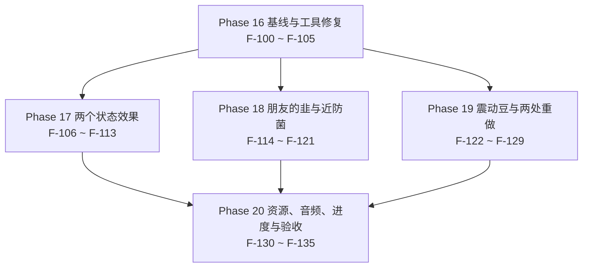

# 19 · v0.0.3 任务拆分与开发大纲（Task Breakdown & Roadmap）

> 项目：农场风云 / Farmstorm · v0.0.3
> 依据：`docs/zh/16-DECISIONS-0.0.3.md`（D-80 ~ D-102，23 条）+ `docs/zh/17-DESIGN-0.0.3.md`（7 个条目的完整规格）+ `docs/zh/18-TECH-0.0.3.md`（注册增量 / 类设计 / 资源与 config 清单 / RT-17 ~ RT-23 / §11 的 17 条验收自检）
> 本文件把 18 号的规格拆成 **36** 个「一次可独立提交、可独立验证」的任务，编号 **F-100 ~ F-135**，接 `13-TASKS-0.0.2.md` 的 F-99。Phase 16 ~ Phase 20 与里程碑 M12 ~ M16 一一对应。
> 覆盖：13 个新增注册对象、19 行 config 变更（纯新增 16 + 改既有默认值 3）、31 个新增资源文件（PNG 8 + OGG 1 + JSON 22）、9 条数据条目、7 条 RT 风险，未覆盖 0 条（逐条对照见 §9）。
> 本文件只读上游：不改 `16` / `17` / `18` 号文件、不改 `docs/zh` 的 00 – 18 与 `docs/en` 的任何一份、不改 `src/`（D-80）。

---

## 0. 阅读约定

### 0.1 任务粒度

一个任务 = 一次可独立提交、可独立验证的改动。判据沿用 `13-TASKS-0.0.2.md §0.1` 的三条，v0.0.3 沿用它的两条补充（本文补充）：

1. 提交后 `.tools\gw.cmd build` 退出码 0，且不依赖同一批次中尚未提交的任务。
2. 任务自带至少一条能在 §0.3 列出的位置观察到的验收断言。
3. 回滚该提交不会让其它已完成任务失效（回滚只影响依赖它的后续任务）。
4. 不跨 Phase 边界：一个任务的交付物全部落在它所属 Phase 的名称范围内；跨 Phase 的前置只写在「依赖」列里。
5. 只动 `18-TECH-0.0.3.md §3.0` 总览表点名的文件（11 个新类 + 6 个既有文件 + 接线文件）与 `18-TECH-0.0.3.md §8.1 / §9` 点名的 config 键与资源文件；表外的改动一律先改 16 号再拆任务。

### 0.2 复杂度与工作量换算

换算口径与 `13-TASKS-0.0.2.md §0.2` 完全一致，不在中途调整：

| 复杂度 | 含义 | 折算人日 |
|---|---|---|
| S | 单文件或纯数据；≤ 1 个类，或 ≤ 20 个 JSON | 0.5 |
| M | 2 ~ 4 个文件，跨 1 ~ 2 个包，或新增 1 个完整行为实现 | 1.5 |
| L | ≥ 5 个文件或跨 3 个包，含运行期状态机 / 序列化 / 事务 / 渲染管线 | 3.0 |

v0.0.3 的 36 个任务按此分布：**S 6 个 / M 22 个 / L 8 个**，折算合计 `6 × 0.5 + 22 × 1.5 + 8 × 3.0 = 3.0 + 33.0 + 24.0 = 60.0` 人日（不含缓冲）。

### 0.3 验收标准写法

每条验收必须能在下列位置之一被观察到：`logs/latest.log` 的断言输出；游戏内 `/execute` `/data get` `/damage` `/advancement` `/playsound` 的返回值；F3 / F3+B 的界面读数；`src/generated/resources` 或 `config/farmstorm-server.toml` 的文件内容；`build/libs` 或 `dist` 的产物。禁止「表现正常」「手感良好」这类不可观测表述。

本文件的四条写法约定（本文补充）：

1. 断言里必须出现具体数值、键名或文件路径（例：「`interceptCount` 逐次为 1..6」而不是「计数正常」）。
2. 手测类断言必须写清对照场景（例：「`cancelFallDamage` 开 / 关各落一次」）。
3. 引用上游自检项时写编号（例 `18-TECH-0.0.3.md §11 #15`），不重抄判据。
4. 少数断言用结构性证据（`grep` 匹配数为 0、`git diff` 为空、`ffprobe` 的编码输出、`jar tf` 的条目列表）——它们指向文件的确定内容，与上面五类位置同等有效，且只在无法用那五类判定时使用（如「0 个自定义网络包」这条红线本身就没有运行期读数）。

### 0.4 文档裁决记录

下面 9 条是本轮的口径分歧与本文的裁决，编号接 `13-TASKS-0.0.2.md §0.4` 的 A-09。后续任务一律按「裁决」列执行；A-15 ~ A-17 三处**曾经**的上游不一致已由上游按裁决订正，登记在 §12.3 作溯源。

| 编号 | 冲突点 | 涉及文档 | 裁决 | 落地任务 |
|---|---|---|---|---|
| A-10 | 刺球改名要连带改什么：只改中文显示名，还是连 registry id 与英文名一起改 | `16-DECISIONS-0.0.3.md` §3.4 D-93、§5.2；`17-DESIGN-0.0.3.md` §7.2 | **只改 `zh_cn.json` 的取值**：中文名「赢过输过没死过」→「刺球」；registry id 仍是 `fang_trap_cactus`、方块 id 仍是 `fang_trap_cactus_block`、`DeployedKind` 常量仍是 `FANG_TRAP_CACTUS`、英文名仍是 Fang Trap Cactus。这是 C-10 的**第一处也是唯一一处**显式例外（中英不再对译），不许在别处再开第二处 | F-125 |
| A-11 | 震动豆档案的 `DeployedKind` 填 `null` 还是 `VIBRATION_BEAN` | `16-DECISIONS-0.0.3.md` §4 第 22 行（该行**曾写「—」**，已订正为 `VIBRATION_BEAN`）；`18-TECH-0.0.3.md` §1.4(b)、§2.2 注 3 | **填 `DeployedKind.VIBRATION_BEAN`**：`DeployedCropBlockEntity#kindOf` 对任何不是 `DeployedCropBlock` 的方块直接抛 `IllegalStateException`，而 `kind` 从 `profile.kind()` 取，填 `null` 会回落到 `BLAST_CARROT`，陷阱就变成爆炸陷阱。枚举由 6 个值变 **8** 个（`POINT_DEFENSE_FUNGUS`、`VIBRATION_BEAN`）；枚举常量不是注册对象，注册总数不受影响。**上游已订正**：16 号 §4 第 22 行已改为 `VIBRATION_BEAN`；本条保留作溯源 | F-103、F-105 |
| A-12 | Q弹 的 `mount` 分支用什么承载坐骑 | `16-DECISIONS-0.0.3.md` §3.6 D-102；`18-TECH-0.0.3.md` §4.3 | **`minecraft:armor_stand`**（原版既有实体类型），不新增 `entity_type`，`entity_types` 增量恒为 **+2**；五项属性覆写 `setInvisible` / `setNoGravity` / `setInvulnerable` / `setSilent` / `setMarker`，随生物死亡立即 `discard()` | F-109、F-112 |
| A-13 | 近防菌的拦截音与震动豆的爆炸音要不要新增 `sound_event` | `16-DECISIONS-0.0.3.md` §3.6 D-100；`18-TECH-0.0.3.md` §8.4、§9.2 附 | **都复用原版事件**：拦截音 `SoundEvents.SHIELD_BLOCK`、爆炸音 `SoundEvents.GENERIC_EXPLODE`，代码里只写 Java 常量、不写 `minecraft:***` 字符串。`sound_events` 增量**恒为 +1**（只有 `friend_chives`），`sounds.json` 的事件数 2 → 3 | F-120、F-124、F-131 |
| A-14 | `tools/verify_project.py` 滞后于实现时，验收要不要降级成人工签字 | `16-DECISIONS-0.0.3.md` §6 第 10 条；`18-TECH-0.0.3.md` §1.4(c)、§11 #1 | **不许降级**：工具必须修到 0.0.2 基线 **77 / 77**（config 139、lang 263、`结论：FAIL 0 项`、退出码 0），v0.0.3 落地后再收到 **90 / 90**（config 155、lang 297）。RT-23 兜底栏的「工具保持红 + 人工签字」只在作者明确否决修工具时启用，本轮不适用 | F-100、F-135 |
| A-15 | `qbounce` 三个姿态参数的默认值曾有两种读数：`rotateDegreesPerTick` 与 `squashPeriodTicks` 取 24.0 / 6，还是 12.0 / 10 | `17-DESIGN-0.0.3.md` §2.3、§2.5、§11.1（曾写 24.0 / 0.15 / 6）；`18-TECH-0.0.3.md` §4.2、§8.1 #2–#4、§8.2、§11 #3（曾写 12.0 / 0.15 / 10） | **取 24.0 度/刻、0.15、6 刻**（= 480 度/秒、一圈 15 刻、1 秒约 3.3 个压缩周期）：这是 D-81 在 17 号 §2.3 与施工事实卡 §3.3 里的同一组值，而 18 号 §8.1 这三行自带「默认值本文补充」标注（即不由决策派生）。**范围列仍以 18 号 §8.1 为唯一出处**（0.0–360.0 / 0.0–0.90 / 2–100）。18 号 §4.2、§8.1 #2–#4、§8.2 与 §11 #3 的 12.0 / 10 刻 / 240 度每秒已按本条改为 24.0 / 6 刻 / 480 度每秒。**上游已订正**，本条保留作溯源 | F-104、F-107、F-108 |
| A-16 | PNG 增量曾出现 7 张与 8 张两种写法 | `16-DECISIONS-0.0.3.md` §8（曾写 +7 / +1）；`17-DESIGN-0.0.3.md` §1.3（曾写 +7 / +1）；`18-TECH-0.0.3.md` §1.4(d)、§9.1（8 行） | **8 张**：第 8 张是震动豆的物品图标（`ModItemModelProvider` 的 `basicItem` 兜底分支固定引用 `farmstorm:item/<id>`，与 0.0.2 三个隐形陷阱同处置）。资源增量按 PNG 8 + OGG 1 + JSON 22 = **31**。**上游已订正**：17 号 §1.3 已改为 +8，16 号 §8 同批改为 +8；本条保留作溯源 | F-130、F-135 |
| A-17 | 三条新进度的 ID 与文件名曾有两套写法 | `17-DESIGN-0.0.3.md` §10.1（`first_q_bounce` / `point_defense_intercept` / `vibration_bean_trigger`）；`18-TECH-0.0.3.md` §2.3、§9.3 #20–#22（曾写 `first_q_bounce` / `first_intercept` / `first_vibration_bean`） | **取 17 号 §10.1 的三条**：`farmstorm:first_q_bounce`、`farmstorm:point_defense_intercept`、`farmstorm:vibration_bean_trigger`，JSON 文件名与 ID 一致。18 号 §2.3 与 §9.3 #21 / #22 的两个短名已按本条改为同 ID（17 号 §10.1 是这三条的显示名、父进度与触发口径的唯一出处）。**上游已订正**，本条保留作溯源 | F-133 |
| A-18 | §9 的子表 3（31 个资源文件）与子表 4（9 条数据条目）有 6 条重叠，怎么算 | `18-TECH-0.0.3.md` §9.3（按文件 22 行）、§2.3（按数据条目 5 行，不进注册计数） | **两张表口径不同、不重复计入总数**：子表 3 **按文件**数（PNG 8 + OGG 1 + JSON 22 = 31 个文件）；子表 4 **按数据条目**数（2 条转换配方 + 3 个进度 + 1 个 item tag + 2 处 vanilla / 自家方块标签追加 + 1 个 damage_type 的 data json = 9 条），其中 6 条（2 配方 + 3 进度 + 1 damage_type）在子表 3 里已作为文件出现过一次。两个合计不相加，各自的「未覆盖 0」分别成立 | F-132、F-133 |

#### 0.4.1 与 13 号 A-01 ~ A-09 的关系

13 号的 9 条裁决属于 0.0.2 的口径（莫洛托夫概率键、狂野苹果时长、桑吉尔蔗相位驱动、config 键形态、转速 72.0、抗性矩阵、压缩膨胀麦沿用什么、触发掉落的双路径、进度显示名用短句）。v0.0.3 只延续其中两条：**A-08 的双路径口径**（触发后静默移除不走战利品表，玩家自挖照常掉落，本版由近防菌的第 6 次上限与震动豆的触发沿用）与 **A-09 的短句口径**（F-133 的三条进度标题），其余七条与 v0.0.3 无关，不重新裁决。

---

## 1. 任务依赖图

### 1.1 Phase 级依赖



Phase 17 / 18 / 19 三者互不依赖，只共享 Phase 16 的注册层、config 层与档案层，可分别派给三个人。三条线唯一的交叉在 Phase 20 的进度（`first_q_bounce` 要 Q弹 能施加、`point_defense_intercept` 要拦截能计数、`vibration_bean_trigger` 要陷阱能结算），因此 Phase 20 必须等三条线全部收口。

### 1.2 主干链（文本树）

```text
F-100 修 verify_project.py 0.5
├─ F-101 基线三账对账 0.5 ── F-102 版本与构建基线 0.5 ── F-103 注册接线 3.0
│   ├─ F-104 config 16 键 1.5
│   ├─ F-105 三条档案与池 19 条 1.5 ── F-114 朋友的韭种植形态 1.5 ── F-115 落点结算 1.5 ── F-116 命中音 0.5
│   ├─ F-106 两个效果类 1.5
│   │   ├─ F-107 客户端状态机 1.5 ── F-108 render 分支 3.0
│   │   │                    └─ F-110 输入锁复用 1.5
│   │   ├─ F-109 mount 分支 3.0
│   │   └─ F-111 混乱反转 1.5
│   ├─ F-117 近防菌方块 1.5 ── F-118 索敌四筛 3.0 ── F-119 计数去重 1.5 ── F-120 图效 discard 1.5
│   ├─ F-123 不依附模式 3.0 ── F-122 震动豆落点放置 1.5
│   ├─ F-125 刺球改名 0.5 ── F-126 刺球四项数值 1.5 ── F-127 击中定义 3.0
│   └─ F-128 桑吉尔蔗固定 7.5 1.5
├─ 汇合层：F-112 真机对照 0.5（F-108 + F-109）── F-113 Phase 17 出口 1.5（F-110 + F-111 + F-112）
├─ 汇合层：F-121 Phase 18 出口 1.5（F-116 + F-120）
├─ 汇合层：F-124 震动豆触发结算 1.5（F-123 + F-111）── F-129 Phase 19 出口 1.5（F-124 + F-127 + F-128）
└─ Phase 20：F-130 PNG 8 张 1.5、F-131 音频管线 1.5（两件只等 F-102）
    └─ F-132 DataGen 19 个 JSON 3.0（F-103 + F-123 + F-128）
        └─ F-133 三条进度 1.5（F-115 + F-119 + F-124）
            └─ F-134 语言键 34 条 1.5（F-104 + F-132 + F-133）
                └─ F-135 全量验收 3.0（F-113、F-121、F-129、F-130 ~ F-134）
```

只画决定总工期的那几条。**每个任务在树里只出现一次，且树上的父节点一定是该任务「依赖」字段里列出的任务之一**；树里没画全的前置以任务块的「依赖」字段为准。三条补充前置：`F-126` 还要等 `F-104`（两个新 config 键），`F-124` 还要等 `F-111`（它要施加 `confusion`），`F-132` 还要等 `F-128`（`damage_type` 的 data json 与它同一批）。

---

## 2. 总览

| Phase | 名称 | 任务数 | 任务 ID | 人日 | 对应里程碑 |
|---|---|---|---|---|---|
| Phase 16 | 基线与工具修复 | 6 | F-100 ~ F-105 | 7.5 | M12 |
| Phase 17 | 两个状态效果 | 8 | F-106 ~ F-113 | 14.0 | M13 |
| Phase 18 | 朋友的韭与近防菌 | 8 | F-114 ~ F-121 | 12.5 | M14 |
| Phase 19 | 震动豆与两处重做 | 8 | F-122 ~ F-129 | 14.0 | M15 |
| Phase 20 | 资源、音频、进度与验收 | 6 | F-130 ~ F-135 | 12.0 | M16 |
| **合计** | | **36** | **F-100 ~ F-135** | **60.0** | **M12 ~ M16** |

- **原始人日合计：60.0 人日**（= 各行小计之和 = 各任务折算人日之和，见下方复核）。
- **加 25% 缓冲后的合计：75.0 人日**（`60.0 × 1.25 = 75.0`）。
- 关键路径长度：**18.0 人日 / 11 个任务**（推导见 §11.1）。

复杂度分布与复核：

| 复杂度 | 任务数 | 单件人日 | 小计 | 任务号 |
|---|---|---|---|---|
| S | 6 | 0.5 | 3.0 | F-100、F-101、F-102、F-112、F-116、F-125 |
| M | 22 | 1.5 | 33.0 | F-104、F-105、F-106、F-107、F-110、F-111、F-113、F-114、F-115、F-117、F-119、F-120、F-121、F-122、F-124、F-126、F-128、F-129、F-130、F-131、F-133、F-134 |
| L | 8 | 3.0 | 24.0 | F-103、F-108、F-109、F-118、F-123、F-127、F-132、F-135 |
| **合计** | **36** | — | **60.0** | 1 – 36 全覆盖 |

复核等式：`6 × 0.5 + 22 × 1.5 + 8 × 3.0 = 3.0 + 33.0 + 24.0 = 60.0`，与上表合计逐位相等；`60.0 × 1.25 = 75.0`。

---

## 3. Phase 16 · 基线与工具修复（F-100 ~ F-105）

阶段目标：先把「取数」这件事修对（RT-23），让 0.0.2 的基线 **77** 成为可复算的实测值而不是一句断言；再把 v0.0.3 的 13 个注册对象、19 行 config 变更与 3 条新作物档案一次立稳，后面四个 Phase 只往里填行为。

阶段出口判据：`tools/verify_project.py` 输出 `77 / 77` 与 `结论：FAIL 0 项`（A-14）；`.tools\gw.cmd build` 退出码 0；启动日志的注册自检行逐类为 31 / 25 / 6 / 13 / 4 / 3 / 1 / 1 / 1 / 3 / 1 / 1（合计 90）、作物自检 22 种、池 19 种；`config/farmstorm-server.toml` 叶节点 155 个。

#### F-100 · 修 `tools/verify_project.py` 到 0.0.2 基线 77

- **复杂度**：S ｜ **折算人日**：0.5
- **依赖**：—
- **交付物**：`tools/verify_project.py`，按 `18-TECH-0.0.3.md §1.4(c)` 的四段改法逐段落地——① §1 的期望键集从 117（只读 `01-DESIGN.md` §3.8）改为 139（再读 `12-TECH-0.0.2.md` §8.1 的 22 行）；② §2 的 `EXPECTED` 从 items 22 / blocks 20 / entity 9 改为 items 27 / blocks 22 / entity 11；③ §2 的分母从 64 改为 77，并让 12 类逐类小计与 `18-TECH-0.0.3.md §1.2` 相等；④ 补齐剩余 5 个裸 ID 字面量（含 recipe serializer 与 menu），使 12 类全部走逐类小计。
- **验收**：
  1. `python -X utf8 tools/verify_project.py` 输出 `已核 registry 对象: 77 / 77`、config 段 139 键无 FAIL、`lang 键集一致，共 263 键`、`结论：FAIL 0 项`，退出码 0（`18-TECH-0.0.3.md §1.4(c)` 的「修到 0.0.2 基线的目标」表 + §11 #1；A-14）。
  2. 12 类逐类小计与 `18-TECH-0.0.3.md §1.2` 逐项相等：27 / 22 / 6 / 11 / 2 / 2 / 1 / 1 / 1 / 2 / 1 / 1，相加 77。
  3. 修工具不许回改冻结区：`git diff --stat` 里 `docs/` 为空、`01-DESIGN.md` 未被动过（RT-23 风险③；`16-DECISIONS-0.0.3.md` §6 第 1 条）。
  4. 工具里不出现第二处硬编码总数：`grep -c "64"` 的命中不再包含分母（RT-23 风险①）。

#### F-101 · 0.0.2 基线的三账对账与取数

- **复杂度**：S ｜ **折算人日**：0.5
- **依赖**：F-100
- **交付物**：一次只读的复算与对账（不改源码）：`logs/latest.log` 的四条启动自检行、`tools/verify_project.py` 的四段输出、`12-TECH-0.0.2.md §2.1` 的 12 行表，三者逐项对账，结论写进提交信息。
- **验收**：
  1. 启动日志的注册自检行（`Farmstorm#logRegistrySelfCheck`，L138–L141 的断言）与 F-100 的 `77 / 77` 逐类相等（`18-TECH-0.0.3.md §1.2` 的第 4 / 5 / 6 列三列相等）。
  2. `18-TECH-0.0.3.md §1.3` 的 7 行交叉核对逐行成立：档案 19、池 16、类型 10 / 6 / 3 与破障 4、注册 77、`sounds.json` 2 个事件、config 139、语言键 263。
  3. `git diff --stat` 只含 `tools/`（F-100 的改动），`src/` 与 `docs/` 为空——本条的任务形态就是「先取数、不改码」（RT-23 的首要缓释）。

#### F-102 · 版本号切换与构建基线

- **复杂度**：S ｜ **折算人日**：0.5
- **依赖**：F-101
- **交付物**：`gradle.properties` 的 `mod_version=0.0.2` → `0.0.3`（当前在第 11 行）；`build.gradle` 零改动。
- **验收**：
  1. `.tools\gw.cmd build` 退出码 0，产物为 `build/libs/farmstorm-0.0.3+mc1.21.1.jar`（文件名版本号随 `gradle.properties` 变化）。
  2. `jar tf` 里能看到 `META-INF/neoforge.mods.toml`，其 `version` 为 0.0.3。
  3. `build.gradle` 的 `git diff` 为空（`18-TECH-0.0.3.md §0.1`：构建基线 MC 1.21.1 / NeoForge / Java 21 不变）。

#### F-103 · 13 个注册对象、`DeployedKind` +2 与 11 个新类骨架

- **复杂度**：L ｜ **折算人日**：3.0
- **依赖**：F-102
- **交付物**：
  - `registry/` 七个注册类：(items +4) `friend_chives` / `chive_seeds` / `point_defense_fungus` / `vibration_bean`；(blocks +3) `friend_chives_crop` / `point_defense_fungus` / `vibration_bean`；(entity_types +2) `friend_chives` / `vibration_bean`；(mob_effects +2) `q_bounce` / `confusion`；(sound_events +1) `friend_chives`；(damage_types +1) `zangief_slam`（`18-TECH-0.0.3.md §2.2` 的 13 行逐个点名）。
  - `behavior/DeployedKind.java`：+`POINT_DEFENSE_FUNGUS(10)`、+`VIBRATION_BEAN(10)`，枚举 6 → 8（A-11）。
  - `registry/FarmstormBlockEntities.java`：把 `vibration_bean` 追加进 `fang_trap_cactus` 那个 type、`point_defense_fungus` 追加进 `blast_carrot` 那个 type，`block_entities` 仍 6（§2.2 注 3）。
  - `behavior/DeployedBehaviors.java` 与 `behavior/FarmstormBlockEntities.deployedOf` 的两个新 `case`（穷尽 switch，缺一个就编译不过）。
  - 11 个新类的编译期骨架（`18-TECH-0.0.3.md §3.0` 总览表）：`effect/` 2、`client/` 3、`behavior/` 1、`behavior/impl/` 3、`entity/thrown/` 2。骨架只含构造器与空覆写，行为在 Phase 17 ~ 19 填。
  - `Farmstorm.java`：`logRegistrySelfCheck` 的 12 条断言从 77 改到 90、`mobEffects` 从 2 改到 4。
  - `tools/verify_project.py`：§2 的期望值与分母从 F-100 定下的 77（items 27 / blocks 22 / entity_types 11）更新到 90（items 31 / blocks 25 / entity_types 13，12 类逐类）；config 段仍 139（它在 F-104 之后才动）、lang 段一行不改（该段只比对键集并打印实际键数，没有期望值可改）。
- **验收**：
  1. 启动日志逐字出现 `自检 注册对象 90 个：items 31 / blocks 25 / block_entities 6 / entity_types 13 / mob_effects 4 / sound_events 3 / recipe_types 1 / recipe_serializers 1 / creative_tabs 1 / damage_types 3 / data_components 1 / menu_types 1 → OK`（`18-TECH-0.0.3.md §2.1` 的 v0.0.3 列 + §11 #2）。
  2. `tools/verify_project.py` 在 v0.0.3 代码上输出 `90 / 90` 且 registry 段 `结论` 为通过（config 段此时仍是 139、lang 段打印的是当时的实际键数 263，两段照旧通过；config 的 155 在 F-104 收口，lang 的 297 由 F-104 的 16 条与 F-134 的 18 条自然长到，工具侧没有期望值）。
  3. 13 个新增 ID 与 `18-TECH-0.0.3.md §2.2` 的 13 行逐字一致（`/give` 四个物品各一次、`/setblock` 三个方块各一次、`/summon` 两个实体各一次、两张效果都有 `/effect` 补全、一个音效事件在 `/playsound` 补全）。
  4. `DeployedKind` 的 8 个值全部打印，`VIBRATION_BEAN` 的扫描间隔为 10 刻；`git diff behavior/DeployedKind.java` 只含新增行，六个既有常量一个未改（A-11）。
  5. `.tools\gw.cmd build` 退出码 0，编译日志无 `the switch expression does not cover all possible input values`。

#### F-104 · config 19 行变更与 16 条 configuration 语言键

- **复杂度**：M ｜ **折算人日**：1.5
- **依赖**：F-103
- **交付物**：`config/FarmstormConfig.java`——四个新分组 `qbounce` 4 键 / `friend_chives` 3 键 / `point_defense_fungus` 3 键 / `vibration_bean` 2 键（12 个纯新增）+ `fang_trap_cactus` 追加 2 个新键并改 3 个既有默认值 + `zangief_cane` 追加 2 个新键（合计 19 行 = 纯新增 16 + 改既有默认值 3）；`datagen/ModLangProvider` 的 16 条 `farmstorm.configuration.*`；生成物 `config/farmstorm-server.toml`；`tools/verify_project.py` 的 §1 期望键集从 139 更新到 **155**（纯新增的 16 行逐行加进去，不是改一个总数）。
- **验收**：
  1. `config/farmstorm-server.toml` 叶节点 **155** 个（139 + 16），四个新分组按字母序追加在文件末尾（`18-TECH-0.0.3.md §8.2` 的 TOML 片段）。
  2. 三个被改的既有默认值读回：`fang_trap_cactus.triggerRadius = 2.5`、`outerDelayTicks = 4`、`innerDelayTicks = 2`；既有键的 `min` / `max` 与语言键逐字保留（§8.1 表下注）。
  3. 姿态三参数读回 24.0 / 0.15 / 6（A-15）；其余 16 个纯新增键的默认值与 §8.1 逐行相等。
  4. `confusion` 组不存在任何键：`grep -c "[confusion]" config/farmstorm-server.toml` 为 0（§8.1 的 1 行非键说明；D-83）。
  5. `farmstorm.configuration.*` 语言键同样是 155 条，与 config 键数恒相等、中英键集逐字相同（§8.3）。
  6. 改 `point_defense_fungus.maxIntercepts` 为 3 → `/reload` → 读回 3，再改回 6 读回 6（既有 `bake()` 口径）。

#### F-105 · 三条新档案、`ALL` 22 条与幸运浆果池 19 条

- **复杂度**：M ｜ **折算人日**：1.5
- **依赖**：F-103
- **交付物**：`util/CropProfile.java`（+3 常量 `FRIEND_CHIVES`（THROWABLE / BUFF，方块 `friend_chives_crop`、种子 `chive_seeds`）、`POINT_DEFENSE_FUNGUS`（DEPLOYABLE / TURRET，方块与种子都为 null、`kind = POINT_DEFENSE_FUNGUS`）、`VIBRATION_BEAN`（THROWABLE / TRAP，方块与种子都为 null、`kind = VIBRATION_BEAN`）；`ALL` 22 条；`LUCKY_BERRY_POOL` 一行不改）；`Farmstorm.java` 的作物自检与池自检两行文案。
- **验收**：
  1. 启动日志逐字出现 `自检 作物 22 种：投掷型 12 / 部署型 7 / 食用型 3；破障类 4 → OK`（`16-DECISIONS-0.0.3.md` §4 的计数自洽表 + `18-TECH-0.0.3.md §11 #2`）。
  2. 启动日志逐字出现 `自检 幸运浆果池 19 种（排除 lucky_berry / wild_apple / compressed_puffed_wheat）→ OK`（D-97；池由 16 变 19 是推导式的自然结果）。
  3. `git diff util/CropProfile.java` 里既有 19 条档案的八个字段一个字符未改；`LUCKY_BERRY_POOL` 那一行的 `git diff` 为空（D-97 的「不改那行推导式」；`16-DECISIONS-0.0.3.md` §5.7）。
  4. `CropProfile.VIBRATION_BEAN.kind() == DeployedKind.VIBRATION_BEAN`，不是 `null`：置 `null` 会回落到 `BLAST_CARROT` 让陷阱跑成爆炸陷阱（A-11；`18-TECH-0.0.3.md §1.4(b)`）。
  5. 两个新部署档案没有作物方块与种子：`POINT_DEFENSE_FUNGUS` 与 `VIBRATION_BEAN` 的 `block()` / `seed()` 返回 `null`，`/give` 不给种子（`18-TECH-0.0.3.md §2.3` 的「朋友的韭没有转换配方」与 §3.2 第 1 点）。

阶段小计：**6 个任务、7.5 人日**（S 3 / M 2 / L 1）。

---

## 4. Phase 17 · 两个状态效果（F-106 ~ F-113）

阶段目标：把 `q_bounce` 与 `confusion` 两个状态效果做完——Q弹 要给出「坐姿 + 旋转 + 压缩拉伸 + 全锁」四件事且两条坐姿分支都实现，混乱只反转移动方向的分量并在锁生效时让位。

阶段出口判据：`18-TECH-0.0.3.md §11` 的 #3 ~ #7 五条全过；`qbounce.poseMode` 两条分支各跑一次都能过 #3 / #4；`entity_types` 增量仍是 +2；`CustomPacketPayload` 与 `Mixin` 的匹配数都为 0。

#### F-106 · 两个效果类：`QbounceEffect` 与 `ConfusionEffect`

- **复杂度**：M ｜ **折算人日**：1.5
- **依赖**：F-103
- **交付物**：`effect/QbounceEffect.java`（`super(MobEffectCategory.HARMFUL, 0xFF6EC7)`；不重写 `applyEffectTick` 与 `isDurationEffectTick`；不设自己的时长键；不读任何 config 键）；`effect/ConfusionEffect.java`（同形，隐藏项、不注册图标）；两个效果的本体都不知道自己是 10 秒还是 4 秒。
- **验收**：
  1. `/effect give @s farmstorm:q_bounce 10 0` 与 `/effect give @s farmstorm:confusion 4 0` 都返回成功（**注意 `/effect` 第 3 参数单位是秒**：10/4 秒 ⇒ 200/80 刻；写 200/80 会得到 4000/1600 刻），`/data get entity @s active_effects` 里出现两条记录，`amplifier` 都是 0、`duration` 分别是 200 与 80（`18-TECH-0.0.3.md §3.1` 的构造器行）。
  2. 两个效果类不读 config：`grep -c "FarmstormConfig" effect/QbounceEffect.java effect/ConfusionEffect.java` 为 0（§3.1 的「读哪些 config 键：不读」）。**范围只限这两个类**——`effect/WildHunterEffect.java` 按 D-61/D-62 读 config 是既有设计，不能算违规。
  3. `confusion` 不注册图标：`grep -rc "mob_effect/confusion" src/main/java/` 为 0，`textures/mob_effect/` 下没有 `confusion.png`（D-83；§3.2）。
  4. 专用服务器启动日志无 `NoClassDefFoundError`（两个效果类都在公共侧，不依赖 `Dist.CLIENT`）。

#### F-107 · 客户端三件套状态机与编译期镜像常量

- **复杂度**：M ｜ **折算人日**：1.5
- **依赖**：F-106
- **交付物**：`client/QbounceClientState.java`（`t` 逐刻累加、`θ = 24.0 × t mod 360`、`s = 0.15 × sin(2π × t / 6)`、`scale = (1 − s ÷ 2, 1 + s, 1 − s ÷ 2)`；效果消失归零；一律不写回实体、不发包）；三个编译期镜像常量（照 `client/ZangiefClientState` 的既有写法，`18-TECH-0.0.3.md` 的「编译期镜像常量 + 注释说明必须同步改」口径）。
- **验收**：
  1. 三个镜像常量与 `config/farmstorm-server.toml` 的 `qbounce.*` 逐值相等：24.0 / 0.15 / 6（A-15），差一处即判失败（§4.2 的读键行 + §3.12）。
  2. `t` 只在客户端本地累加，不用「总时长 − 剩余时长」反推：把剩余时长用 `/effect` 改成 100 后 `t` 不跳相位（`17-DESIGN-0.0.3.md` §2.5 的三条实现约束第 2 条）。
  3. 效果消失的下一 tick `t` 归零，并只打一行 `q_bounce t=0`（不刷屏）。
  4. 不发包、不写回实体：`grep -c "CustomPacketPayload" src/main/java/` 为 0、`grep -c "setYRot" client/QbounceClientState.java` 为 0（D-50、`17-DESIGN-0.0.3.md` §2.5 第 3 条）。

#### F-108 · `render` 分支：模型 `riding`、压低、旋转、压缩

- **复杂度**：L ｜ **折算人日**：3.0
- **依赖**：F-107
- **交付物**：`client/QbouncePoseRenderer.java`——`RenderLivingEvent.Pre` 里依次 `pushPose()`、`translate(0, −0.35, 0)`、`scale`、绕 `Axis.YP` 旋转，`Post` 里 `popPose()` 成对；进入条件只有 `hasEffect(Q_BOUNCE)`；`riding` 标志只改这一帧的模型实例。
- **验收**：
  1. `18-TECH-0.0.3.md §11 #3` 全过：僵尸呈乘坐姿势（腿部下压）、压低 0.35 格、约 480 度/秒旋转（24.0 度/刻，A-15）、按 6 刻周期压缩拉伸；AI 仍在走（位置继续变化）、碰撞箱不变。
  2. `push` / `pop` 成对：连续渲染 30 秒后画面无整体漂移（RT-17 的验法③）。
  3. 同屏 3 个受效果生物各看一帧，三者互不累积位移；第三人称下「我看别人坐着」与「别人看我坐着」是同一段逻辑（`17-DESIGN-0.0.3.md` §2.4.1）。
  4. 对不读 `riding` 的模型（任选一个非 `HumanoidModel` 的原版生物对照）降级为「只旋转不压坐」，不抛异常（RT-17 兜底②③）。
  5. `entity_types` 增量仍是 +2、注册自检仍是 90（本条只改渲染层，不新增注册对象）。

#### F-109 · `mount` 分支：隐形 `minecraft:armor_stand` 坐骑与记账表

- **复杂度**：L ｜ **折算人日**：3.0
- **依赖**：F-106
- **交付物**：`behavior/QbounceMountController.java`——`EntityType.ARMOR_STAND.create(level)` + 五项属性覆写（`setInvisible` / `setNoGravity` / `setInvulnerable` / `setSilent` / `setMarker`）、`startRiding(stand, true)`、`Map<UUID, MountRecord>` 记账表（只存内存）、每 tick 三条校验、四条退出路径（死亡 / 掉线 / 换维度 / 服务器停止）+ 每 tick 兜底、重挂超过 20 次放弃并打一行 warn；只在这条分支读 `qbounce.poseMode`。
- **验收**：
  1. `qbounce.poseMode = mount` 时，受效果僵尸的**坐骑侧**能读到它——`/execute as @e[type=minecraft:armor_stand] run data get entity @s Passengers` 里出现该僵尸（A-12）。**不要用骑手侧的 `RootVehicle`**：21.1.213 实测骑手侧读不到该键（`Found no elements matching RootVehicle`），原判据据此订正；僵尸死亡后世界里不再有该 ArmorStand（`18-TECH-0.0.3.md §11 #4`）。
  2. 效果期间 `kill` 该生物、断线重连、走传送门各一次，世界里不残留 ArmorStand（用 `/data get entity` 或日志行验证；RT-18 验法②）。
  3. 切 `poseMode` 两次（render → mount → render），每次切换后记账表被清空、坐骑全部 `discard()`（§4.1 的切换时机行）。
  4. 坐骑类型不是自定义实体：注册自检的 `entity_types` 仍是 13、增量仍是 +2（D-102）。
  5. `setMarker(true)` 若连带取消坐姿，退回 `setMarker(false) + setSmall(true) + setInvisible(true)`，行为不变（RT-18 兜底①）。

#### F-110 · Q弹 复用七段输入锁

- **复杂度**：M ｜ **折算人日**：1.5
- **依赖**：F-107
- **交付物**：`client/InputLockHandler.java`——`locked()` 的判据扩成 `ZangiefClientState.active() || QbounceClientState.active()`；七段与「只留 ESC」一个字不改，不新增第二套锁。
- **验收**：
  1. `18-TECH-0.0.3.md §11 #5` 全过：W / A / 空格 / 潜行 / 左键 / 右键 / 滚轮 / 数字键各一次全部无响应，ESC 仍能开暂停菜单，锁定日志只打印一次。
  2. 锁的定义处只有一个：`grep -rn "isLocked" src/main/java/com/dashpig/farmstorm/client/` 的命中全部指向 `InputLockHandler`（RT-19 兜底栏；D-79 的「不复用第二套锁」）。
  3. 效果结束后下一 tick 输入全部恢复（`QbounceClientState.active()` 为 false 即解除）。

#### F-111 · 混乱的移动反转与「锁优先」

- **复杂度**：M ｜ **折算人日**：1.5
- **依赖**：F-106
- **交付物**：`client/ConfusionInputHandler.java`——`MovementInputUpdateEvent` 里先 `if (InputLockHandler.isLocked()) return;`，再把 `forwardImpulse` 与 `leftImpulse` 各自取反；跳跃、潜行、视角、攻击、使用一律不动。
- **验收**：
  1. `18-TECH-0.0.3.md §11 #6`：只施加混乱时 W 向后走、A 向右平移，速度幅度与正常一致（F3 坐标逐刻差算），视角 / 跳跃 / 潜行 / 左键全部正常。
  2. `18-TECH-0.0.3.md §11 #7`：Q弹 + 混乱同时存在时按 W 位移为 0、锁日志已打印、效果结束的下一 tick 恢复反向。
  3. 只订阅一个事件：`grep -c "@SubscribeEvent" client/ConfusionInputHandler.java` 为 1；不写第二套锁（D-83、D-79）。**不要用 `grep -c "MovementInputUpdateEvent"` 当判据**——任何正常写法都要 import 该类，import 行与形参各命中一次，实测恒为 2；为凑 1 而改写成全限定名属本末倒置。
  4. 不碰速度与视角：`grep -c "MOVEMENT_SPEED" client/ConfusionInputHandler.java` 为 0、`grep -c "Sensitivity" client/ConfusionInputHandler.java` 为 0（`17-DESIGN-0.0.3.md` §3.4）。

#### F-112 · 两条坐姿分支的真机对照与保留结论

- **复杂度**：S ｜ **折算人日**：0.5
- **依赖**：F-108、F-109
- **交付物**：一次真机对照的记录（写进提交信息）：观感、AI 表现、碰撞差异、第三方自定义模型是否认 `riding`、最终保留哪条；落选的那条改成默认关闭，**代码一行不删**。
- **验收**：
  1. 两条分支都能在 `qbounce.poseMode` 下单值切换，并各自通过 `18-TECH-0.0.3.md §11 #3` / #4。
  2. 落选分支的代码仍在：`client/QbouncePoseRenderer.java` 与 `behavior/QbounceMountController.java` 两个文件都还在，`git diff` 里没有删除行（`16-DECISIONS-0.0.3.md` §6 第 8 条）。
  3. `qbounce.poseMode` 的默认值仍是 `render`（D-82 不改）；若保留的是 `mount`，只登记「默认值需上游改 D-82」，本条不动 config 默认值。
  4. 记录里对 RT-17 与 RT-18 各给一句结论（哪条风险真的发生了、缓释是否够用）。

#### F-113 · Phase 17 出口回归

- **复杂度**：M ｜ **折算人日**：1.5
- **依赖**：F-110、F-111、F-112
- **交付物**：一次回归（不新增行为，只补 `17-DESIGN-0.0.3.md` §12.1 / §12.2 / §12.3 / §12.12 / §12.13 五条边界的处置）。
- **验收**：
  1. Q弹 期间玩家死亡、退出、换维度各一次：坐骑无残留、锁在重生后解除（`17-DESIGN-0.0.3.md` §12.2、§12.3；RT-18）。
  2. Q弹 与桑吉尔蔗的相位锁并存：只打印一条锁日志，混乱照常早退（§12.13；RT-19）。
  3. 创造玩家与旁观者：旁观者不受影响，创造玩家的效果与锁照常（§12.12）。
  4. Q弹 生效中目标被拴绳、被骑乘两种情形各一次，行为不回滚、不崩（§12.3）。
  5. `18-TECH-0.0.3.md §11` 的 #3 ~ #7 五条复跑全过；注册自检仍是 90、`block_entities` 仍是 6。

阶段小计：**8 个任务、14.0 人日**（S 1 / M 5 / L 2）。

---

## 5. Phase 18 · 朋友的韭与近防菌（F-114 ~ F-121）

阶段目标：把两个新作物从档案做到行为——朋友的韭走「种子 → 作物 → 收获 → 投掷 → 落点 6 格球 + 命中音」这一条闭环；近防菌走「部署方块 → 8 格欧氏索敌 → 四筛（含非己方）→ 6 次计数 → 图效后 discard」这条拦截闭环。

阶段出口判据：`18-TECH-0.0.3.md §11` 的 #8 / #9 / #12 / #13 / #14 五条全过；`interceptCount` 在「己方穿过」与「原版射弹穿过」两种情形下都不变；`sound_events` 增量仍是 +1、`block_entities` 仍是 6。

#### F-114 · 朋友的韭：物品、韭菜种子、作物方块与 4 个 age

- **复杂度**：M ｜ **折算人日**：1.5
- **依赖**：F-103、F-105
- **交付物**：`registry/FarmstormItems.java` 的 `friend_chives`（`ThrowableCropItem`）与 `chive_seeds`（`SeedItem`）；`registry/FarmstormBlocks.java` 的 `friend_chives_crop`（`FarmstormCropBlock`，4 个 age）；`util/CropProfile.FRIEND_CHIVES` 的作物方块与种子字段接线；`FarmstormTags` 的 `converter_fuel` 常量成员身份（标签文件在 F-132）。
- **验收**：
  1. `/give @s farmstorm:friend_chives` 与 `/give @s farmstorm:chive_seeds` 各返回成功，创造栏 `farmstorm:main` 可见这两条（`18-TECH-0.0.3.md §2.2` 第 1、2 行）。
  2. 韭菜种子种在耕地上生成 `farmstorm:friend_chives_crop`，`age` 从 0 推到 3 逐级可见（`/setblock ... age=3` 与自然生长各验一次），方块 id 与 `18-TECH-0.0.3.md §2.2` 第 5 行一致。
  3. 没有转换配方：`grep -c "FRIEND_CHIVES" datagen/ModRecipeProvider.java` 为 0（D-84 的「没有原版对应物，因此没有转换器配方」）。
  4. 种子只走耕地路径：`/setblock` 在非耕地上放种子不生成作物（D-84 的「获取只有一条路径」）。
  5. 投掷入口存在：`/summon farmstorm:friend_chives ~ ~2 ~` 成功且落地不报错（落点结算在 F-115，此时是骨架版 `onImpact`）。

#### F-115 · `FriendChivesProjectile` 的落点结算：欧氏 6 格球与 200 刻 Q弹

- **复杂度**：M ｜ **折算人日**：1.5
- **依赖**：F-114、F-106
- **交付物**：`entity/thrown/FriendChivesProjectile.java`——`onImpact` 以落点为球心取半径 6.0 的欧氏球，球内每个 `LivingEntity` 写入 200 刻 `q_bounce`（amplifier 0、六参构造的最后两位分别是 `false` 与 `true`），累计施加成功数 `n` 供 F-116 判「要不要播音」；`profile()` 返回 `FRIEND_CHIVES`。
- **验收**：
  1. `18-TECH-0.0.3.md §11 #12` 前半：命中 1 只生物时，6 格内全部生物获得 Q弹，`/data get entity` 的 `duration` 为 200、`amplifier` 为 0。
  2. 欧氏而非切比雪夫：球内 6.0 格被施加、对角 8.4 格不被施加（`17-DESIGN-0.0.3.md` §4.5 的「6.0（欧氏）」口径；与 RT-20 的欧氏复核同一把尺子）。
  3. 投掷者本人在球内时同样拿 Q弹（`17-DESIGN-0.0.3.md` §4.5 最后一列）。
  4. 不筛敌我：同队玩家与对立玩家都被施加（D-85、D-27 的一次性 AoE 口径）。
  5. 判据只有一条：`n` 就是施加成功计数，不另做一次「附近有没有生物」的查询（`17-DESIGN-0.0.3.md` §4.6 的四条口径第 1 条）。

#### F-116 · 朋友的韭命中音：只在命中时播一次、32 格可闻

- **复杂度**：S ｜ **折算人日**：0.5
- **依赖**：F-115
- **交付物**：`FriendChivesProjectile#onImpact` 的播音段——`n ≥ 1` 才播、一次投掷只播一次、`SoundSource.PLAYERS`、音量取 2.0（广播半径 16 × 2.0 = 32 格）、事件是 `farmstorm:friend_chives`。
- **验收**：
  1. `18-TECH-0.0.3.md §11 #12` 后半：命中时 32 格内可闻、33 格外不可闻；空投（`n = 0`）完全不播。
  2. 广播半径与 config 是同一个数的两种写法：`soundRange = 32.0` ↔ 音量 2.0（`17-DESIGN-0.0.3.md` §4.6 的「32 格怎么来」行）；把 `soundRange` 改 16.0 后 16 格可闻，验完改回。
  3. 播音次数与命中生物数无关：一次命中 3 个只响一次（D-85 的「播放一次音效」）。
  4. 音源分类是 `PLAYERS`，不打断背景音乐（`17-DESIGN-0.0.3.md` §4.6）。

#### F-117 · 近防菌方块、`POINT_DEFENSE_FUNGUS` 类别名与部署入口

- **复杂度**：M ｜ **折算人日**：1.5
- **依赖**：F-103、F-105
- **交付物**：`registry/FarmstormBlocks.java` 的 `deployed(POINT_DEFENSE_FUNGUS, …)`（炮台类外观，不隐形，借原版 `warped_fungus`）；`behavior/DeployedBehaviors.java` 的 `POINT_DEFENSE_FUNGUS` → `PointDefenseFungusBehavior` 分派；`CropProfile.POINT_DEFENSE_FUNGUS` 的档案接线（无作物方块、无种子）。
- **验收**：
  1. `/setblock ~ ~ ~ farmstorm:point_defense_fungus` 成功，世界里可见几何体，`/data get block` 返回 `owner` 字段（复用既有 `DeployedCropBlockEntity`，`block_entities` 仍 6）。
  2. `DeployedKind` 的 8 个值全部打印，`POINT_DEFENSE_FUNGUS` 的扫描间隔为 10 刻（F-103 的枚举值在此被真正分派）。
  3. 每玩家 32 / 每区块 8 的既有上限照旧生效（`18-TECH-0.0.3.md §6.4` 的上限行）。
  4. 物品与方块同 ID 且 `Item.BY_BLOCK` 有映射：`lootTableItem(block)` 能落到物品上（`18-TECH-0.0.3.md §2.2` 注 1）。
  5. 0 张新贴图：方块与物品都借原版 `warped_fungus`，`textures/` 下没有 `point_defense_fungus` 的新文件（§9.1 的「不新增 PNG」行）。

#### F-118 · 近防菌的索敌与四筛（含「非己方」）

- **复杂度**：L ｜ **折算人日**：3.0
- **依赖**：F-117
- **交付物**：`behavior/impl/PointDefenseFungusBehavior.java`（`TurretBehavior` 子类）——AABB 8 格立方只做粗筛 → `getEntitiesOfClass(ThrownCropEntity.class, box, predicate)` → 四筛按固定顺序 ① `!isRemoved()` ② `!isSubmunition()` ③ `center.distanceTo(...) <= 8.0`（欧氏复核）④ 非己方（`!(owner instanceof Player p && be.isAlly(p))`）→ 取最近的一个交给后续的 `fire`。
- **验收**：
  1. `18-TECH-0.0.3.md §11 #13`：原版箭 / 雪球 / 三叉戟 / 末影珍珠 / man瓜导弹（`farmstorm:turret_bullet`）各投一次全部穿过，`interceptCount` 不变；再投一支朋友的韭被拦、`interceptCount` +1。
  2. 对角 7.9 格被拦、8.1 格不被拦（欧氏而非切比雪夫；`18-TECH-0.0.3.md §6.2` 第 4 步与 RT-20 验法③）。
  3. 己方（放置者本人、同队队友）的投掷物穿过、不扣次数、无粒子（D-98；`18-TECH-0.0.3.md §11 #8` 第三段）。
  4. 归属者不是玩家（发射器 / 指令生成 / `getOwner()` 为 `null`）时按非己方处理，照常拦截（`18-TECH-0.0.3.md §6.1` 的己方排除行）。
  5. `isSubmunition()` 为真的风弹不被拦（§6.1 的额外排除行）。

#### F-119 · 拦截计数、同刻去重与第 6 次静默移除

- **复杂度**：M ｜ **折算人日**：1.5
- **依赖**：F-118
- **交付物**：`blockentity/DeployedCropBlockEntity.java` 的 `interceptCount` 与 `recordIntercept(now)`；`entity/ThrownCropEntity.java` 的 `lastInterceptTick` 与 `markIntercepted(now)`（**不**写进 `addAdditionalSaveData`）；第 6 次之后走 `consume()` → `removeBlock`，不触战利品表。
- **验收**：
  1. `18-TECH-0.0.3.md §11 #8` 第一段：单菌连投 6 个朋友的韭，日志里 `interceptCount` 逐次为 1..6，第 6 次结束瞬间方块消失且无掉落物（D-72 口径）。
  2. `18-TECH-0.0.3.md §11 #9`：单菌同一刻面对 2 个投掷物只拦 1 个，计数只 +1，日志里「本刻已拦过」分支至少被走到一次。
  3. 3 个近防菌围同一投掷物：`interceptCount` 总共只 +1，另外 2 个菌没有粒子（D-88 的去重；RT-20 验法①）。
  4. 读档不残留标记：`grep -c "lastInterceptTick" ` 在 `addAdditionalSaveData` 附近的命中为 0（§6.3 的「绝不持久化」）。
  5. 上限可调：把 `maxIntercepts` 改成 2，第 2 次拦截后方块消失（§8.1 第 9 行）；验完改回 6。

#### F-120 · 拦截图效与 `discard()`（不结算落点）

- **复杂度**：M ｜ **折算人日**：1.5
- **依赖**：F-119
- **交付物**：`PointDefenseFungusBehavior#fire` 的四步固定顺序——① `if (target.markIntercepted(now)) return;` ② `sendParticles`（粒子数取 `interceptParticles`，类型 `ParticleTypes.CRIT`）③ `playSound`（常量 `SoundEvents.SHIELD_BLOCK`）④ `recordIntercept(now)` 后 `target.discard()`；**没有任何走 `onImpact` 的分支**。
- **验收**：
  1. `18-TECH-0.0.3.md §11 #14`：满血玩家站在 8 格内让 6 个投掷物被拦，血量 / 饥饿 / 坐标逐点不变，方块与方块状态无变化，日志里没有 `Explosion` 构造行（D-89）。
  2. 被拦的投掷物落地无任何后续：不爆炸、不写方块、不施加效果、无掉落（D-99；`18-TECH-0.0.3.md §6.5`）。
  3. 不新增音效事件：`sounds.json` 的事件数仍是 2（`friend_chives` 在 F-131 才追加，A-13；D-100）。
  4. `grep -c "hurt(" behavior/impl/PointDefenseFungusBehavior.java` 为 0、`grep -c "new Explosion"` 为 0（§6.5 的三件事）。
  5. 粒子数与 config 同步：把 `interceptParticles` 改 0 后拦截无粒子，改回 8 恢复（§8.1 第 10 行）。

#### F-121 · Phase 18 出口回归

- **复杂度**：M ｜ **折算人日**：1.5
- **依赖**：F-116、F-120
- **交付物**：一次回归（覆盖 `18-TECH-0.0.3.md §11` 的 #8 / #9 / #12 / #13 / #14 五条 + `17-DESIGN-0.0.3.md` §12.4 的区块卸载边界）。
- **验收**：
  1. 上述五条自检全过，且 `interceptCount` 在「己方穿过」与「原版射弹穿过」两种情形下都不变。
  2. 拦截到一半时区块卸载再重载：`interceptCount` 不重置、不双加（`17-DESIGN-0.0.3.md` §12.4）。
  3. 朋友的韭与近防菌同场：先命中再被拦、先被拦后不结算，两种顺序只产生一种结果（D-99 与 D-85 不叠加；`17-DESIGN-0.0.3.md` §12.14）。
  4. 注册自检仍是 90，`entity_types` 13、`sound_events` 3、`block_entities` 6 三个小计逐项不变。

阶段小计：**8 个任务、12.5 人日**（S 1 / M 6 / L 1）。

---

## 6. Phase 19 · 震动豆与两处重做（F-122 ~ F-129）

阶段目标：三件事——震动豆（投掷 → 落点放一个不依附的隐形方块 → 严格小于 4.0 触发 → 半径内所有玩家 4 秒混乱 → 静默移除）、刺球（只改中文名 + 四项数值 + 命中施加缓慢 V）、桑吉尔蔗（相位 2 取消自然坠落、落地固定 7.5 点）。后两件是 v0.0.3 唯一被授权改动 0.0.2 既有内容的地方。

阶段出口判据：`18-TECH-0.0.3.md §11` 的 #10 / #11 / #15 / #16 四条全过；`16-DECISIONS-0.0.3.md` §5.3 的 8 行差量表逐行对上（4 行变、4 行不变）；`damage_types` 小计为 3。

#### F-122 · 震动豆投掷物与落点放置

- **复杂度**：M ｜ **折算人日**：1.5
- **依赖**：F-105、F-123
- **交付物**：`entity/thrown/VibrationBeanProjectile.java`——`onImpact` 在落点放置 `farmstorm:vibration_bean`（不依附模式、方块实体复用 `DeployedCropBlockEntity`）；`registry/FarmstormItems.java` 的 `vibration_bean` 是 `ThrowableCropItem`，**不继承** `BlockItem`。
- **验收**：
  1. 投出后落点生成 `farmstorm:vibration_bean` 方块 + 方块实体，方块状态里 `unattached` 为 true、`FLOATING` 为 false（D-91）。
  2. 落点是空气格时方块照样悬空保留，不掉落、不自动消失（D-91 的「只靠粒子暴露位置」）。
  3. 物品没有 BlockItem 映射：`Item.BY_BLOCK.get(FarmstormBlocks.VIBRATION_BEAN)` 为 `null`（`18-TECH-0.0.3.md §2.2` 注 2）——战利品表必须显式指向物品，落在 F-132 验收。
  4. 投掷物寿命与堆叠沿用既有键：`throwable.lifetimeTicks` 100、`stack.throwable` 16（`18-TECH-0.0.3.md §8.4` 与 `17-DESIGN-0.0.3.md` §6.3；不新增键）。

#### F-123 · `DeployedCropBlock` 的「不依附」模式

- **复杂度**：L ｜ **折算人日**：3.0
- **依赖**：F-103
- **交付物**：`block/DeployedCropBlock.java`——新增第 5 个**独立旗标** `unattached`，与 `supportsFloating` 正交：`canSurvive` 恒真、`updateShape` 返回自身、FACE 支撑检查早退、不被方块更新移除；`PushReaction.BLOCK` 沿用既有行。
- **验收**：
  1. `18-TECH-0.0.3.md §11 #10`：放置后把东西南北上下 6 个相邻方块各挖掉一个，方块仍在原位、`FLOATING` 始终为 false。
  2. 走出 200 格再回来（强制区块卸载 / 重载）后方块与方块实体仍在，`owner` 字段可读（RT-21 验法②）。
  3. 活塞臂推一次推不动（RT-21 的 `PushReaction.BLOCK`，`FarmstormBlocks` 既有行）。
  4. 与 `supportsFloating` 正交：把既有 `supportsFloating` 方块（`blast_carrot` 等）逐一回归，行为一个不变（`16-DECISIONS-0.0.3.md` §5.7 第 1 行）。
  5. 方块与方块实体配错时快速失败：`kindOf` 仍会对非 `DeployedCropBlock` 抛 `IllegalStateException`（A-11；§1.4(b) 的快速失败路径）。

#### F-124 · 震动豆的触发与结算（两端严格小于 4.0）

- **复杂度**：M ｜ **折算人日**：1.5
- **依赖**：F-123、F-111
- **交付物**：`behavior/impl/VibrationBeanTrap.java`——触发：非己方玩家与陷阱 `distanceTo < 4.0`；结算：半径内**所有玩家**（不筛敌我）写 80 刻 `confusion`；陷阱处播一次常量 `SoundEvents.GENERIC_EXPLODE`；一次性，触发后 `consume()` 静默移除、不掉落。
- **验收**：
  1. `18-TECH-0.0.3.md §11 #11`：3.9 格触发、4.1 格不触发；触发后 4 格内所有玩家（含己方）获得 80 刻混乱，陷阱处响一次爆炸音。
  2. 两端同一把尺子：`< 4.0` 只出现一处常量引用，`grep -c "4.0" behavior/impl/VibrationBeanTrap.java` 为 1（D-101；`18-TECH-0.0.3.md §3.6` 的两端表）。
  3. 触发后静默移除、无掉落，再踩一次不再触发（D-72 口径；D-92 的「一次性」）。
  4. 不构造 `Explosion`、不调 `hurt`、不写方块：`grep -c "new Explosion"` 与 `grep -c "hurt("` 都为 0（D-92 依据段）。
  5. 触发端只认非己方玩家、效果端不筛敌我：放置者本人走进 3.9 格不触发；但被别的玩家触发时，放置者在 4 格内照样被施加混乱（D-92 依据段）。

#### F-125 · 刺球改名：`zh_cn.json` 的取值只改一处

- **复杂度**：S ｜ **折算人日**：0.5
- **依赖**：F-103
- **交付物**：`assets/farmstorm/lang/zh_cn.json` 的刺球显示名取值由「赢过输过没死过」改为「刺球」；`en_us.json` 一字不改；键数与键集不变。
- **验收**：
  1. 游戏内该方块与物品的显示名都是「刺球」，英文仍是 `Fang Trap Cactus`（D-93；C-10 的第一处显式例外）。
  2. 注册身份一处未动：registry id `fang_trap_cactus`、方块 id `fang_trap_cactus_block`、`DeployedKind.FANG_TRAP_CACTUS`、战利品表、尖牙实体与归属全部不变（`16-DECISIONS-0.0.3.md` §5.2 的 8 行对照表；A-10）。
  3. `git diff --numstat assets/farmstorm/lang/` 增删各 1 行、只落在 `zh_cn.json`；`en_us.json` 无改动。
  4. 语言键总数不变：本条不增删键（`16-DECISIONS-0.0.3.md` §5.2 的「只改取值，不增删键」）。

#### F-126 · 刺球四项数值：触发 ≤ 2.5、外圈 4 刻、内圈 2 刻

- **复杂度**：M ｜ **折算人日**：1.5
- **依赖**：F-125、F-104
- **交付物**：`behavior/impl/FangTrapCactusTrap.java`——触发距离改读 `fang_trap_cactus.triggerRadius`（2.5）且比较符是 **≤**；内圈用 `innerDelayTicks` = 2、外圈用 `outerDelayTicks` = 4；两圈个数 5 / 8 与分布半径 1.0 / 2.0 不动；内圈仍先出、外圈仍后出。
- **验收**：
  1. `18-TECH-0.0.3.md §11 #15` 前半：3.0 格不触发、2.5 格触发（比较符 ≤，`16-DECISIONS-0.0.3.md` §5.3 的「不许只写数字」）。
  2. 内圈 5 个在第 2 刻先出、外圈 8 个在第 4 刻后出，两圈间隔 2 刻（8 行差量表的第 3、6 行）。
  3. 四项之外的边界一行未动：个数 8 / 5 与半径 2.0 / 1.0 在 `git diff` 里没有改动行（`16-DECISIONS-0.0.3.md` §5.3 的「不变」四行）。
  4. 可回退：把 `triggerRadius` 调回 3.0，触发距离回到 0.0.2 的行为；调回 2.5 恢复（`18-TECH-0.0.3.md §8.1` 第 13 行）。
  5. 尖牙仍是原版 `EvokerFangs`、归属仍是部署者（`16-DECISIONS-0.0.3.md` §1.2 的现状行，D-94 不改这两项）。

#### F-127 · 刺球的「击中」定义与缓慢 V

- **复杂度**：L ｜ **折算人日**：3.0
- **依赖**：F-126
- **交付物**：`behavior/impl/FangTrapFangs.java`——尖牙归属表 + 伤害事件订阅：只对「被本陷阱尖牙**实际造成伤害**的玩家」施加缓慢，时长取 `slownessDurationTicks` 60、`amplifier = slownessLevel − 1` = 4；同一玩家只施加一次。
- **验收**：
  1. `18-TECH-0.0.3.md §11 #15` 后半：被尖牙实际造成伤害的玩家获得缓慢 V（amplifier 4）60 刻，且只施加一次。
  2. 被动画扫到但没掉血的玩家（无敌帧吞掉伤害、或同一刻被另一颗尖牙命中）**不**获得缓慢（D-95）。
  3. 归属不变：`/data get entity` 的 `Owner` 指向部署者，击杀归属照旧记给部署者（`16-DECISIONS-0.0.3.md` §3.4 D-95 的第二段）。
  4. 等级换算成对：`slownessLevel` 改 1 时 amplifier 0（I 级），改 5 时 amplifier 4；验完改回 5（`18-TECH-0.0.3.md §8.1` 第 17 行的「写入 amplifier = level − 1」）。
  5. 拿不到尖牙实例时按 RT-22 兜底③ 的 `Set<Integer>` + `getPersistentData()` 标记走，且把结论写进验收记录（RT-22 兜底③）。

#### F-128 · 桑吉尔蔗：相位 2 取消自然坠落、落地固定 7.5

- **复杂度**：M ｜ **折算人日**：1.5
- **依赖**：F-104、F-103
- **交付物**：`behavior/ZangiefPiledriverController.java`——相位 2 期间取消目标受到的自然坠落伤害（判据是「效果存在 + `amplifier == 2`」，不改全局）；`onGround()` 分支里**先结算后 `finish`**：施加 `farmstorm:zangief_slam` 固定 `slamDamage`（7.5）点，再做既有的静默移除；两个新 config 键在此被消费。
- **验收**：
  1. `18-TECH-0.0.3.md §11 #16`：默认 16 格拉升后自然下落，落地瞬间血量恰好减 7.5 点（= 3.75 颗心），日志里没有原版坠落伤害行。
  2. 对照实验：关掉 `cancelFallDamage` 再落一次，伤害 > 7.5 且随高度变化（RT-22 验法②）；验完改回 `true`。
  3. 死亡消息显示 `death.attack.farmstorm.zangief_slam`，伤害归属仍是陷阱所有者（`18-TECH-0.0.3.md §9.3` 第 14 行；D-96 依据段）。
  4. 不改全局：缓降 / 免疫 / 飞行三类情形各测一次都不受影响（RT-22 风险③）。
  5. 0.0.2 的其余功能原样：相位时序 14 / 15 / 22 刻、抬升 14.86 格、yaw 每刻 +72 度自转、世界隐形、静默移除（`16-DECISIONS-0.0.3.md` §5.5 的「原样不动」行）。

#### F-129 · Phase 19 出口回归

- **复杂度**：M ｜ **折算人日**：1.5
- **依赖**：F-124、F-127、F-128
- **交付物**：一次回归（不新增行为）：`16-DECISIONS-0.0.3.md` §5.3 的 8 行逐项、震动豆的 3.9 / 4.1 边界、桑吉尔蔗的四高度与两态对照。
- **验收**：
  1. 8 行差量表逐行对上：4 行变（触发距离 ≤ 2.5、外圈 4 刻、内圈 2 刻、缓慢 V 60 刻），4 行不变（外圈 8 个、外圈半径 2.0、内圈 5 个、内圈半径 1.0）。
  2. 震动豆：3.9 格与 4.1 格各一次，两端比较符一致（D-101）；区块重载后方块仍在（F-123 的复跑）。
  3. 桑吉尔蔗：16 格与 4 格两个高度各一次，取消与结算成对——0 伤害与「7.5 + 自然坠落」双重伤害两种错误都不出现（`16-DECISIONS-0.0.3.md` §5.5 的成对约束）。
  4. `18-TECH-0.0.3.md §11` 的 #10 / #11 / #15 / #16 四条全过；注册自检仍是 90、`damage_types` 小计 3、`block_entities` 仍是 6。

阶段小计：**8 个任务、14.0 人日**（S 1 / M 5 / L 2）。

---

## 7. Phase 20 · 资源、音频、进度与验收（F-130 ~ F-135）

阶段目标：把前四个 Phase 留下的三类交付一次补齐——8 张 PNG（含 4 张洋红占位）、1 个 OGG 与扩充后的媒体管线、22 个新 JSON 与 5 处既有文件追加、3 条进度、34 条语言键；最后跑 `18-TECH-0.0.3.md §11` 的 17 条自检与四项计数。

阶段出口判据：`tools/verify_project.py` 输出 `90 / 90`、config 155、lang 297、`结论：FAIL 0 项`；资源 8 PNG + 1 OGG + 22 JSON；`dist/farmstorm-0.0.3+mc1.21.1.jar` 存在。

#### F-130 · 8 张 PNG（含 4 张洋红占位）

- **复杂度**：M ｜ **折算人日**：1.5
- **依赖**：F-102
- **交付物**：`assets/farmstorm/textures/mob_effect/q_bounce.png`（18×18，由 `preview.jpg` 转换后缩放）+ `textures/item/friend_chives.png`、`textures/item/chive_seeds.png`、`textures/item/vibration_bean.png`（各 16×16）+ `textures/block/friend_chives_stage0..3.png`（4 张 16×16，**洋红 #D81E8A 占位，非终稿**）。
- **验收**：
  1. `18-TECH-0.0.3.md §11 #17` 前半：`textures/` 下新增 PNG 恰好 **8** 张，文件名与 §9.1 的 8 行逐条同名（A-16）。
  2. 4 张 stage 贴图的像素颜色是 `#D81E8A`（取色验证），且在该处标注「占位，非终稿」（`17-DESIGN-0.0.3.md` §4.7）。
  3. 两张「不新增」对得上：`textures/` 下没有 `point_defense_fungus` 与 `vibration_bean` 的方块贴图（前者借 `minecraft:block/warped_fungus`，后者是空模型 + `particle` 借 `minecraft:block/cocoa_stage2`，§9.1 的两条）。
  4. 效果图标是 18×18（D-53 的效果图标规格；D-81）。

#### F-131 · 媒体管线扩建与 `friend_chives.ogg`

- **复杂度**：M ｜ **折算人日**：1.5
- **依赖**：F-102
- **交付物**：`tools/convert_media.ps1` 的处理面从 0.0.2 的两音一图扩到 0.0.3 的素材——`preview.jpg` → 18×18 图标这一路（交给 F-130 的第 1 张）、`pengyoudejiu.mp3` → mono 64 kbps OGG 这一路（`-Ffmpeg` 指向 `D:\dsh\default\sf6_audio\tools\ffmpeg.exe`，不在 PATH 上）；`assets/farmstorm/sounds/friend_chives.ogg`（mono 64 kbps，源文件 `pengyoudejiu.mp3` 7,450,588 B，源文件名不改）；`assets/farmstorm/sounds.json` 追加 1 个事件。
- **验收**：
  1. `ffprobe` 输出该 ogg 为 mono、64 kbps（`18-TECH-0.0.3.md §9.2` 的规格行；D-53 的音频规格）。
  2. `sounds.json` 的事件数为 **3**（2 → 3），新事件的 `subtitle` 是 `subtitles.farmstorm.friend_chives`、单条 sound、`stream: false`、`category: player`（§9.3 的 A1 行）。
  3. 脚本仍是同一支、不另写：`git diff tools/convert_media.ps1` 只含新增分支，0.0.2 的两音一图仍能跑通（D-53 的「不另写一个」）。
  4. `/playsound farmstorm:friend_chives master @s` 成功，事件在补全列表里可见。

#### F-132 · DataGen：19 个新 JSON 与 5 处既有文件追加中的 3 处

- **复杂度**：L ｜ **折算人日**：3.0
- **依赖**：F-103、F-123、F-128
- **交付物**：`18-TECH-0.0.3.md §9.3` 的 #1–#19 共 19 个新 JSON（blockstate 3 + block 模型 6 + item 模型 4 + damage_type 1 + recipe 2 + loot_table 3）+ 既有文件追加 3 处（A4 `converter_fuel` +1 项；A5 的 `deployed_crops.json` 与 `data/minecraft/tags/block/mineable/pickaxe.json` 各 +2 项）。
- **验收**：
  1. 19 个新 JSON 逐个存在、文件名与 §9.3 #1–#19 一致；`friend_chives_stage0..3` 的父模型是 `minecraft:block/crop` 且 `render_type: cutout`。
  2. 两条转换配方都是 `farmstorm:converting`、双向、3 点经验、无催化剂（D-86、D-90）；`vibration_bean` 那条的对应物是 `minecraft:cocoa_beans`、`point_defense_fungus` 那条是 `minecraft:warped_fungus`。
  3. 朋友的韭**没有**转换配方（D-84）：`data/farmstorm/recipe/` 下没有它的文件，它只在 `farmstorm:converter_fuel` 标签里（A4）。
  4. `vibration_bean` 的方块战利品表显式 `LootItem.lootTableItem(FarmstormItems.VIBRATION_BEAN)`——写 `lootTableItem(block)` 会解析成空气（§2.2 注 2；§9.3 第 19 行）。
  5. `data/farmstorm/damage_type/zangief_slam.json` 的四个字段与 §9.3 第 14 行逐字一致：`message_id` 为 `farmstorm.zangief_slam`、`WHEN_CAUSED_BY_LIVING_NON_PLAYER`、`exhaustion 0.0`、`HURT`。

#### F-133 · 三条进度

- **复杂度**：M ｜ **折算人日**：1.5
- **依赖**：F-115、F-119、F-124
- **交付物**：3 个 advancement JSON——`first_q_bounce`（首次获得 `farmstorm:q_bounce`）、`point_defense_intercept`（首次成功拦下非己方投掷物）、`vibration_bean_trigger`（首次踩中并完成震动豆结算），ID 与文件名按 A-17；三处服务端 `award` 触发点。
- **验收**：
  1. 三条进度各弹一次 toast、`/advancement` 可查到，形态是 `frame = task`、`show_toast = true`、`announce_to_chat = false`（`17-DESIGN-0.0.3.md` §10.1）。
  2. 父进度分别是 `farmstorm:root`（Q弹）与 `farmstorm:first_deploy`（另两条），不新建根节点（§10.3 的父进度行）。
  3. 触发口径三条细则各验一次：`first_q_bounce` 不限定来源（`/effect` 施加也推进）、`point_defense_intercept` 只认第 1 次非己方拦截（己方穿过不推进）、`vibration_bean_trigger` 己方踩中也推进（§10.2 的三条）。
  4. 既有 15 条进度一个未改：`git diff` 只含 3 个新文件，进度总数 15 → 18（§10.3 的计数行）。

#### F-134 · 语言键 34 条（中英各 297）

- **复杂度**：M ｜ **折算人日**：1.5
- **依赖**：F-104、F-132、F-133
- **交付物**：`assets/farmstorm/lang/zh_cn.json` 与 `en_us.json` 各 +34 键——`item` +4、`block` +3、`effect` +2、`subtitles` +1、`farmstorm.configuration.*` +16、`advancements` +6、`death.attack` +2；其余三类（`tooltip` / `entity` / `gui` 等）保持 +0。**`tools/verify_project.py` 的 §3 语言段不需要改**——它只比对中英键集是否相等并打印实际键数，没有写死的期望值；本任务的验收改为「跑工具、把当时的实际键数记进回报」（F-104 之后是 279，本任务收口时是 297）。
- **验收**：
  1. `18-TECH-0.0.3.md §11 #17` 后半：两份文件各 **297** 键且键集逐字相等（§9.4 的 7 行小计相加 = 34）。
  2. 16 条 `farmstorm.configuration.*` 与 F-104 落地的 19 行里纯新增的 16 行逐键同名，键数等于 config 键数 155（§8.3）。
  3. `advancements.farmstorm.*` 新增 6 条（3 条进度 × title + description），标题用短句（沿用 13 号的 A-09 口径）。
  4. `death.attack.farmstorm.*` 新增 2 条：`zangief_slam` 与 `zangief_slam.player`（照既有两个伤害类型各 2 键的形态；§9.4 第 7 行）。
  5. 刺球的中文名仍是「刺球」、英文仍是 `Fang Trap Cactus`，本条不得把它改回（A-10）。
  6. `tooltip.farmstorm.*` 仍是 16 条、`entity.farmstorm.*` 仍是 11 条（§9.4 表下的「+0 的三类为什么不动」）。
  7. `python -X utf8 tools/verify_project.py` 的 §3 打印 `lang 键集一致，共 297 键`，且 `git diff` 显示 `tools/verify_project.py` 在本任务**没有改动**（它只该在 F-100 与 F-104 动过）。

#### F-135 · 全量验收：§11 的 17 条与四项计数

- **复杂度**：L ｜ **折算人日**：3.0
- **依赖**：F-113、F-121、F-129、F-130、F-131、F-132、F-133、F-134
- **交付物**：`18-TECH-0.0.3.md §11` 的 17 条自检逐条执行记录；`tools/verify_project.py` 的两处期望值（F-103 的注册 90、F-104 的 config 155）收口为最终值，lang 段不设期望值、在输出里按实测键数记录 **297**，并给出最终输出；`dist/farmstorm-0.0.3+mc1.21.1.jar`。
- **验收**：
  1. 工具输出 `已核 registry 对象: 90 / 90`、config 段 **155** 键无 FAIL、`lang 键集一致，共 297 键`、`结论：FAIL 0 项`，退出码 0（§11 #1 的 v0.0.3 收口；A-14）。
  2. 启动自检四行全 OK：注册 **90**（逐类 31 / 25 / 6 / 13 / 4 / 3 / 1 / 1 / 1 / 3 / 1 / 1）、作物 **22**（投掷 12 / 部署 7 / 食用 3、破障 4）、幸运浆果池 **19**（§11 #2）；实体渲染器 **13 / 13**（本文补充：`entity_types` 由 11 增到 13，0.0.2 的「11 / 11」随之变 13 / 13）。
  3. §11 的 #3 – #17 逐条有可观测记录：Q弹 3 条（#3 / #4 / #5）、混乱 2 条（#6 / #7）、近防菌 4 条（#8 / #9 / #13 / #14）、震动豆 2 条（#10 / #11）、朋友的韭 1 条（#12）、刺球 1 条（#15）、桑吉尔蔗 1 条（#16）、资源与语言键 1 条（#17）。
  4. 四项计数：PNG +8、OGG +1、JSON +22、`sounds.json` 事件 3（§11 #17）。
  5. `dist/farmstorm-0.0.3+mc1.21.1.jar` 存在，`jar tf` 里能看到 `assets/farmstorm/sounds/friend_chives.ogg` 与 `assets/farmstorm/textures/mob_effect/q_bounce.png`。
  6. 红线复跑：`CustomPacketPayload` 0 个、`Mixin` 0 个、`git diff docs/zh/` 里 00 – 18 号文件为空（D-80；`16-DECISIONS-0.0.3.md` §6 第 1 条）。

阶段小计：**6 个任务、12.0 人日**（S 0 / M 4 / L 2）。

---

## 8. 并行度分析

### 8.1 可并行的任务簇

| 簇 | 位置 | 可并行任务 | 并行度 | 说明 |
|---|---|---|---|---|
| A | Phase 16 | F-104、F-105 | 2 | 两者都只等 F-103；F-100 → F-101 → F-102 → F-103 是串行链（工具与注册层有硬顺序） |
| B | Phase 17 | F-108、F-109、F-110、F-111 | 4 | F-106 之后四条互不依赖的分支（render / mount / 锁 / 混乱）；F-112 是汇合点，F-113 是出口 |
| C | Phase 18 | F-114、F-117 | 2 | 两条线都只等 F-103 / F-105；随后 115 → 116 与 118 → 119 → 120 各自成链，F-121 是汇合点 |
| D | Phase 19 | F-122、F-124、F-126、F-128 | 3 | 四条线只共享 F-103 / F-104；F-123 → F-124 与 F-125 → F-126 → F-127 各串，F-129 是汇合点 |
| E | Phase 20 | F-130、F-131、F-132、F-133 | 4 | 资源 / 音频 / DataGen / 进度四条独立产线；F-134 等 F-132 + F-133，F-135 是强制汇合点 |

簇 D 的四条线里真正能同时开的是 3 路：F-123（3.0 人日）是 F-122 与 F-124 的共同前置，占掉 Phase 19 的第一段。

### 8.2 串行瓶颈

| # | 瓶颈链 | 长度 | 为什么不能拆 |
|---|---|---|---|
| 1 | F-100 → F-101 → F-102 → F-103 | 4.5 人日 | 取数 → 对账 → 版本 → 注册层的唯一入口：13 个对象与 8 个 `DeployedKind` 值不先立，后面 30 个任务一个都编译不过（RT-23） |
| 2 | F-103 → F-117 → F-118 → F-119 | 9.0 人日 | 近防菌的硬顺序：方块与类别名 → 索敌四筛 → 计数去重。四筛的「非己方」在索敌阶段就把己方排掉，计数才有意义（D-98） |
| 3 | F-119 → F-133 → F-134 → F-135 | 7.5 人日 | 验收链：`point_defense_intercept` 的触发点长在拦截代码上，语言键要等进度 ID 定稿，最终验收要等三条进度都落地 |
| 4 | F-103 → F-106 → F-107 → F-108 | 9.0 人日 | Q弹 的 render 链：效果类 → 客户端状态机 → 渲染分支。RT-17 的 4 个待验证 API 全部落在这条链上，越晚发现越贵 |
| 5 | F-103 → F-123 → F-132 | 9.0 人日 | 不依附方块 → 它的战利品表与 blockstate。方块模式不先立，模板与模型的「空模型 + particle」无从验 |

### 8.3 并行度上限与排班建议

- 理论上限 **4**（簇 B 与簇 E）。实际受**同文件冲突**约束：F-103 / F-117 / F-122 / F-123 都改 `registry/FarmstormBlocks.java`，F-107 / F-108 / F-110 / F-111 都改 `client/`（`FarmstormClient.java` 的接线），F-115 / F-122 都改 `entity/thrown/` 的新文件与 `ThrownCropEntity`，F-132 / F-133 / F-134 都改 datagen 的 provider 与两份语言文件。按「一个任务只追加自己那一段」约定后，可稳定并行 **3 路**。
- 建议 3 路排班（1 名主程负责 `registry/` + `behavior/` + `entity/`，1 名并程负责 `client/` 的三件套与视觉，1 名并程负责 datagen 与资源）：总工作量 60.0 人日 ÷ 3 = **20.0 人日**，加 25% 缓冲 ≈ **25.0 人日（约 5 周 @ 5 天/周）**。
- 单人串行不做并行时：`60.0 × 1.25 = 75.0` 人日（约 15 周）。
- 关键路径只有 **18.0 人日 / 11 个任务**（见 §11.1），占总量 60.0 的 **30 %**。工期的一半以上由总工作量决定，不由最长的链决定：把簇 B（`client/`）与簇 E（资源与 datagen）分包出去，是缩短总工期最有效的两个动作。

---

## 9. 覆盖对照表

统计口径：注册对象、config 键、资源文件以 `18-TECH-0.0.3.md §2.2 / §8.1 / §9` 为准（与 `16-DECISIONS-0.0.3.md` §4 的 22 行档案表、§8 的数字出处表同构）；RT 风险以 `18-TECH-0.0.3.md §10` 的 7 条为准。每张子表都给「对象 → 任务 ID」与本表的覆盖数 / 总数。**子表 3 与子表 4 的口径不同、合计不相加**（A-18）。

### 9.1 13 个新增注册对象（覆盖 13 / 13）

| # | registry | 完整 ID | 落地的任务 |
|---|---|---|---|
| 1 | items | `farmstorm:friend_chives` | F-103（注册）、F-114（物品与种植形态） |
| 2 | items | `farmstorm:chive_seeds` | F-103（注册）、F-114（种子物品） |
| 3 | items | `farmstorm:point_defense_fungus` | F-103（注册）、F-117（部署入口） |
| 4 | items | `farmstorm:vibration_bean` | F-103（注册）、F-122（投掷入口） |
| 5 | blocks | `farmstorm:friend_chives_crop` | F-103（注册）、F-114（4 个 age） |
| 6 | blocks | `farmstorm:point_defense_fungus` | F-103（注册）、F-117（部署方块） |
| 7 | blocks | `farmstorm:vibration_bean` | F-103（注册）、F-123（不依附模式） |
| 8 | entity_types | `farmstorm:friend_chives` | F-103（注册）、F-115（落点结算） |
| 9 | entity_types | `farmstorm:vibration_bean` | F-103（注册）、F-122（落点放置） |
| 10 | mob_effects | `farmstorm:q_bounce` | F-103（注册）、F-106（效果类） |
| 11 | mob_effects | `farmstorm:confusion` | F-103（注册）、F-106（效果类） |
| 12 | sound_events | `farmstorm:friend_chives` | F-103（注册）、F-116（播放侧）、F-131（音频文件与 sounds.json） |
| 13 | damage_types | `farmstorm:zangief_slam` | F-103（注册）、F-128（伤害来源）、F-132（data json） |
| **合计** | **6 个 registry 有增量** | | **13 / 13，未覆盖 0** |

回归口径：`18-TECH-0.0.3.md §2.1` 的其余 6 类全是 +0——`block_entities` +0、`recipe types` +0、`recipe serializers` +0、`creative tabs` +0、`data_components` +0、`menu types` +0，因此不需要为它们单开任务；它们的「没被改坏」由 F-103（`block_entities` 仍 6、六类逐项不变）与 F-135（90 / 90 的逐类小计）各验一次。

### 9.2 19 行 config 变更（覆盖 19 / 19）

19 行全部在 F-104 落键；「消费任务」列是实际读这个键的实现任务，用于核对键没有落空。默认值与范围照 `18-TECH-0.0.3.md §8.1`，其中 #2 与 #4 的默认值按 A-15 取 24.0 与 6。

| # | 键（`<group>.<key>`） | 默认 | 类型 | 落键任务 | 消费任务 |
|---|---|---|---|---|---|
| 1 | `qbounce.poseMode` | `render` | enum | F-104 | F-109、F-112 |
| 2 | `qbounce.rotateDegreesPerTick` | 24.0（A-15） | double | F-104 | F-107（镜像常量）、F-108 |
| 3 | `qbounce.squashAmplitude` | 0.15 | double | F-104 | F-107、F-108 |
| 4 | `qbounce.squashPeriodTicks` | 6（A-15） | int | F-104 | F-107、F-108 |
| 5 | `friend_chives.hitRadius` | 6.0 格 | double | F-104 | F-115 |
| 6 | `friend_chives.effectTicks` | 200 刻 | int | F-104 | F-115 |
| 7 | `friend_chives.soundRange` | 32.0 格 | double | F-104 | F-116 |
| 8 | `point_defense_fungus.interceptRadius` | 8.0 格 | double | F-104 | F-118 |
| 9 | `point_defense_fungus.maxIntercepts` | 6 次 | int | F-104 | F-119 |
| 10 | `point_defense_fungus.interceptParticles` | 8 个 | int | F-104 | F-120 |
| 11 | `vibration_bean.triggerRadius` | 4.0 格 | double | F-104 | F-124 |
| 12 | `vibration_bean.confusionTicks` | 80 刻 | int | F-104 | F-124 |
| 13 | `fang_trap_cactus.triggerRadius` | **2.5**（原 3.0，改既有默认值） | double | F-104 | F-126 |
| 14 | `fang_trap_cactus.outerDelayTicks` | **4**（原 10，改既有默认值） | int | F-104 | F-126 |
| 15 | `fang_trap_cactus.innerDelayTicks` | **2**（原 4，改既有默认值） | int | F-104 | F-126 |
| 16 | `fang_trap_cactus.slownessDurationTicks` | 60 刻 | int | F-104 | F-127 |
| 17 | `fang_trap_cactus.slownessLevel` | 5 级 | int | F-104 | F-127 |
| 18 | `zangief_cane.slamDamage` | 7.5 点 | double | F-104 | F-128 |
| 19 | `zangief_cane.cancelFallDamage` | `true` | boolean | F-104 | F-128 |
| **合计** | **19 行 = 纯新增 16（#1–#12、#16–#19）+ 改既有默认值 3（#13–#15）** | | | **19 / 19** | **19 / 19 有实现读取点** |

`139 + 16 = 155`，与 F-104 与 F-135 的「toml 叶节点 155」逐项对齐；16 个键对应的 16 条 `farmstorm.configuration.*` 语言键由 F-104 落键、F-134 复核（§8.3 的相等性）。表外那 1 行不是键：`confusion` 组**不设任何键**（时长由 `vibration_bean.confusionTicks` 写入），不计入 19 行（`18-TECH-0.0.3.md §8.1` 的表下注）。

### 9.3 31 个新增资源文件（覆盖 31 / 31）

PNG 8 行逐个点名，OGG 1 行，JSON 22 行按 `18-TECH-0.0.3.md §9.3` 的七个小计分组列出（文件名逐个给出）。**按文件计数 = 8 + 1 + 22 = 31**。

| # | 文件 | 类别 | 落地的任务 |
|---|---|---|---|
| 1 | `assets/farmstorm/textures/mob_effect/q_bounce.png`（18×18） | PNG | F-130 |
| 2 | `assets/farmstorm/textures/item/friend_chives.png`（16×16） | PNG | F-130 |
| 3 | `assets/farmstorm/textures/item/chive_seeds.png`（16×16） | PNG | F-130 |
| 4 | `assets/farmstorm/textures/item/vibration_bean.png`（16×16） | PNG | F-130 |
| 5 | `assets/farmstorm/textures/block/friend_chives_stage0.png`（洋红占位） | PNG | F-130 |
| 6 | `assets/farmstorm/textures/block/friend_chives_stage1.png`（洋红占位） | PNG | F-130 |
| 7 | `assets/farmstorm/textures/block/friend_chives_stage2.png`（洋红占位） | PNG | F-130 |
| 8 | `assets/farmstorm/textures/block/friend_chives_stage3.png`（洋红占位） | PNG | F-130 |
| 9 | `assets/farmstorm/sounds/friend_chives.ogg`（mono 64 kbps） | OGG | F-131 |
| 10 | blockstates 3 个：`friend_chives_crop.json`、`point_defense_fungus.json`、`vibration_bean.json` | JSON | F-132 |
| 11 | block 模型 6 个：`friend_chives_stage0..3.json`、`point_defense_fungus.json`、`vibration_bean.json` | JSON | F-132 |
| 12 | item 模型 4 个：`friend_chives.json`、`chive_seeds.json`、`point_defense_fungus.json`、`vibration_bean.json` | JSON | F-132 |
| 13 | damage_type 1 个：`data/farmstorm/damage_type/zangief_slam.json` | JSON | F-132 |
| 14 | recipe 2 个：`point_defense_fungus.json`、`vibration_bean.json` | JSON | F-132 |
| 15 | loot_table 3 个：`blocks/friend_chives_crop.json`、`blocks/point_defense_fungus.json`、`blocks/vibration_bean.json` | JSON | F-132 |
| 16 | advancement 3 个：`first_q_bounce.json`、`point_defense_intercept.json`、`vibration_bean_trigger.json`（文件名按 A-17） | JSON | F-133 |
| **合计** | **PNG 8 + OGG 1 + JSON 22 = 31 个文件** | | **31 / 31，未覆盖 0** |

**追加型改动（不产生新文件，因此不计入 31）**5 处：A1 `sounds.json` +1 事件（F-131）、A2 / A3 两份语言各 +34 键（F-134）、A4 `data/farmstorm/tags/item/converter_fuel.json` +1 项（F-132）、A5 `data/farmstorm/tags/block/deployed_crops.json` 与 `data/minecraft/tags/block/mineable/pickaxe.json` 各 +2 项（F-132）。

### 9.4 9 条数据条目（覆盖 9 / 9）

**按数据条目计**，与子表 3 的按文件计不同（A-18）：其中 6 条（2 配方 + 3 进度 + 1 damage_type）在子表 3 里已作为文件出现过。

| # | 条目 | 类型 | 内容 | 落地的任务 |
|---|---|---|---|---|
| 1 | `minecraft:warped_fungus` ⇄ `farmstorm:point_defense_fungus` | 配方 · 转换 | 双向、3 点经验、无催化剂（D-86） | F-132 |
| 2 | `minecraft:cocoa_beans` ⇄ `farmstorm:vibration_bean` | 配方 · 转换 | 双向、3 点经验、无催化剂（D-90） | F-132 |
| 3 | `farmstorm:first_q_bounce` | 进度 | 首次获得 Q弹，父进度 `farmstorm:root`（D-63 的扩充） | F-133 |
| 4 | `farmstorm:point_defense_intercept` | 进度 | 首次成功拦截非己方投掷物，父进度 `farmstorm:first_deploy`（D-98 口径） | F-133 |
| 5 | `farmstorm:vibration_bean_trigger` | 进度 | 首次踩中并完成震动豆结算，父进度 `farmstorm:first_deploy`（D-92） | F-133 |
| 6 | `farmstorm:converter_fuel` += `farmstorm:friend_chives` | item tag · 追加 | 朋友的韭能当转换器的合成材料（D-84；它自己没有转换配方） | F-132 |
| 7 | `data/farmstorm/tags/block/deployed_crops.json` += 2 项 | 自家方块标签 · 追加 | `point_defense_fungus`、`vibration_bean`（A5） | F-132 |
| 8 | `data/minecraft/tags/block/mineable/pickaxe.json` += 2 项 | vanilla 标签 · 追加 | 同上两个方块（A5） | F-132 |
| 9 | `data/farmstorm/damage_type/zangief_slam.json` | damage_type · data json | `message_id` / `WHEN_CAUSED_BY_LIVING_NON_PLAYER` / `exhaustion 0.0` / `HURT`（D-96） | F-132 |
| **合计** | **2 配方 + 3 进度 + 1 item tag + 2 处方块标签追加 + 1 个 damage_type 的 data json** | | | **9 / 9，未覆盖 0** |

计数核对：转换配方 `21 → 23`（+2，D-86 / D-90）；进度 `15 → 18`（+3，D-63 的扩充）；item tag 追加 1 项、方块标签追加 2 处（各 +2 项）；damage type `2 → 3`（`zangief_slam`，D-96）。这五项都不进注册对象总数（`18-TECH-0.0.3.md §2.3`），因此 90 那笔账不受影响。

### 9.5 7 条 RT 风险（覆盖 7 / 7，每条至少一个任务负责验证）

| # | 风险 | 标题（`18-TECH-0.0.3.md §10`） | 负责验证的任务 |
|---|---|---|---|
| 1 | RT-17 | Q弹 render 分支：模型标志与 PoseStack 的生命周期 | F-108（4 个待验证 API 的最小用例 + push/pop 平衡）、F-112（真机比对结论） |
| 2 | RT-18 | Q弹 mount 分支：实体关系与坐骑残留 | F-109（记账表与四条退出路径）、F-112、F-113（重生后不残留） |
| 3 | RT-19 | 混乱与输入锁共存：两套逻辑动同一个 `Input` | F-110（锁的定义只有一处）、F-111（锁优先早退）、F-113（三道来源并存） |
| 4 | RT-20 | 近防菌：逐 tick 扫描、计数与「同刻只扣一次」 | F-118（欧氏复核与非己方筛选）、F-119（去重标记与 6 次上限）、F-121（多菌同刻） |
| 5 | RT-21 | 震动豆：不依附方块与世界维护 | F-123（`unattached` 与 `supportsFloating` 正交、区块重载）、F-124（两端比较符）、F-129（边界复跑） |
| 6 | RT-22 | 桑吉尔蔗与刺球：伤害事件链上的挂钩 | F-127（尖牙归属表与命中定义）、F-128（取消与结算成对）、F-129（两态对照） |
| 7 | RT-23 | 数字纪律与 `tools/verify_project.py` 的缺口 | F-100（修到 77 / 77）、F-101（三账对账）、F-135（90 / 90、155、297） |
| **合计** | **7 条** | | **7 / 7，未覆盖 0** |

---

## 10. 里程碑（M12 ~ M16）

M12 ~ M16 与 Phase 16 ~ Phase 20 一一对应。每个里程碑给两个工作量数：**裸工作量**与**含 25% 缓冲**（缓冲只吸收返工与调试，不吸收范围变化）。

| 里程碑 | 名称 | 包含 Phase | 任务数 | 裸工作量 | 含 25% 缓冲 | 累计（缓冲后） | 出口一句话 |
|---|---|---|---|---|---|---|---|
| M12 | 基线与工具修复 | Phase 16 | 6 | 7.5 | 9.375 | 9.375 | 工具从 77 / 77 起、收口到 90 / 90；90 个注册对象全部在 registry 内、155 条 config 键生成 |
| M13 | 两个状态效果 | Phase 17 | 8 | 14.0 | 17.500 | 26.875 | 一颗韭把生物弹起来：坐姿 + 旋转 + 压缩拉伸 + 全锁，混乱单独施加时只反方向 |
| M14 | 朋友的韭与近防菌 | Phase 18 | 8 | 12.5 | 15.625 | 42.500 | 种韭 → 收获 → 投掷 → 6 格球命中；近防菌拦下 6 发自家的韭后消失 |
| M15 | 震动豆与两处重做 | Phase 19 | 8 | 14.0 | 17.500 | 60.000 | 悬空陷阱按 < 4.0 触发并静默移除；刺球八行数值全对；桑吉尔蔗落地恰好 7.5 点 |
| M16 | 资源、音频、进度与验收 | Phase 20 | 6 | 12.0 | 15.000 | 75.000 | 8 / 1 / 22 / 297 / 297 / 155 / 90 对齐，jar 可发布 |
| **合计** | | **5 个 Phase** | **36** | **60.0** | **75.000** | | |

### M12 · 基线与工具修复（Phase 16）

- **完成判据**：① 工具先在 0.0.2 基线上输出 `已核 registry 对象: 77 / 77` 与 `结论：FAIL 0 项`（F-100 / F-101），再在 v0.0.3 代码上输出 `90 / 90`、config 155、`lang 键集一致，共 279 键`（263 + F-104 的 16 条 config 键）、`结论：FAIL 0 项`、退出码 0（F-103 / F-104）；② `.tools\gw.cmd build` 退出码 0，产物 `build/libs/farmstorm-0.0.3+mc1.21.1.jar`；③ 启动日志逐类 31 / 25 / 6 / 13 / 4 / 3 / 1 / 1 / 1 / 3 / 1 / 1（合计 90）、作物 22 种、池 19 种四行全 OK；④ `config/farmstorm-server.toml` 叶节点 155 个；⑤ `18-TECH-0.0.3.md §1.4(c)` 的五段改法逐段落地且未回改 `01-DESIGN.md`。
- **该里程碑结束时能做什么**：用一条命令拿到可信的注册 / config / 语言三项计数；在创造栏拿到 4 个新物品；`/setblock` 放出 3 个新方块；`/summon` 出 2 个新投掷物（落地无行为，行为在 M13 ~ M15）；`/effect` 试出两个新效果；`/give` 与 `/playsound` 的补全里能看到全部新 ID。

### M13 · 两个状态效果（Phase 17）

- **完成判据**：① `18-TECH-0.0.3.md §11` 的 #3 / #4 / #5 / #6 / #7 五条全过；② `qbounce.poseMode` 两条分支各跑一次都能过 #3 / #4，落选分支的代码仍在；③ 七段锁的判据只有一处、混乱只订阅一个事件；④ `CustomPacketPayload` 与 `Mixin` 匹配数都为 0。
- **该里程碑结束时能做什么**：对一只僵尸投一颗朋友的韭（骨架版即可用 `/effect` 代施加），它会坐着转、按 6 刻周期上下弹，按什么键都没反应（ESC 例外）；单独给玩家施加混乱后按 W 往后走、按 A 往右平移，其余操作一切正常；两者叠加时双手离开键盘——一动不动。

### M14 · 朋友的韭与近防菌（Phase 18）

- **完成判据**：① `18-TECH-0.0.3.md §11` 的 #8 / #9 / #12 / #13 / #14 五条全过；② 己方投掷物与原版四类射弹全部穿过且 `interceptCount` 不变；③ 单菌 6 次后静默移除且无掉落；④ `sound_events` 增量 +1、`block_entities` 仍是 6。
- **该里程碑结束时能做什么**：种一片韭、收一茬、投出去把怪和队友一起弹起来（命中才响，32 格内可闻）；摆一个近防菌，自己人的投掷物直接穿过，对面掷来的被拦下并冒粒子响一声；连拦 6 次后菌消失，地上不留东西。

### M15 · 震动豆与两处重做（Phase 19）

- **完成判据**：① `18-TECH-0.0.3.md §11` 的 #10 / #11 / #15 / #16 四条全过；② `16-DECISIONS-0.0.3.md` §5.3 的 8 行差量表逐行对上（4 变 4 不变）；③ 震动豆两端比较符一致、区块重载后仍在；④ 桑吉尔蔗落地恰好 7.5 点且 `cancelFallDamage = false` 时伤害随高度变化；⑤ `damage_types` 小计 3。
- **该里程碑结束时能做什么**：把震动豆甩出去，落点悬着一个看不见的方块，对面玩家走近 3.9 格时全屋混乱 4 秒、陷阱消失；刺球 2.5 格内两圈尖牙 2 刻 / 4 刻先后合拢，被打中的掉血并挂上缓慢 V；桑吉尔蔗把人举到 16 格再砸下来，落地固定掉 3.75 颗心、死亡消息写着 `death.attack.farmstorm.zangief_slam`。

### M16 · 资源、音频、进度与验收（Phase 20）

- **完成判据**：① `tools/verify_project.py` 输出 `90 / 90`、config 155、lang 297、`结论：FAIL 0 项`；② 资源 PNG 8 / OGG 1 / JSON 22、`sounds.json` 事件 3；③ 两份语言文件各 297 键且键集逐字相等；④ 三条新进度各弹一次 toast；⑤ `18-TECH-0.0.3.md §11` 的 17 条全过；⑥ `dist/farmstorm-0.0.3+mc1.21.1.jar` 存在且 `jar tf` 里能看到 `friend_chives.ogg` 与 `q_bounce.png`。
- **该里程碑结束时能做什么**：全程中文界面无缺字（刺球显示为「刺球」）；8 张新图各就各位（4 张作物贴图是洋红占位，看得见但明显不是终稿）；命中音能听；三条进度各弹一次 toast（弹起来了 / 一颗都不放 / 留个纪念）；把 jar 丢进专用服务器，玩家只装模组本体就能参与。

---

## 11. 关键路径与关键链

### 11.1 关键路径（决定最短日历工期）

按 §1 的依赖图逐节点取最长前驱，得下面这条链：

```text
F-100 修 verify_project.py 0.5            （累计 0.5）
 └─ F-101 基线三账对账 0.5                （累计 1.0）
     └─ F-102 版本与构建基线 0.5           （累计 1.5）
         └─ F-103 注册接线与枚举 3.0       （累计 4.5）
             └─ F-105 三条档案与池 19 条 1.5（累计 6.0）
                 └─ F-117 近防菌方块 1.5   （累计 7.5）
                     └─ F-118 索敌四筛 3.0 （累计 10.5）
                         └─ F-119 计数去重 1.5（累计 12.0）
                             └─ F-133 三条进度 1.5（累计 13.5）
                                 └─ F-134 语言键 34 条 1.5（累计 15.0）
                                     └─ F-135 全量验收 3.0（累计 18.0）
```

**关键路径长度 = 18.0 人日 / 11 个任务**，占总量 60.0 的 **30 %**。这条链的骨架是「工具 → 注册层 → 近防菌 → 进度 → 语言 → 验收」：近防菌是全项目最长的一条行为链（方块 → 四筛 → 计数），而它的拦截计数又是 `point_defense_intercept` 这条进度的唯一触发点，进度的 ID 又必须先进语言文件、语言文件又必须等全部资源与 JSON 定稿——三段扣在一起，把这条链钉成关键路径。

### 11.2 次长链

| 排名 | 链 | 总人日 | 任务数 |
|---|---|---|---|
| 1（关键） | F-100 → F-101 → F-102 → F-103 → F-105 → F-117 → F-118 → F-119 → F-133 → F-134 → F-135 | 18.0 | 11 |
| 2（Q弹 / 混乱） | F-100 → F-101 → F-102 → F-103 → F-106 → F-107 → F-108 → F-112 → F-113 → F-135 | 15.5 | 10 |
| 3（朋友的韭） | F-100 → F-101 → F-102 → F-103 → F-105 → F-114 → F-115 → F-116 → F-121 → F-135 | 14.0 | 10 |
| 4（刺球） | F-100 → F-101 → F-102 → F-103 → F-125 → F-126 → F-127 → F-129 → F-135 | 14.0 | 9 |
| 5（震动豆） | F-100 → F-101 → F-102 → F-103 → F-123 → F-124 → F-129 → F-135 | 13.5 | 8 |

五条链的末端都是 F-135，因此 M16 是全部内容线的汇合点。第 2 条是唯一带渲染管线的链（RT-17 的 4 个待验证 API 全在 F-108 上），第 4 条最短但含两个 L 任务（F-127 的伤害事件订阅与 F-129 的对照实验），实际排期时它比数字看起来更紧。

### 11.3 结论与可压缩点

- 关键路径 18.0 人日占总量 60.0 的 30 %。**工期的一半以上是被总工作量与并行度卡住的**，不是被最长的链卡住的：单人串行 60.0 人日，3 路并行约 20.0 人日（缓冲后 25.0）。想缩短工期，优先加并行，其次才是压关键路径。
- 三个可压缩点：
  1. **把 F-133 的三条进度拆成三个 0.5 人日的任务**：三条进度的触发点分别在 F-115、F-119、F-124 之后就能各自落地，不必等三条线全部收口。拆开后 `point_defense_intercept` 可以紧随 F-119 完成，关键路径从 `F-119 → F-133 → F-134 → F-135` 压到 `F-119 → F-134 → F-135`（语言键只等进度 ID 定稿，不等三条全部实现），关键路径变成 **17.0 人日 / 11 个任务**，省 1.0 人日。
  2. **放宽 F-117 的前置**：近防菌方块的注册（F-103）一落地就能开工，`F-105` 只是它读档案的软前置。把 F-117 的前置从「F-103、F-105」改为「F-103」，它可以与 F-105 同时开工，关键路径上的 1.5 人日与 F-105 重叠，再省 1.5 人日。代价是 F-117 早期用 `/setblock` 手动造 `owner` 验证，档案落定后复跑一次。
  3. **不建议压缩的两段**：`F-100 → F-101`（取数在修工具之前是不可能的，压掉就回到「拿 +13 宣布 90」的老路，正是 RT-23 要防的）与 `F-134 → F-135`（语言键 34 条与 17 条验收是 M16 的 DoD 门槛，压掉等于把 §11 的 #17 推迟到发版之后）。
- 真正的日历瓶颈在 **M12**：7.5 人日里 4.5 人日是工具与注册层的顺序链（F-100 → F-101 → F-102 → F-103），M12 不做并行，后面四个里程碑一条都起不来。建议 M12 由主程独占、不与其它线抢人。

---

## 12. 本文件与上游文档的一致性（自检记录）

### 12.1 引用数字的出处

本文件出现的每个关键数字都在下表里给出上游位置。数字一律照抄，不重算、不改写；只有一个数（人日）是本文件自己估的，它由 §0.2 的 S / M / L 换算复核。

| # | 数字 | 本文件的引用处 | 出处（文档 + 节） | 与上游是否一致 |
|---|---|---|---|---|
| 1 | 注册对象 **77**（v0.0.2 基线） | F-100、F-101、§0.4 A-14 | `18-TECH-0.0.3.md §1.2`（12 类逐类实测）、§2.1 的 v0.0.2 列、§2.2 表下注 | 一致 |
| 2 | 注册对象 **90**（v0.0.3） | F-103、F-121、F-135、§10 | `18-TECH-0.0.3.md §2.1`（12 类 + 增量 13）、§2.4 的两条算法、§11 #2 | 一致 |
| 3 | config **139**（v0.0.2） | F-100、F-104、F-135 | `18-TECH-0.0.3.md §0.4`（133 + 4 + 2 = 139）、§8.3；`16-DECISIONS-0.0.3.md` §1、§8 | 一致 |
| 4 | config **155**（v0.0.3） | F-104、F-134、F-135、§10 | `18-TECH-0.0.3.md §8.3`（139 + 16） | 一致 |
| 5 | 语言键 **263**（v0.0.2） | F-100、F-135 | `18-TECH-0.0.3.md §0.4`、§9.4 的合计行；`16-DECISIONS-0.0.3.md` §1、§8 | 一致 |
| 6 | 语言键 **297**（v0.0.3） | F-134、F-135、§10 | `18-TECH-0.0.3.md §9.4`（263 + 34） | 一致 |
| 7 | PNG **8** | F-130、F-135、§9.3 | `18-TECH-0.0.3.md §9.1`（8 行）、§1.4(d) 的关闭项 | 一致（A-16：+7 是旧值，16 号 §8 与 17 号 §1.3 已订正为 +8） |
| 8 | OGG **1** | F-131、§9.3 | `18-TECH-0.0.3.md §9.2`（1 行） | 一致（16 号 §8 的 +1 同值） |
| 9 | JSON **22** | F-132、F-133、F-135、§9.3 | `18-TECH-0.0.3.md §9.3`（22 行）+ 表下的七项小计 | 一致 |
| 10 | config **19 行**（纯新增 16 + 改既有默认值 3） | F-104、§9.2、§2 | `18-TECH-0.0.3.md §8.1`（19 行 + 表下的行数与分类小计）；`16-DECISIONS-0.0.3.md` §8 的「19 / 16 / 3 / 1」行 | 一致 |
| 11 | 决策 **23 条**（D-80 ~ D-102） | §0 文件头、§12.3 | `16-DECISIONS-0.0.3.md` §1（编号区间与条数）、§3 的五个分组 | 一致 |
| 12 | RT **7 条**（RT-17 ~ RT-23） | §9.5、§1、§11 | `18-TECH-0.0.3.md §10`（7 条）；`16-DECISIONS-0.0.3.md` §8 的末行 | 一致 |
| 13 | `ThrownCropEntity` 家族 **12**（0.0.2 的 10 + 0.0.3 的 2） | F-118、§5 阶段出口 | `16-DECISIONS-0.0.3.md` §3.6 D-98；`18-TECH-0.0.3.md §6.1` 的 12 行表 | 一致（D-87 的「9 种」已由 D-98 订正，本文不引用旧值） |
| 14 | `DeployedKind` **6 → 8** | F-103、F-105、F-117、§0.4 A-11 | `18-TECH-0.0.3.md §1.4(b)`（+2 值、枚举 6 → 8）；`16-DECISIONS-0.0.3.md` §4 第 21 行 | 一致（16 号 §4 第 22 行曾写「—」，已按 A-11 订正为 `VIBRATION_BEAN`） |
| 15 | 作物档案 **19 → 22** | F-105、§5、§9.2 | `16-DECISIONS-0.0.3.md` §4（22 行表与表下计数）；`18-TECH-0.0.3.md §1.3`（19 条常量、`ALL` 19 项） | 一致 |
| 16 | 语言键增量 **34** | F-134、§9.3 的追加型改动 | `18-TECH-0.0.3.md §9.4` 的七行小计 | 一致 |
| 17 | 注册增量 **+13** 及分项（items 4 / blocks 3 / entity_types 2 / mob_effects 2 / sound_events 1 / damage_types 1） | F-103、§9.1 | `18-TECH-0.0.3.md §2.1`、§2.2 的 13 行；`16-DECISIONS-0.0.3.md` §3.1 表 | 一致 |
| 18 | 验收自检 **17 条** | F-135、§10 | `18-TECH-0.0.3.md §11`（#1 – #17 与表末的覆盖声明） | 一致 |
| 19 | 幸运浆果池 **16 → 19** | F-105、§5 | `16-DECISIONS-0.0.3.md` §3.5 D-97；`18-TECH-0.0.3.md §1.3` | 一致 |
| 20 | 进度 **15 → 18**、转换配方 **21 → 23** | F-133、§9.4 | `17-DESIGN-0.0.3.md` §10.1、§10.3；`18-TECH-0.0.3.md §2.3` | 一致 |

复核结论：上表 20 行里 18 行与上游逐字相等；第 7 行按 §0.4 的 A-16 取 8（+7 是旧值，16 号 §8 与 17 号 §1.3 已订正），第 14 行按 A-11 取 6 → 8（16 号 §4 第 22 行曾写「—」，已订正为 `VIBRATION_BEAN`）。本文件不出现任何自行统计的注册对象总数：**77 与 90 这一对是 18 号 §1.2 与 §2.1 的实测值，本文只引用、不复算**。

### 12.2 任务总量与阶段边界的自检

| Phase | 骨架给定的任务区间 | 本文件的区间 | 任务数 | 是否挪动边界 |
|---|---|---|---|---|
| Phase 16 | F-100 ~ F-105 | F-100 ~ F-105 | 6 | 否 |
| Phase 17 | F-106 ~ F-113 | F-106 ~ F-113 | 8 | 否 |
| Phase 18 | F-114 ~ F-121 | F-114 ~ F-121 | 8 | 否 |
| Phase 19 | F-122 ~ F-129 | F-122 ~ F-129 | 8 | 否 |
| Phase 20 | F-130 ~ F-135 | F-130 ~ F-135 | 6 | 否 |
| **合计** | **F-100 ~ F-135** | **F-100 ~ F-135** | **36** | **未做任何边界挪动** |

编号自检的四个结论：

1. **连续**：F-100 起、F-135 止，中间没有跳号，共 36 个编号（`135 − 100 + 1 = 36`）。核对方法：`grep -c "^#### F-" 19-TASKS-0.0.3.md` 应为 **36**，`grep -oE "F-[0-9]{3}" docs/zh/19-TASKS-0.0.3.md | sort -u | wc -l` 也应为 **36**。
2. **无重复**：每个编号只出现在一个任务标题里，其余出现处都是依赖 / 覆盖引用，任务标题级无重复。
3. **人日自洽**：`7.5 + 14.0 + 12.5 + 14.0 + 12.0 = 60.0`；`6 × 0.5 + 22 × 1.5 + 8 × 3.0 = 60.0`；`60.0 × 1.25 = 75.0`。三条算法互为校验，且 §10 的里程碑表逐行相加同样是 60.0 / 75.0。
4. **覆盖自洽**：注册对象 13 / 13、config 19 / 19、资源文件 31 / 31、数据条目 9 / 9、RT 风险 7 / 7（§9 的五张表），未覆盖 0 条。子表 3 与子表 4 按 A-18 的口径不相加。

### 12.3 上游不一致的登记与落点

下面四处是 16 / 17 / 18 三份上游之间**曾经出现**的不一致。**四处已全部由上游按 §0.4 的裁决订正关闭**，本表保留它们作溯源。本文所有任务按裁决执行；本文件不改 16 / 17 / 18 的任何一行（D-80）。

| # | 不一致 | 两侧原文 | 本文的落点 | 状态 |
|---|---|---|---|---|
| 1 | `qbounce` 三个姿态参数的默认值 | 旧值两侧不一致：`17-DESIGN-0.0.3.md` §2.3 / §2.5 / §11.1 曾写 24.0 度/刻、0.15、6 刻（480 度/秒、一圈 15 刻）；`18-TECH-0.0.3.md` §4.2 / §8.1 #2–#4 / §8.2 / §11 #3 曾写 12.0 度/刻、10 刻（240 度/秒） | 取 **24.0 / 0.15 / 6**（A-15）；F-104 的验收读回 24.0 与 6，F-107 的三个镜像常量按 24.0 / 0.15 / 6，F-108 的旋转观感按 480 度/秒 | **已关闭**：上游已订正（18 号 §4.2、§8.1 #2–#4、§8.2、§11 #3 已改为 24.0 / 6 刻），本条保留作溯源 |
| 2 | PNG 增量 | 旧值两侧不一致：`16-DECISIONS-0.0.3.md` §8 与 `17-DESIGN-0.0.3.md` §1.3 曾写「+7 / +1」；`18-TECH-0.0.3.md` §1.4(d) 与 §9.1 写 8 张（第 8 张是震动豆物品图标） | 取 **8**（A-16）；§9.3 按 8 + 1 + 22 = 31 计 | **已关闭**：上游已订正（17 号 §1.3 已改为 +8，16 号 §8 同批改为 +8），本条保留作溯源 |
| 3 | 三条新进度的 ID | 旧值两套写法：`17-DESIGN-0.0.3.md` §10.1 写 `first_q_bounce` / `point_defense_intercept` / `vibration_bean_trigger`；`18-TECH-0.0.3.md` §2.3 与 §9.3 #21 / #22 曾写 `first_intercept` / `first_vibration_bean` | 取 **17 号 §10.1 的三条**（A-17）；F-133 的 JSON 文件名与 ID 一致，§9.3 第 16 行按此列名 | **已关闭**：上游已订正（18 号 §2.3 与 §9.3 #21 / #22 已改为同 ID），本条保留作溯源 |
| 4 | 震动豆档案的 `DeployedKind` | 旧值两侧不一致：`16-DECISIONS-0.0.3.md` §4 第 22 行**曾写「—」**（表下注曾写第 22 行三列全空）；`18-TECH-0.0.3.md` §1.4(b) 取「+2，填 `VIBRATION_BEAN`」 | 取 **`VIBRATION_BEAN`**（A-11）；F-105 的验收直接断言 `kind()` 不是 `null` | **已关闭**：上游已订正（16 号 §4 第 22 行已改为 `VIBRATION_BEAN`），本条保留作溯源 |

另有一处**不是 16 / 17 / 18 之间的冲突**，但排期时会遇到：`18-TECH-0.0.3.md §8.1` 的范围列与施工事实卡 §3.3 的范围列有 8 处在数值上不同（`squashAmplitude` 上限 0.90 vs 1、`squashPeriodTicks` 2–100 vs 1–40、`effectTicks` 20–1200 vs 1–72000、`confusionTicks` 20–600 vs 1–7200、`slownessDurationTicks` 0–600 vs 0–7200、`slownessLevel` 1–10 vs 1–255、`interceptRadius` 0–16 vs 0–32、`slamDamage` 0–40 vs 0–100）。本文一律按 **18 号 §8.1**，因为 17 号 §11 的前言明写「范围列、注释文案与语言键在那份文档里定义一次，本文不重复」，18 号 §8.1 是**唯一给出 min / max 的分项清单**；16 号与 17 号都不定义范围，因此这 8 处不构成三份交付物之间的冲突。

四处曾经的不一致有一个共同点：**都不改变任何注册对象数、config 键数、资源文件数，也不改变本文件的 36 个任务 / 60.0 人日 / 关键路径 18.0 人日**。它们只决定四处验收的具体读数（旋转速度、PNG 张数、进度文件名、一个枚举字段），而这几处都已在 §0.4 登记、在对应的任务验收里写死；四处均随上游订正关闭，任务一律按 §0.4 的裁决执行。
