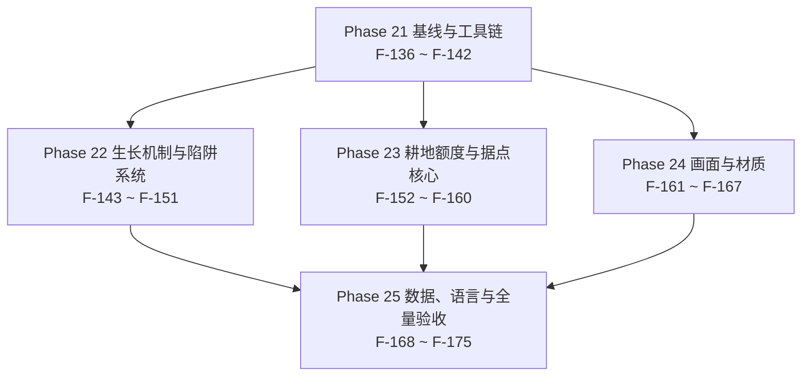

# 25 · v0.1.0 任务拆分与开发大纲（Task Breakdown & Roadmap）

> 项目：农场风云 / Farmstorm · v0.1.0
> 依据：`docs/zh/22-DECISIONS-0.1.0.md`（D-103 ~ D-123，**21 条**，唯一真相源）+ `docs/zh/23-DESIGN-0.1.0.md`（9 条需求的设计增量，13 章 + §11 的 13 条边界）+ `docs/zh/24-TECH-0.1.0.md`（注册增量实测 90 → 93、类设计、config 12 行、RT-24 ~ RT-30、§11 的 18 条验收自检、§1 的 8 处「待验证」API）
> 本文件把 24 号的规格拆成 **40** 个「一次可独立提交、可独立验证」的任务，编号 **F-136 ~ F-175**，接 `19-TASKS-0.0.3.md` 的 F-135。Phase 21 ~ Phase 25 与里程碑 M17 ~ M21 一一对应。
> 覆盖：22 号 §4.2 的 **19 条改动面**（表 A 5 + 表 B 14）、**3 个新增注册对象**、**12 行 config**（新增 11 + 改默认 1）、**11 张 PNG**（新增 5 + 就地替换 6）与 **7 个 JSON**（新增 5 + 就地替换 2）、**RT-24 ~ RT-30 七条**、24 号 §1 的 **8 处待验证 API**（①~⑧），未覆盖 0 条（逐条对照见 §9）。
> 本文件只读上游：不改 `docs/zh/00` ~ `24`、不改 `docs/en`、不改 `src/`（22 号 §6 第 15 条）。

---

## 0. 阅读约定

### 0.1 任务粒度

一个任务 = 一次可独立提交、可独立验证的改动。判据沿用 `13-TASKS-0.0.2.md §0.1` / `19-TASKS-0.0.3.md §0.1` 的三条，v0.1.0 补两条（本文补充）：

1. 提交后 `.tools\gw.cmd build` 退出码 0，且不依赖同一批次中尚未提交的任务。
2. 任务自带至少一条能在 §0.3 列出的位置观察到的验收断言。
3. 回滚该提交不会让其它已完成任务失效（回滚只影响依赖它的后续任务）。
4. 不跨 Phase 边界：一个任务的交付物全部落在它所属 Phase 的名称范围内；跨 Phase 的前置只写在「依赖」列里。
5. 只动 24 号 §3.0 总览表、§3.7 的 19 个条目、§8.1 的 12 行 config 与 §9 逐项点名的文件；表外的改动一律先改 22 号再拆任务。

一条本版特有的边界（本文补充）：**F-140 → F-141 → F-142 三个任务提交后，工具在中间态是红的**。这不是缺陷，是 24 号 §1.4 的 G2 写明的因果——只加 ID 清单不改计数就会红（A-21）。三个任务按此顺序串行，中间的红色中间态在验收里写成「预期中间态」，不由后一个任务吸收进同一个提交。另有配套的排期约定（A-21）：F-139（把 config 推到 166）与这条链可并行，但**不先于 F-141**——它先落地会把 config 段从绿推到红，红虽由 F-142 收口，中间态的因果会被读错；建议排法 F-138 → F-140 → F-141 → F-139 → F-142。

### 0.2 复杂度与工作量换算

换算口径与 `13-TASKS-0.0.2.md §0.2` 完全一致，不在中途调整：

| 复杂度 | 含义 | 折算人日 |
|---|---|---|
| S | 单文件或纯数据；≤ 1 个类，或 ≤ 20 个 JSON | 0.5 |
| M | 2 ~ 4 个文件，跨 1 ~ 2 个包，或新增 1 个完整行为实现 | 1.5 |
| L | ≥ 5 个文件或跨 3 个包，含运行期状态机 / 序列化 / 事务 / 渲染管线 | 3.0 |

v0.1.0 的 40 个任务按此分布：**S 9 个 / M 23 个 / L 8 个**，折算合计 `9 × 0.5 + 23 × 1.5 + 8 × 3.0 = 4.5 + 34.5 + 24.0 = 63.0` 人日（不含缓冲）。

22 号 §4.2 表 B 里第 9 / 13 / 14 / 18 行是**新增或结构性改动**（新类、指令树、事件订阅），不按「改一行」估时：F-143（表 B 第 9 行）与 F-152 / F-153 / F-156 / F-157（表 B 第 13、14、18 行连带的新类）都按 L 计 3.0 人日，指令树的 F-160 按 M 计 1.5 人日而不是按「加一行订阅」计 0.5。

### 0.3 验收标准写法

每条验收必须能在下列位置之一被观察到：`logs/latest.log` 的断言输出；游戏内 `/execute` `/data get` `/setblock` `/loot` `/clear` `/effect` 的返回值；F3 / F3+B 的界面读数；`config/farmstorm-server.toml` 或 `src/generated/resources` 的文件内容；`build/libs` 与 `dist` 的产物（含 `jar tf` 的条目清单）。禁止「表现正常」「手感良好」这类不可观测表述。

本文件的四条写法约定（沿用 19 号 §0.3，一处不新创）：

1. 断言里必须出现具体数值、键名或文件路径（例：「`已核 registry 对象: 93 / 93`」而不是「计数正确」）。
2. 手测类断言必须写清对照场景（例：「`compressed.replaceOnlyAirAndFluid` 开 / 关各投一次」）。
3. 引用上游自检项时写编号（例 `24-TECH-0.1.0.md §11 #3`），不重抄判据。
4. 少数断言用结构性证据（`grep` 匹配数为 0、`git diff` 为空、`jar tf` 的条目列表、PNG 的逐字节比对）——它们指向文件的确定内容，与上面五类位置同等有效，且只在无法用那五类判定时使用。

### 0.4 文档裁决记录

下面 10 条是本轮的口径分歧与本文的裁决，编号接 `19-TASKS-0.0.3.md §0.4` 的 A-18。**A-19 ~ A-23 是任务书点名的五条**，A-24 ~ A-28 是本文在 22 / 23 / 24 三份上游之间核对出来的五处分歧（逐条见 §12.3）。后续任务一律按「裁决」列执行。

| 编号 | 冲突点 | 涉及文档 | 裁决 | 落地任务 |
|---|---|---|---|---|
| A-19 | 耕地规则是不是 gamerule | `22-DECISIONS-0.1.0.md` §0「耕地规则的叫法」、§2.6 D-116；`23-DESIGN-0.1.0.md` §8.1；`24-TECH-0.1.0.md` §7.4 | **不是 gamerule**：载体只有 `/farmstorm farmlandlimit <n>` 子指令 + 服务端 config `farmland.limitPerPlayer`（默认 **0**）两件；1.21.1 在无 Mixin 红线内无法注册 `GameRule`（`GameRules.register` 是 `private static`）。全套交付物不写「gamerule」，也不注册任何 `GameRule`；指令值只作用于当前进程、重启回 config 默认 | F-160（指令树）、F-156（额度的消费面）、F-171（#10 的重启回默认）、F-175（红线复核） |
| A-20 | 据点核心用哪套素材 | `22` §2.7 D-123、§3.3；`24` §9.1 #1–#3；`23` §8.3 | **`outpost_core_all_textures\32x32\a_runic` 的三张 32 × 32**（`_top` 2,745 B / `_side` 2,534 B / `_bottom` 2,513 B），原样入库；**不用** `512x512` 版本，`b_industrial` / `c_obsidian` / `d_royal` 三套不入本版；`textures/item/` 下不出现 `outpost_core.png`（物品模型以方块模型为父） | F-166（三张 PNG + 三个 JSON）、F-167（三面观感复跑） |
| A-21 | `tools/verify_project.py` 现在是红的还是绿的 | `22` §4.2 第 5 行；`24` §1.4 的 G1 / G2 / G3 | **是绿的**：实测 `FAIL 0` / `退出码 0`，属**静默盲区**而非红灯——两边都不动则持续全绿但漏检新增对象，**只加清单不改计数才会红**。三段动作固定为「① 加 3 个 ID 清单 → ② 改 3 个计数与分母（93 / 32 / 26 / 7）→ ③ 加第四个 config 来源（期望 166）」，由 F-140 / F-141 / F-142 三个任务按此顺序串行；F-139（config 落地）不在链上但排在 F-141 之后，好让 F-140 / F-141 的「config 段 155 绿」成为无条件断言；计数只走到 **93 / 166 / 315** 这一组。24 号 §1.4 里「22 号把工具写成红的」那句按 22 号现文作废（22 号已写「实测 FAIL 0 / 退出码 0（不是坏的）」） | F-140、F-141、F-142、F-170（#1 的复跑） |
| A-22 | 桑吉尔蔗相位 1 是漂浮还是伺服抬升 | `22` §7.2 的 D-71 行、§8 #91；`24` §5.3 的术语约定；`23` §7.5 | **伺服抬升固定高度，不是漂浮**：关重力 + 每刻「剩余高度 ÷ 剩余刻数」，`riseHeightBlocks` 16（实测约 15 格）/ `riseTicks` 15 / 单刻上限 `MAX_RISE_SPEED = 4.0`，相位 2 每刻 yaw +72°、落地固定 7.5 点；`amplifier` 只是相位号（`PHASE_REVERSED` 0 / `PHASE_LEVITATING` 1 / `PHASE_FALLING` 2，常量名是历史漏名），`MobEffects.LEVITATION` 只被移除。文档与验收一律写「相位 1 伺服抬升固定高度」，不写「漂浮」「浮空」「施加 LEVITATION」；对生物的分支**不进相位链**，只结算 7.5 + 击退 | F-148（生物分支与玩家分支对照）、F-175（措辞复核） |
| A-23 | 压缩麦的物品模型与方块模型怎么改 | `22` §2.2 D-107；`24` §9.2 #6 / #7；`23` §4.6 | **物品模型改 3D 且落地方块六面区分**：`models/item/compressed_puffed_wheat.json` 删 `item/generated` + `layer0`，父改为 `farmstorm:block/compressed_hay_block`；`models/block/compressed_hay_block.json` 由 `cube_all` 改 `cube_bottom_top`，`textures` 三键 `top` / `side` / `bottom` 各一张 16 × 16（侧面 9 档黄褐、顶 5 档、底 5 档压暗 + 十字捆绳）；方块属性与 id 一字不动 | F-164（三张图与生成器）、F-165（两个模型）、F-167（六面观感复跑） |
| A-24 | 边界粒子的粒子类型、颜色与每轮包数 | `23` §8.7（`minecraft:dust`、颜色 **(0.30, 0.85, 0.90)**、scale 1.0、每轮 1 个包 / 48 个粒子、两档衰减）；`24` §6.6（`ParticleTypes.END_ROD`、按边发 **4 个包 / 圈**、三档衰减，并声明「本版不产生任何 RGB 常量，也不与 23 号的配色表冲突」） | **取 23 号 §8.7**：22 号 D-121 第 2 条只要求「原版粒子包」，观感与包量由 23 号对齐（22 号 §2.6 D-121 补充项写明「实测包量与观感由 23 号的时序表核对」）；24 号 §6.6 的「不产生 RGB 常量」与 23 号确实给了 RGB 这一点自相矛盾，且 4 包 / 圈是 1 包 / 圈的 4 倍包量，与 RT-30 的方向相反。落地取 dust 青蓝、单圈 48 点、每轮 1 个包、两档衰减（范围内满点 / 16 格余量带每 4 轮 1 次） | F-155（实现）、F-171（#14 / #15 的观察）、F-172（§11.2 的卸载段） |
| A-25 | 陷阱 dust 的颜色、偏移与位置 | `23` §7.4（`minecraft:dust`、颜色 **(0.62, 0.56, 0.44)** 中性土色、位置 `(x+0.5, y+0.15, z+0.5)`、散布 `0.25 / 0.10 / 0.25`、32 格广播、首次第 100 刻）；`24` §5.2（`DustParticleOptions(1.0F, 0.15F, 0.15F)` 红色、偏移 `(0.2, 0.1, 0.2)`、`Vec3.atCenterOf`） | **取 23 号 §7.4**：22 号 D-113 补充项明写「粒子的颜色、scale 与扩散半径取既有粒子常量表的取值，**由 `23-DESIGN-0.1.0.md` 与之对齐**」——授权链指向 23 号，24 号改用狂野猎人的红烟 `(1, 0.15, 0.15)` 越过了这条授权，且 23 号已给出「取红会与狂野猎人的红烟混淆」的理由。落地取中性土色、偏移 `0.25 / 0.10 / 0.25`、位置 y + 0.15 | F-147（实现）、F-170（#7 的观察） |
| A-26 | 生长段长的载体与下界 | `22` §2.4 D-110 第 3 条（先随机总刻数 T，`d1 = d2 = floor(T/3)`、`d3 = T − 2×d1`）；`23` §6.3（在闭区间 **[400, 900]** 内均匀取整数 T，每株独立抽一次）；`24` §4.2（T 取 3 的倍数、`d = 134 + floorMod(pos.hashCode(), 167)`、T = 3d ∈ **[402, 900]**） | **取 24 号 §4.2 的载体与端点**：D-111 排除了方块实体，「随机抽一次 T 再把余数带到第三段」在无状态载体上不可实现（余数只有排第一段时知道），因此让 T 恒为 3 的倍数、由坐标哈希决定每段长——D-110 第 3 条的算式 `d3 = T − 2×d1` 仍精确成立（余数 r = 0），总时长 402 – 900 刻 = 20.1 – 45.0 秒仍落在 [20, 45] 秒内。23 号 §6.3 的「每株独立均匀取 T」与 400 这个下界作废，验收一律按 **402 – 900 刻** | F-143（实现）、F-144（实测）、F-170（#3 / #4 / #5） |
| A-27 | JSON 新增是 4 个还是 5 个 | `22` §3.3（**5 个**，含 `loot_table/blocks/outpost_core.json`）；`23` §1.3 与 §10.3（**4 个**）；`24` §9.2（**5 个**，但把「4 个」的账记在 22 号头上） | **取 5 个**：22 号 §3.3 已逐项列出战利品表，5 个是正确值；漏项在 23 号 §1.3 / §10.3（只数了 3 个模型 + 配方），24 号 §9.2 末段把漏项归因给 22 号属**归因错位**。落地按 5 新增（blockstate / block 模型 / item 模型 / 配方 / 战利品表）+ 2 替换 | F-166（前 3 个）、F-168（后 2 个）、F-174（jar 条目核对） |
| A-28 | 狂野苹果现贴图是 11 色还是 12 色 | `22` §2.1 D-105 的依据与 §8 #32（**12 色** / 126 透明）；`23` §9.4（逐色列出 **11 色**）；`BRIEF` §1.11（「**11 色**，常见误记的『12 色』是 11 色 + 透明项」） | **取 11 色**：成品量化回 11 色（色板与像素数按 23 号 §9.4 的五组），22 号那两格沿用了施工事实卡已明确纠正的误记；本条只改「色数」这一格的读法，不改 D-105 的任何结论（成品 16 × 16、模型与注册面不动） | F-163（成品）、F-167（边缘复跑） |

#### 0.4.1 与 19 号 A-10 ~ A-18 的关系

19 号的 9 条裁决属 0.0.3 的口径（刺球改名、震动豆的 `DeployedKind`、Q弹 的坐骑、近防菌与震动豆的音效、`verify_project.py` 不许降级、三个姿态参数、PNG 8 张、三条进度 ID、两张子表不相加）。v0.1.0 只延续其中一条：**A-14 的「工具不许降级成人工签字」**——本版 F-170 的 #1 仍要求工具自己输出 `93 / 93`、`166`、`315` 与 `FAIL 0`，不拿人工核对代替。其余八条与 v0.1.0 无关，不重新裁决。

### 0.5 数字口径速查

本文件出现的数字只有下面 14 组，每组的来源节号列在 §12.1；表中不再重复出处。

| 数字 | 含义 | 本版口径 |
|---|---|---|
| **90 / 93** | 注册对象（0.0.4 基线 / v0.1.0 目标） | 只写这一对；`blocks` +1、`block_entities` +1、`items` +1，其余 9 类 +0 |
| **155 / 166** | config 键 | 155 + 11（第 10 行是改既有键的默认值，键不增） |
| **299 / 315** | 语言键（中英各一份） | 299 + 16 = 1 + 1 + 11 + 1 + 2 |
| **19 = 5 + 14** | 22 号 §4.2 的改动面 | 表 A 数值与断言 5 行 + 表 B 其余代码面 14 行 |
| **12 = 11 + 1** | config 变更表行数 | 新增 11 + 改默认值 1 |
| **5 / 6** | PNG 新增 / 就地替换 | outpost_core 3 + 压缩麦顶底 2 / 韭 4 + 狂野苹果 1 + 压缩麦侧 1 |
| **5 / 2** | JSON 新增 / 就地替换 | 核心 3 + 配方 1 + 战利品表 1 / 压缩麦方块模型 + 压缩麦物品模型 |
| **7** | RT-24 ~ RT-30 风险条数 | 每条至少一个任务负责验证 |
| **18** | 24 号 §11 的验收自检条数 | #1 – #18 |
| **8** | 24 号 §1 的「待验证」API（①~⑧） | 每处点名由哪个任务在实现时确认 |
| **13** | 23 号 §11 的边界条数 | 11.1 – 11.13 |
| **21** | 决策条数 | D-103 ~ D-123，连续无跳号 |
| **40** | 本文件的任务数 | F-136 ~ F-175，连续无跳号 |
| **63.0 / 78.75** | 原始人日 / 加 25% 缓冲后 | `63.0 × 1.25 = 78.75`；关键路径 **22.0** 人日 / 11 个任务 |

---

## 1. 任务依赖图

### 1.1 Phase 级依赖



Phase 22 / 23 / 24 三者互不依赖，只共享 Phase 21 的注册层（F-138）、config 层（F-139）与工具链（F-140 ~ F-142），可分别派给三个人。三条线在 Phase 25 汇合：数据面（F-168）要等核心方块与它的模型，语言键（F-169）要等指令与文案，验收（F-170 / F-171）要等三条线全部收口。

### 1.2 主干链（文本树）

```text
F-136 基线三账对账 0.5 ── F-137 版本与构建 0.5
├─ F-138 注册面 +3 与两个骨架类 3.0
│   ├─ F-140 工具① 加 3 个 ID 0.5 ── F-141 工具② 改计数 0.5 ── F-142 工具③ 第四来源 0.5
│   └─ F-152 核心方块：归属与上限 3.0
│       └─ F-153 核心索引 3.0
│           ├─ F-154 方块实体：三字段与范围查询 1.5
│           │   ├─ F-155 边界粒子 1.5
│           │   ├─ F-157 锄地拦截（范围 → 额度）3.0 ── F-158 踩坏保护 1.5
│           │   └─ F-159 拆核转泥土 1.5
│           └─ F-156 耕地账本与 capacity 1.5 ── F-160 指令树 1.5
├─ F-139 config 12 行 1.5
│   ├─ F-143 生长计划 tick 链 3.0 ── F-144 生长实测 1.5
│   ├─ F-145 陷阱签名放宽 3.0
│   │   ├─ F-146 5 秒大类免疫 1.5
│   │   ├─ F-147 dust 粒子 0.5
│   │   ├─ F-148 生物可触发 1.5
│   │   └─ F-149 陷阱 FIFO 与索引落盘 3.0
│   ├─ F-150 膨胀麦白名单 1.5
│   └─ F-151 两件瓜与落点收拢 1.5
├─ 材质四线（只等 F-137）：F-161 蓄力条 0.5、F-162 韭四张 1.5、F-163 狂野苹果 0.5、F-166 核心资源 1.5
│   └─ F-162 ── F-164 压缩麦三张 1.5 ── F-165 压缩麦模型 1.5
│       └─ F-167 材质三处复跑 1.5（F-161 + F-162 + F-164 + F-165 + F-166）
└─ 汇合层：F-168 数据面 1.5（F-152 + F-166）── F-169 语言键 1.5（F-168 + F-160）
    ├─ F-170 §11 #1–#9 1.5（F-142 + F-143 + F-144 + F-146 ~ F-149）
    ├─ F-171 §11 #10–#18 1.5（F-155 ~ F-160）
    │   ├─ F-172 边界 11.1–11.6 1.5（F-170 + F-171）
    │   └─ F-173 边界 11.7–11.13 1.5（F-170 + F-171）
    ├─ F-174 构建与 dist 0.5（F-169 + F-170 + F-171）
    └─ F-175 全量验收汇总 3.0（F-167 + F-172 + F-173 + F-174）
```

只画决定总工期的那几条。**每个任务在树里只出现一次，且树上的父节点一定是该任务「依赖」字段里列出的任务之一**；树里没画全的前置以任务块的「依赖」字段为准。

---

## 2. 总览

| Phase | 名称 | 任务数 | 任务 ID | 人日 | 对应里程碑 |
|---|---|---|---|---|---|
| Phase 21 | 基线与工具链 | 7 | F-136 ~ F-142 | 7.0 | M17 |
| Phase 22 | 生长机制与陷阱系统 | 9 | F-143 ~ F-151 | 17.0 | M18 |
| Phase 23 | 耕地额度与据点核心 | 9 | F-152 ~ F-160 | 18.0 | M19 |
| Phase 24 | 画面与材质 | 7 | F-161 ~ F-167 | 8.5 | M20 |
| Phase 25 | 数据、语言与全量验收 | 8 | F-168 ~ F-175 | 12.5 | M21 |
| **合计** | | **40** | **F-136 ~ F-175** | **63.0** | **M17 ~ M21** |

- **原始人日合计：63.0 人日**（= 各行小计之和 = 各任务折算人日之和，见下方复核）。
- **加 25% 缓冲后的合计：78.75 人日**（`63.0 × 1.25 = 78.75`）。
- 关键路径长度：**22.0 人日 / 11 个任务**（推导见 §11.1）。

复杂度分布与复核：

| 复杂度 | 任务数 | 单件人日 | 小计 | 任务号 |
|---|---|---|---|---|
| S | 9 | 0.5 | 4.5 | F-136、F-137、F-140、F-141、F-142、F-147、F-161、F-163、F-174 |
| M | 23 | 1.5 | 34.5 | F-139、F-144、F-146、F-148、F-150、F-151、F-154、F-155、F-156、F-158、F-159、F-160、F-162、F-164、F-165、F-166、F-167、F-168、F-169、F-170、F-171、F-172、F-173 |
| L | 8 | 3.0 | 24.0 | F-138、F-143、F-145、F-149、F-152、F-153、F-157、F-175 |
| **合计** | **40** | — | **63.0** | 1 – 40 全覆盖 |

复核等式：`9 × 0.5 + 23 × 1.5 + 8 × 3.0 = 4.5 + 34.5 + 24.0 = 63.0`，与上表合计逐位相等；`63.0 × 1.25 = 78.75`；五个 Phase 小计逐行相加 `7.0 + 17.0 + 18.0 + 8.5 + 12.5 = 63.0`。三条算法互为校验。

---

## 3. Phase 21 · 基线与工具链（F-136 ~ F-142）

阶段目标：先把「取数」这件事钉死在 0.0.4 的实测值上（注册 90 / config 155 / 语言键 299），再把 v0.1.0 的 **3 个新增注册对象**与 **12 行 config**一次立稳，最后按 24 号 §1.4 的固定顺序把 `tools/verify_project.py` 推到 **93 / 166 / 315**。后面四个 Phase 只往里填行为。

阶段出口判据：`python -X utf8 tools/verify_project.py` 输出 `已核 registry 对象: 93 / 93`、config 段 166、`lang 键集一致，共 310 键`（299 + F-139 的 11 条，余 5 条在 F-169）、`结论：FAIL 0 项`、退出码 0；启动日志的注册自检行为 93 且逐类 32 / 26 / 7 / 13 / 4 / 3 / 1 / 1 / 1 / 3 / 1 / 1；`config/farmstorm-server.toml` 叶节点 166 个；`.tools\gw.cmd build` 退出码 0，产物 `farmstorm-0.1.0+mc1.21.1.jar`。

#### F-136 · 0.0.4 基线三账对账与取数

- **复杂度**：S ｜ **折算人日**：0.5
- **依赖**：—
- **交付物**：一次只读的复算与对账（不改源码）：`logs/latest.log` 的四条启动自检行、`python -X utf8 tools/verify_project.py` 的四段输出、24 号 §1.2 的 12 行逐类实测表，三者逐项对账；24 号 §1.1 的工厂方法调用次数表逐行点一遍（`crop` 15、`deployed` 8、`registerBlock` 2、`cropItem` 22、`seedItem` 7、`registerItem` 2、`projectile` 12、直调 1、`BlockEntityType` 6、`damageTypes` 3）；结论写进提交信息。
- **验收**：
  1. 启动日志四行与 24 号 §11 #2 的 0.0.4 版逐字相等：注册 **90** 且逐类 31 / 25 / 6 / 13 / 4 / 3 / 1 / 1 / 1 / 3 / 1 / 1、作物 **22** 种（投掷型 12 / 部署型 7 / 食用型 3）、幸运浆果池 **19**、破障类 **4**。
  2. `python -X utf8 tools/verify_project.py` 输出 `已核 registry 对象: 90 / 90`、config 段 `155 个配置键与文档逐字一致`、`lang 键集一致，共 299 键`、`结论：FAIL 0 项`，退出码 0（24 号 §1.4 的实跑输出；A-21）。
  3. 24 号 §1.2 的 12 类小计相加 = 90，与工具 §2 段的硬编码小计逐项相等（24 号 §1.1 的三条证据链第 3 条）。
  4. `git status` 干净、`git diff --stat` 里 `src/` / `docs/` / `tools/` 全为空——本条的任务形态是「先取数、不改码」。

#### F-137 · 版本号 0.1.0 与构建基线

- **复杂度**：S ｜ **折算人日**：0.5
- **依赖**：F-136
- **交付物**：`gradle.properties` 的 `mod_version` 由 `0.0.4` 改为 `0.1.0`；`build.gradle` 零改动（MC 1.21.1 / NeoForge 21.1.213 / Java 21 不变，22 号 §1.1）。
- **验收**：
  1. `.tools\gw.cmd build` 退出码 0，产物为 `build/libs/farmstorm-0.1.0+mc1.21.1.jar`。
  2. `jar tf` 里能看到 `META-INF/neoforge.mods.toml`，其 `version` 为 0.1.0。
  3. `build.gradle` 与 `gradle.properties` 的其余行的 `git diff` 为空。

#### F-138 · 注册面 +3 与两个类的骨架

- **复杂度**：L ｜ **折算人日**：3.0
- **依赖**：F-137
- **交付物**：
  - `registry/FarmstormBlocks.java`：+1 行 `registerBlock("outpost_core", OutpostCoreBlock::new, properties)`，属性为 `mapColor(MapColor.STONE).strength(30.0F, 1200.0F).requiresCorrectToolForDrops().sound(SoundType.STONE).pushReaction(PushReaction.BLOCK)`（22 号 §4.2 表 B 第 11 行、24 号 §3.1）。
  - `registry/FarmstormBlockEntities.java`：+1 个 `outpost_core` 的 `BlockEntityType`（单方块例，与 `converter` 同形；22 号 §4.2 表 B 第 12 行、24 号 §2.2 注 1 的三条理由）。
  - `registry/FarmstormItems.java`：+1 个 `BlockItem`（24 号 §2.2 第 3 行）。
  - `block/OutpostCoreBlock.java` 与 `blockentity/OutpostCoreBlockEntity.java` 的编译期骨架：构造器、`newBlockEntity` 返回骨架 BE、`getTicker` 返回 null；行为在 Phase 23 填。
  - `Farmstorm.java`：`logRegistrySelfCheck` 的 `total == 90` → **93**、`items == 31` → **32**、`blocks == 25` → **26**、`blockEntities == 6` → **7**（`:138-141`；24 号 §3.7 第 4 行的前四项）。
- **验收**：
  1. 启动日志逐字出现 `自检 注册对象 93 个：items 32 / blocks 26 / block_entities 7 / entity_types 13 / mob_effects 4 / sound_events 3 / recipe_types 1 / recipe_serializers 1 / creative_tabs 1 / damage_types 3 / data_components 1 / menu_types 1 → OK`（24 号 §11 #2）。
  2. `/setblock ~ ~ ~ farmstorm:outpost_core` 成功、`/give @s farmstorm:outpost_core` 拿到物品；F3 里方块实体显示 `farmstorm:outpost_core`。
  3. `block_entities` 增量确为 +1：`git diff registry/FarmstormBlockEntities.java` 只含新增行，既有 6 个 type 一行未改。
  4. `deployedOf(DeployedKind)` 的 switch 一字未改、枚举仍 8 个（24 号 §2.2 注 3）；`CropProfile.ALL` 仍 22 条、`DeployedKind` 仍 8 个（22 号 §3.1、§3.2 的两条附注）。
  5. `.tools\gw.cmd build` 退出码 0。

#### F-139 · config 12 行与 11 条 configuration 语言键

- **复杂度**：M ｜ **折算人日**：1.5
- **依赖**：F-137
- **交付物**：`config/FarmstormConfig.java`——5 个新分组共 10 行（`growth` 2 / `trap` 3 / `farmland` 1 / `outpost_core` 3 / `compressed` 1）+ `melon_grenade.submunitionSpeed` 1 行新增 + `melon_grenade.horizontalJitter` 改默认值 0.3 → **0.05**，合计 **12 行 = 新增 11 + 改默认 1**（22 号 §5.2、24 号 §8.1 的 12 行逐行照抄类型与默认值）；`datagen/ModLangProvider` 的 11 条 `farmstorm.configuration.*`；生成物 `config/farmstorm-server.toml`（24 号 §8.2 的 5 个分组片段，组内键序照 §8.1 行序，追加在 `vibration_bean` 之后）。
- **验收**：
  1. `config/farmstorm-server.toml` 叶节点 **166** 个（155 + 11）——**行数 12 不等于新键数**（24 号 §8.1 表下注）。
  2. 12 行逐行读回：20 / 45 / 100 / 100 / 16 / 0 / 16 / 2 / 40 / **0.05** / **0.1** / `true`；第 10 行的 `min` 0.0 / `max` 8.0 与 translation 键逐字保留（24 号 §8.1 表下核对结论第 2 条）。
  3. `farmstorm.configuration.*` 语言键 155 → **166**，中英键集逐字相等；此时两份语言文件总键数为 299 + 11 = **310**，余下 5 条由 F-169 补齐。
  4. 顶层分组数 30 → **35**（24 号 §8.3 的三列相等性）。
  5. 没有为 3 × 3 范围、48 × 48 边界、边界粒度、桑吉尔蔗的生物结算新增任何键：`outpost_core` 组只有 3 个键、`zangief_cane` 组的 `git diff` 为空（22 号 §6 第 9 条、24 号 §8.4）。

#### F-140 · `verify_project.py` 第 1 段：三张 ID 清单加 `outpost_core`

- **复杂度**：S ｜ **折算人日**：0.5
- **依赖**：F-138
- **交付物**：`tools/verify_project.py:120-146` 的三张 `EXPECTED` 清单（`items` / `blocks` / `block_entity_type`）各追加 `"outpost_core"`（24 号 §1.4 的 G1）。**本任务提交后工具转红是预期中间态**：§2 段会报「清单 26 个 ID，但 §2.1 的 v0.0.3 列是 25 个」（24 号 §1.4 的 G2，A-21）。
- **验收**：
  1. 三张清单各多 1 个字面量：`grep -c '"outpost_core"' tools/verify_project.py` 为 3。
  2. `python -X utf8 tools/verify_project.py` 的 §2 段**只有一处类型**的红：`items` 32 / `blocks` 26 / `block_entity_type` 7 三行同形；§3 lang 段仍是 310 绿。§1 config 段的读法分两种、判据是同一条：**本任务没有改动 config 期望集**（`git diff tools/verify_project.py` 只含 §2 段的 ID 清单）——F-139 尚未落地时 config 段是 `155 个配置键与文档逐字一致`（绿），F-139 已并行落地时是 166 命中 `real_extra`（红，由 F-142 收口、不算本任务失败，A-21）。
  3. 工具里不出现 93：`grep -c "93" tools/verify_project.py` 为 0（93 只在 F-141 引入，顺序不能反，24 号 §1.4 与 RT-27 的首要缓释）。
  4. 冻结区未被回改：`git diff --stat docs/` 为空（24 号 §1.4 的 G3 末句）。

#### F-141 · `verify_project.py` 第 2 段：`EXPECTED_COUNTS` 与分母 90 → 93

- **复杂度**：S ｜ **折算人日**：0.5
- **依赖**：F-140
- **交付物**：`tools/verify_project.py:150-163` 的 12 类小计——`items` 31 → **32**、`blocks` 25 → **26**、`block_entity_type` 6 → **7**；表下注释的 `90` 改 **93**；§2 段打印的分母同步（24 号 §1.4 的 G2 修法列）。
- **验收**：
  1. 工具输出 `已核 registry 对象: 93 / 93`，12 类逐类等于 24 号 §2.1 的 v0.1.0 列（32 / 26 / 7 / 13 / 4 / 3 / 1 / 1 / 1 / 3 / 1 / 1），`结论：FAIL 0 项`，退出码 0。
  2. config 段与 lang 段都不因本任务变化（本任务只动 §2 段的计数与分母）：lang 段打印 310；config 段在 F-139 尚未落地时为 155 绿，F-139 已落地时为 166 报 `real_extra`（红，由 F-142 收口）——两种读法都不构成本任务失败（判据同 F-140，A-21）。
  3. 工具里不再出现 90 这个分母：`grep -n "90" tools/verify_project.py` 的命中不含注册分母与分母注释。
  4. 注册面这条线不再有红：`grep -c "清单 .* 个 ID" tools/verify_project.py` 对应的三行为全绿输出。

#### F-142 · `verify_project.py` 第 3 段：第四个 config 来源与期望 166

- **复杂度**：S ｜ **折算人日**：0.5
- **依赖**：F-141、F-139
- **交付物**：`tools/verify_project.py:174-189` 增加第四个来源——解析 `docs/zh/24-TECH-0.1.0.md` §8.1 的 12 行，取「新」列的 11 个键名并与三个已冻结文档的键集求并集；期望键数 155 → **166**。**不许回改 01 / 12 / 18 号**（那三个文件在冻结区）。
- **验收**：
  1. 工具 §1 config 段输出 `166 个配置键与文档逐字一致`，无 `MISMATCH`、无 `real_extra`，退出码 0（24 号 §1.4 的 G3）。
  2. `git diff --stat docs/` 为空：第四个来源只读文档、不回改文档。
  3. 解析失败时给出可定位的报错（文件 + 表格行号），不是静默跳过；工具仍只有一段 config 逻辑，没有第二份硬编码键清单。

阶段小计：**7 个任务、7.0 人日**（S 5 / M 1 / L 1）。

## 4. Phase 22 · 生长机制与陷阱系统（F-143 ~ F-151）

阶段目标：把两件「改行为」的事做完——本模组作物的生长从原版随机刻换成**计划 tick 链**（D-110 / D-111，RT-24，本版唯一的机制替换），以及陷阱的四项调整（D-112 ~ D-115）与同属投掷物 / 爆炸行为面的三处改动（膨胀麦写入白名单、两件瓜的类别与落点）。

阶段出口判据：24 号 §11 的 #3 ~ #9 七条全过；`randomTickSpeed` 临时调到 1000 后成熟时长不变；同一玩家第 17 个陷阱挤掉最早的且无掉落；僵尸能触发四个陷阱且拿不到混乱；dust 每 5 秒 2 个；`compressed.replaceOnlyAirAndFluid` 两态各投一次；启动日志的作物自检为 `22 种、投掷型 12 / 部署型 7 / 食用型 3；破障类 2 → OK`；`CustomPacketPayload` 与 `@Mixin` 的匹配数都是 0。

#### F-143 · `FarmstormCropBlock` 的计划 tick 链与防双源三件套

- **复杂度**：L ｜ **折算人日**：3.0
- **依赖**：F-139
- **交付物**：`block/FarmstormCropBlock.java`——`onPlace` 首次排程（只在 `oldState.getBlock() != this` 且 `level instanceof ServerLevel` 时调私有 `scheduleNext`）、`tick` 推进（第一行判 `state.getBlock() != this`、第二行判 `age >= MAX_CUSTOM_AGE`、过亮度闸 `getRawBrightness(pos, 0) >= 9`、`setBlock(..., UPDATE_ALL)`、推进后再排一次）、亮度不足时排 20 刻重试、`segmentTicks` 按 `d = 134 + floorMod(pos.hashCode(), 167)`、总时长 `T = 3d ∈ [402, 900]` 刻、`isRandomlyTicking` 返回 `false`、**不重写** `randomTick`、**不重写** `performBonemeal`；`registry/FarmstormBlocks.java:88` 删 `.randomTicks()`（22 号 §4.2 表 B 第 9、10 行；24 号 §4.2 / §4.3 / §4.4；§0.4 的 A-26）。
- **验收**：
  1. 三件套同时成立（24 号 §4.4）：`.randomTicks()` 的 `git diff` 只有删除行；`grep -c "randomTick" block/FarmstormCropBlock.java` 为 0；`isRandomlyTicking` 里有一行 `return false`。
  2. 光照 15 的田里种 4 株坐标各不相同的作物，成熟时长全部落在 **402 – 900 刻**（20.1 – 45.0 秒）且四株的值不全相同（24 号 §11 #3）。
  3. 同一株的推进日志恰好 **3** 次（不是 6 次、不是 30 次）；`age` 从不超过 3（24 号 §4.5、§11 #4 的末句）。
  4. 待验证 ① 与 ② 的最小用例通过：`scheduleTick` / `tick` / `onPlace` / `isRandomlyTicking` 的 1.21.1 签名可编译，且对同一 `(pos, this)` 的重复排程是**覆盖**而非并存——同一株 1 秒内不出现两次推进（24 号 §0.5 的 ① ②、RT-24 兜底 ①）。
  5. 原版判据一条不改：亮度门槛、骨粉、`AGE_3` 四阶段、四个 `VoxelShape` 的 `git diff` 为空（24 号 §4.5）。

#### F-144 · 生长时长的四项实测与 RT-24 兜底

- **复杂度**：M ｜ **折算人日**：1.5
- **依赖**：F-143
- **交付物**：一次实测与取证（除兜底补丁外不改源码）：24 号 §11 的 #3 / #4 / #5 三组对照、骨粉后重排的取证、存档 → 停服 → 起服 → 继续推进的对照（待验证 ③）、结论与兜底取舍（RT-24 兜底 ①②③ 逐条给出「启用 / 未启用」）写进提交信息。
- **验收**：
  1. `randomTickSpeed` 临时调到 1000 后与 #3 逐株相等（差 ≤ 20 刻），同一株的推进仍是 3 次（24 号 §11 #4）。
  2. 种下后立刻走出 200 格（强制区块卸载）再回来：总时长仍落在 402 – 900 刻，回来的一瞬间没有「全部瞬间成熟」（24 号 §11 #5）。
  3. 存档 → 停服 → 起服：作物按剩余段继续推进；若实测不成立，则启用 D-111 授权的 `ChunkEvent.Load` 重排补丁，并在提交信息里写明「改的是载体细节、不改 D-111 的口径」（22 号 §2.4 D-111 补充、24 号 §4.3 第 6 步）。
  4. 骨粉推进一级后只多一条计划 tick（不是两条），下一段按新的 `age` 重排（23 号 §11.8、24 号 §4.3 第 4 步）。

#### F-145 · `TrapBehavior` 签名放宽到 `LivingEntity` 与四处实现收口

- **复杂度**：L ｜ **折算人日**：3.0
- **依赖**：F-137
- **交付物**：`behavior/TrapBehavior.java:5` 的 import 与 `:18-24` 的两个方法签名由 `Optional<Player>` / `trigger(be, Player)` 放宽到 `Optional<LivingEntity>` / `trigger(be, LivingEntity)`（24 号 §3.5 的改前 / 改后两段代码）；四个实现的签名同步（`BlastCarrotTrap:38`、`:58`；`FangTrapCactusTrap:33`、`:53`；`ZangiefCaneTrap:48`、`:61`、`:108`；`VibrationBeanTrap:43`、`:66`、`:88`）；`VibrationBeanTrap:88` 的 `target.getGameProfile().getName()` 改为 `target.getName().getString()`（`LivingEntity` 没有 `getGameProfile`，这是本任务唯一的编译期硬阻塞；22 号 §4.2 表 B 第 17 行的前半、24 号 §3.5 第 5 行）。
- **验收**：
  1. `.tools\gw.cmd build` 退出码 0，编译日志无 `incompatible types`；四处 `findTrigger` 的返回类型全是 `Optional<LivingEntity>`（`grep -rn "Optional<LivingEntity> findTrigger" src/main/java` 命中 4）。
  2. `grep -c "getGameProfile" behavior/impl/VibrationBeanTrap.java` 为 0。
  3. 行为零变化：四个陷阱的触发半径仍是 **1 / 2.5 / 1.5 / 4.0**（度量分别是切比雪夫 / 欧氏 / 球形 / 严格小于，22 号 §8 #57），四个既有豁免（创造 / 旁观 / 己方 / 生物不参与）一字未改。
  4. 扫描间隔仍 10 刻、三个部署安全阀 5 / 8 / 32 仍不动（22 号 §8 #56 / #59）。

#### F-146 · 触发后 5 秒大类免疫与 `TrapImmunity`

- **复杂度**：M ｜ **折算人日**：1.5
- **依赖**：F-145、F-139
- **交付物**：`trap/TrapImmunity.java`（`Map<UUID, Long> UNTIL`，值是免疫到期的 `gameTime`，配一个 `MinecraftServer` 实例守卫，与 `ledgerOf` 同形）；`TrapBehavior#tick` 默认实现里的免疫闸 `passGate`（非 `Player` 一律放行、是 `Player` 时先判窗口再写窗口）；调用顺序固定 `findTrigger → passGate → trigger`，被闸住时**不 `consume`、不施效果、不写免疫**（22 号 §2.5 D-112、§4.2 表 B 第 15 行的免疫段；24 号 §5.1）。
- **验收**：
  1. 同一玩家先踩胡罗贝、2 秒内再踩刺球：第二次**不触发**（无爆炸、无音效、刺球方块仍在原地）；6 秒后第三次正常触发（24 号 §11 #6）。
  2. 免疫只记玩家：一只僵尸先后踩两枚陷阱，两枚都照常触发（22 号 §2.5 D-112 第 3 条）。
  3. 计时用 `gameTime` 且不写存档：`grep -c "SavedData" trap/TrapImmunity.java` 为 0；重连后免疫清零（D-112 第 4 条）。
  4. 端点按半开区间 `[t0, t0 + 100)`：第 100 刻起可以再次触发（23 号 §7.3 的端点行与 5 行时序例）。

#### F-147 · 部署后每 5 秒的 dust 粒子与相位对齐

- **复杂度**：S ｜ **折算人日**：0.5
- **依赖**：F-145、F-139
- **交付物**：`TrapBehavior#emitDust(be)` 默认实现（在免疫闸**之前**调用，因为 dust 与有没有人踩无关）；出粒条件 `floorMod(now + floorMod(pos.hashCode(), dustInterval), dustInterval) == 0`；每轮 **2 个**粒子；取值按 **23 号 §7.4**：`minecraft:dust`、颜色 **(0.62, 0.56, 0.44)** 中性土色、scale 1.0、位置 `(x + 0.5, y + 0.15, z + 0.5)`、散布 `0.25 / 0.10 / 0.25`、速度 0、32 格广播；只有 4 个 TRAP 类的部署物发（22 号 §2.5 D-113、§4.2 表 B 第 15 行的 dust 段；24 号 §5.2、§0.4 的 A-25）。
- **验收**：
  1. 部署 1 个陷阱（人不靠近），10 秒内方块中心恰好出现 **2 次** dust、每次 **2 个**；首次出现在第 **100** 刻而不是第 0 刻（24 号 §11 #7、23 号 §7.4 的首次时刻行）。
  2. 炮台（`pumpkin_turret` / `awakened_*` / `point_defense_fungus`）与光环方块一次都不出现 dust（22 号 §2.5 D-113 第 4 条、24 号 §5.2 的「只为谁发」行）。
  3. 相位不漏：1 秒内连续记录 60 秒，dust 次数为 12 次（不是 0 次、不是 120 次）——`dustInterval` 100 是 `scanInterval` 10 的整数倍，错峰不会把 dust 跳过（24 号 §5.2 的相位行）。
  4. 仍走原版粒子包：`grep -rn "CustomPacketPayload" src/main/java` 为 0（24 号 §11 #18）。

#### F-148 · 敌对生物可触发：四个陷阱的第二遍遍历与桑吉尔蔗生物分支

- **复杂度**：M ｜ **折算人日**：1.5
- **依赖**：F-145、F-146
- **交付物**：四个 `findTrigger` 各加第二遍 `level.getEntitiesOfClass(Monster.class, box)`，`box` 用与玩家那一遍相同的半径包 `AABB`，距离判据复用同一个 metric 与同一个 config 键（**不写第二个数**），生物恒按非己方（不调 `isAlly`）；`ZangiefCaneTrap:61-81` 的 `trigger` 改两分支——`ServerPlayer` 走既有相位链，其余只结算 `FarmstormDamageTypes.zangiefSlam(...)` 的固定 **7.5** 点 + `knockback(0.4, -dx, -dz)` 并播一次击退、**不进相位链**；`config` 无新键（22 号 §2.5 D-114、§4.2 表 B 第 17 行的后半；24 号 §5.3、§0.4 的 A-22）。
- **验收**：
  1. 僵尸推进胡罗贝 / 刺球 / 震动豆各一次：前三个都触发（爆炸 / 尖牙 / 爆炸音 + `consume`）；僵尸只拿到通用效果，`/data get entity @e[type=zombie,limit=1] active_effects` 里**没有** `farmstorm:confusion`（24 号 §11 #8）。
  2. 僵尸推进桑吉尔蔗：掉 **7.5** 点并被击退，身上**没有** `farmstorm:zangief_piledriver` 效果（说明没进相位链；22 号 §7.2 的 D-71 行、A-22）。
  3. 玩家分支零变化：相位 1 仍是**伺服抬升固定高度**（`riseHeightBlocks` 16 / `riseTicks` 15 / 单刻上限 4.0），相位 2 每刻 yaw **+72°**、落地固定 7.5；文档与提交信息一律写「相位 1 伺服抬升固定高度」，不出现「漂浮」「浮空」「LEVITATION」（22 号 §8 #91、A-22）。
  4. 创造 / 旁观玩家仍不触发；动物与村民不触发（只认原版 `Monster`，22 号 §2.5 D-114 第 1、4 条）。
  5. 炮台集合不变：man瓜 仍只锁非己方玩家 + 敌对生物，其余炮台仍只锁玩家（D-114 第 5 条）。

#### F-149 · 每玩家 16 个陷阱与 `TrapFifoIndex` 落盘

- **复杂度**：L ｜ **折算人日**：3.0
- **依赖**：F-145、F-138
- **交付物**：`trap/TrapFifoIndex.java`（服务端 `SavedData`；格式 `UUID → 按 placedGameTime 升序的坐标列表`；`count` 只数 `CropProfile.byKind(kind).has(CropCategory.TRAP)` 的 4 个 kind；加载后**惰性校验**——坐标处的方块必须仍是该玩家名下的 TRAP 部署物，否则丢弃该条目）；**在 `DeployedCropBlock#getStateForPlacement`（`:163`）判定 `count >= trap.maxTrapsPerPlayer` 并选出队首，经 `DeployedCropBlockEntity#consume()`（定义 `:322-330`，调用点 `:166` / `:194` / `:317`）执行移除**——判定与执行分居两个类，缺一半都不成立；挤出排在写入新方块之前（`canDeploy(...)` 之后、`return defaultBlockState()` 之前），一轮最多挤 1 个，走 `removeBlock(pos,false)` + 破坏粒子、**无掉落**；`DeployedCropBlockEntity` 的 `setOwner` 里 `record`、`setRemoved` 里 `remove`（22 号 §4.2 表 B 第 15 行的 FIFO 段与第 16 行；24 号 §5.4、待验证 ⑤）。
- **验收**：
  1. 同一玩家连放 17 个陷阱：第 17 个放下后**最早**那个的坐标变成空气、**没有掉落物**、该玩家的陷阱总数仍为 16（24 号 §11 #9）。
  2. 服务端 `stop` 再 `start`，再放第 17 个：被挤掉的仍是最早那个（不是最后那个）；索引的落盘格式在存档里可读到「UUID → 升序坐标列表」（RT-26 的第 2 条风险与首要缓释）。
  3. 16 个陷阱 + 8 个炮台混放，再放第 17 个陷阱：被挤的是最早的**陷阱**，8 个炮台一个都没被挤、位置不变（24 号 §11 #17）。
  4. 把某个陷阱坐标 `/setblock air` 后再放第 17 个：惰性校验跳过这个空位，挤掉动作不空转（RT-26 第 6 条风险）。
  5. 三个安全阀 5 / 8 / 32 一个未改：`git diff blockentity/DeployedCropBlockEntity.java` 不含 `:48-50` 三行（22 号 §6 第 7 条）。

#### F-150 · 膨胀麦落地只替换空气与流体

- **复杂度**：M ｜ **折算人日**：1.5
- **依赖**：F-139
- **交付物**：`entity/thrown/PuffedWheatProjectile.java:99-113` 的 `fillHay` 在既有「抗性 ≥ 3.6e6 跳过」**之上叠加**一道白名单（不替换那条底线）：目标必须是空气或处于流体状态的方块才写，普通方块 / 方块实体 / 不可替换方块一律跳过；`compressed.replaceOnlyAirAndFluid`（`true` / `false` 两态）的读点；`CompressedPuffedWheatProjectile.java:35-37` **不改**（只重写 `fillBlock()`，判定继承）（22 号 §2.2 D-106、§4.2 表 B 第 7 行；23 号 §4.2 的五道闸、§4.3、§11.13）。
- **验收**：
  1. 对石头 / 泥土 / 箱子（有方块实体）各投一颗膨胀麦：一个都不被覆盖，方块原样；对纯水与纯岩浆：照常写成干草块（22 号 §2.2 D-106 第 1 条、23 号 §4.8）。
  2. 含水楼梯 / 含水栅栏 / 海带 / 海草位置**不写**（23 号 §4.8 第 1、2 行与 §11.13）。
  3. 关掉开关（`false`）后行为与 0.0.4 逐格一致：只剩抗性底线，石头被整块覆盖——这是验收的对照实验（23 号 §4.3、§4.8 末行）。
  4. 压缩膨胀麦走同一份判定：`git diff entity/thrown/CompressedPuffedWheatProjectile.java` 为空（24 号 §3.7 第 9 行「核对后不改」）。

#### F-151 · 两件瓜的破障移除与瓜片子落点收拢

- **复杂度**：M ｜ **折算人日**：1.5
- **依赖**：F-139
- **交付物**：`util/CropProfile.java:58-63` 两处 `categorySet` 去掉 `DEMOLITION`（两件都只剩 `DAMAGE`）；`Farmstorm.java:104` 的 `demolition == 4` → **2**（断言在 `:103-104`；`:99-106` 是整段自检方法的输出区间；表 A 第 1 行）；`entity/thrown/MelonGrenadeProjectile.java:26` 删 `SUBMUNITION_SPEED` 常量、`:25` 那句「实现细节常量，不进 config」的注释删掉、`:66` 改读 `melon_grenade.submunitionSpeed`（默认 **0.1**）、`:56` 的抖动走既有键（默认 **0.05**）（22 号 §2.3 D-108 / D-109、§4.2 表 A 第 1–3 行与表 B 第 6、8 行）。
- **验收**：
  1. 启动日志逐字出现 `自检 作物 22 种：投掷型 12 / 部署型 7 / 食用型 3；破障类 2 → OK`（24 号 §11 #2）。
  2. 瓜！与瓜片子各炸一次：方块一个都不破（含泥土与木板），伤害与击退照旧——`explosionPower` 3 / 2、`maxDamage` 8 / 6、两个阈值 6.0 全不动（22 号 §2.3 D-108 第 2–5 条、§5.3）。
  3. `grep -rn "DEMOLITION" src/main/java` 的命中只剩枚举定义与 2 处读点（`canBreakBlocks()`、`BlastRule.forCrop`）；`Farmstorm.java` 的自检里不再引用它，两条档案也已无该类别（22 号 §2.3 依据列的 3 处读取点在改动后为 2 处 + 枚举本身；§3.1 的「破障类 4 → 2」）。
  4. 瓜片子仍是 **4** 片；抖动 0.05 与径向初速 0.1 可从 toml 读回，改值后 `/reload` 生效（23 号 §5.5、§5.6 的散布对比）。
  5. `grep -c "SUBMUNITION_SPEED" src/main/java` 为 0；`Farmstorm.java` 的 22 / 12 / 7 / 3 四项断言一字未改（RT-27 第 2 条风险）。

阶段小计：**9 个任务、17.0 人日**（S 1 / M 5 / L 3）。

---

## 5. Phase 23 · 耕地额度与据点核心（F-152 ~ F-160）

阶段目标：把「能锄地的范围」与「耕地额度」两件事绑到据点核心上，并把额度的载体、记账、拦截、保护与清算五条链路一次做完——这是本版唯一「从零开一条链路」的部分（RT-28：`FARMLAND` / `FarmlandBlock` / `turnToDirt` / `HoeItem` / `Tillable` / `BlockEvent` 在 `src/` 下 0 命中）。

阶段出口判据：24 号 §11 的 #10 ~ #16 七条全过 + #17 的名额口径；默认额度 0 时锄不了地且不扣耐久；一个核心给 16 额度、3 × 3 区块外的第 9 个区块锄不了；范围内踩不坏、拆核转泥土只铲己方账上的那几块；第 3 个核心被拒且物品不消耗；己方看得见边界粒子、非己方看不见；`/farmstorm farmlandlimit` 权限 2、重启回 config 默认；`GameRules.register` 仍是 0 命中。

#### F-152 · `OutpostCoreBlock`：归属写入与每人 2 个上限

- **复杂度**：L ｜ **折算人日**：3.0
- **依赖**：F-138、F-139
- **交付物**：`block/OutpostCoreBlock.java` 把 F-138 的骨架填成完整方块——`getStateForPlacement` 里先判 `OutpostCoreIndex.countOwned(玩家) >= outpost_core.maxPerPlayer` ⇒ 返回 `null`（放置不成立、物品不消耗、无掉落、不做 FIFO）；`setPlacedBy` 写 `ownerUuid` / `ownerName` 并登记索引（复用 `util/DeployedOwnership` 的写入形态）；`onRemove` 把归属交给 `OutpostCoreBlockEntity#release()`；`getTicker` 服务端返回 ticker（先例 `block/DeployedCropBlock.java:146-158`，含 `level.isClientSide` 早退）；`getDestroyProgress` 走原版公式（不做己方秒拆）（22 号 §2.6 D-119 / D-122、§4.2 表 B 第 13 行的归属与上限段；24 号 §3.1）。
- **验收**：
  1. 同一玩家放第 3 个核心：方块没出现、物品**不消耗**（`/clear` 前后计数不变）、无掉落；已有 2 个不受影响（24 号 §11 #16）。
  2. 属性读回：硬度 **30** / 抗爆 **1200** / `requiresCorrectToolForDrops()` / `pushReaction(BLOCK)`；木镐就能挖出掉落物（不要求石 / 铁 / 钻石工具），活塞推不动也拉不动（22 号 §2.6 D-119 第 1–3 条、23 号 §11.1）。
  3. 挖掉核心立即释放名额：再放第 3 个成功，不需要延迟释放（22 号 §2.6 D-122 补充）。
  4. 任意位置可放（悬空 / 贴墙 / 水中各一次），不要求依附或支撑（22 号 §2.6 D-119 第 4 条）。
  5. 上限按**玩家**计、不按队伍计：2 人队里每人各 2 个都能放下（D-122 第 4 条）。

#### F-153 · `OutpostCoreIndex`：玩家 → 核心坐标的落盘索引

- **复杂度**：L ｜ **折算人日**：3.0
- **依赖**：F-152
- **交付物**：`outpost/OutpostCoreIndex.java`（服务端 `SavedData`，与 `TrapFifoIndex` / `FarmlandLedger` 同一种「UUID → 坐标列表 + 惰性校验」形态）；`countOwned(玩家)` / `record` / `remove` / `owned(player)` / `isOwnerOrAlly(server, core, player)`；加载后惰性校验——坐标处的方块必须仍是该玩家名下的 `outpost_core`，否则丢弃该条目；这份查询同时供 D-120 的额度、D-121 的边界粒子、D-122 的上限三处使用（22 号 §2.6 D-122 补充、§4.2 表 B 第 14 行的索引段；24 号 §3.2；待验证 ⑤、RT-26）。
- **验收**：
  1. 服务端重启后 `countOwned` 与重启前一致；被 `/setblock air` 清掉的核心在下一次读取时被丢弃（23 号 §11.2 的「已知代价」行）。
  2. 两份索引不共用类而是同一形态：`TrapFifoIndex` 与 `OutpostCoreIndex` 各自独立，落盘格式都是「UUID → 坐标列表」（RT-26 的首要缓释「三份索引格式统一」）。
  3. 归属只存 UUID 与名字、**不留队伍快照**：队伍关系在读取时由 `TeamResolver` 实时解析（C-9 的扩充，22 号 §7.2）。
  4. 换队后立即生效：把放置者换到另一队，新队友立刻算「己方」、旧队友立刻不算（23 号 §11.4 的「核心归属不随换队改变」行）。

#### F-154 · `OutpostCoreBlockEntity`：三字段、归属解析与 3 × 3 区块范围查询

- **复杂度**：M ｜ **折算人日**：1.5
- **依赖**：F-152、F-153
- **交付物**：`blockentity/OutpostCoreBlockEntity.java`——`ownerUuid` / `ownerName` / `placedGameTime` 三字段的 `saveAdditional` / `loadAdditional`（读写复用 `util/DeployedOwnership` 的 `write` / `readUuid` / `readName`，NBT 键名不加前缀）；`owner()` 用 `getPlayerList().getPlayer(uuid)` 取在线实体、`isAlly(Player)` 走 `DeployedOwnership.isAlly`；`inRange(BlockPos)`：核心区块 `(cx, cz)` 与目标区块 `(tx, tz)` 满足 `max(|tx − cx|, |tz − cz|) ≤ 1`；静态 `serverTick` 骨架与 `setRemoved` 的一次性标志位（22 号 §4.2 表 B 第 14 行的范围查询段；24 号 §3.2、§6.2）。
- **验收**：
  1. 核心放在区块 (0, 0)：目标在 `[−1, 1] × [−1, 1]` 这 9 个区块内 `inRange` 为真、第 9 个之外的区块为假（23 号 §8.2 的区块边界算例、24 号 §6.2 的三行伪码）。
  2. 多核心取并集：两核心区块距离 3 时并集首尾相接、无空洞；距离 4 时出现 16 格宽的缝（23 号 §8.8 的并集连续性表）。
  3. `/data get block` 能读到三个字段，重启后不丢；一次性标志位保证 `setRemoved` 的清算只跑一次（24 号 §6.5 的「先算完再动世界」顺序行）。
  4. 区块卸载再加载：方块实体恢复、范围判定不依赖它是否在内存里（23 号 §11.2）。

#### F-155 · 边界粒子：每 40 刻一轮、己方可见与距离两档

- **复杂度**：M ｜ **折算人日**：1.5
- **依赖**：F-154、F-139
- **交付物**：`OutpostCoreBlockEntity` 的粒子轮——`floorMod(now + floorMod(pos.hashCode(), interval), interval) == 0` 时跑一轮（同区块多核心错峰）；几何为 48 × 48 格地面矩形的四条边、每 4 格一点、单圈 **48** 点；只发给「己方且在看得到的范围内」的玩家，按玩家发包（原版 `ClientboundLevelParticlesPacket` + `ServerPlayer#connection.send`，待验证 ⑧；退路是 `ServerLevel#sendParticles` 广播）；取值按 **23 号 §8.7**：`minecraft:dust`、颜色 **(0.30, 0.85, 0.90)**、scale 1.0、高度 核心 y + 0.1、两档衰减（范围内满 48 点 / 16 格余量带每 4 轮 1 次）（22 号 §2.6 D-121；24 号 §6.6；§0.4 的 A-24、RT-30）。
- **验收**：
  1. 己方玩家站在核心 48 格内：地面矩形四条边每 2 秒出现一圈点、间距约 4 格；走进 16 格余量带后每 4 轮才发一次；离开余量带后消失（24 号 §11 #14 的距离段、23 号 §8.7 的两档衰减）。
  2. 非己方玩家站在同一点：看不见任何边界粒子（24 号 §11 #14）。
  3. 两个核心范围相邻时，交界处只有**一圈**而不是两圈重叠：每轮用玩家 UUID 去重（24 号 §11 #15 的对照项、§10 RT-30 兜底 ③）。
  4. 0 自定义网络包：`grep -rn "CustomPacketPayload" src/main/java` 为 0；10 个己方玩家都在范围内时 10 秒内的粒子包数量可被记录，并与 23 号 §8.7 的包量账对齐（RT-30）。
  5. 不改采样与配色口径：不新增 RGB 之外的颜色常量（青蓝是 23 号 §8.7 的唯一取值），`boundaryParticleIntervalTicks` 改 60 后频率随之变化（只改 config，不改代码，RT-30 兜底 ②）。

#### F-156 · `FarmlandLedger`：坐标集合、计数缓存与 `capacity`

- **复杂度**：M ｜ **折算人日**：1.5
- **依赖**：F-153、F-139
- **交付物**：`farmland/FarmlandLedger.java`——`Map<UUID, LinkedHashSet<BlockPos>>` + 计数缓存并落盘（`SavedData`，与 F-153 同形）；`setBase(int)`（指令的唯一写入口）、`capacity(ServerLevel, Player)` = base + `outpost_core.farmlandBonus` × 该玩家名下核心数、队伍口径 = Σ 成员的个人额度、`used` = 坐标集合的基数、`add` / `remove` / `ownedBy`；读取时实体性校验（坐标处必须仍是 `minecraft:farmland`）；一块耕地被挖掉或炸掉时**当场**减项（22 号 §2.6 D-117、§4.2 表 B 第 15 行的账本段；24 号 §3.4、§6.1；待验证 ⑤）。
- **验收**：
  1. 五个算例逐个对上（23 号 §8.1 的求和表）：**0 / 32 / 26 / 48 / 62**——单人默认 0、单人 2 个核心 32、单人指令 10 + 1 个核心 26、3 人队 3 个核心 48、3 人队指令 5 + 2 个核心 62。
  2. 重启后再读 `used` 与重启前一致（不归零，RT-28 第 4 条风险）。
  3. 玩家自己挖掉一块耕地后 `used` 立刻 −1（纯计数做不到这一点，22 号 §2.6 D-117 第 4 条）。
  4. 同一块耕地在两个核心的并集范围里只算**一块**（坐标集合去重，24 号 §6.1 的三条硬口径）。
  5. 指令只改 `base`、不改已开垦数：把额度调小后已开垦的耕地一块不消失（D-116 第 3 条、24 号 §7.6）。

#### F-157 · `FarmlandGuard` 的锄地拦截：范围 → 额度

- **复杂度**：L ｜ **折算人日**：3.0
- **依赖**：F-154、F-156
- **交付物**：`farmland/FarmlandGuard.java` 的锄地拦截——`canTill(level, player, pos) = inOwnRange(...) && used < capacity`，判定顺序固定「**先范围、后额度**」；拦截点用 `PlayerInteractEvent.RightClickBlock` 并在取消时 `setUseBlock(Result.DENY)`（待验证 ⑥）；两种拒绝都**不产生耕地、不扣耐久**，各发一条动作栏提示（`message.farmstorm.farmland.no_core` / `message.farmstorm.farmland.quota_full` 带 `%s/%s`）；通过后在**同一 tick** 把该坐标写进账本（22 号 §2.6 D-116 第 4 条、D-118 第 3 条、§4.2 表 B 第 18 行的拦截段；24 号 §6.3、§7.3）。
- **验收**：
  1. 默认额度 0、无核心：拿锄头右键草方块 → 不产生耕地、锄头耐久**不变**、出现「附近没有己方据点核心」的提示（24 号 §11 #10）。
  2. 放 1 个核心：核心所在区块及其周围 8 个区块内各锄一格全部成功；第 9 个区块那一格失败；核心给到的额度是 **16**，第 17 格被拒并提示已用 / 上限（24 号 §11 #11）。
  3. 两个核心范围相邻：交界处那一格能正常开垦（并集成立、不出现空洞，24 号 §11 #15）。
  4. 待验证 ⑥ 的最小用例通过：取消之后既不产生耕地也不扣耐久；做不到时按 RT-28 兜底 ① 退化为「允许产生但不入账」，并把「视觉上能耕、规则上无效」写进验收记录。
  5. 通过后账本当场 +1：紧接着的下一次锄地读到的 `used` 已含这一块（24 号 §6.3 第 4 步的写入口径）。

#### F-158 · 核心范围内己方耕地的踩坏保护

- **复杂度**：M ｜ **折算人日**：1.5
- **依赖**：F-156、F-157
- **交付物**：`event/FarmstormGameEvents.register(...)` 里 +1 行踩踏事件订阅（待验证 ⑦），处理器判「被踩的坐标在己方核心的 3 × 3 内且是己方账上的耕地」，是则取消；只拦「踩踏变泥土」、**不拦失水退化**；不可取消时退化为 40 刻对账 + 恢复（`moisture` 取默认 0）（22 号 §4.2 表 B 第 18 行的踩踏段、§2.6 D-120 第 3 项；24 号 §6.4）。
- **验收**：
  1. 范围内跳踩己方耕地：仍是 `minecraft:farmland`；范围外同一动作：变 `minecraft:dirt`（24 号 §11 #12）。
  2. 只拦踩踏：范围内耕地的失水退化照常发生（不把范围内的田变成永不退化的永久田，22 号 §2.6 D-120 补充）。
  3. 待验证 ⑦ 的结论写进提交信息：可取消的踩踏事件存在 / 不存在，以及走的是哪条兜底；兜底的代价「踩坏的那一瞬闪一帧泥土」写进验收记录（RT-28 兜底 ②）。
  4. 与 D-116 同一判据：保护只作用于己方账上的耕地，他人或范围外的耕地一块都不受保护（23 号 §8.5、§11.12 的豁免表）。

#### F-159 · 核心被破坏时己方耕地转泥土

- **复杂度**：M ｜ **折算人日**：1.5
- **依赖**：F-154、F-156
- **交付物**：`OutpostCoreBlockEntity#setRemoved` 的清算——**只遍历账本里该归属者名下的坐标**（不做全范围扫描），三条同时成立才 `setBlock(DIRT, UPDATE_ALL)` 并从账本删除：① 仍在该核心的 3 × 3 内、② 方块仍是 `minecraft:farmland`、③ 账本归属者是核心归属者本人或其队友；**先算完「要转哪些坐标」再动世界**；转完从索引删除，`+16` 当场失效（22 号 §2.6 D-120 第 4 项；24 号 §6.5；23 号 §11.10 / §11.11）。
- **验收**：
  1. 记下范围内己方、范围外己方、他人各 1 块耕地，然后挖掉核心：范围内己方那块变泥土；范围外那块与他人那块都不变（24 号 §11 #13）。
  2. 该核心的 `+16` 当场失效：额度读数回到 `base`（指令值或 config 默认）。
  3. 不做全范围扫描：范围内但不在账上的耕地（他人开垦的）不被铲（22 号 §2.6 D-120 补充）。
  4. 重叠区的已知后果按 23 号 §11.10 执行并写进验收记录：被拆核心自身 3 × 3 内的己方耕地全部转泥土，即使它同时也在另一个核心的范围内。

#### F-160 · `/farmstorm farmlandlimit <n>` 指令树、权限与反馈

- **复杂度**：M ｜ **折算人日**：1.5
- **依赖**：F-156、F-139
- **交付物**：新类 `command/FarmstormCommands.java`（全仓 `command/` 目录当前不存在，本版新建）+ `event/FarmstormGameEvents.register(...)` 里 +1 行 `RegisterCommandsEvent` 订阅（待验证 ④）；指令树 `/farmstorm farmlandlimit <value>`——字面量逐字照抄（不是 `farmland_limit`、不是 `farmlandLimit`）、参数 `IntegerArgumentType.integer(0, 4096)`、`.requires(src -> src.hasPermission(2))`、执行写 `FarmlandLedger.setBase(value)` 后 `sendSuccess` 回一条带新值的反馈、返回 `Command.SINGLE_SUCCESS`；**不注册任何 `GameRule`**（22 号 §2.6 D-116、§4.2 表 B 第 18 行的指令段；24 号 §7.1 / §7.2 / §7.4；§0.4 的 A-19）。
- **验收**：
  1. 起服后 `/farmstorm` 能补全出 `farmlandlimit`；权限 1 的玩家执行被拒（原版权限提示）（RT-25 的实现阶段怎么验 ① / ②）。
  2. 执行 `farmlandlimit 8` 后：无核心的玩家在额度 8 处被拒；放 1 个核心后能锄到 24 块（RT-25 第 ③ 条）。
  3. 重启后额度回到 config 默认 **0**（24 号 §11 #10 末句、22 号 §2.6 D-116 第 5 项）；`/reload` 不重置指令值（24 号 §7.5 的 `bake()` 行）。
  4. 反馈文案回显**新额度**与「本进程内有效、重启回 config 默认」两件事，且不带玩家名（这是全局值，24 号 §7.3）。
  5. `grep -rn "GameRules.register" src/main/java` 为 0；`GameRule` 的唯一读点仍是 `explosion/FarmstormExplosion.java:109` 的 `RULE_MOBGRIEFING`（24 号 §11 #18）。

阶段小计：**9 个任务、18.0 人日**（S 0 / M 6 / L 3）。

---

## 6. Phase 24 · 画面与材质（F-161 ~ F-167）

阶段目标：把 9 条需求里纯「看得见」的那几条一次做完——蓄力条上移 13 px、朋友的韭四阶段、狂野苹果换图、压缩麦的六面与 3D、据点核心的三张 32 × 32 与三个模型，并把生成器改到「重跑等于入库」。

阶段出口判据：**11 张 PNG**（新增 5 + 就地替换 6）与 **5 个 JSON**（核心 3 + 压缩麦 2）全部到位；删图重跑 `tools/gen_textures.py` 的产物与入库**逐字节相同**；压缩麦落地后顶 / 侧 / 底三面不同、物品栏里是小方块；核心三面互不相同且都不是紫黑格；蓄力条落在 [44, 48) 带、与三条行带都不重叠。

#### F-161 · 蓄力条 `BAR_Y_FROM_BOTTOM` 39 → 52

- **复杂度**：S ｜ **折算人日**：0.5
- **依赖**：F-137
- **交付物**：`client/WildHunterHud.java:26` 的常量 `39` → **52**（整体上移 13 个 GUI 像素）；`int y = screenHeight - BAR_Y_FROM_BOTTOM` 的写法不变，不引入按分辨率自适应的第二套公式；条宽 20 / 条高 4 / 间隔 4 / 总宽 44 / 居中算法 / 四种颜色 / 逐格填充顺序一律不动；`HOTBAR_WIDTH = 182` 不删（22 号 §2.1 D-103、§6 第 10 条；§4.2 表 A 第 4 行）。
- **验收**：
  1. 游戏内两条充能条的纵坐标落在距底 **[44, 48)** 带：与快捷栏 `[0, 22)`、经验条 `[24, 29)`、生命 / 饥饿 `[30, 39)` 三条行带都不再重叠（22 号 §8 #23、23 号 §2.3 / §2.5）。
  2. 满充能与空充能两种状态各截一帧：蓄力条不再被生命值与饥饿值挡住（23 号 §2.4 的算术）。
  3. `git diff client/WildHunterHud.java` 只有这一行常量；`grep -c "HOTBAR_WIDTH" client/WildHunterHud.java` 为 1（声明仍在，22 号 §6 第 10 条）。
  4. 条宽、高度、间隔、总宽、四种颜色、逐格填充顺序的代码块 `git diff` 为空（23 号 §2.6 的不动清单）。

#### F-162 · 朋友的韭四阶段 16 × 16 与生成器专用分支

- **复杂度**：M ｜ **折算人日**：1.5
- **依赖**：F-137
- **交付物**：4 张 `assets/farmstorm/textures/block/friend_chives_stage0..3.png` 就地替换——按 23 号 §3.4 的形态表：贴图高度 4 / 8 / 12 / 16（对齐 `SHAPE_BY_AGE` 的四级碰撞箱）、叶片数 2 / 3 / 5 / 7、四色 `#266325` / `#2B702A` / `#4A8F28` / `#55AB2D`、目标不透明像素 6 / 14 / 40 / 90、alpha 只能是 0 或 255；`tools/gen_textures.py` 新增按阶段绘制的专用分支（`STAGE_DRAWERS` + `build_additions_specs()` 的 4 张循环补 `drawer`，**不用随机数**），`PLACEHOLDER_COLOR` 与 `make_placeholder()` 保留给其它占位项（22 号 §2.1 D-104、§4.2 表 B 第 19 行的韭段；23 号 §3.4 / §3.5；24 号 §9.3 第 1 项）。
- **验收**：
  1. 删掉这 4 张 PNG、重跑 `tools/gen_textures.py`，产出的 4 张与入库文件**逐字节相同**（23 号 §3.5 的唯一判据、D-104 补充项的确定性）。
  2. 四张不再是纯洋红 `#D81E8A`：像素统计读出四张的不透明像素数为 **6 / 14 / 40 / 90**，色数不超过 4。
  3. 模型与渲染类型不动：blockstate 的四条 variant 与 4 个模型 json 的 `git diff` 为空，仍 `parent: minecraft:block/crop` + `render_type: cutout`（23 号 §3.6）。
  4. 注册 id `farmstorm:friend_chives_crop`、语言键、作物档案一字未改（22 号 §2.1 D-104）。

#### F-163 · 狂野苹果 16 × 16 成品与 11 色量化

- **复杂度**：S ｜ **折算人日**：0.5
- **依赖**：F-137
- **交付物**：`assets/farmstorm/textures/item/wild_apple.png` 就地替换——由 1294 × 1216 RGBA（1,113,442 B）的桌面素材重采样到 16 网格并量化回 **11 色**，色板与像素数按 23 号 §9.4 的六组；模型 `layer0 = farmstorm:item/wild_apple` 不动，不新增第二张图，不改物品名与语言键（22 号 §2.1 D-105；23 号 §9.3 / §9.4 / §9.5；24 号 §9.1 #10；§0.4 的 A-28）。
- **验收**：
  1. 成品 16 × 16、色数 **11**、透明像素 **126 / 256**（22 号 §8 #32 的「12」是施工事实卡已纠正的误记，取 11；BRIEF §1.11 与 23 号 §9.4 一致）。
  2. 高光像素只有 4 + 2 = 6 个且集中在左上；果实与叶片之间留 1 px 深色分隔（`#542409`）（23 号 §9.4 的三条形态要求）。
  3. 模型与 id 不动：`assets/farmstorm/models/item/wild_apple.json` 的 `git diff` 为空；jar 里只有一张 `item/wild_apple.png`（23 号 §9.5）。
  4. 原图不进 jar：`jar tf` 里没有 1294 × 1216 的源文件，jar 体积不因此增长三个数量级（23 号 §9.6 第 1 行）。

#### F-164 · 压缩麦三张贴图：侧面黄褐化与顶 / 底新增

- **复杂度**：M ｜ **折算人日**：1.5
- **依赖**：F-162
- **交付物**：`assets/farmstorm/textures/block/compressed_hay_block.png` 就地改色——保持每像素的相对亮度，色相拧到 H 42° / S 0.55，9 档灰阶按 23 号 §4.6 的映射表逐档替换（`#ADADAD` → `#DABF80` 等 9 行），像素布局与分布原样保留；新增 `compressed_hay_block_top.png` / `_bottom.png` 两张 16 × 16——顶面是每 2 行一组的横向束纹 + 四周 1 px 描边（5 档 `#9D7B2D` ~ `#DABF80`），底面同图案整体压暗一档 + 中心 4 × 4 的 2 px 十字捆绳（5 档 `#745B22` ~ `#BF9637`）；`tools/gen_textures.py` 三处改动——`monochrome` `True` → `False` 并加 `tint` 成黄褐、`BLOCK_SPECS` 追加顶 / 底两项（22 号 §2.2 D-107 第 3 项、§3.3 的 PNG 新增 2 + 替换 1；23 号 §4.6；24 号 §9.1 #4 / #5 / #11、§9.3 第 2、3 项）。
- **验收**：
  1. 侧面 9 档逐像素与 23 号 §4.6 的映射表相等，像素分布不变（29 / 40 / 65 / 54 / 36 / 15 / 4 / 12 / 1，合计 256）。
  2. 顶与底能一眼区分：底整体压暗一档且中心有十字捆绳（23 号 §4.6 的三条约束之③）。
  3. 重跑 `tools/gen_textures.py` 后三张 PNG 的字节数与入库相同（生成器已同步，24 号 §9.3 的「为什么必须改生成器」列）。
  4. 三张都是 **16 × 16**，且顶 / 底各只用 5 档（与侧面 9 档不同，23 号 §4.6 的约束之②）。

#### F-165 · 压缩麦模型：方块 `cube_bottom_top` 与物品 3D

- **复杂度**：M ｜ **折算人日**：1.5
- **依赖**：F-164
- **交付物**：`assets/farmstorm/models/block/compressed_hay_block.json` 就地替换——`minecraft:block/cube_all` → `minecraft:block/cube_bottom_top`，`textures` 三键 `side` 指 `farmstorm:block/compressed_hay_block`、`top` / `bottom` 指 F-164 的两张；`assets/farmstorm/models/item/compressed_puffed_wheat.json` 就地替换——删 `item/generated` 与 `layer0`，父改为 `farmstorm:block/compressed_hay_block`（3D 小方块）（22 号 §2.2 D-107 第 1、2 项、§4.2 表 B 的连带改动；24 号 §9.2 #6 / #7；§0.4 的 A-23）。
- **验收**：
  1. 物品栏里压缩膨胀麦显示为一个小方块（能看出顶面与侧面不同），不是平面图（RT-29 的实现阶段怎么验 ②）。
  2. 落地后顶 / 侧 / 底三面不同，都不是紫黑格（RT-29 ①）。
  3. 方块属性一个未改：`strength(30.0F, 6.0F)` / `requiresCorrectToolForDrops()` / `sound(SoundType.GRASS)` / `mapColor(MapColor.COLOR_BROWN)` 的 `git diff` 为空（22 号 §2.2 D-107 第 4 项）。
  4. 方块 id、物品 id、无序合成配方、战利品表一行未动（22 号 §2.2 D-107 补充）。
  5. 不新增第二张物品贴图：jar 里没有 `textures/item/compressed_puffed_wheat.png` 之外的压缩麦物品图（24 号 §9.1 的「不新增 PNG 的两处」）。

#### F-166 · 据点核心的三张 32 × 32 与三个 JSON

- **复杂度**：M ｜ **折算人日**：1.5
- **依赖**：F-137
- **交付物**：3 张 PNG 新增——`outpost_core_top.png`（2,745 B）/ `_side.png`（2,534 B）/ `_bottom.png`（2,513 B），32 × 32，取自 `outpost_core_all_textures\32x32\a_runic`，原样入库；3 个 JSON 新增——`assets/farmstorm/blockstates/outpost_core.json`（单变体指向 `farmstorm:block/outpost_core`）、`models/block/outpost_core.json`（父 `minecraft:block/cube_bottom_top`，`textures` 三键 `top` / `side` / `bottom`）、`models/item/outpost_core.json`（父 `farmstorm:block/outpost_core`，**不写 `layer0`**）；`textures/item/` 下**不出现** `outpost_core.png`（22 号 §2.7 D-123、§3.3；24 号 §2.3、§9.2 #1–#3；§0.4 的 A-20）。
- **验收**：
  1. 三张 PNG 的字节数与来源逐字节相同（2745 / 2534 / 2513）、尺寸 **32 × 32**（22 号 §8 #74）。
  2. 放下核心，四个侧面 / 顶 / 底各截一帧：三面贴图互不相同、都不是紫黑格（RT-29 ①）。
  3. 物品栏里它是小方块而不是平面图；`models/item/outpost_core.json` 里没有 `layer0`（RT-29 ②、22 号 §2.7 D-123 第 2 项）。
  4. 32 × 32 与图集里 16 × 16 混排不渗色：边缘截帧无紫边；若渗色可见，按 RT-29 兜底 ① 把边缘 1 像素向内收缩并把结论写进验收记录。
  5. 不用 512 × 512、不用 `b_industrial` / `c_obsidian` / `d_royal`（22 号 §6 第 5 条）。

#### F-167 · 材质与画面的三处边界复跑

- **复杂度**：M ｜ **折算人日**：1.5
- **依赖**：F-161、F-162、F-164、F-165、F-166
- **交付物**：一次只读验收（除兜底项外不改码）：生成器重跑逐字节一致（韭 4 张 + 压缩麦 3 张）、RT-29 的三条真机观感（核心三面、压缩麦六面、物品 3D）、`cutout` 边缘无半透明黑边、HUD 四条行带不重叠；结论与兜底取舍写进提交信息（23 号 §3.7 / §4.8 / §9.6；24 号 §10 RT-29 的实现阶段怎么验三条）。
- **验收**：
  1. 工作树干净的前提下重跑 `tools/gen_textures.py`：`git diff --stat src/main/resources/assets` 与 `src/generated/resources` 都为空（生成物与入库一致，23 号 §3.5）。
  2. 四阶段韭贴图的 alpha 只有 0 或 255；`cutout` 下无黑边（23 号 §3.7 第 3 行）。
  3. 压缩麦落地 → 挖掉 → 重放三次的六面观感一致；核心 `_top` / `_side` / `_bottom` 三者互不相同（RT-29）。
  4. HUD 在 1280 × 720 与 1920 × 1080 两种分辨率下都落在 [44, 48) 带（23 号 §2.5 的实测口径）。
  5. 三条兜底若被启用，逐条写明触发条件与代价（RT-29 兜底 ①②、23 号 §9.6 第 2 行）。

阶段小计：**7 个任务、8.5 人日**（S 2 / M 5 / L 0）。

## 7. Phase 25 · 数据、语言与全量验收（F-168 ~ F-175）

阶段目标：把 datagen 的三条数据面、两份语言文件的剩余 5 键、24 号 §11 的 18 条自检与 23 号 §11 的 13 条边界一次收口，产出可发布的 0.1.0 构建与一份可复核的验收记录。

阶段出口判据：工具输出 `93 / 93`、`166`、`315`、`FAIL 0`、退出码 0；24 号 §11 的 18 条与 23 号 §11 的 13 条全部通过、未通过 0 条；`dist/farmstorm-0.1.0+mc1.21.1.jar` 存在且 `jar tf` 的条目与 §9.4 的 18 个资源逐项对上；三处红线（`@Mixin` / `CustomPacketPayload` / `GameRules.register`）的计数都是 0。

#### F-168 · DataGen 的三条数据面：配方、战利品表与 `mineable/pickaxe` 标签

- **复杂度**：M ｜ **折算人日**：1.5
- **依赖**：F-152、F-166
- **交付物**：`datagen/ModRecipeProvider`——3 × 3 shaped 配方 +1（四角 `minecraft:stone`、正中 `minecraft:diamond`、其余四格 `minecraft:redstone`，产 **1** 个）→ `data/farmstorm/recipe/outpost_core.json`；`datagen/ModLootTableProvider`——`data/farmstorm/loot_table/blocks/outpost_core.json`（掉自身，`LootItem.lootTableItem(block)`；该方块**有** `BlockItem`，与 `vibration_bean` 那种无 BlockItem 的情形不同）；`datagen/ModBlockTagsProvider`——`minecraft:mineable/pickaxe` 追加 `farmstorm:outpost_core`，**不进** `needs_stone_tool` / `needs_iron_tool` / `needs_diamond_tool` 三个等级标签（22 号 §2.6 D-119 第 2、5 项、D-122 第 3 项；24 号 §2.2、§2.3、§9.2 #4 / #5、A1；§0.4 的 A-27）。
- **验收**：
  1. 3 × 3 摆法（四角石头 / 正中钻石 / 其余红石）产出 1 个核心；把红石换到角上不产出（22 号 §2.6 D-122 第 3 条）。
  2. 开采核心掉自身 1 个（木镐即可；不做「己方秒拆」），`/loot give` 与直接挖两条路径的产物一致（22 号 §2.6 D-119 第 5 项）。
  3. `data/minecraft/tags/block/mineable/pickaxe.json` 里出现 `farmstorm:outpost_core`；三个 `needs_*_tool` 的 `grep -c outpost_core` 都是 0（D-119 第 2 项）。
  4. `src/generated/resources` 的资源面与注册面对应：blockstates 25 → **26**、`loot_table/blocks` 25 → **26**、`models/item` 31 → **32**（24 号 §1.3 的对应关系行）。

#### F-169 · 语言键剩余 5 条与 299 → 315 的复核

- **复杂度**：M ｜ **折算人日**：1.5
- **依赖**：F-168、F-160、F-139
- **交付物**：两份语言文件各 +5 键——`block.farmstorm.outpost_core`、`item.farmstorm.outpost_core`、`command.farmstorm.farmlandlimit.set`、`message.farmstorm.farmland.no_core`、`message.farmstorm.farmland.quota_full`（中英键集逐字相同，文案按 24 号 §7.3 的三条要点写）；与 F-139 的 11 条 `farmstorm.configuration.*` 合计 **+16**，299 → **315**（22 号 §3.3 的语言键行；24 号 §7.3、§9.4）。
- **验收**：
  1. 中英各 **315** 键、键集逐字相等：工具 §3 段输出 `lang 键集一致，共 315 键`（24 号 §9.4 的两列核对式）。
  2. 六项合计复核：`26 + 32 + 166 + 1 + 2 + 88 = 315`；增量 `1 + 1 + 11 + 1 + 2 + 0 = 16`（24 号 §9.4 的三处同时成立）。
  3. 三条文案都用 `Component.translatable(...)`；`quota_full` 带 `%s/%s`（已用 / 上限）；拒绝文案不配音效（24 号 §7.3 末行）。
  4. 其余类别 +0：进度仍 **18** 条、`tooltip` 仍 16 条、`entity` 仍 13 条、`subtitles` 仍 3 条（22 号 §3.2 的进度 +0 附注、24 号 §9.4 的 `+0` 行）。

#### F-170 · 24 号 §11 的 #1 – #9 九条验收

- **复杂度**：M ｜ **折算人日**：1.5
- **依赖**：F-140、F-141、F-142、F-143、F-144、F-146、F-147、F-148、F-149
- **交付物**：一份完整的验收记录（不改码）——#1 工具四读数（93 / 166 / 315 / FAIL 0 与退出码）、#2 两行启动自检、#3 四株生长时长、#4 `randomTickSpeed` 1000 的对照、#5 走出 200 格再回来、#6 免疫、#7 dust、#8 生物触发、#9 17 个陷阱的 FIFO；每条给出实测读数与日志 / 截图路径（24 号 §11 的 #1–#9）。
- **验收**：
  1. 九条逐条通过；任一条不通过即回到对应任务（F-142 / F-138 / F-143 / F-144 / F-146 / F-147 / F-148 / F-149）重新执行，不就地改判据。
  2. 三条计数一次读齐：`已核 registry 对象: 93 / 93`、`166 个配置键与文档逐字一致`、`lang 键集一致，共 315 键`（24 号 §11 #1）。
  3. 两行启动自检逐字出现：注册 93 且逐类 32 / 26 / 7 / 13 / 4 / 3 / 1 / 1 / 1 / 3 / 1 / 1；作物 22 种 12 / 7 / 3、破障类 2（24 号 §11 #2）。
  4. 验收记录以表格落盘（每条四列：动作 / 预期 / 实测 / 结论），不得只写「通过」。

#### F-171 · 24 号 §11 的 #10 – #18 九条验收

- **复杂度**：M ｜ **折算人日**：1.5
- **依赖**：F-155、F-157、F-158、F-159、F-160
- **交付物**：一份完整的验收记录（不改码）——#10 默认额度 0 的锄地、#11 核心额度 16 与第 9 个区块、#12 踩踏保护、#13 拆核转泥土、#14 边界粒子己方 / 非己方对照、#15 两核心并集与单圈粒子、#16 第 3 个核心被拒、#17 16 陷阱 + 8 炮台的名额口径、#18 三条红线扫描（`@Mixin` / `CustomPacketPayload` / `GameRules.register` 三个计数都是 0，`GameRule` 只允许 `explosion/FarmstormExplosion.java:109` 那一处读取 `RULE_MOBGRIEFING`）（24 号 §11 的 #10–#18）。
- **验收**：
  1. 九条逐条通过；#18 的三个 `grep -c` 都是 0。
  2. #16 的「物品不消耗」用 `/clear` 前后的计数取证；#13 的「+16 当场失效」用额度读数取证（不用观感描述）。
  3. #14 / #15 的粒子观察在两个客户端上各截一帧：己方看得见、非己方看不见，交界处只有一圈。
  4. #10 的「耐久不变」用 `ItemDamage` 读数取证；重启后再试行为不变（24 号 §11 #10 的末句）。

#### F-172 · 23 号 §11.1 – §11.6 六条边界复跑

- **复杂度**：M ｜ **折算人日**：1.5
- **依赖**：F-170、F-171
- **交付物**：六条边界的对照实验与结论——§11.1 核心被活塞 / 爆炸 / 掉入虚空、§11.2 核心所在区块卸载、§11.3 玩家退出时额度回收、§11.4 队伍解散或换队、§11.5 FIFO 与区块卸载、§11.6 生物触发时的己方判定（23 号 §11）。
- **验收**：
  1. §11.1：活塞推不动也拉不动、爆炸拆不掉核心；`/setblock air` 走「核心被移除」并把范围内己方耕地转泥土。
  2. §11.2：核心所在区块卸载期间不发粒子、重载后恢复（相位从 0 重数）；范围判定与额度求和都不依赖核心是否在内存里。
  3. §11.3 与 §11.4：玩家下线不回收已开垦的耕地；换队后额度按新队求和、核心归属对新队友生效（`TeamResolver` 实时解析）。
  4. §11.5：未加载区块里的陷阱仍占名额；挤不掉时第 17 个仍照常放下（该节的已知边界，不延迟、不排队）。
  5. §11.6：己方领地里的僵尸照样触发己方陷阱（有意行为）；创造 / 旁观玩家仍不触发。

#### F-173 · 23 号 §11.7 – §11.13 七条边界复跑

- **复杂度**：M ｜ **折算人日**：1.5
- **依赖**：F-170、F-171、F-150
- **交付物**：七条边界的对照实验与结论——§11.7 生长推进遇区块边界、§11.8 骨粉与计划 tick 竞态、§11.9 锄地被拒是否扣耐久、§11.10 两个核心范围重叠、§11.11 核心破坏时耕地正被踩、§11.12 创造 / 旁观豁免的四处、§11.13 含水方块与落地写入白名单（23 号 §11）。
- **验收**：
  1. §11.7 与 §11.8：计划 tick 随区块走（「看不到它长」不等于「它不长」）；`scheduleTick` 对同一位置去重覆盖——骨粉推进后重排不产生第二条链、一次只推一级；若目标版本是并存，按该节的代次号退路处理并记录（23 号 §11.8 末行）。
  2. §11.9：额度不足与范围外两种拒绝都不扣耐久、不产生耕地，提示文案各出现一次。
  3. §11.10 与 §11.11：拆核只铲被拆那个核心自身 3 × 3 内的己方耕地（重叠区照样被铲，已知后果）；同刻两条路径都只让耕地变一次泥土，账本无「已变泥土但仍在账上」的脏条目。
  4. §11.13：含水楼梯 / 含水栅栏 / 海带位置不写干草；关掉开关后这些位置被覆盖（0.0.4 行为可复现的对照）。

#### F-174 · 0.1.0 的构建产物与 `dist/` 放行

- **复杂度**：S ｜ **折算人日**：0.5
- **依赖**：F-169、F-170、F-171
- **交付物**：`.tools\gw.cmd build` 的最终产物 `build/libs/farmstorm-0.1.0+mc1.21.1.jar`，复制到 `dist/farmstorm-0.1.0+mc1.21.1.jar`；`jar tf` 的条目清单核对（3 张 `outpost_core_*.png`、2 张 `compressed_hay_block_top/bottom.png`、4 张 `friend_chives_stage*.png`、两份 `lang`、`blockstates/outpost_core.json` 等）。
- **验收**：
  1. `dist/farmstorm-0.1.0+mc1.21.1.jar` 存在；`jar tf` 里能数到 PNG 新增 5 + 就地替换 6 的对应条目与 JSON 新增 5（24 号 §9.1 / §9.2 的行）。
  2. jar 里没有 `textures/item/outpost_core.png`，也没有第二张压缩麦物品贴图（24 号 §9.1 的「不新增 PNG 的两处」）。
  3. `META-INF/neoforge.mods.toml` 的 `version` 为 **0.1.0**；`build/libs` 里没有残留的 0.0.4 产物。
  4. 纯服务端可起：玩家只装模组本体就能进服（客户端零新增代码，24 号 §7.1 的「是否服务端 only」行）。

#### F-175 · 全量验收汇总与三份上游的一致性签字

- **复杂度**：L ｜ **折算人日**：3.0
- **依赖**：F-167、F-172、F-173、F-174
- **交付物**：一份汇总记录（不改码）——24 号 §11 的 **18 条**与 23 号 §11 的 **13 条**全部条目化（共 31 条），附 40 个任务的完成状态与本文件的数字复核（90 / 93、155 / 166、299 / 315、19、12、5 / 6、5 / 2、7、18、8、13、40）；三份上游之间仍开着的分歧逐条列出并指向 §0.4 的裁决编号；交付结论写进提交信息（22 号 §1.1 的数字口径、24 号 §11 表末的行数复核行）。
- **验收**：
  1. 31 条（18 + 13）逐条有「通过」证据，未通过 **0** 条。
  2. 五处计数一次读齐且与 22 号 §1.1 对齐：注册 **93**、config **166**、语言键 **315 × 2**、作物档案 **22**、进度 **18**（22 号 §8 的 #7 / #8 / #9 / #10 / #11）。
  3. 本文件 §9 的六张子表逐张成立：19 / 19、3 / 3、12 / 12、18 个资源逐项、7 / 7、8 / 8。
  4. §0.4 的 10 条裁决逐条给出落地任务，§12.3 的五处登记逐条给出状态；仍开着的分歧 **0** 条。

阶段小计：**8 个任务、12.5 人日**（S 1 / M 6 / L 1）。

---

## 8. 并行度分析

### 8.1 可并行的任务簇

| 簇 | 位置 | 可并行任务 | 并行度 | 说明 |
|---|---|---|---|---|
| A | Phase 21 | F-138、F-139 | 2 | F-136 → F-137 → F-138 是串行链（先取数、再动版本）；F-139 只等 F-137，可与 F-138 并行，但按 A-21 的排期约定落在 F-141 之后。F-140 → F-141 → F-142 是**强制串行**（A-21 的动作顺序） |
| B | Phase 22 | F-139 之后的五条线 | 4 | F-143 生长链、F-145 陷阱签名、F-150 膨胀麦、F-151 两件瓜四条只共享 F-139；F-145 之后 F-146 / F-147 / F-148 / F-149 再开四路 |
| C | Phase 23 | F-153 之后的四条线 | 4 | F-154 方块实体、F-156 账本、F-159 转泥土、F-160 指令四条互不依赖；F-157 要 F-154 + F-156，F-158 要 F-156 + F-157 |
| D | Phase 24 | F-161、F-162、F-163、F-166 | 4 | 四条都只等 F-137；F-162 → F-164 → F-165 是生成器与模型的串行链，F-167 是汇合点 |
| E | Phase 25 | F-168、F-170、F-171 | 3 | 数据面、两批验收三条独立产线；F-169 等 F-168 + F-160，F-172 / F-173 等 F-170 + F-171，F-174 等前三者，F-175 是强制汇合点 |

### 8.2 串行瓶颈

| # | 瓶颈链 | 长度 | 为什么不能拆 |
|---|---|---|---|
| 1 | F-136 → F-137 → F-138 → F-152 → F-153 | 10.0 人日 | 取数 → 版本 → 注册层 → 核心方块 → 核心索引：3 个新对象不先立，后面 30 多个任务一个都编译不过；核心的归属与索引是额度、范围、粒子、上限四件事的共同前置（RT-27 / RT-26） |
| 2 | F-152 → F-153 → F-154 → F-157 → F-158 | 12.0 人日 | 耕地降系的硬顺序：方块 → 索引 → 范围查询 → 锄地拦截 → 踩踏保护。范围判定（3 × 3 并集）不先立，额度闸就只能盲判（RT-28） |
| 3 | F-140 → F-141 → F-142 | 1.5 人日 | 工具三段固定顺序：先加清单 → 再改计数 → 再加第四个来源；顺序反了会先红一次（A-21、24 号 §1.4 的 G2） |
| 4 | F-137 → F-139 → F-143 → F-144 | 6.5 人日 | 生长链：两个 config 键 → 计划 tick 链 → 四项实测。RT-24 的四个待验证 API（①②③ 与 `isRandomlyTicking`）全在这条链上，越晚发现越贵 |
| 5 | F-137 → F-145 → F-149 | 6.5 人日 | 陷阱侧最长的两条连在一起：签名放宽是四次实现的编译前提，FIFO 索引要等签名与注册都收口（RT-26 的待验证 ⑤） |

### 8.3 并行度上限与排班建议

- 理论上限 **4**（簇 B / 簇 C / 簇 D）。实际受**同文件冲突**约束：F-139 一次落满 12 个 config 键（后面四个 Phase 只读不写 `FarmstormConfig.java`）；F-138 与 F-143 都改 `registry/FarmstormBlocks.java`（一条是新增注册行、一条是删 `.randomTicks()`，F-143 在 Phase 22，天然错开）；F-145 / F-146 / F-147 都改 `behavior/TrapBehavior.java`（按 F-145 → F-146 / F-147 的顺序串起来）；F-162 与 F-164 都改 `tools/gen_textures.py`（已串成 F-162 → F-164）；F-139 与 F-169 都改两份语言文件（`farmstorm.configuration.*` 与其余 5 键分两批，互不同键）。按「一个任务只追加自己那一段」的约定后，可稳定并行 **3 路**。
- Phase 21 内部的第一段排法固定为 **F-138 → F-140 → F-141 → F-142**（A-21）：F-139 与这条链并行、但排在 F-141 之后落地，否则 config 段会提前从 155 推到 166，F-140 / F-141 的 config 段断言随之转红（红由 F-142 收口，但中间态的因果会变浑）。
- 建议 3 路排班（1 名主程负责 `registry/` + `block/` + `blockentity/` + `command/`，1 名并程负责 `behavior/` + `entity/thrown/` + `farmland/` + `trap/`，1 名并程负责资源、datagen 与验收）：总工作量 63.0 人日 ÷ 3 = **21.0 人日**，加 25% 缓冲 ≈ **26.25 人日（约 5 周 @ 5 天/周）**。
- 单人串行不做并行时：`63.0 × 1.25 = 78.75` 人日（约 16 周）。
- 关键路径只有 **22.0 人日 / 11 个任务**（见 §11.1），占总量 63.0 的 **35 %**。工期的大部分由总工作量与并行度决定，不由最长的链决定：把 Phase 22（`behavior/` 四项）与 Phase 24（资源与生成器）分包出去，是缩短总工期最有效的两个动作。

---

## 9. 覆盖对照表

统计口径：注册对象、config 键、资源文件以 22 号 §3.2 / §5.2 / §3.3 与 24 号 §2.2 / §8.1 / §9 为准（两者逐项一致，唯一的例外是 A-27 记的 JSON 新增数，取 22 号的 5）；RT 风险以 24 号 §10 的 7 条为准；「待验证」API 以 24 号 §1（§0.5 的登记表）的 8 处为准。每张子表都给「对象 → 任务 ID」与本表的覆盖数 / 总数。

### 9.1 22 号 §4.2 的 19 条改动面（覆盖 19 / 19）

表 A 5 行（数值与断言）+ 表 B 14 行（其余代码面）。「落地的任务」列里，斜线前是主责任务、斜线后是核对任务。

| # | 位置 | 改什么 | 落地的任务 |
|---|---|---|---|
| 1（表 A） | `Farmstorm.java:104`（断言在 `:103-104`；`:99-106` 是整段自检） | `demolition == 4` → **2** | F-151 |
| 2（表 A） | `entity/thrown/MelonGrenadeProjectile.java:26` | 删 `SUBMUNITION_SPEED`，改读 `melon_grenade.submunitionSpeed`（0.1） | F-151 |
| 3（表 A） | `melon_grenade.horizontalJitter` 默认值 | 0.3 → **0.05** | F-139（落键）/ F-151（读点） |
| 4（表 A） | `client/WildHunterHud.java:26` | `BAR_Y_FROM_BOTTOM` 39 → **52** | F-161 |
| 5（表 A） | `tools/verify_project.py` 的 `EXPECTED` / `EXPECTED_COUNTS` | 加 3 个 ID、计数与分母 → 93、第四个 config 来源 → 166 | F-140 / F-141 / F-142 |
| 6（表 B） | `util/CropProfile.java:58-63` | 两条档案删 `DEMOLITION` | F-151 |
| 7（表 B） | `entity/thrown/PuffedWheatProjectile.java:99-113` | `fillHay` 写入前加「只写空气与流体」判据 | F-150 |
| 8（表 B） | `entity/thrown/MelonGrenadeProjectile.java:56`、`:66` | 抖动走既有键、径向速度改读新键 | F-151 |
| 9（表 B） | `block/FarmstormCropBlock.java` | 计划 tick 链推进（`onPlace` / `tick` / 骨粉后重排） | F-143 / F-144 |
| 10（表 B） | `registry/FarmstormBlocks.java:82-91` | `crop(...)` 工厂删 `.randomTicks()` | F-143 |
| 11（表 B） | `registry/FarmstormBlocks.java`（新增一行注册） | 注册 `outpost_core`：30 / 1200 / `requiresCorrectToolForDrops()` / `pushReaction(BLOCK)` | F-138 / F-152 |
| 12（表 B） | `registry/FarmstormBlockEntities.java` | `block_entities` +1：`outpost_core` 的 type | F-138 |
| 13（表 B） | `block/OutpostCoreBlock.java`（新增） | `setPlacedBy` 写归属、放置上限 2 的判定、被破坏时把己方耕地转泥土 | F-152 / F-159 |
| 14（表 B） | `blockentity/OutpostCoreBlockEntity.java`（新增） | 3 × 3 区块范围查询、边界粒子 tick（每 40 刻） | F-154 / F-155 |
| 15（表 B） | `blockentity/DeployedCropBlockEntity.java` | 5 秒大类免疫闸、dust 调度、陷阱 FIFO 索引的读写与挤出 | F-146 / F-147 / F-149 |
| 16（表 B） | `block/DeployedCropBlock.java:163`（判定与选队首）+ `blockentity/DeployedCropBlockEntity.java:322-330`（`consume()` 执行移除，调用点 `:166` / `:194` / `:317`） | FIFO 的判定与移除是同一条链路的两半，且挤出排在写入新方块之前 | F-149 |
| 17（表 B） | `behavior/TrapBehavior.java:18-24` 与四个 `behavior/impl/*Trap` | 触发者类型放宽到 `LivingEntity`；桑吉尔蔗加生物分支 | F-145 / F-148 |
| 18（表 B） | `event/FarmstormGameEvents.java` | 注册 `/farmstorm farmlandlimit` 子指令；订阅踩踏事件 | F-160 / F-158 |
| 19（表 B） | `tools/gen_textures.py` | 韭 4 张专用分支；压缩麦 `monochrome` / `tint` 与顶底两项 | F-162 / F-164 |
| **合计** | **表 A 5 + 表 B 14 = 19** | | **19 / 19，未覆盖 0** |

### 9.2 3 个新增注册对象（覆盖 3 / 3）

| # | registry | 完整 ID | 注册任务 | 消费任务 |
|---|---|---|---|---|
| 1 | blocks | `farmstorm:outpost_core` | F-138 | F-152（属性与归属）、F-166（模型）、F-168（掉落与标签） |
| 2 | block_entities | `farmstorm:outpost_core` | F-138 | F-154（三字段与范围）、F-155（粒子）、F-159（清算） |
| 3 | items | `farmstorm:outpost_core` | F-138 | F-168（合成配方与掉落）、F-169（物品名语言键） |
| **合计** | **3 个 registry 各 +1** | | **3 / 3** | **90 → 93，未覆盖 0** |

回归口径：其余 9 类全 +0（`entity_type` / `mob_effect` / `sound_event` / `damage_type` / `recipe_type` / `recipe_serializer` / `creative_mode_tab` / `data_component_type` / `menu_type`），因此不为它们单开任务；它们的「没被改坏」由 F-138（12 类逐类自检）与 F-170（#2 的逐类读数）各验一次。

### 9.3 12 行 config（覆盖 12 / 12）

12 行全部在 F-139 落键；「消费任务」列是实际读这个键的实现任务，用于核对键没有落空。

| # | 键（`<group>.<key>`） | 默认 | 新 / 改 | 落键任务 | 消费任务 |
|---|---|---|---|---|---|
| 1 | `growth.minSeconds` | 20 | 新 | F-139 | F-143 |
| 2 | `growth.maxSeconds` | 45 | 新 | F-139 | F-143 |
| 3 | `trap.immunityTicks` | 100 | 新 | F-139 | F-146 |
| 4 | `trap.dustIntervalTicks` | 100 | 新 | F-139 | F-147 |
| 5 | `trap.maxTrapsPerPlayer` | 16 | 新 | F-139 | F-149 |
| 6 | `farmland.limitPerPlayer` | 0 | 新 | F-139 | F-156、F-160 |
| 7 | `outpost_core.farmlandBonus` | 16 | 新 | F-139 | F-156 |
| 8 | `outpost_core.maxPerPlayer` | 2 | 新 | F-139 | F-152、F-153 |
| 9 | `outpost_core.boundaryParticleIntervalTicks` | 40 | 新 | F-139 | F-155 |
| 10 | `melon_grenade.horizontalJitter` | **0.05**（原 0.3） | **改** | F-139 | F-151 |
| 11 | `melon_grenade.submunitionSpeed` | 0.1 | 新 | F-139 | F-151 |
| 12 | `compressed.replaceOnlyAirAndFluid` | `true` | 新 | F-139 | F-150 |
| **合计** | **12 行 = 新增 11（#1–#9、#11、#12）+ 改默认 1（#10）** | | | **12 / 12** | **12 / 12 有实现读取点** |

`155 + 11 = 166`，与 F-139 与 F-170 的「toml 叶节点 166」逐项对齐；11 个新键对应的 11 条 `farmstorm.configuration.*` 语言键由 F-139 落键、F-169 复核（24 号 §8.3 的相等性）。

### 9.4 资源：PNG 新增 5 + 就地替换 6、JSON 新增 5 + 就地替换 2（覆盖 18 / 18）

| # | 文件 | 类别 | 处理 | 落地的任务 |
|---|---|---|---|---|
| 1 | `textures/block/outpost_core_top.png`（32 × 32，2,745 B） | PNG 新增 | 原样入库 | F-166 |
| 2 | `textures/block/outpost_core_side.png`（32 × 32，2,534 B） | PNG 新增 | 原样入库 | F-166 |
| 3 | `textures/block/outpost_core_bottom.png`（32 × 32，2,513 B） | PNG 新增 | 原样入库 | F-166 |
| 4 | `textures/block/compressed_hay_block_top.png`（16 × 16） | PNG 新增 | 束纹 + 1 px 描边，5 档 | F-164 |
| 5 | `textures/block/compressed_hay_block_bottom.png`（16 × 16） | PNG 新增 | 压暗一档 + 十字捆绳，5 档 | F-164 |
| 6 | `textures/block/friend_chives_stage0.png`（16 × 16） | PNG 替换 | 洋红 → 第 0 阶段（6 / 256） | F-162 |
| 7 | `textures/block/friend_chives_stage1.png`（16 × 16） | PNG 替换 | 第 1 阶段（14 / 256） | F-162 |
| 8 | `textures/block/friend_chives_stage2.png`（16 × 16） | PNG 替换 | 第 2 阶段（40 / 256） | F-162 |
| 9 | `textures/block/friend_chives_stage3.png`（16 × 16） | PNG 替换 | 第 3 阶段（90 / 256） | F-162 |
| 10 | `textures/item/wild_apple.png`（16 × 16） | PNG 替换 | 1294 × 1216 → 16 网格，11 色 | F-163 |
| 11 | `textures/block/compressed_hay_block.png`（16 × 16） | PNG 替换 | 9 档灰阶 → 黄褐（同布局） | F-164 |
| 12 | `blockstates/outpost_core.json` | JSON 新增 | 单变体 | F-166 |
| 13 | `models/block/outpost_core.json` | JSON 新增 | 父 `cube_bottom_top`，三键 | F-166 |
| 14 | `models/item/outpost_core.json` | JSON 新增 | 父为方块模型，无 `layer0` | F-166 |
| 15 | `data/farmstorm/recipe/outpost_core.json` | JSON 新增 | 3 × 3 shaped，产 1 | F-168 |
| 16 | `data/farmstorm/loot_table/blocks/outpost_core.json` | JSON 新增 | 掉自身 | F-168 |
| 17 | `models/block/compressed_hay_block.json` | JSON 替换 | `cube_all` → `cube_bottom_top` | F-165 |
| 18 | `models/item/compressed_puffed_wheat.json` | JSON 替换 | `item/generated` → 3D 小方块 | F-165 |
| **合计** | **PNG 5 新增 + 6 替换 = 11 张、JSON 5 新增 + 2 替换 = 7 个，合计 18** | | | **18 / 18，未覆盖 0** |

不新增的文件（必须写明，否则会有人去补图）：据点核心**没有** `textures/item/outpost_core.png`（物品模型以方块模型为父）；压缩膨胀麦**不新增**第二张物品贴图（物品是 3D 模型）。两处由 F-166 / F-165 的验收各断言一次、F-174 的 `jar tf` 再断言一次（24 号 §9.1 的「不新增 PNG 的两处」）。

### 9.5 RT-24 ~ RT-30 七条风险（覆盖 7 / 7）

| # | 风险 | 标题（24 号 §10） | 负责验证的任务 |
|---|---|---|---|
| 1 | RT-24 | 生长从 10~44 分钟压到 20~45 秒：随机刻 → 计划 tick 链 | F-143（三件套与 ①② 的最小用例）、F-144（③ 与 #3 / #4 / #5 的对照）、F-170（#3–#5 复跑） |
| 2 | RT-25 | 自定义 `GameRule` 在 1.21.1 无法注册：改走 `/farmstorm farmlandlimit` | F-160（④ 的最小用例、权限 2、重启回默认）、F-171（#10 的重启段） |
| 3 | RT-26 | FIFO 与三份服务端索引：现有账本只有计数且不落盘 | F-149（⑤ 与挤出位置）、F-153（索引同形）、F-156（账本落盘）、F-170（#9）、F-172（§11.5） |
| 4 | RT-27 | 三处计数断言：`demolition == 4`、`total == 90`、工具的硬编码小计 | F-138（`total` 93 与三个逐类数）、F-140 / F-141 / F-142（工具三段）、F-151（`demolition` 2）、F-170（#1 / #2） |
| 5 | RT-28 | 耕地干预零基础：锄地拦截 + 记账 + 踩坏保护三条链 | F-156（账本）、F-157（⑥ 的拦截）、F-158（⑦ 的保护）、F-159（清算）、F-171（#10–#13）、F-173（§11.9） |
| 6 | RT-29 | 据点核心 32 × 32 与其它方块 16 × 16 不同规格 + 六面区分 | F-164（三张图）、F-165（压缩麦六面与 3D）、F-166（核心三面）、F-167（三处真机观感） |
| 7 | RT-30 | 边界粒子：48 × 48 格的量大 | F-155（⑧ 与两档衰减、去重）、F-167（画面复跑）、F-171（#14 / #15） |
| **合计** | **7 条** | | **7 / 7，未覆盖 0** |

### 9.6 24 号 §1 的 8 处「待验证」API（①~⑧，覆盖 8 / 8）

| # | 待验证的调用 | 挂在 | 由哪个任务在实现时确认 |
|---|---|---|---|
| 1 | ① `Level#scheduleTick` / `Block#tick` / `Block#onPlace` / `isRandomlyTicking` 的 1.21.1 签名与调用时机 | RT-24 | F-143（先写最小用例跑通，再写正式逻辑） |
| 2 | ② 同一 `(BlockPos, Block)` 重复 `scheduleTick` 是覆盖还是并存 | RT-24 | F-143（最小用例）+ F-144（骨粉重排的实测） |
| 3 | ③ 计划 tick 是否随区块写进 `block_ticks` 并在重启后继续推进 | RT-24 | F-144（存档 → 停服 → 起服的对照） |
| 4 | ④ `RegisterCommandsEvent` 的订阅方式与 Brigadier 写法 | RT-25 | F-160（先跑通「指令树已注册」的日志，再写子指令） |
| 5 | ⑤ `SavedData` / `DimensionDataStorage#computeIfAbsent` 的工厂签名与保存形态 | RT-26 | F-153（第一处落地）+ F-156 / F-149（同形复用） |
| 6 | ⑥ 土 → 耕地的拦截点：`HoeItem` 的形态与 `RightClickBlock` 的取消语义 | RT-28 | F-157（最小用例确认「取消之后不产生耕地也不扣耐久」） |
| 7 | ⑦ 耕地踩坏的拦截点：是否提供可取消的踩踏事件 | RT-28 | F-158（可用则订阅，不可用则 40 刻对账） |
| 8 | ⑧ `ClientboundLevelParticlesPacket` 的构造参数与「只发给指定玩家」的写法 | RT-30 | F-155（按玩家发包；退路是 `sendParticles` 广播） |
| **合计** | **8 处（①~⑧）** | | **8 / 8，未覆盖 0** |

---

## 10. 里程碑（M17 ~ M21）

M17 ~ M21 与 Phase 21 ~ Phase 25 一一对应。每个里程碑给两个工作量数：**裸工作量**与**含 25% 缓冲**（缓冲只吸收返工与调试，不吸收范围变化）。

| 里程碑 | 名称 | 包含 Phase | 任务数 | 裸工作量 | 含 25% 缓冲 | 累计（缓冲后） | 出口一句话 |
|---|---|---|---|---|---|---|---|
| M17 | 基线与工具链 | Phase 21 | 7 | 7.0 | 8.750 | 8.750 | 工具自己在 93 / 166 / 310 上全绿；启动自检 93 且逐类对；166 条 config 键生成 |
| M18 | 生长机制与陷阱系统 | Phase 22 | 9 | 17.0 | 21.250 | 30.000 | 一株作物 20.1 – 45.0 秒成熟且不受随机刻影响；四个陷阱踩过一次要等 5 秒；第 17 个陷阱挤掉最早的 |
| M19 | 耕地额度与据点核心 | Phase 23 | 9 | 18.0 | 22.500 | 52.500 | 没核心耕不了地；一个核心给 16 块额度与 3 × 3 范围；拆核只铲己方账上那几块 |
| M20 | 画面与材质 | Phase 24 | 7 | 8.5 | 10.625 | 63.125 | 11 张 PNG 各就各位；重跑生成器不产生 diff；压缩麦与核心六面可辨 |
| M21 | 数据、语言与全量验收 | Phase 25 | 8 | 12.5 | 15.625 | 78.750 | 31 条验收全过、315 键无缺字、jar 可发布 |
| **合计** | | **5 个 Phase** | **40** | **63.0** | **78.750** | | |

### M17 · 基线与工具链（Phase 21）

- **完成判据**：① F-136 取到的三账与 24 号 §1.2 / §1.4 逐字相等（注册 90、config 155、语言键 299、`FAIL 0`、退出码 0）；② v0.1.0 代码上工具输出 `已核 registry 对象: 93 / 93`、config 段 166、lang 段 310、`结论：FAIL 0 项`、退出码 0（F-140 → F-141 → F-142 三段按顺序落地，A-21）；③ 启动日志 `自检 注册对象 93 个：items 32 / blocks 26 / block_entities 7 / …→ OK`；④ `config/farmstorm-server.toml` 叶节点 166 个、顶层分组 35 个；⑤ `.tools\gw.cmd build` 退出码 0，产物 `farmstorm-0.1.0+mc1.21.1.jar`。
- **该里程碑结束时能做什么**：用一条命令拿到可信的注册 / config / 语言三项计数；`/setblock` 放出骨架版据点核心、`/give` 拿到它的物品；`config/farmstorm-server.toml` 里能看到 5 个新分组与 12 个新键（键还没有消费方，行为在 M18 ~ M19）。

### M18 · 生长机制与陷阱系统（Phase 22）

- **完成判据**：① 24 号 §11 的 #3 ~ #9 七条全过；② `randomTickSpeed` 调到 1000 后成熟时长不变、同一株推进仍是 3 次；③ 走出 200 格再回来不瞬间成熟、停服再起服继续推进；④ 第 17 个陷阱挤掉最早的且无掉落、索引重启后顺序不变、炮台一个不被挤；⑤ 僵尸能触发四个陷阱、拿不到混乱、桑吉尔蔗对生物只结算 7.5 + 击退；⑥ dust 每 5 秒 2 个、只有 4 个 TRAP 类发；⑦ 启动日志的作物自检为 `22 种、投掷型 12 / 部署型 7 / 食用型 3；破障类 2 → OK`，两件瓜炸不破方块而伤害照旧，膨胀麦的开关两态可复现。
- **该里程碑结束时能做什么**：种下去 20 秒到 45 秒就能收（换随机刻倍率也没用）；踩过一枚陷阱后 5 秒内所有陷阱都不理你；每个陷阱落地后每 5 秒冒两个土色粒子；同一玩家最多同时挂 16 个陷阱，第 17 个把最早的那个静默拆掉；僵尸踩陷阱会掉血但不会被混乱，桑吉尔蔗对僵尸只拍 7.5 点不上天；瓜炸不动方块但照旧掉血；膨胀麦只往空气与液体里落。

### M19 · 耕地额度与据点核心（Phase 23）

- **完成判据**：① 24 号 §11 的 #10 ~ #16 七条全过 + #17 的名额口径；② 默认额度 0 时锄地不产生耕地且不扣耐久；③ 一个核心给 16 额度、3 × 3 区块外的第 9 个区块锄不了、两核心取并集无空洞；④ 范围内踩不坏、范围外照常变泥土；⑤ 拆核只铲己方账上那几块、`+16` 当场失效；⑥ 第 3 个核心被拒且物品不消耗；⑦ 己方看得见边界粒子、非己方看不见、交界处只有一圈；⑧ `/farmstorm farmlandlimit` 权限 2、重启回 config 默认；⑨ `GameRules.register` 仍是 0 命中。
- **该里程碑结束时能做什么**：开局谁也耕不了地——必须先搓一个据点核心（四角石头 / 正中钻石 / 四格红石）放下来；放下之后那 3 × 3 区块里能开垦、额度 16，范围内跳踩也踩不坏；拆掉核心，范围内的己方田全变泥土、额度当场收回；指令 `/farmstorm farmlandlimit 8` 能临时给全服加 8 块基础额度（重启回到 0）。

### M20 · 画面与材质（Phase 24）

- **完成判据**：① PNG **11 张**（新增 5 + 就地替换 6）全部到位，`jar tf` 逐项可数；② JSON **5 个**到位（核心 3 + 压缩麦 2；余下 2 个在 M21）；③ 删图重跑 `tools/gen_textures.py` 的产物与入库**逐字节相同**；④ 压缩麦落地后顶 / 侧 / 底三面不同、物品栏里是小方块；⑤ 核心三面互不相同、都不是紫黑格、32 × 32 不渗色；⑥ 蓄力条落在 [44, 48) 带、与三条行带都不重叠；⑦ 四阶段韭贴图的 alpha 只有 0 或 255，`cutout` 下无黑边。
- **该里程碑结束时能做什么**：冲刺时两条蓄力条不再压在心上与鸡腿上；田里的韭是四阶段植株图而不是四块洋红；狂野苹果换成新图（11 色、16 × 16）；压缩膨胀麦在小方块与方块的六个面上都能分辨朝向；据点核心是 32 × 32 的符文石质三面。

### M21 · 数据、语言与全量验收（Phase 25）

- **完成判据**：① 工具输出 `93 / 93`、`166`、`315`、`FAIL 0`、退出码 0；② 24 号 §11 的 **18 条**与 23 号 §11 的 **13 条**全部通过（未通过 0 条）；③ 中英各 **315** 键、键集逐字相等；④ 三条红线（`@Mixin` / `CustomPacketPayload` / `GameRules.register`）的计数都是 0；⑤ `dist/farmstorm-0.1.0+mc1.21.1.jar` 存在，`jar tf` 的条目与 §9.4 的 18 个资源逐项对上；⑥ §0.4 的 10 条裁决逐条有落地任务、§12.3 的五处登记逐条有状态。
- **该里程碑结束时能做什么**：把 jar 丢进专用服务器，只装模组本体的玩家就能进服玩完整的 9 条需求；全程中文界面无缺字（据点核心、额度提示、指令反馈都在）；一个 0.1.0 的发布包可供作者按 `plan0.1.0.txt` 的 9 条逐项验收。

---

## 11. 关键路径与关键链

### 11.1 关键路径（决定最短日历工期）

按 §1 的依赖图逐节点取最长前驱，得下面这条链：

```text
F-136 基线三账对账 0.5                     （累计 0.5）
 └─ F-137 版本与构建 0.5                    （累计 1.0）
     └─ F-138 注册面 +3 与骨架 3.0          （累计 4.0）
         └─ F-152 核心方块：归属与上限 3.0  （累计 7.0）
             └─ F-153 核心索引 3.0          （累计 10.0）
                 └─ F-154 方块实体与范围 1.5（累计 11.5）
                     └─ F-157 锄地拦截 3.0  （累计 14.5）
                         └─ F-158 踩坏保护 1.5（累计 16.0）
                             └─ F-171 §11 #10–#18 1.5（累计 17.5）
                                 └─ F-172 边界 11.1–11.6 1.5（累计 19.0）
                                     └─ F-175 全量验收汇总 3.0（累计 22.0）
```

**关键路径长度 = 22.0 人日 / 11 个任务**，占总量 63.0 的 **35 %**。这条链的骨架是「取数 → 注册层 → 核心方块 → 核心索引 → 范围查询 → 锄地拦截 → 踩踏保护 → 两批验收 → 汇总」：据点核心是全项目最长的一条实现链（注册 → 归属 → 索引 → 范围 → 拦截 → 保护 → 清算 → 额度 → 粒子），而它的拦截与保护又是 §11 的 #10 ~ #13 与 §11.9 的唯一观测面，验收记录又必须等两批自检都跑完——三段扣在一起，把这条链钉成关键路径。

### 11.2 次长链

| 排名 | 链 | 总人日 | 任务数 |
|---|---|---|---|
| 1（关键） | F-136 → F-137 → F-138 → F-152 → F-153 → F-154 → F-157 → F-158 → F-171 → F-172 → F-175 | 22.0 | 11 |
| 2（核心清算） | F-136 → F-137 → F-138 → F-152 → F-153 → F-154 → F-159 → F-171 → F-173 → F-175 | 19.0 | 10 |
| 3（指令与语言） | F-136 → F-137 → F-138 → F-152 → F-153 → F-156 → F-160 → F-169 → F-174 → F-175 | 17.5 | 10 |
| 4（陷阱） | F-136 → F-137 → F-145 → F-149 → F-170 → F-173 → F-175 | 13.0 | 7 |
| 5（生长） | F-136 → F-137 → F-139 → F-143 → F-144 → F-170 → F-173 → F-175 | 13.0 | 8 |
| 6（材质） | F-136 → F-137 → F-162 → F-164 → F-165 → F-167 → F-175 | 10.0 | 7 |

六条链的末端都是 F-175，因此 M21 是全部内容线的汇合点。第 3 条与第 1 条只差一次「转泥土」与「踩坏保护」的次序；第 2 条是唯一穿过指令树与语言键的链（RT-25 的待验证 ④ 在 F-160 上）；第 5 条最短但含本版唯一的机制替换（RT-24 的 ①②③ 全在 F-143 / F-144 上），实际排期时它比数字看起来更紧。

### 11.3 结论与可压缩点

- 关键路径 22.0 人日占总量 63.0 的 35 %。**工期的大部分是被总工作量与并行度卡住的**，不是被最长的链卡住的：单人串行 63.0 人日，3 路并行约 21.0 人日（缓冲后 26.25）。想缩短工期，优先加并行，其次才是压关键路径。
- 三个可压缩点：
  1. **把 F-170 / F-171 的两批验收前移并拆细**：两条进度的观测面其实分属三条线（生长、陷阱、耕地），把 #3–#9 拆成「生长三条」与「陷阱四条」两个 0.5 人日的小任务后，生长那批可以紧随 F-144 完成，关键路径从 `F-158 → F-171 → F-172` 压到 `F-158 → F-172`，省 1.5 人日，关键路径变成 **20.5 人日 / 10 个任务**。
  2. **放宽 F-152 的前置**：核心方块的注册（F-138）一落地就能开工，F-139 的 `outpost_core.maxPerPlayer` 只是它读配置的软前置。把 F-152 的前置从「F-138、F-139」改为「F-138」，它可以与 F-139 同时开工，代价是早期用写死的 2 验证上限、config 落定后再复跑一次验收（省 1.5 人日，但多一次复跑，净收益约 1.0 人日）。
  3. **不建议压缩的两段**：`F-136 → F-137`（取数在动版本之前，压掉就回到「拿 +3 宣布 93」的老路，正是 RT-27 与 A-21 要防的）与 `F-172 → F-173 → F-175`（两批边界复跑与汇总签字是 M21 的 DoD 门槛，压掉等于把 13 条边界推迟到发版之后）。
- 真正的日历瓶颈在 **M17**：7.0 人日里 4.0 人日是工具与注册层的顺序链（F-136 → F-137 → F-138），M17 不做完，M18 ~ M21 一条都起不来。建议 M17 由主程独占、不与其它线抢人。

---

## 12. 本文件与上游文档的一致性（自检记录）

### 12.1 引用数字的出处

本文件出现的每个关键数字都在下表里给出上游位置。数字一律照抄，不重算、不改写；只有人日是本文件自己估的，它由 §0.2 的 S / M / L 换算复核。

| # | 数字 | 本文件的引用处 | 出处（文档 + 节） | 与上游是否一致 |
|---|---|---|---|---|
| 1 | 注册对象 **90**（0.0.4 基线） | F-136、F-138、§0.5、§9.2 | `22-DECISIONS-0.1.0.md` §1.1、§3.2；`24-TECH-0.1.0.md` §1.2（12 类逐类实测）、§2.1 的 0.0.4 列 | 一致 |
| 2 | 注册对象 **93**（v0.1.0） | F-138、F-141、F-170、§9.2、§10 | `24` §2.1（32 / 26 / 7 / … 合计 93）、§2.4 的三条算法、§11 #2 | 一致（只写 90 → 93 这一对） |
| 3 | config **155**（0.0.4 基线） | F-136、F-139、F-142、§9.3 | `24` §0.4、§8.3 的 0.0.4 列；`22` §1.1、§5.3 | 一致 |
| 4 | config **166**（v0.1.0） | F-139、F-142、F-170、§9.3、§10 | `24` §8.3（155 + 11）；`22` §5.3 | 一致 |
| 5 | 语言键 **299**（0.0.4 基线） | F-136、F-139、F-169 | `24` §0.4、§9.4 的合计行；`22` §1.1 | 一致 |
| 6 | 语言键 **315**（v0.1.0） | F-169、F-170、§9.4（连带）、§10 | `24` §9.4（299 + 16），三处核对式 | 一致 |
| 7 | 增量 **+3**（注册）/ **+11**（config 键）/ **+16**（语言键） | §0.5、§9.2、§9.3、F-169 | `22` §3.2、§5.2；`24` §2.1、§8.1、§9.4 | 一致 |
| 8 | 决策 **21 条**（D-103 ~ D-123） | 文件头、§0.5、F-151 / F-152 / F-155 / F-160 等的依据列 | `22` §0（编号接续）、§2（21 条与七个分组） | 一致 |
| 9 | 改动面 **19 = 5 + 14** | §0.5、§9.1 | `22` §4.2 两张表（表 A 5 行 + 表 B 14 行）、§8 #77 | 一致 |
| 10 | config 表行数 **12 = 11 + 1** | §0.5、§9.3、F-139 | `22` §5.2、§5.3；`24` §8.1 表下注 | 一致 |
| 11 | PNG **5 新增 + 6 就地替换** | §0.5、§9.4、F-162 / F-163 / F-164 / F-166 | `22` §3.3、§8 #19；`24` §9.1（11 行） | 一致 |
| 12 | JSON **5 新增 + 2 就地替换** | §0.5、§9.4、F-165 / F-166 / F-168 | `22` §3.3、§8 #20；`24` §9.2（7 行） | 一致（A-27：23 号的「4 个」是漏项） |
| 13 | RT **7 条**（RT-24 ~ RT-30） | §9.5、§1、F-144 / F-160 / F-172 | `24` §10（7 条，不增删合并）；`22` §1.2 与 §8 #77 | 一致 |
| 14 | 验收自检 **18 条** | F-170、F-171、F-175、§10 | `24` §11（#1 – #18 与表末的四张表行数复核） | 一致 |
| 15 | 「待验证」**8 处**（①~⑧） | §9.6、F-143 / F-144 / F-149 / F-153 / F-155 / F-157 / F-158 / F-160 | `24` §0.5 与 §1 的登记表（分布 RT-24 三、RT-25 一、RT-26 一、RT-28 二、RT-30 一） | 一致 |
| 16 | 边界 **13 条**（11.1 ~ 11.13） | F-172、F-173、F-175 | `23-DESIGN-0.1.0.md` §11（13 条） | 一致 |
| 17 | 任务 **40 个**、**63.0** 人日、**78.75** 人日、关键路径 **22.0** 人日 | §2、§10、§11、§12.2 | 本文件自估（S = 0.5 / M = 1.5 / L = 3.0 折算）+ §1 的依赖图 | 自估值，由 §12.2 的三条等式复核 |
| 18 | 作物档案 **22**、进度 **18**（本版 +0） | F-136、F-138、F-169、F-175 | `22` §3.1、§3.2（两条附注）、§6 第 3、14 条；`24` §1.3 | 一致 |

复核结论：上表 18 行里 16 行与上游逐字相等（第 4、6 两行是 `155 + 11`、`299 + 16` 的加法结果，加法过程写在同一行的出处列里）；第 12 行按 A-27 取 5（23 号 §1.3 / §10.3 的 4 是漏项）；第 17 行是本文件的自估值（由 §12.2 的三条等式复核）。**本文件不出现任何自行统计的注册对象总数**：90 与 93 这一对是 24 号 §1.2 与 §2.1 的实测值，本文只引用、不复算。

### 12.2 任务总量与阶段边界的自检

| Phase | 骨架建议的任务数 | 本文件的任务数 | 本文件的区间 | 是否挪动边界 |
|---|---|---|---|---|
| Phase 21 | 8 | 7 | F-136 ~ F-142 | 是（少 1 个：把「启动自检断言」并入 F-138，避免与之同提交的注册层被拆成两次） |
| Phase 22 | 8 | 9 | F-143 ~ F-151 | 是（多 1 个：把 D-112 的免疫与 D-113 的 dust 拆成两个任务，它们是两条独立可验证的改动） |
| Phase 23 | 8 | 9 | F-152 ~ F-160 | 是（多 1 个：边界粒子 D-121 单列，它与范围查询是两件事且带 ⑧ 的待验证） |
| Phase 24 | 8 | 7 | F-161 ~ F-167 | 是（少 1 个：把据点核心的 3 张 PNG 与 3 个 JSON 合成 F-166，它们互相引用、拆开会让 JSON 处于指向不存在贴图的状态） |
| Phase 25 | 8 | 8 | F-168 ~ F-175 | 否 |
| **合计** | **40** | **40** | **F-136 ~ F-175** | **总数不变，只调整了 Phase 21 / 22 / 23 / 24 的内部条数** |

编号自检的四个结论：

1. **连续**：F-136 起、F-175 止，中间没有跳号，共 40 个编号（`175 − 136 + 1 = 40`）。核对方法：`grep -c "^#### F-" docs/zh/25-TASKS-0.1.0.md` 应为 **40**，`grep -oE "F-[0-9]{3}" docs/zh/25-TASKS-0.1.0.md | sort -u | wc -l` 也应为 **40**。
2. **无重复**：每个编号只出现在一个任务标题里，其余出现处都是依赖 / 覆盖引用，任务标题级无重复；五个 Phase 各覆盖一段连续区间，区间之间不交叠。
3. **人日自洽**：`7.0 + 17.0 + 18.0 + 8.5 + 12.5 = 63.0`；`9 × 0.5 + 23 × 1.5 + 8 × 3.0 = 63.0`；`63.0 × 1.25 = 78.75`。三条算法互为校验，§10 的里程碑表逐行相加同样是 63.0 / 78.75。
4. **覆盖自洽**：改动面 19 / 19、注册对象 3 / 3、config 12 / 12、资源 18 / 18、RT 风险 7 / 7、待验证 API 8 / 8（§9 的六张表），未覆盖 0 条。

另有一条**任务条数与骨架不同**的登记（本文补充）：骨架建议 8 / 8 / 8 / 8 / 8，本文按实际改成 7 / 9 / 9 / 7 / 8，理由逐行写在上表的「是否挪动边界」列里；**总数仍 40、编号仍从 F-136 起连续**，五个 Phase 仍各覆盖一段连续区间（F-136 ~ F-142、F-143 ~ F-151、F-152 ~ F-160、F-161 ~ F-167、F-168 ~ F-175）。

### 12.3 上游不一致的登记与落点

下面五处是 22 / 23 / 24 三份上游之间的不一致，**已由 §0.4 的 A-24 ~ A-28 逐条裁决**。本文件不改三份上游的任何一行（22 号 §6 第 15 条），只把裁决落到任务与验收上；五处都不改变注册对象数、config 键数、资源文件数，也不改变本文件的 40 个任务 / 63.0 人日 / 关键路径 22.0 人日——它们只决定五处验收的读数（边界粒子的类型与包数、dust 的颜色与偏移、生长时长的下界、JSON 新增数、狂野苹果的色数）。

| # | 不一致 | 两侧原文 | 本文的落点 | 状态 |
|---|---|---|---|---|
| 1 | 边界粒子的粒子类型、颜色、每轮包数与衰减档位 | `23` §8.7：`minecraft:dust`、颜色 `(0.30, 0.85, 0.90)`、每轮 1 个包 / 48 个粒子、两档衰减；`24` §6.6：`ParticleTypes.END_ROD`、按边发 4 个包 / 圈、三档衰减，并称「不与 23 号的配色表冲突」 | 取 **23 号 §8.7**（A-24）：dust 青蓝、单圈 48 点、每轮 1 个包、两档衰减。24 号那句「不产生任何 RGB 常量」与 23 号确实给了 RGB 相矛盾，且 4 包 / 圈是 4 倍包量，与 RT-30 的方向相反。落地在 F-155，观察在 F-171 的 #14 / #15 | **已裁决**（A-24） |
| 2 | 陷阱 dust 的颜色、偏移与位置 | `23` §7.4：`(0.62, 0.56, 0.44)`、位置 `(x+0.5, y+0.15, z+0.5)`、散布 `0.25 / 0.10 / 0.25`、32 格广播；`24` §5.2：`(1.0, 0.15, 0.15)`、偏移 `(0.2, 0.1, 0.2)`、`Vec3.atCenterOf` | 取 **23 号 §7.4**（A-25）：22 号 D-113 补充项把颜色 / scale / 半径的取值授权给 23 号，24 号改用狂野猎人的红烟越过了这条授权。落地在 F-147，观察在 F-170 的 #7 | **已裁决**（A-25） |
| 3 | 生长段长的载体与下界 | `22` D-110 第 3 条与 `23` §6.3：先随机抽 T（闭区间 **[400, 900]**），再取 `d1 = d2 = floor(T/3)`、`d3 = T − 2×d1`；`24` §4.2：T 取 3 的倍数、`d = 134 + floorMod(pos.hashCode(), 167)`、T ∈ **[402, 900]** | 取 **24 号 §4.2**（A-26）：无方块实体时「余数带到第三段」不可实现，坐标哈希让 D-110 的算式仍精确成立（r = 0），总时长 402 – 900 刻 = 20.1 – 45.0 秒仍在 [20, 45] 秒内。落地在 F-143，实测在 F-144，验收按 402 – 900 刻（F-170 的 #3） | **已裁决**（A-26） |
| 4 | JSON 新增是 4 个还是 5 个，以及漏项算在哪份文档头上 | `22` §3.3：**5 个**（含战利品表）；`23` §1.3 与 §10.3：**4 个**；`24` §9.2：**5 个**，但末段写「22 号把 JSON 新增记为 4 个……少了第 5 行的战利品表」 | 取 **5 个**（A-27）：22 号 §3.3 已逐项列出战利品表；漏项在 23 号，「4 个」的账被 24 号记错到 22 号头上属归因错位。落地在 F-166（3 个）与 F-168（2 个），F-174 的 `jar tf` 再核对一次 | **已裁决**（A-27） |
| 5 | 狂野苹果现贴图的色数 | `22` §2.1 D-105 的依据与 §8 #32：**12 色**；`23` §9.4：逐色列出 **11 色**；施工事实卡 §1.11：**11 色**（「常见误记的『12 色』是 11 色 + 透明项」） | 取 **11 色**（A-28）：成品量化回 11 色、透明 126 / 256，22 号那两格沿用施工事实卡已纠正的误记。落地在 F-163，边缘复跑在 F-167 | **已裁决**（A-28） |

另有三处**不是三份上游之间的矛盾**，但排期与写验收时会遇到，一并登记：

- **24 号 §1.4 对 22 号 §4.2 第 5 行的描述已过时**：24 号两处写「22 号把『工具现在是红的』写成了事实」「『不变就永远红』的措辞也不成立」，而 22 号现文已写「实测 FAIL 0 / 退出码 0（不是坏的）」与「静默盲区，不是红灯」。按 A-21 取 22 号现文，24 号那两句只作溯源，不影响任何任务的动作（工具的三段动作仍然必须做）。
- **FIFO 挤出的 `consume()` 记错了类路径**：22 号 §4.2 表 B 第 16 行与 23 号 §7.6 都把 `:322-330` 记成 `block/DeployedCropBlock.java`，源码实测是 `blockentity/DeployedCropBlockEntity.java:322-330`（`consume()` 的定义，调用点 `:166` / `:194` / `:317`），判定侧才在 `block/DeployedCropBlock.java:163` 的 `getStateForPlacement`；24 号 §5.4 第 3 步与源码一致。F-149 按源码实编写成「判定 + 移除」一条链路，§9.1 第 16 行同步；22 / 23 原文不回改。
- **Q弹 出现在 22 号 D-114 第 2 项与 23 号 §7.5 的「玩家专属」清单里**，而施工事实卡 §2 第 17 条明确注「Q弹 不是陷阱效果（来自朋友的韭投掷物），本行不涉及它」。这条只影响措辞、不产生任何代码动作：F-148 的二分支只处理「伤害、缓慢、击退」对所有触发者生效与「混乱」对生物跳过，不实现也不验收任何与 Q弹 有关的陷阱行为。
